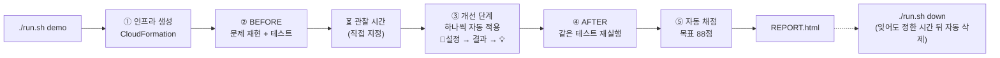

# hannctl_mentoring — AWS EKS 보안 프로젝트 실습 키트

> 「보안 위협 대응을 위한 클라우드 기반 보안 엔지니어 양성 과정」 최종 프로젝트용
> **"클라우드 컨테이너 인프라에서 애플리케이션을 운영하고, 기준에 맞는 보안성을 구축한다"**

실제 기업에서 일어날 법한 보안·운영 문제 **5가지**를 AWS EKS 위에 그대로 재현하고, 보안 통제를 **하나씩 적용하면서 무엇이 어떻게 바뀌는지 눈으로 확인**하는 실습 키트다.
시나리오마다 **명령 하나(`./run.sh demo`)** 로 아래 과정이 전부 자동으로 진행된다.



---

## 📚 시나리오 고르기

| | 시나리오 | 이런 회사의 이런 문제 | 핵심 포커스 (전→후로 개선되는 것) | K8s 보안 비중 | 난이도 |
|---|---|---|---|:-:|:-:|
| **1** | [🛒 쇼핑몰 안전한 배포·장애 대응](s1-shop-deploy-resilience/) | 할인 행사 트래픽 폭주, 잘못된 버전 배포 | **운영 안정성 + 배포 보안**: Trivy CI 게이트, PSA/Kyverno, Probe·롤백, HPA + Cluster Autoscaler, Prometheus/Grafana | ★★★☆☆<br><sub>운영+보안 균형형</sub> | ★★★ |
| **2** | [🏢 B2B SaaS 고객사별 격리](s2-saas-tenant-isolation/) | 한 클러스터를 쓰는 고객사 A가 B의 데이터·리소스에 접근 | **테넌트 격리**: NetworkPolicy(default-deny → allow-list), RBAC + EKS Access Entry, PSA + Kyverno 이중 방어 | ★★★★★ | ★★★ |
| **3** | [🚦 취약 이미지 배포 차단 DevSecOps](s3-devsecops-image-gate/) | 취약한 이미지·출처 불명 이미지가 운영에 유입 | **공급망 보안**: CodeBuild + Trivy(Critical·High) 게이트, ECR, Kyverno 신뢰 레지스트리, PSA | ★★★★☆<br><sub>CI 단계는 K8s 밖</sub> | ★★½ |
| **4** | [🔍 EKS 보안 진단·하드닝·감사](s4-eks-audit-hardening/) | 감사에서 "설정을 바꿨다"는 말 대신 증거를 요구 | **진단→하드닝→재진단**: kube-bench(CIS), 자체 점검, 감사 로그, RBAC·PSA·Kyverno·NetworkPolicy, 정기 점검 | ★★★★★ | ★★★½ |
| **5** | [🔑 내부 API 인증정보·권한 보호](s5-secret-iam-least-privilege/) | 코드에 박힌 AWS 키, 모든 Pod가 같은 권한 | **워크로드 신원·최소 권한**: Secrets Manager + EKS Pod Identity, 정적 키 제거, IMDS 차단, RBAC, NetworkPolicy | ★★★★☆<br><sub>K8s↔IAM 경계</sub> | ★★★ |

> 각 시나리오 README 맨 위의 **"🎯 이 시나리오의 초점"** 에 무엇을 쓰고, 무엇을 중요하게 보며, 전→후로 무엇이 바뀌는지(실측값)가 정리되어 있다.

### 과정 요구사항과의 연결

| 과정 요구사항 | S1 | S2 | S3 | S4 | S5 |
|---|:-:|:-:|:-:|:-:|:-:|
| EKS 기반 애플리케이션 운영 | ★ | ★ | ★ | ★ | ★ |
| 인프라 운영 (오토스케일링·모니터링·장애 대응·업그레이드) | ★ | | | ★ | |
| 공급망 보안 (Trivy/ECR, Critical·High 차단, 신뢰 레지스트리) | ★ | | ★ | | |
| 정책 기반 통제 (privileged·root·hostPath 차단, PSS) | ○ | ★ | ★ | ★ | ○ |
| 접근·네트워크 통제 (RBAC, NetworkPolicy, Secrets Manager) | | ★ | | ★ | ★ |
| 컴플라이언스 (kube-bench 정기 점검, 감사 로그 증적) | | ○ | | ★ | ○ |
| 정량적 Before/After 성과 | ★ | ★ | ★ | ★ | ★ |

★ 시나리오의 핵심 / ○ 공통 기반으로 포함

---

## 🚀 멘티용 빠른 시작

**1) 원하는 시나리오 폴더만 내려받기** (예: 시나리오 2 — git 이 없으면 압축 파일로 받는 방법이 각 폴더 `START_HERE.md` 1단계에 있다)

```bash
git clone --depth 1 --filter=blob:none --sparse https://github.com/kimjhtlzk/hannctl_mentoring.git
cd hannctl_mentoring && git sparse-checkout set s2-saas-tenant-isolation
cd s2-saas-tenant-isolation
```

**2) 점검 → 실행 → 삭제** (모두 시나리오 폴더 안에서 실행한다)

```bash
./run.sh doctor      # 없는 도구 자동 설치 + AWS 로그인(브라우저) + 작업용 역할 준비 + 한도 점검
./run.sh demo        # 전부 자동 (인프라 생성 포함 약 17~30분, 시나리오마다 다르다)
./run.sh down        # 끝나면 삭제
```

필요한 것은 **내 AWS 계정에 관리자로 콘솔 로그인할 수 있는 것** 하나뿐이다. Access Key 발급이나 `aws configure` 는 필요 없다.
처음 실행하면 브라우저 로그인(`aws login`)으로 임시 자격 증명을 받고, 키트가 작업용 IAM 역할 `hannctl-operator-role` 을 만들어 모든 작업을 그 역할로 한다(CloudShell 은 로그인도 생략).

실습은 각 폴더의 **`GUIDE.md`** 하나만 보고 따라간다(0단계 내려받기·준비부터 10단계 삭제까지, 단계별 할 일과 실제 화면). 준비 과정의 자세한 설명(OS별 설치, 로그인 흐름)과 문제 해결은 **`START_HERE.md`**, 시나리오 배경과 원리는 **`README.md`**(해설서)에 있다.

| 지원 환경 | 비고 |
|---|---|
| macOS · Ubuntu · CentOS/Rocky · Amazon Linux | bash 와 인터넷만 있으면 된다. python3·AWS CLI·kubectl·helm 등은 **없는 것만 자동 설치**(`tools/install-tools.sh`, 있으면 건너뜀) |
| **AWS CloudShell** | 이미 로그인되어 있고 대부분 설치되어 있어 가장 쉽다 |
| Windows | PowerShell·명령 프롬프트에서는 실행되지 않는다 → **AWS CloudShell** 또는 리눅스 환경(WSL2 의 Ubuntu 등) 사용 |
| Docker | **필요 없음** — 이미지 빌드는 AWS CodeBuild에서 수행 |

---

## 👀 실행하면 무엇이 보이나

```text
⏰ 이 실습 환경을 몇 시간 유지할까요? … 그냥 Enter 면 6시간:
── CloudFormation 배포: hannctl-s2-saas (유지 6h → 자동 삭제)
  [  0m22s] ✔ Vpc                       VPC (격리된 가상 네트워크)
  [  9m41s] ✔ Cluster                   EKS Control Plane
  [ 12m05s] ✔ NodeGroup                 EKS 관리형 노드 그룹 (EC2 워커 노드)
── [before] 1) 네트워크: 고객사 간 Pod 통신
  💡 Kubernetes 기본값은 '모든 Pod 끼리 통신 허용'. Namespace 를 나눠도 네트워크는 나뉘지 않는다
  ⚠ [before] 차단: A web → B api            기대=200   관찰=200        ← 위험이 실제로 재현됨 (노란색)
  ⏳ Before 상태 유지 중, 이후 자동으로 After 로 전환 —   42s 남음
┏━ [개선 1/4] 네트워크 기본 차단(default-deny)
┃  📄 k8s/after/10-default-deny.yaml
┃     spec: { podSelector: {}, policyTypes: [Ingress, Egress] }
      A→A api: BLOCKED | A→B api: BLOCKED | DNS: FAILED            ← 적용 직후 효과
┃  💡 배움 포인트: 허용 규칙 없이 차단만 걸면 정상 통신과 DNS 까지 끊긴다
┗━ 완료
  ✔ [after ] 차단: A web → B api            기대=BLOCKED 관찰=BLOCKED
  총점 100/100 — 목표 88점 → PASS
```

- **다른 터미널에서 `./run.sh watch`**: 클러스터 상태(Pod·정책·권한·노드)가 바뀌는 모습을 5초마다 갱신해 보여준다.
- **`evidence/latest/REPORT.html`**: 점수 게이지, Before→After 비교표, 전환 타임라인, 비용을 한 화면에 보여준다.

---

## 💸 비용과 안전장치 (FinOps)

| 항목 | 값 |
|---|---|
| 시나리오 1개 실행 | 약 **$0.21~0.25/시간 (≈ 290~350원)**, `demo` 1회(생성~삭제) 약 **$0.1~0.2 (≈ 130~280원)** — 시나리오별 실측은 각 README 의 비용 절 |
| 유지 시간 | `demo` 시작 시 멘티가 정함 (기본 **6시간**, 만든 시각 기준) → 지나면 자동 삭제. 방치해도 최대 약 $1.3~1.5 (≈ 1,800~2,100원) |
| 월 상한 | **$20 (≈ 2.8만원)** — 도달하면 모든 hannctl 스택 자동 삭제 + 새 배포 거부 |

처음 `demo`(또는 `up`)를 실행할 때 공통 안전장치 스택 **`hannctl-finops-guard`** 가 계정에 한 번 만들어지고, 이후 모든 시나리오가 함께 쓴다.

| 장치 | 역할 |
|---|---|
| `hannctl-janitor` (Lambda, 10분 주기) | 유지 시간 만료 또는 월 상한 도달 시 **hannctl 스택만** 삭제 (끄는 방법: 각 폴더 `START_HERE.md` 7단계) |
| `hannctl-cfn-exec-role` | 시나리오 스택 전용 실행 역할 (IAM·S3·Secrets 권한은 `hannctl-*` 리소스로 한정) |
| `hannctl-monthly-budget` | AWS Budget 알림 (`HANNCTL_ALERT_EMAIL=me@example.com` 지정 시 메일) |

사양은 시나리오에 **필요한 만큼만** 잡았다: Graviton(ARM) 노드 1대(S1만 오토스케일링 시연을 위해 1→3대, 기본 온디맨드 — `HANNCTL_CAPACITY=SPOT` 이면 노드 비용이 시나리오에 따라 약 30~70% 줄지만 실습 중 노드가 교체될 수 있음), NAT 1개, 로그 3일 보존, LoadBalancer 미사용.

---

## 🏷️ `hannctl` 식별자 규칙

이 키트가 AWS에 만드는 **모든 리소스**는 다음 규칙을 따른다(After 테스트가 자동 검사).

1. 이름이 **`hannctl-`** 로 시작한다(Secrets Manager는 `hannctl/…`). 자격 증명·역할·권한도 같다.
   | 신원 | 종류 | 설명 |
   |---|---|---|
   | `hannctl-operator-role` | IAM 역할 (`hannctl-identity` 스택) | 키트의 모든 작업을 수행하는 역할. 임시 자격 증명만 사용, IAM 은 `hannctl-*` 만 다룰 수 있고 자기 권한은 못 늘림 |
   | `hannctl-admin` | IAM 사용자 (root 로 로그인한 경우만) | 콘솔 로그인 전용, Access Key 없음, `hannctl-operator-role` 전환만 가능 |
   | `hannctl-cfn-exec-role`, `hannctl-janitor-role` | IAM 역할 (`hannctl-finops-guard` 스택) | CloudFormation 실행용 / 자동 정리 Lambda 용 |
   | `hannctl-login`, `hannctl` | 멘티 PC 의 AWS CLI 프로필 | 콘솔 로그인 임시 자격 증명 / `hannctl-operator-role` 전환 설정 |
2. 태그 **`Project=hannctl`** 과 `hannctl:scenario`, `hannctl:lifetime-hours`, `hannctl:expires-at`, `hannctl:est-usd-per-hour`를 가진다.
3. 이 키트는 **이름 `hannctl-*` + 태그 `Project=hannctl`을 모두 만족하는 스택만** 만들고, 고치고, 지운다.

> 같은 AWS 계정을 쓰는 다른 프로젝트는 `hannctl` 식별자가 있는 리소스를 무시하면 된다.
> 이름을 정할 수 없는 AWS 자동 생성 하위 리소스(EKS 노드 인스턴스 프로파일 `eks-…`, 서비스 연결 역할 `AWSServiceRoleFor…`, EKS가 클러스터 안에 만드는 `eks:*` 바인딩)는 hannctl 클러스터·노드 그룹과 수명을 같이한다.

---

## 🗂️ 저장소 구성

```text
hannctl_mentoring/
├── s1-shop-deploy-resilience/       ┐
├── s2-saas-tenant-isolation/        │  시나리오 폴더 = 멘티 1개 조
├── s3-devsecops-image-gate/         │  각 폴더가 독립적으로 실행된다
├── s4-eks-audit-hardening/          │  (GUIDE · README · START_HERE · run.sh · cfn · k8s · lib · tools)
├── s5-secret-iam-least-privilege/   ┘
└── _shared/                         # [관리자용] 공통 파일 원본 → sync.sh 로 각 시나리오에 복사
```

각 시나리오 폴더 안의 구성은 같다.

| 파일 | 내용 |
|---|---|
| `README.md` | **해설서**: 실무 상황, 목표, AWS·EKS 구성도, 단계별 변화와 배울 점, 직접 조회 명령, 발표 포인트, 비용, 용어 |
| `GUIDE.md` | **따라하기 가이드**: 점검 → 실행 → 관찰 → 결과 → 삭제를 단계별 실제 화면과 함께 (실습은 이 문서 하나로 진행) |
| `START_HERE.md` | 준비와 명령 참고서: 내려받기·도구·로그인 준비, 명령 모음, 비용, 문제 해결 |
| `RUBRIC.md` / `rubric.json` | 평가표 (100점 만점, 목표 88점, 자동 채점) |
| `run.sh` | 유일한 실행 진입점 |
| `cfn/stack.yaml` | 시나리오의 AWS 인프라 전부 (CloudFormation) |
| `cfn/hannctl-identity.yaml` · `cfn/hannctl-finops-guard.yaml` | 계정 공용 스택 템플릿: 작업용 역할 / 자동 삭제·예산·CloudFormation 실행 역할 (모든 시나리오 공용, 자동 생성) |
| `k8s/` | `base`(워크로드), `before`(통제 전), `after`(개선 단계별), `policies`, `attack`(dry-run 전용 위험 예시) |
| `lib/`, `tools/` | 공통 실행 라이브러리, 채점기, 비용 추정, 도구 설치 |

---

## 🧑‍🏫 멘토·관리자용

| 작업 | 방법 |
|---|---|
| 조별 배포 | 시나리오 폴더 링크를 전달하거나 `zip -r s2.zip s2-saas-tenant-isolation -x '*/evidence/*' '*/.kube/*' '*/.tools/*'` |
| 공통 파일 수정 | `_shared/` 수정 → `_shared/sync.sh` (모든 시나리오에 복사 + RUBRIC.md / START_HERE.md 재생성) |
| 멘티 자격 증명 | **멘토가 주거나 관리할 것이 없다.** 멘티가 자기 AWS 계정으로 로그인하면 hannctl 신원이 자동으로 만들어진다 (START_HERE.md 3단계) |
| 리전 변경 / 기존 프로필 사용 | `HANNCTL_REGION=리전 ./run.sh demo`, `HANNCTL_SOURCE_PROFILE=프로필 ./run.sh demo` |
| 유지 시간·상한 조정 | `./run.sh demo --hours 8`, `./run.sh lifetime 9`, `./run.sh cap 15` (0 = 끄기) |
| 전체 정리 | 각 시나리오 `./run.sh down`, 마지막에 `./run.sh down-all` (공통 안전장치까지), `./run.sh down-all --identity` (작업용 역할까지) |

> ⚠️ 이 저장소에는 계정 ID, 키, IP 같은 환경 정보가 들어 있지 않다. 모두 실행 시점에 조회한다.
> 실행 결과(`evidence/`)와 kubeconfig(`.kube/`)는 `.gitignore`로 제외되어 있다. 직접 올리지 않도록 주의한다.
