# 따라하기 가이드 · 시나리오 1 · 쇼핑몰의 안전한 배포·장애 대응 (ShopNow)

이 문서 하나만 보면서 처음부터 끝까지 진행한다.
각 단계에는 **할 일**, **화면에 나오는 것**, **정상이면 이렇게 보인다**가 순서대로 있고, 실제 실행 화면을 함께 넣었다.

> 처음이라면 [0단계 · 시작 전 준비](#0단계--시작-전-준비-처음-한-번)부터 한다. 내려받기부터 삭제까지 이 문서 하나로 진행한다.
> 시나리오의 배경·원리·발표 포인트는 [README.md](README.md)에 있다. 진행 중에는 이 문서만 보면 된다.

---

## 🗺️ 진행 지도 — 지금 어디쯤인가

터미널에 `📍 [가이드 N/10단계]` 표시가 나오면, 이 문서의 같은 번호 단계로 오면 된다.

| 단계 | 하는 일 | 걸리는 시간 | 누가 |
|---|---|---|---|
| [0](#0단계--시작-전-준비-처음-한-번) | 내려받기 · 준비 (처음 한 번) | 몇 분 | 내가 실행 |
| [1](#1단계--사전-점검) | 사전 점검 `./run.sh doctor` | 약 20초 (처음 한 번은 1~2분) | 내가 실행 |
| [2](#2단계--실행-시작) | `./run.sh demo` 시작 + 두 번째 터미널에서 `./run.sh watch` | 1분 | 내가 실행 |
| [3](#3단계--인프라-생성) | CloudFormation 이 VPC·EKS·노드·ECR·CodeBuild 를 만든다 | 약 14분 | 자동 |
| [4](#4단계--클러스터-기본-구성) | 노드 준비, 이미지 빌드(v1·v2-bad), Kyverno·Prometheus/Grafana 설치, 쇼핑몰 API 배포 | 약 2분 30초 | 자동 |
| [5](#5단계--before-위험-재현) | Before: 보호 장치 없는 상태에서 부하·잘못된 배포·위험 Pod·취약 이미지 재현 | 약 5분 | 자동 |
| [6](#6단계--before-관찰) | Before 상태를 직접 살펴보는 시간 | 60초(늘릴 수 있음) | 내가 관찰 |
| [7](#7단계--개선-단계-1--5) | 개선 1~5 적용, 단계마다 효과 확인 | 약 2분 | 자동 |
| [8](#8단계--after-테스트와-채점) | After 테스트(Before 와 같은 테스트) + 자동 채점 | 약 4분 | 자동 |
| [9](#9단계--결과-확인) | 점수와 보고서(REPORT.html), Grafana 그래프 확인 | 자유 | 내가 확인 |
| [10](#10단계--삭제) | `./run.sh down` 으로 전부 삭제 | 약 9분 | 내가 실행 |

`demo` 한 번(2~9단계)은 처음 실행할 때 약 **30분**(실측 29분 35초) 걸린다. 내 계정에서 hannctl 시나리오를 **맨 처음** 실행할 때는 공통 안전장치(`hannctl-finops-guard`, 3단계에 `✔ FinOps Guard 준비 완료` 로 표시)를 함께 만들어 몇 분 더 걸린다(시나리오 2 실측 23분). 비용은 약 **$0.25/시간(≈350원)**, `demo` 1회(생성~삭제 약 40분) 약 $0.15~0.2(≈210~280원)이다.

**터미널을 두 개(Grafana 를 볼 때는 세 개) 쓴다.**

| 터미널 | 용도 | 실행하는 명령 |
|---|---|---|
| 첫 번째 | 실습 진행 | `./run.sh doctor` → `./run.sh demo` → `./run.sh down` |
| 두 번째 | Pod·노드·HPA·CI 게이트 상태 실시간 관찰 | `./run.sh watch` (끝낼 때 `Ctrl+C`) |
| 세 번째(선택) | Grafana 그래프 보기 | `./run.sh grafana` (끝낼 때 `Ctrl+C`) |

모든 터미널은 시나리오 폴더(`s1-shop-deploy-resilience`)에서 실행한다. AWS 콘솔(브라우저)도 함께 열어 두면 리소스가 만들어지는 모습과 CI 빌드 결과를 볼 수 있다. 콘솔 오른쪽 위 리전은 **아시아 태평양(서울) ap-northeast-2** 로 둔다.

> 로컬 Docker 는 필요 없다. 이미지 빌드와 Trivy 검사는 AWS CodeBuild 에서 한다.

---

## 0단계 · 시작 전 준비 (처음 한 번)

**필요한 것**

| 항목 | 내용 |
|---|---|
| AWS 계정 | 내 AWS 계정에 **관리자 권한으로 콘솔 로그인**할 수 있으면 된다. Access Key 를 만들거나 `aws configure` 를 할 필요가 없다 |
| 실행 환경 | macOS · Linux(Ubuntu, CentOS/Rocky, Amazon Linux) 터미널, 또는 **AWS CloudShell**(콘솔 오른쪽 위 `>_` 아이콘). Windows 는 CloudShell 이나 WSL2 의 Ubuntu 터미널을 쓴다 |
| 도구 | 따로 설치하지 않는다. python3·AWS CLI·kubectl·helm 중 없는 것을 1단계에서 자동으로 설치한다 |

**① 시나리오 내려받기** — 둘 중 하나

```bash
# 방법 A: git
cd ~
git clone --depth 1 --filter=blob:none --sparse https://github.com/kimjhtlzk/hannctl_mentoring.git
cd hannctl_mentoring
git sparse-checkout set s1-shop-deploy-resilience
cd s1-shop-deploy-resilience

# 방법 B: git 없이 (curl, tar 만 있으면 된다)
mkdir -p ~/hannctl_mentoring && cd ~/hannctl_mentoring
curl -L https://github.com/kimjhtlzk/hannctl_mentoring/archive/refs/heads/main.tar.gz | tar xz --strip-components=1 hannctl_mentoring-main/s1-shop-deploy-resilience
cd s1-shop-deploy-resilience
```

이후의 명령은 모두 **이 폴더(`s1-shop-deploy-resilience`) 안에서** 실행한다. 터미널을 새로 열면 먼저 이 폴더로 `cd` 한다. 두 방법 모두 경로는 `~/hannctl_mentoring/s1-shop-deploy-resilience` 다.

**② macOS 터미널(zsh)이라면 한 번 실행** — 문서의 명령에 붙은 `# 설명` 주석을 zsh 가 명령으로 읽지 않게 한다. (Linux·CloudShell 은 필요 없다)

```bash
setopt interactivecomments
echo 'setopt interactivecomments' >> ~/.zshrc     # 다음에 여는 터미널에도 적용
```

**③ 처음 1단계를 실행하면 자동으로 일어나는 일** — 미리 알아 두기만 한다.

| 화면에 나오는 것 | 할 일 |
|---|---|
| 없는 도구를 설치한다 (`… 설치 중` → `✔ 설치됨`) | 기다린다. macOS 는 관리자 암호가 필요 없고, Linux 는 `sudo` 암호를 물을 수 있다 |
| 브라우저가 열리고 AWS 로그인 화면이 나온다 (CloudShell 은 이 과정이 없다) | 내 AWS 계정으로 로그인 → **허용** → 터미널로 돌아오면 이어서 진행된다 |
| 주소가 출력되고 코드를 묻는다 (브라우저가 없는 서버·SSH) | 주소를 PC·휴대폰 브라우저에서 열어 로그인 → 화면의 코드를 터미널에 붙여 넣는다 |
| 작업용 역할 `hannctl-operator-role` 을 만든다 (약 1분, 비용 0원) | 기다린다. 이후 모든 작업은 이 역할로 실행된다 |
| `root 사용자로 로그인되어 있습니다` + `hannctl-admin` 로그인 정보 | root 로 로그인한 경우다. 화면의 주소·임시 비밀번호로 `hannctl-admin` 으로 다시 로그인하고 같은 명령을 다시 실행한다 ([START_HERE.md](START_HERE.md) 3단계) |

> 막히는 곳이 있으면 [START_HERE.md](START_HERE.md) 의 준비 과정과 문제 해결 표를 본다.

---

## 1단계 · 사전 점검

**할 일** — 첫 번째 터미널에서:

```bash
./run.sh doctor          # 0단계에서 들어간 시나리오 폴더에서 실행
```

**화면에 나오는 것** — 도구(python3, AWS CLI, kubectl, helm 등), 로그인, 작업용 역할, 리전, VPC·탄력적 IP 여유, EKS API 허용용 공인 IP, 이번 달 비용을 차례로 점검한다.

처음 실행할 때는 작업용 역할을 만드느라 `• 작업용 IAM 역할 hannctl-operator-role 준비 중 (스택 hannctl-identity, 처음 한 번 약 1분)` 줄이 먼저 나오고 1~2분 걸린다. 두 번째부터는 20초 안팎이다.

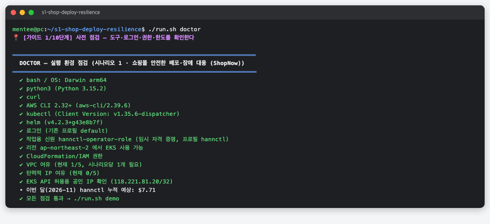

**정상이면** 모든 줄이 `✔` 이고 마지막 줄이 `✔ 모든 점검 통과 → ./run.sh demo` 다.

- `✘` 가 있으면 그 줄의 `→` 뒤 안내대로 해결하고 `./run.sh doctor` 를 다시 실행한다.
- `VPC 여유` 가 부족하다고 나오면 다른 시나리오를 먼저 `./run.sh down` 으로 지운다(시나리오 1개가 VPC 1개를 쓴다).

---

## 2단계 · 실행 시작

**할 일** — 첫 번째 터미널에서:

```bash
./run.sh demo
```

유지 시간을 묻는다. 그냥 **Enter** 를 누르면 6시간이다(만든 시각부터 6시간이 지나면 자동 삭제된다). 1~24 사이 숫자를 넣어도 된다. 6시간이면 `• 유지 시간 6시간 (최대 예상 비용 약 $1.5)` 이 나온다.

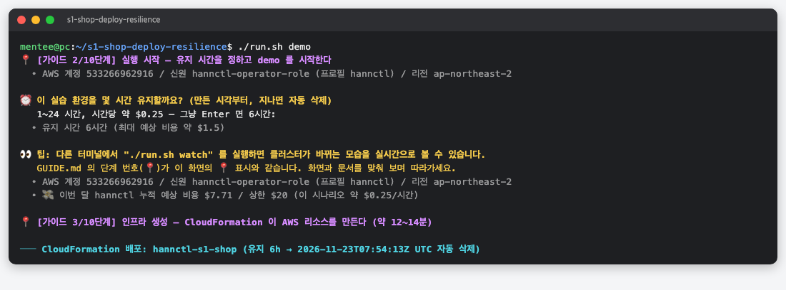

이어서 **두 번째 터미널**을 열고:

```bash
cd ~/hannctl_mentoring/s1-shop-deploy-resilience     # 새 터미널은 홈 폴더에서 시작하므로 시나리오 폴더로 이동
./run.sh watch
```

클러스터가 만들어지는 동안에는 `⏳ EKS 클러스터 hannctl-s1-shop 준비 대기 중 (현재: 아직 없음) — 인프라 생성에 10~15분 걸립니다. 준비되면 자동으로 화면이 바뀝니다.` 화면이 나온다. 클러스터가 준비되면 자동으로 관찰 화면으로 바뀌므로 그대로 켜 둔다.

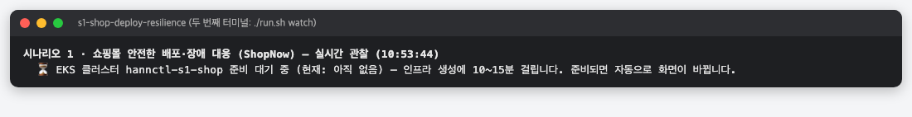

> 💡 Before 상태를 더 오래 살펴보고 싶으면 `./run.sh demo --before-wait 180` 처럼 관찰 시간(초)을 늘려서 시작한다(기본 60초).

---

## 3단계 · 인프라 생성

> 📍 터미널: `[가이드 3/10단계] 인프라 생성` · 약 14분 · 자동 진행

**화면에 나오는 것** — CloudFormation 이 리소스를 하나씩 만든다. `…` 는 만드는 중, `✔` 는 완료다. 왼쪽 `[ 0m23s]` 는 시작 후 지난 시간이다.

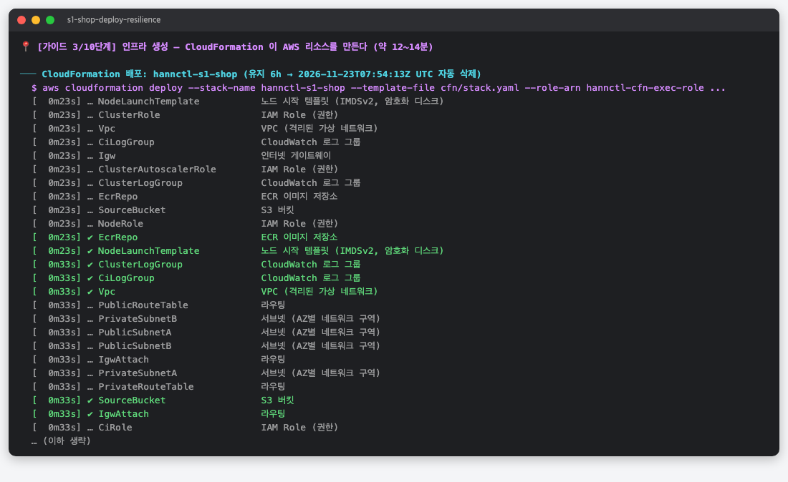

만드는 순서는 ECR 저장소(`EcrRepo`)·로그 그룹·S3 소스 버킷(`SourceBucket`)·IAM 역할·VPC·서브넷 → CI 역할·**CodeBuild CI 프로젝트**(`CiProject`, 1분 안에 끝남) → NAT(약 2분) → **EKS 클러스터(`Cluster`, 약 10분, 가장 오래 걸림)** → Access Entry·애드온 → 노드 그룹(약 1분 40초) → CoreDNS·Pod Identity Agent·metrics-server 애드온 → Cluster Autoscaler 용 **Pod Identity 연결**(`ClusterAutoscalerPodIdentity`) 순서다.

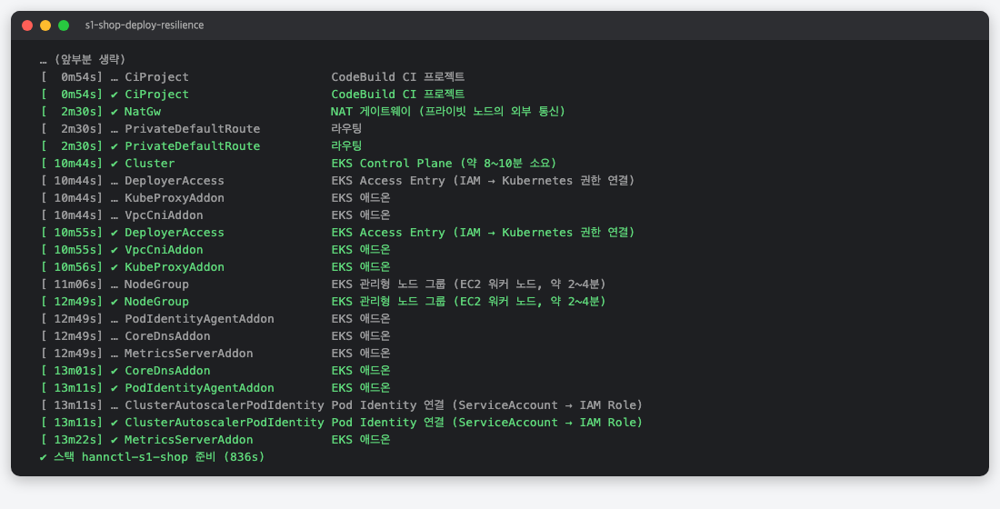

**정상이면** 마지막에 `✔ 스택 hannctl-s1-shop 준비 (836s)` 처럼 걸린 시간과 함께 준비 완료가 나온다.

### 🖥️ 콘솔에서 같이 보기

**CloudFormation** → **스택(Stacks)** → `hannctl-s1-shop` → **리소스(Resources)** 탭. 새로 고침(⟳)을 누를 때마다 `CREATE_IN_PROGRESS` 가 `CREATE_COMPLETE` 로 바뀌어 간다. CodeBuild 프로젝트 `hannctl-s1-ci`, CI 역할 `hannctl-s1-ci-role`, ECR 저장소 `hannctl-s1-shop-api` 는 먼저 끝나고, `Cluster`·`NatGw` 는 아직 `CREATE_IN_PROGRESS` 다.

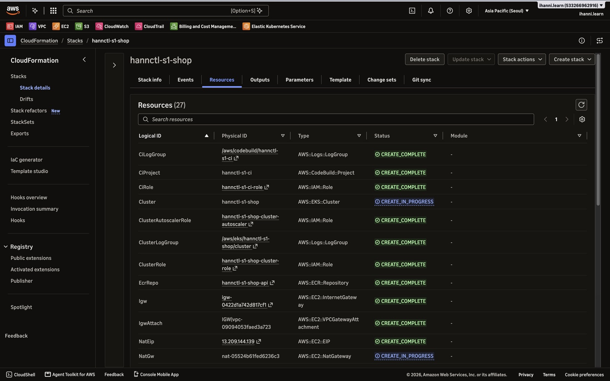

**Elastic Kubernetes Service** → **클러스터(Clusters)** → `hannctl-s1-shop`. 처음에는 상태가 **Creating** 이고, Node groups·Add-ons·Pod Identities 도 아직 0 이다.

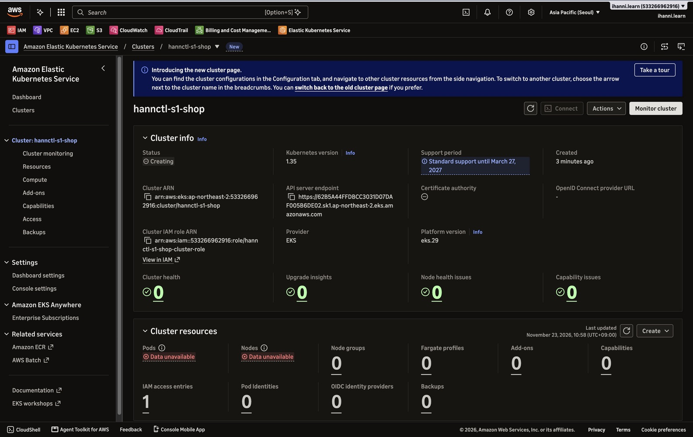

모두 끝나면 리소스 36개가 모두 `CREATE_COMPLETE` 가 된다. `ClusterAutoscalerPodIdentity`(Pod Identity 연결)도 이 목록에 있다.

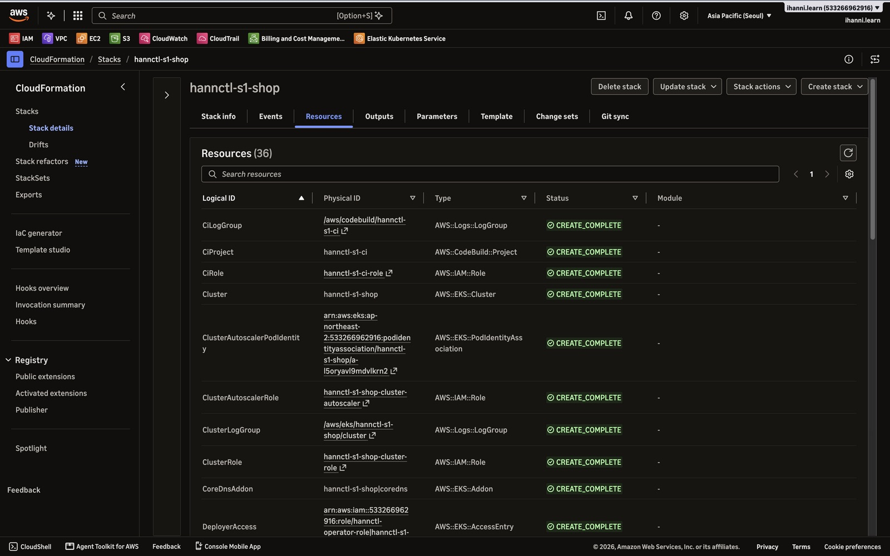

---

## 4단계 · 클러스터 기본 구성

> 📍 터미널: `[가이드 4/10단계] 클러스터 기본 구성` · 약 2분 30초 · 자동 진행

**화면에 나오는 것** — 노드가 Ready 가 될 때까지 기다린 뒤, 순서대로 진행한다.

1. **CI 이미지 빌드** — CodeBuild 에서 정상 버전 `v1` 과 버그 버전 `v2-bad` 를 병렬로 빌드한다(`• 빌드 시작: hannctl-s1-ci:… / hannctl-s1-ci:…`).
2. **Kyverno 3.9.2 설치** — Admission 정책 엔진.
3. **Prometheus + Grafana(kube-prometheus-stack) 설치** — 개선 5에서 그래프를 볼 모니터링.
4. **ShopNow 기본 리소스** — 이미지 빌드가 끝나기를 기다렸다가 쇼핑몰 상품 API `shop-api` v1 을 배포한다.

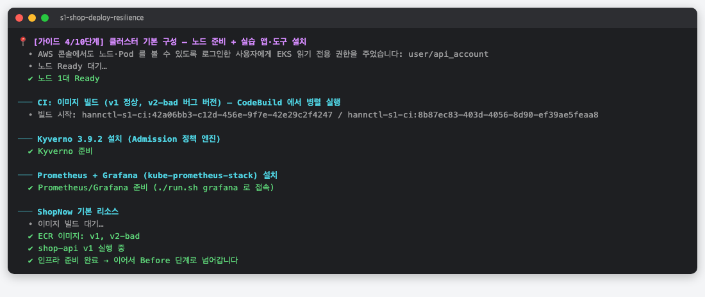

**정상이면** `✔ ECR 이미지: v1, v2-bad`, `✔ shop-api v1 실행 중`, `✔ 인프라 준비 완료 → 이어서 Before 단계로 넘어갑니다` 가 나오고 바로 5단계로 넘어간다.

### 🖥️ 콘솔에서 같이 보기

**EKS** → **클러스터** → `hannctl-s1-shop` → 왼쪽 **Compute**: 노드 1대(`t4g.large`, On-Demand)가 **Ready** 이고, 노드 그룹 `hannctl-s1-shop-ng-od` 가 **Active**(Desired size 1)다.

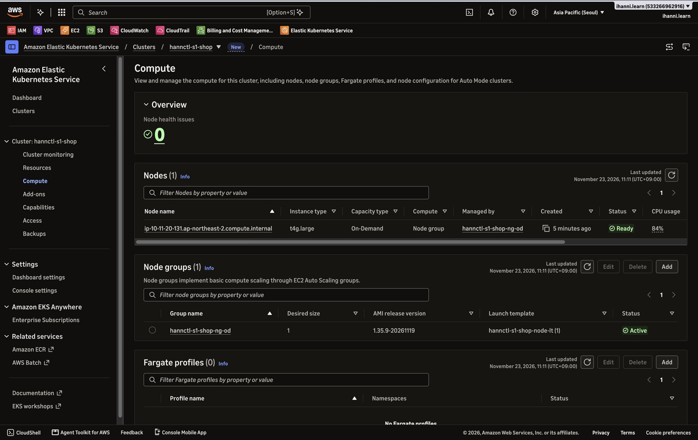

> 콘솔에서 노드·Pod 를 볼 수 있도록, 콘솔에 로그인한 사용자에게 이 클러스터의 **읽기 전용** 권한이 자동으로 주어진다(`• AWS 콘솔에서도 노드·Pod 를 볼 수 있도록 로그인한 사용자에게 EKS 읽기 전용 권한을 주었습니다: …` 안내가 한 번 나온다). 콘솔에 `Unauthorized` 나 `forbidden` 이 보이면 1~2분 뒤 새로 고침한다.

---

## 5단계 · Before (위험 재현)

> 📍 터미널: `[가이드 5/10단계] Before` · 약 5분 · 자동 진행

**무엇을 하나** — 일부러 보호 장치를 모두 뺀 상태를 만든다: `shop-api` **Pod 2개 고정**(HPA·노드 확장 없음), **Probe 없음**, Pod 보안 정책 없음, **CI 보안 게이트 OFF**. 화면에 `✔ Before 적용: Pod 2개 고정, Probe 없음, 보안 정책 없음, CI 게이트 OFF` 가 나온 뒤, 같은 테스트를 차례로 실행해 위험이 실제로 일어나는지 확인한다.

**앞부분 — CI 빌드 시작, 트래픽 급증(부하 테스트)**

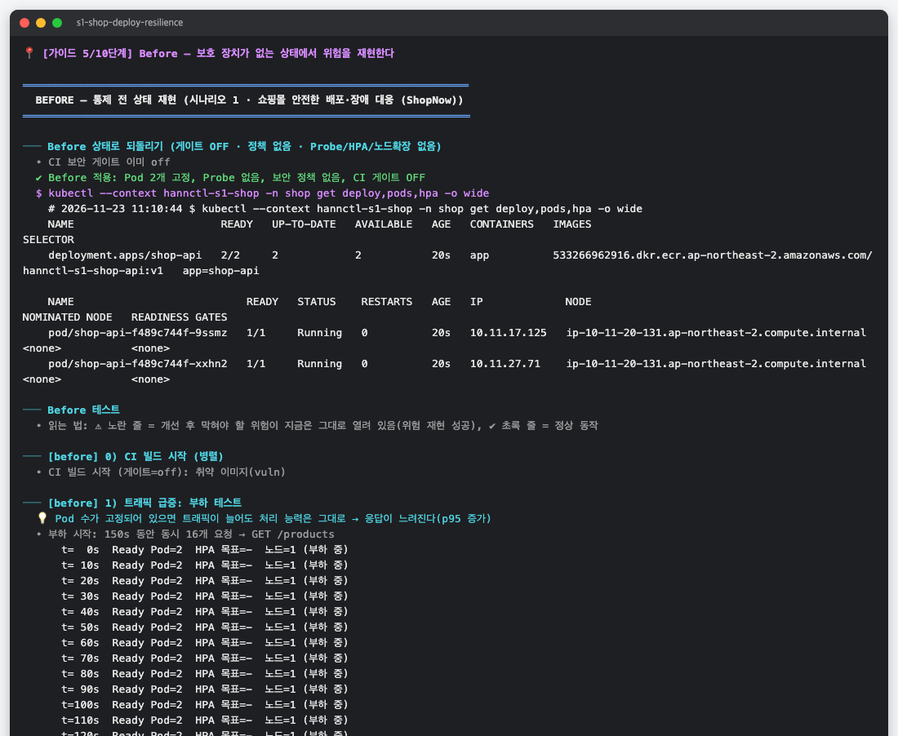

- `0) CI 빌드 시작` — 게이트를 끈 채(`게이트=off`) 취약 이미지(`vuln`)를 빌드한다. 빌드는 뒤에서 병렬로 진행되고 결과는 4)에서 본다.
- `1) 트래픽 급증` — `150s 동안 동시 16개 요청 → GET /products` 부하를 건다. 10초마다 찍히는 줄이 끝까지 `Ready Pod=2  HPA 목표=-  노드=1` 이다. 부하가 늘어도 Pod 도 노드도 늘지 않는다.

**뒷부분 — 잘못된 배포 → 롤백, 위험 Pod, CI 게이트 결과, 인프라**

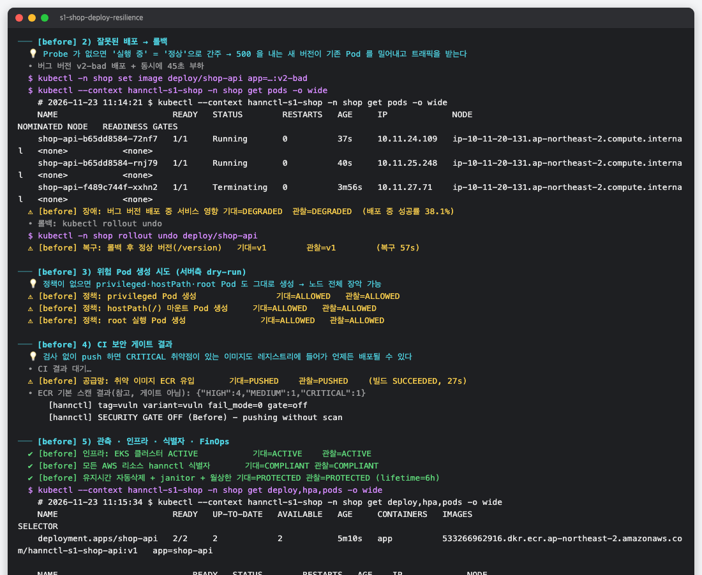

- `2) 잘못된 배포 → 롤백` — 500 을 내는 버그 버전 `v2-bad` 를 배포하면서 동시에 45초 부하를 건다. Pod 목록에서 새 Pod(`shop-api-b65dd8584-…`)가 **`1/1 Running`** 이고, 기존 v1 Pod 는 `Terminating` 이다. Probe 가 없어서 500 을 내는 Pod 도 '정상'으로 보고 트래픽을 보낸다. 이어서 `kubectl rollout undo` 로 되돌린다.
- `3) 위험 Pod 생성 시도` — 서버측 dry-run 이라 실제 Pod 는 만들어지지 않는다.
- `4) CI 보안 게이트 결과` — 게이트가 꺼져 있어 검사 없이 Push 됐다(`[hannctl] SECURITY GATE OFF (Before) - pushing without scan`). `• ECR 기본 스캔 결과(참고, 게이트 아님): {"HIGH":4,"MEDIUM":1,"CRITICAL":1}` 는 ECR 이 Push 뒤에 따로 본 참고값이다. 찾기는 했어도 막지는 않았다.

**읽는 법**

| 표시 | 의미 |
|---|---|
| `⚠` 노란 줄 | 개선 후 막혀야 할 위험이 **지금은 그대로 열려 있다** (위험 재현 성공) |
| `✔` 초록 줄 | 정상 동작 (부하 중 성공률, 인프라 상태 등) |
| `✘` 빨간 줄 | 기대와 다르다 → [문제 해결](#문제-해결) |

**정상이면** 아래처럼 위험이 재현된다.

| 테스트 | 관찰 | 뜻 |
|---|---|---|
| 운영: 부하 시 Pod 수 변화 | `FIXED` ⚠ (`처리 17073건(113rps), 성공률 100.0%, p95 205ms, 최대 Pod 2, 노드 1→1`) | 트래픽이 늘어도 처리 능력은 그대로다 |
| 정상: 부하 중 요청 성공률 ≥99% | `OK` | 이 부하에서는 아직 요청이 실패하지 않는다 |
| 장애: 버그 버전 배포 중 서비스 영향 | `DEGRADED` ⚠ (`배포 중 성공률 38.1%`) | 버그 버전이 기존 Pod 를 밀어내고 고객 요청을 받았다 |
| 복구: 롤백 후 정상 버전(/version) | `v1` ⚠ (`복구 57s`) | 롤백은 됐지만 복구까지 1분 가까이 걸렸다 |
| 정책: privileged / hostPath(/) 마운트 / root 실행 Pod 생성 | `ALLOWED` ⚠ | 노드를 장악할 수 있는 Pod 를 만들 수 있다 |
| 공급망: 취약 이미지 ECR 유입 | `PUSHED` ⚠ (`빌드 SUCCEEDED, 27s`) | 취약 이미지가 저장소에 들어가 언제든 배포될 수 있다 |
| 인프라·hannctl 식별자·유지시간 자동삭제 | `ACTIVE` / `COMPLIANT` / `PROTECTED` | 실습 환경 자체는 정상이다 |

> 성공률·처리량·복구 시간은 실행할 때마다 조금씩 다르다(같은 상태에서 다시 실행한 기록에서는 `배포 중 성공률 32.9%`, `복구 55s`). 발표에는 자기 실행의 `REPORT.html` 값을 쓴다.

### 👀 두 번째 터미널 (watch)

롤백이 진행되는 순간의 화면이다. 버그 버전 Pod(`shop-api-b65dd8584-…`)가 `Terminating` 으로 빠지고, v1 Pod(`shop-api-f489c744f-…`)가 `Pending` → `Running` 으로 새로 뜬다. 노드는 1대, `CI 게이트: off`, 맨 아래 **최근 진행 단계**에 `11:10:31 Before 상태 적용` 이 있다. HPA 표는 아직 없다.

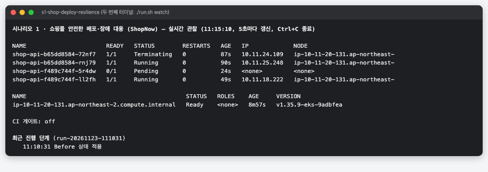

---

## 6단계 · Before 관찰

> 📍 터미널: `[가이드 6/10단계] Before 관찰` · 60초 카운트다운

화면에 `── Before 관찰 시간 (60s) — 다른 터미널에서 ./run.sh status 또는 README 의 조회 명령을 실행해 보세요` 가 나오고 카운트다운이 시작된다. 카운트다운이 끝나면 자동으로 7단계로 넘어간다.

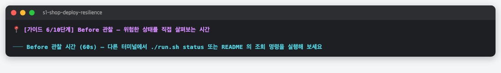

**할 일 (선택)** — 세 번째 터미널을 열어 Before 상태를 직접 확인해 본다. 먼저 이 시나리오 전용 접속 설정을 불러온다.

```bash
cd ~/hannctl_mentoring/s1-shop-deploy-resilience     # 새 터미널은 홈 폴더에서 시작하므로 시나리오 폴더로 이동
eval "$(./run.sh kubeconfig)"
```

| 확인할 것 | 명령 | Before 에서 볼 것 |
|---|---|---|
| AWS 에 무엇이 생겼나 | `./run.sh status` | 스택·클러스터·노드 상태와 남은 유지 시간 |
| 노드·Pod·HPA | `kubectl get nodes` / `kubectl -n shop get deploy,hpa,pods -o wide` | 노드 1대, `shop-api` Pod 2개, HPA 없음 |
| 현재 버전 | `kubectl -n shop-loadtest exec deploy/loadgen -- python3 /app/app.py get http://shop-api.shop.svc.cluster.local/version` | 롤백이 끝나 `v1` |
| ECR 이미지 | `aws ecr describe-images --repository-name hannctl-s1-shop-api` | `v1`, `v2-bad` 와 함께 게이트 없이 들어온 `vuln` 태그 |
| 위험 Pod 직접 시도 (실제로 만들지 않음) | `kubectl apply -n shop --dry-run=server -f k8s/attack/privileged-pod.yaml` | `pod/hannctl-attack-privileged created (server dry run)` (허용됨) |
| Kyverno 정책 | `kubectl get validatingpolicy` | 개선 2에서 적용할 `hannctl-…` 정책이 아직 없다 |

60초가 짧으면 `demo` 가 끝난 뒤 [9단계의 "다시 해 보기"](#다시-해-보기)로 Before 상태를 다시 만들 수 있다.

---

## 7단계 · 개선 단계 1 ~ 5

> 📍 터미널: `[가이드 7/10단계] 개선 단계` · 약 2분 · 자동 진행

개선 단계마다 같은 순서로 나온다: **변경 → 효과 → 📄 적용하는 설정 파일의 핵심 줄 → `$` 실행한 명령 → 즉시 확인(효과 측정) → 💡 배움 포인트**. 단계 사이에는 5초 쉰다.

### 개선 1/5 · CI 보안 게이트 ON (Trivy)

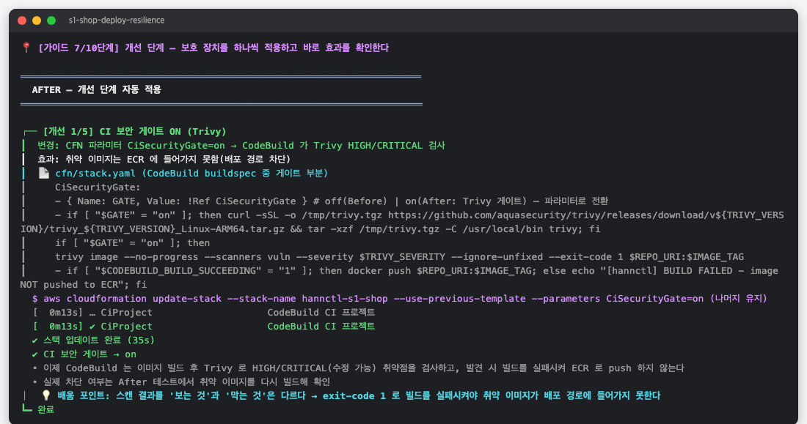

CloudFormation 파라미터 `CiSecurityGate=on` 하나만 바꿔 CodeBuild 프로젝트를 갱신한다(`✔ 스택 업데이트 완료 (35s)`). 📄 에 나오는 buildspec 의 핵심은 두 줄이다.

- `trivy image … --severity $TRIVY_SEVERITY --ignore-unfixed --exit-code 1` — HIGH/CRITICAL(수정 가능) 취약점이 있으면 실패 코드로 빌드를 멈춘다.
- `if [ "$CODEBUILD_BUILD_SUCCEEDING" = "1" ]; then docker push …; else echo "[hannctl] BUILD FAILED - image NOT pushed to ECR"; fi` — 빌드가 실패하면 Push 하지 않는다.

**정상이면** `✔ CI 보안 게이트 → on` 이 나온다. 화면 안내대로 실제 차단 여부는 8단계 After 테스트에서 취약 이미지를 다시 빌드해 확인한다.

### 개선 2/5 · Pod 보안 정책 (PSA restricted + Kyverno)

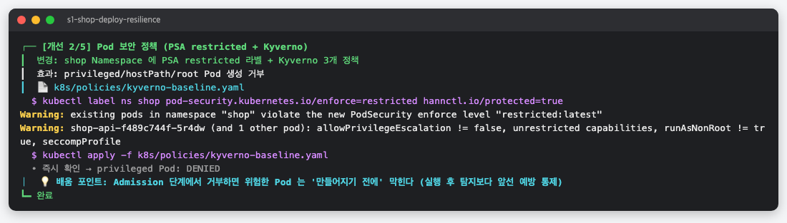

`shop` Namespace 에 PSA `restricted` 라벨과 `hannctl.io/protected=true` 를 붙이고, Kyverno 정책 3개(`k8s/policies/kyverno-baseline.yaml`)를 적용한다.

라벨을 붙이는 순간 `Warning: existing pods in namespace "shop" violate the new PodSecurity enforce level "restricted:latest"` 가 나온다. 지금 돌고 있는 v1 Pod 가 restricted 기준(root 금지, 권한 상승 금지 등)을 어긴다는 경고일 뿐이고, 이미 실행 중인 Pod 는 그대로 둔다. 이 Pod 들은 개선 3에서 기준에 맞는 설정으로 교체된다.

**정상이면** `• 즉시 확인 → privileged Pod: DENIED`.

### 개선 3/5 · 안전한 배포 설정 (Probe + 롤링 전략)

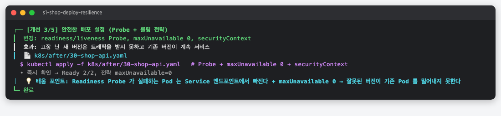

`k8s/after/30-shop-api.yaml` 로 Deployment 를 바꾼다.

| 설정 | 하는 일 |
|---|---|
| `readinessProbe: /health` | `/health` 가 200 일 때만 Service 트래픽을 받는다. 고장 난 새 버전은 트래픽에서 빠진다 |
| `livenessProbe` | 응답이 멈춘 컨테이너는 자동 재시작 |
| `maxUnavailable: 0`, `maxSurge: 1` | 새 Pod 가 Ready 가 되기 전에는 기존 Pod 를 내리지 않는다 |
| `securityContext` | root 금지, 권한 상승 금지, 읽기 전용 파일시스템 (개선 2의 PSA restricted 충족) |

**정상이면** `• 즉시 확인 → Ready 2/2, 전략 maxUnavailable=0`. 효과는 8단계의 "잘못된 배포" 테스트에서 드러난다.

### 개선 4/5 · 자동 확장 (HPA + Cluster Autoscaler)

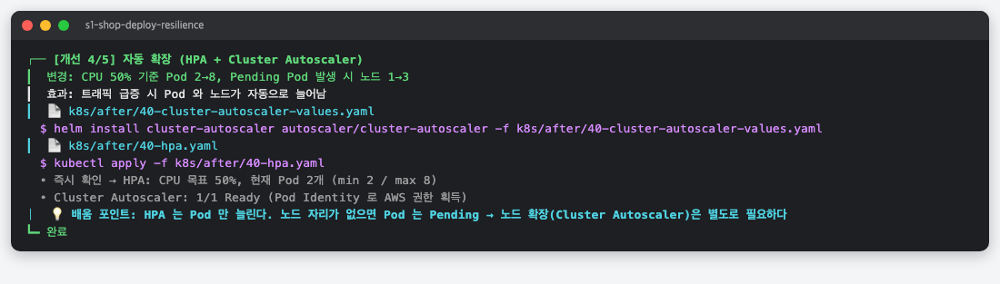

helm 으로 Cluster Autoscaler 를 설치하고(`k8s/after/40-cluster-autoscaler-values.yaml`), HPA(`k8s/after/40-hpa.yaml`)를 적용한다.

- **HPA** — CPU 사용률(요청량 대비) 50% 를 넘으면 Pod 를 2 → 최대 8개로 늘린다. 확장은 15초마다 최대 2배, 축소는 60초 안정 뒤.
- **Cluster Autoscaler** — 자리가 없어 Pending 인 Pod 가 생기면 노드를 늘린다(1 → 최대 3대). AWS 권한은 Access Key 없이 3단계에서 만든 Pod Identity 연결로 받는다.

**정상이면** `• 즉시 확인 → HPA: CPU 목표 50%, 현재 Pod 2개 (min 2 / max 8)` 와 `• Cluster Autoscaler: 1/1 Ready (Pod Identity 로 AWS 권한 획득)`.

HPA 는 Pod 만 늘린다. 노드에 자리가 없으면 Pod 는 Pending 으로 남고, 노드를 늘리는 일은 Cluster Autoscaler 가 따로 한다. 8단계 부하 테스트에서 이 두 단계가 차례로 일어나는 것을 볼 수 있다.

### 개선 5/5 · 관측 (Prometheus/Grafana)

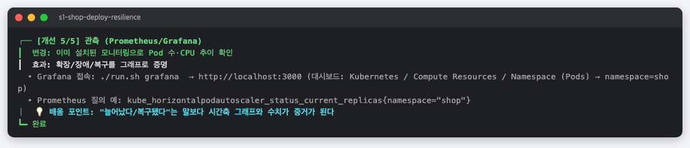

모니터링은 4단계에서 이미 설치했다. 화면에 접속 방법(`./run.sh grafana  → http://localhost:3000`, 대시보드 `Kubernetes / Compute Resources / Namespace (Pods) → namespace=shop`)과 Prometheus 질의 예(`kube_horizontalpodautoscaler_status_current_replicas{namespace="shop"}`)가 나온다. 그래프에는 8단계 부하 테스트까지 담기므로 [9단계의 "Grafana 로 그래프 보기"](#grafana-로-그래프-보기)에서 본다. 지금 세 번째 터미널에서 `./run.sh grafana` 를 켜 두고 8단계 동안 그래프가 바뀌는 모습을 지켜봐도 된다.

### 👀 두 번째 터미널 (watch) — 개선이 끝난 모습

`demo` 가 끝난 직후(11:24)의 화면이다.

- 맨 위에 HPA `shop-api` 표가 생겼다: `TARGETS cpu: 0%/50%`, `MINPODS 2`, `MAXPODS 8`. 8단계 부하가 끝나 CPU 가 0% 로 내려갔고, `REPLICAS 3` 으로 줄어드는 중이라 Pod 여러 개가 `Terminating` 이다
- 노드가 2대다. 새로 생긴 `ip-10-11-40-82…` 는 `AGE 4m1s` 로, 8단계 부하 중에 Cluster Autoscaler 가 추가한 노드다
- `CI 게이트: on`
- 맨 아래 **최근 진행 단계**에 개선 단계와 `after 테스트 완료` 가 시간순으로 쌓인다

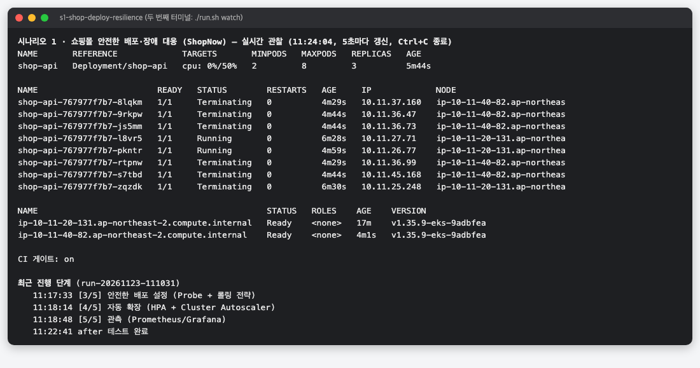

---

## 8단계 · After 테스트와 채점

> 📍 터미널: `[가이드 8/10단계] After 테스트·채점` · 약 4분 · 자동 진행

**무엇을 하나** — 5단계와 **똑같은 테스트**를 다시 실행한다. 같은 조건에서 비교해야 "개선됐다"고 말할 수 있다. 이번 CI 빌드는 게이트가 켜진 상태(`게이트=on`)에서 취약 이미지(vuln)와 정상 이미지(v1)를 함께 다시 빌드한다.

**앞부분 — 트래픽 급증(부하 테스트)**

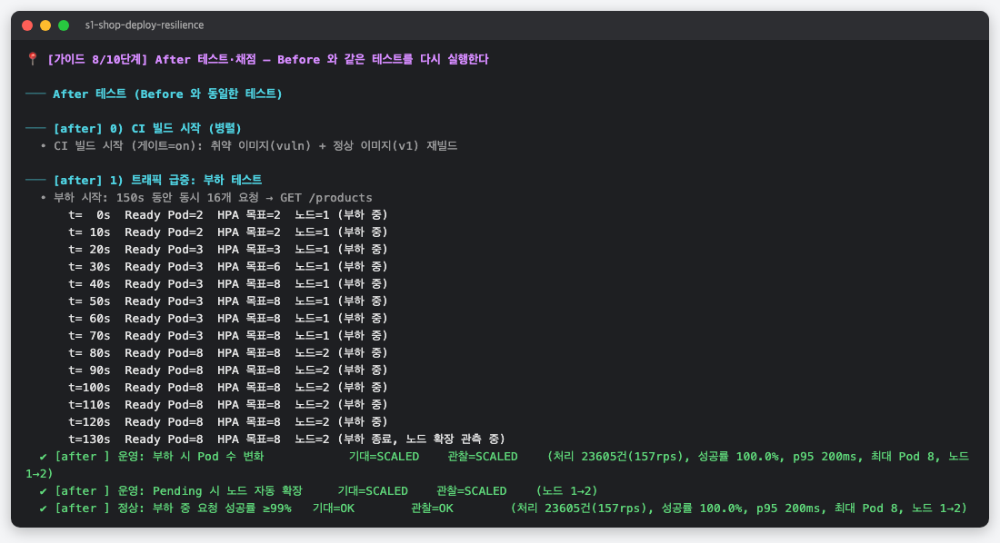

10초마다 찍히는 줄을 위에서부터 읽는다.

| 시점 | 화면 | 무슨 일인가 |
|---|---|---|
| t=0~10s | `Ready Pod=2  HPA 목표=2  노드=1` | 부하 시작, 아직 그대로 |
| t=20~70s | `HPA 목표` 가 3 → 6 → 8 로 오르지만 `Ready Pod=3`, `노드=1` | HPA 는 Pod 8개를 원하지만 노드에 자리가 없어 나머지는 Pending |
| t=80s~ | `Ready Pod=8  HPA 목표=8  노드=2` | Cluster Autoscaler 가 노드를 추가했고 Pending 이던 Pod 가 모두 Ready |

**정상이면**

- `✔ [after ] 운영: 부하 시 Pod 수 변화 … 관찰=SCALED (처리 23605건(157rps), 성공률 100.0%, p95 200ms, 최대 Pod 8, 노드 1→2)`
- `✔ [after ] 운영: Pending 시 노드 자동 확장 … 관찰=SCALED (노드 1→2)`
- `✔ [after ] 정상: 부하 중 요청 성공률 ≥99% … 관찰=OK`

**뒷부분 — 잘못된 배포, 위험 Pod, CI 게이트, 관측**

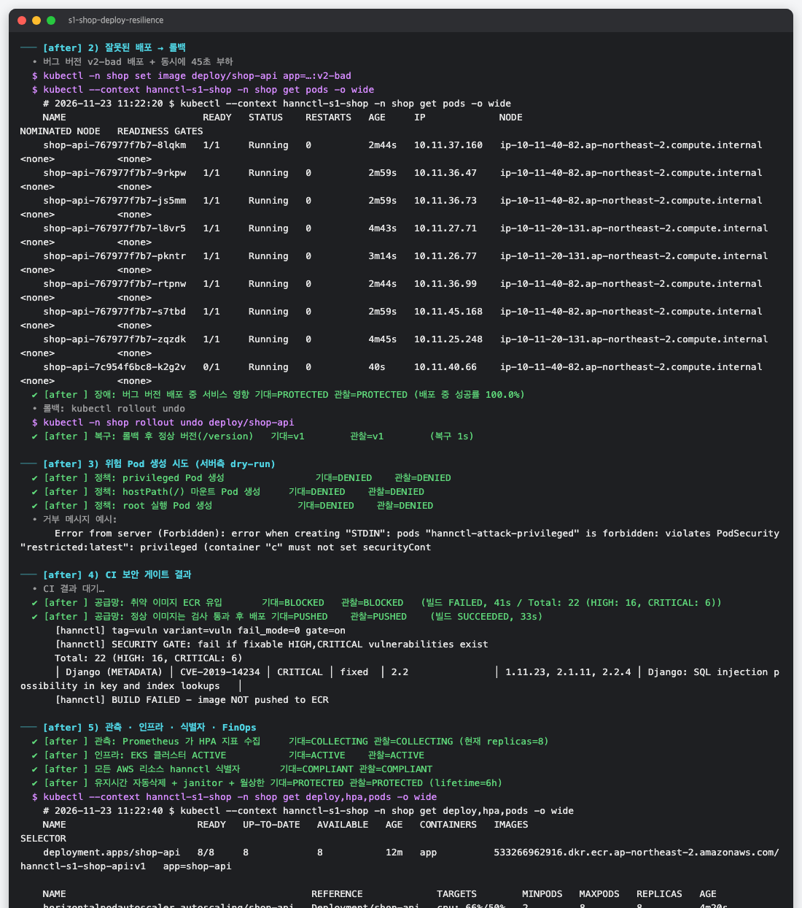

**여기가 이 시나리오에서 가장 중요한 순간이다.** 5단계와 같은 버그 버전 `v2-bad` 를 같은 방법으로 배포했는데, Pod 목록에서 새 Pod(`shop-api-7c954f6bc8-…`)는 **`0/1 Running`** 으로 남고 기존 v1 Pod 8개는 `1/1` 로 계속 서비스한다. Readiness Probe 가 실패해 새 Pod 는 트래픽을 받지 못하고, `maxUnavailable 0` 이라 기존 Pod 도 내려가지 않는다.

- `✔ [after ] 장애: 버그 버전 배포 중 서비스 영향 기대=PROTECTED 관찰=PROTECTED (배포 중 성공률 100.0%)`
- `✔ [after ] 복구: 롤백 후 정상 버전(/version) 기대=v1 관찰=v1 (복구 1s)` — 기존 v1 Pod 가 그대로 서비스 중이었으므로 롤백이 바로 끝난다
- privileged / hostPath(/) 마운트 / root 실행 Pod `DENIED` + 누가 막았는지 거부 메시지:

```text
  • 거부 메시지 예시:
      Error from server (Forbidden): error when creating "STDIN": pods "hannctl-attack-privileged" is forbidden: violates PodSecurity "restricted:latest": privileged (container "c" must not set securityCont
```

- CI 게이트가 취약 이미지를 막고, 정상 이미지는 통과시킨다:

```text
  ✔ [after ] 공급망: 취약 이미지 ECR 유입       기대=BLOCKED   관찰=BLOCKED   (빌드 FAILED, 41s / Total: 22 (HIGH: 16, CRITICAL: 6))
  ✔ [after ] 공급망: 정상 이미지는 검사 통과 후 배포 기대=PUSHED    관찰=PUSHED    (빌드 SUCCEEDED, 33s)
      [hannctl] tag=vuln variant=vuln fail_mode=0 gate=on
      [hannctl] SECURITY GATE: fail if fixable HIGH,CRITICAL vulnerabilities exist
      Total: 22 (HIGH: 16, CRITICAL: 6)
      │ Django (METADATA) │ CVE-2019-14234 │ CRITICAL │ fixed  │ 2.2               │ 1.11.23, 2.1.11, 2.2.4 │ Django: SQL injection possibility in key and index lookups   │
      [hannctl] BUILD FAILED - image NOT pushed to ECR
```

5단계와 같은 취약 소스인데 게이트가 있느냐 없느냐로 결과가 `PUSHED` 와 `BLOCKED` 로 갈린다. 스캔은 '발견'일 뿐이고, 빌드를 멈추는 장치가 있어야 '차단'이다.

> 취약점 건수(`HIGH: 16, CRITICAL: 6`)는 2026-11 실측값이다. Trivy 취약점 DB 는 매일 갱신되므로 실행 시점마다 조금씩 다를 수 있다. 발표에는 자기 실행의 `REPORT.html` 값을 쓴다.

- `✔ [after ] 관측: Prometheus 가 HPA 지표 수집 기대=COLLECTING 관찰=COLLECTING (현재 replicas=8)`
- 인프라 `ACTIVE`, hannctl 식별자 `COMPLIANT`, 유지시간 자동삭제 `PROTECTED`

**Before → After 한눈에 보기 (이번 실행 실측)**

| 항목 | Before (5단계) | After (8단계) |
|---|---|---|
| 부하 중 Pod / 노드 | 2개 고정 / 1대 | 최대 8개 / 1→2대 |
| 처리량 | 113rps | 157rps |
| 버그 버전 배포 중 성공률 | 38.1% | 100.0% |
| 롤백 복구 시간 | 57s | 1s |
| 위험 Pod 3종 | `ALLOWED` | `DENIED` |
| 취약 이미지 ECR 유입 | `PUSHED` | `BLOCKED` |

이어서 평가표로 자동 채점한다.

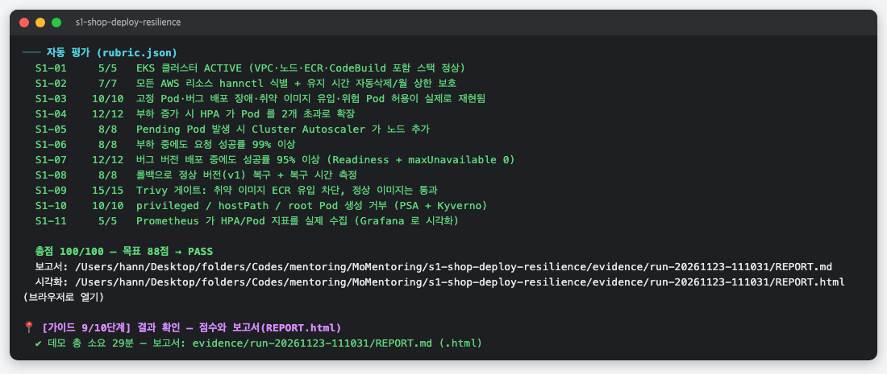

**정상이면** S1-01 ~ S1-11 이 모두 만점이고 `총점 100/100 — 목표 88점 → PASS` (88점 이상이면 통과).

### 🖥️ 콘솔에서 같이 보기

**개발자 도구(Developer Tools)** → **CodeBuild** → **빌드 프로젝트(Build projects)** → `hannctl-s1-ci` → **빌드 기록(Build history)** 탭. 이번 `demo` 가 돌린 빌드 5개가 위에서부터 최신순으로 보인다(#1·#2 는 화면 아래쪽에 있다).

| Build number | Status | Duration | 언제 만든 빌드인가 |
|---|---|---|---|
| 5 | **Succeeded** | 33 seconds | 8단계 After — 정상 이미지 `v1` 재빌드, 게이트 통과 (`빌드 SUCCEEDED, 33s`) |
| 4 | **Failed** | 41 seconds | 8단계 After — 취약 이미지 `vuln`, 게이트가 막음 (`빌드 FAILED, 41s`) |
| 3 | **Succeeded** | 27 seconds | 5단계 Before — 취약 이미지 `vuln`, 게이트 OFF 로 그대로 Push (`빌드 SUCCEEDED, 27s`) |
| 1, 2 | Succeeded | – | 4단계 — `v1`(정상)·`v2-bad`(버그 버전) 병렬 빌드 |

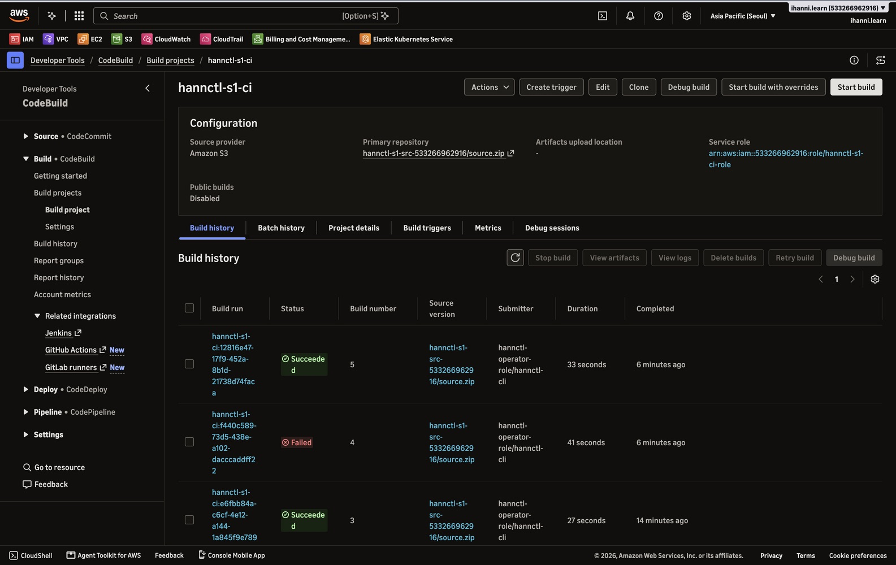

**#4 가 왜 실패했는지** 확인하려면 #4 의 빌드 실행 이름(`hannctl-s1-ci:f440c589-…`)을 눌러 **빌드 로그**를 연다. Trivy 표 아래 `Total: 22 (HIGH: 16, CRITICAL: 6)` 와 `[hannctl] BUILD FAILED - image NOT pushed to ECR` 가 있으면 보안 게이트가 멈춘 것이다. 같은 로그는 `evidence/latest/after/ci-vuln-build.log` 에도 있다.

**Elastic Container Registry** → **프라이빗 레지스트리(Private registry)** → **리포지토리(Repositories)** → `hannctl-s1-shop-api`. **Images (3)** 이다.

| Image tags | Created at | 무엇인가 |
|---|---|---|
| `v1` | 11:19:23 | 8단계 After 에서 게이트를 통과해 다시 Push 된 정상 이미지 (빌드 #5) |
| `v2-bad` | 11:08:47 | 4단계에서 만든 버그 버전 (5단계·8단계의 "잘못된 배포"에 사용) |
| `-` (태그 없음) | 11:08:44 | 4단계에서 처음 만든 `v1`. 8단계에서 새 `v1` 이 같은 태그로 Push 되면서 태그가 새 이미지로 옮겨 가 태그 없이 남았다 |

**`vuln` 태그는 목록에 없다.** After 테스트는 취약 이미지를 다시 빌드하기 전에 5단계에서 들어간 `vuln` 태그를 지우고, 게이트가 켜진 빌드 #4 는 Push 단계까지 가지 못했기 때문이다. 이것이 "공급망: 취약 이미지 ECR 유입 `BLOCKED`" 의 실물이다.

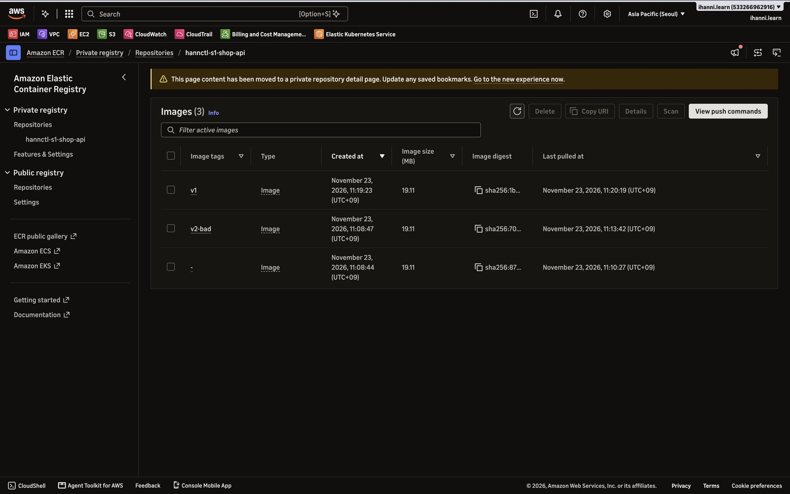

**EKS** → **클러스터** → `hannctl-s1-shop` → 왼쪽 **Compute**: **Nodes (2)** 다. 처음부터 있던 `ip-10-11-20-131…` 옆에, 부하 테스트 중 Cluster Autoscaler 가 추가한 `ip-10-11-40-82…`(`t4g.large`, On-Demand, Created `5 minutes ago`)가 **Ready** 로 있다. 노드 수는 위쪽 Nodes 표로 확인한다(이 화면의 Node groups 표 Desired size 칸은 1 로 보인다).

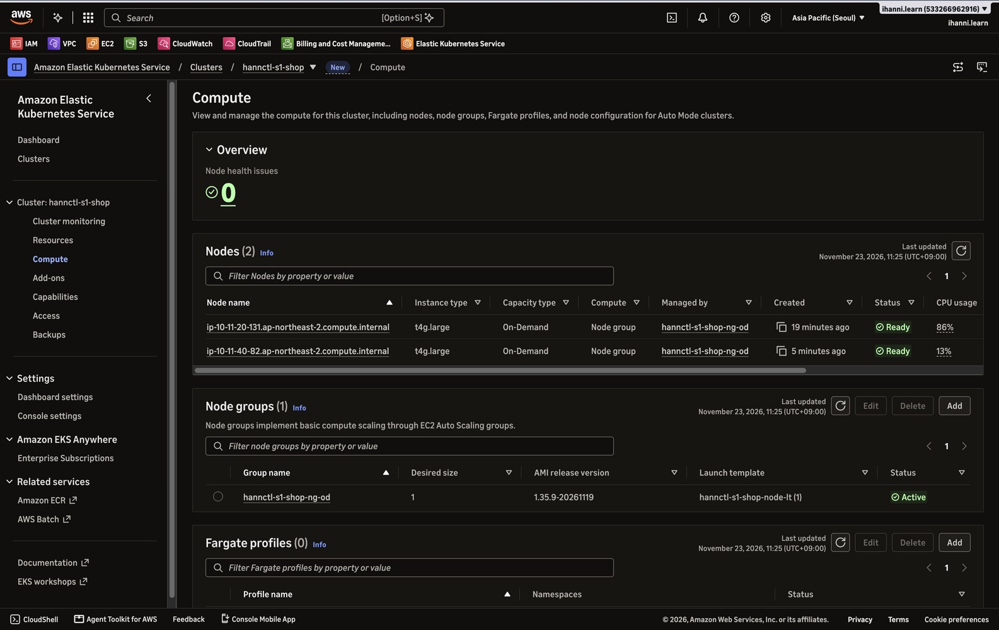

---

## 9단계 · 결과 확인

> 📍 터미널: `[가이드 9/10단계] 결과 확인`

마지막 줄에 `✔ 데모 총 소요 N분 — 보고서: evidence/run-…/REPORT.md (.html)` 가 나오면 `demo` 가 끝난 것이다.

보고서 `evidence/latest/REPORT.html` 이 브라우저로 열린다. 열리지 않으면 직접 연다.

```bash
open evidence/latest/REPORT.html        # macOS
xdg-open evidence/latest/REPORT.html    # Linux
cat evidence/latest/REPORT.md           # 터미널에서 보기 (CloudShell 포함)
```

CloudShell 에서는 오른쪽 위 **작업(Actions) → 파일 다운로드**에 `pwd` 결과 뒤 `/evidence/latest/REPORT.html` 을 붙인 경로를 넣어 내려받는다.

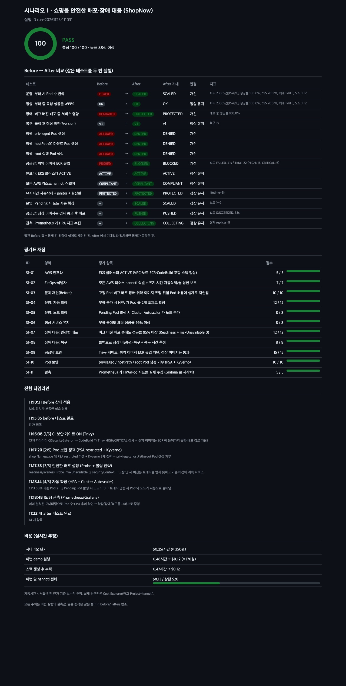

| 보고서 부분 | 보는 법 |
|---|---|
| 점수 원 | 총점과 PASS/FAIL |
| Before → After 비교 | 빨간 Before 값 = 실제로 재현된 위험(`FIXED`, `DEGRADED`, `ALLOWED`, `PUSHED`), After 가 기대값과 같으면 통제가 동작한 것. `→` 는 개선, `=` 는 정상 유지. Before 가 `–` 인 줄(노드 자동 확장, 정상 이미지 배포, Prometheus 지표 수집)은 After 에만 있는 확인 항목이다. 오른쪽 **지표** 칸에 처리량·성공률·복구 시간·Trivy 건수가 있다 |
| 평가표 채점 | 항목별 점수 S1-01 ~ S1-11 (기준은 [RUBRIC.md](RUBRIC.md)) |
| 전환 타임라인 | Before 상태 적용 → before 테스트 완료 → 개선 1~5 → after 테스트 완료 시각 |
| 비용 | 시나리오 단가, 이번 demo 실행·스택 누적·이번 달 hannctl 전체 비용 추정 (이번 실행은 `0.48시간 → $0.12`) |

### Grafana 로 그래프 보기

"늘어났다", "복구됐다"를 시간축 그래프로 확인한다. **세 번째 터미널**에서:

```bash
cd ~/hannctl_mentoring/s1-shop-deploy-resilience     # 새 터미널은 홈 폴더에서 시작하므로 시나리오 폴더로 이동
./run.sh grafana
```

`✔ Grafana → http://localhost:3000  (ID: admin / PW: …)  — Ctrl+C 로 종료` 가 나온다. 이 터미널은 켜 둔 채로 브라우저에서 **http://localhost:3000** 을 열고, 로그인 ID `admin`, 비밀번호는 이 화면에 나온 값을 넣는다.

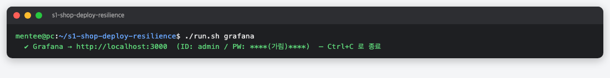

왼쪽 **Dashboards** → **Kubernetes / Compute Resources / Namespace (Pods)** 를 열고, 위쪽 `namespace` 를 **shop** 으로 고른다. 오른쪽 위 시간 범위는 실습 전체가 들어가도록 **Last 40 minutes** 정도로 둔다.

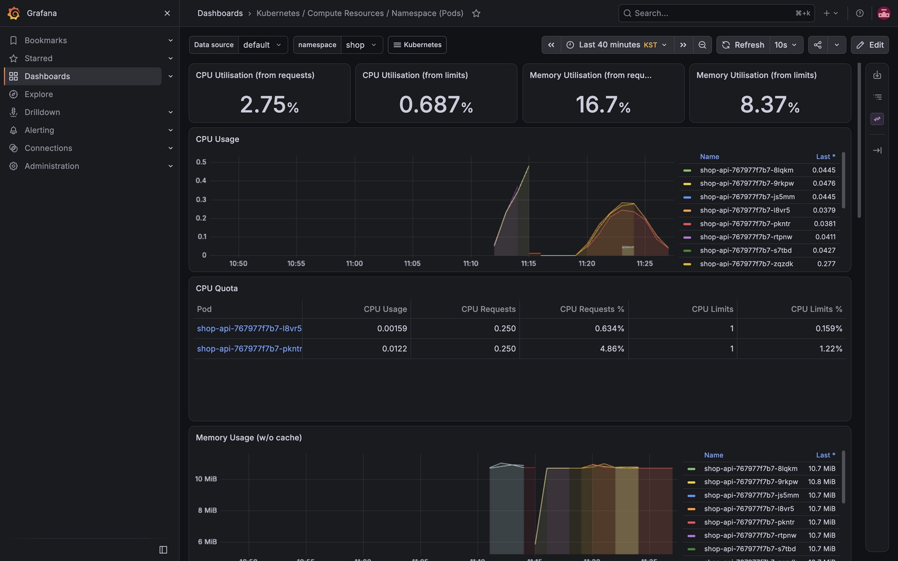

**CPU Usage** 그래프에서 선 하나가 Pod 하나다.

- 11:10 ~ 11:15 사이에 솟은 선 — 5단계 Before 부하 테스트. Pod 가 2개뿐이라 선도 적다.
- 11:19 이후 여러 선이 함께 오르는 부분 — 8단계 After 부하 테스트. HPA 가 늘린 `shop-api-767977f7b7-…` Pod 들이 함께 부하를 나눠 받는다. 오른쪽 범례에 Pod 이름이 8개 보인다.

다 보면 세 번째 터미널에서 `Ctrl+C` 로 끈다.

### 다시 해 보기

인프라를 그대로 둔 채 단계만 다시 실행할 수 있다. 발표 리허설이나 6단계 관찰을 천천히 할 때 쓴다.

| 명령 | 하는 일 | 시간 |
|---|---|---|
| `./run.sh before` | CI 게이트를 OFF 로 되돌리고(스택 업데이트) Pod 2개 고정·Probe 없음·정책 없음 상태에서 Before 테스트 (5단계) | 약 6분 |
| `./run.sh after` | 개선 1~5 적용 + After 테스트 + 채점 (7~8단계) | 약 6분 20초 |
| `./run.sh demo` | 5~9단계 전체 (인프라가 있으면 바로 Before 부터) | 약 15분 |
| `./run.sh status` | 스택·클러스터·노드 상태와 남은 유지 시간 | 몇 초 |

다시 실행할 때마다 CodeBuild 빌드가 새로 돌고 수치도 조금씩 달라진다(예: 다시 실행한 Before 는 `배포 중 성공률 32.9%`, `복구 55s`, After 는 `처리 23263건(155rps)`).

---

## 10단계 · 삭제

> 📍 터미널: `[가이드 10/10단계] 삭제` · 약 9분

**할 일** — 실습이 끝나면 반드시 실행한다. 두 번째 터미널의 watch 와 세 번째 터미널의 grafana 는 `Ctrl+C` 로 먼저 끈다.

```bash
./run.sh down
```

**화면에 나오는 것** — `── 스택 삭제: hannctl-s1-shop (현재 UPDATE_COMPLETE)` 가 나온다(개선 1에서 CI 게이트 파라미터를 바꿨으므로 `UPDATE_COMPLETE` 다). 먼저 S3 소스 버킷을 비우고(`• 버킷 비우기: hannctl-s1-src-…`), CloudFormation 이 만든 순서의 반대로 리소스를 지운다. `🗑 … 삭제됨` 이 하나씩 쌓인다. CodeBuild 프로젝트·CI 역할·Pod Identity 연결·ECR 저장소·S3 버킷은 처음 30초 안에, NAT 는 약 1분에 지워지고, 노드 그룹(약 4분 30초)과 EKS 클러스터(약 3분) 삭제가 가장 오래 걸린다.

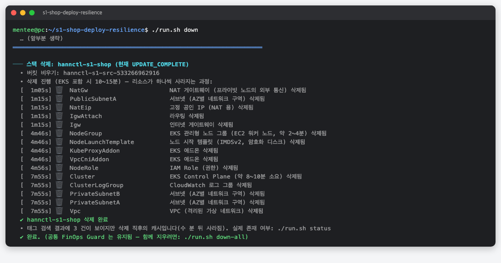

**정상이면** `✔ hannctl-s1-shop 삭제 완료` 다음에 `✔ 완료. (공통 FinOps Guard 는 유지됨 — 함께 지우려면: ./run.sh down-all)` 가 나온다(실측 8분 44초). 공통 안전장치(`hannctl-finops-guard`)는 다음 실습을 위해 남겨 두는 것이다(비용 0원 수준).

> `• 태그 검색 결과에 3 건이 보이지만 삭제 직후의 캐시입니다(수 분 뒤 사라짐). 실제 존재 여부: ./run.sh status` 줄이 함께 나올 수 있다. AWS 태그 검색이 몇 분 늦게 갱신되기 때문이며 실제로 남은 리소스는 아니다.

### 🖥️ 콘솔에서 같이 보기

**CloudFormation** → **스택** → `hannctl-s1-shop` → **리소스** 탭. `CiProject`·`CiRole`·`CiLogGroup`·`EcrRepo`·`ClusterAutoscalerPodIdentity` 등이 하나씩 `DELETE_COMPLETE` 로 바뀐다(아직 지우는 중인 `Cluster`·`ClusterRole`·`ClusterLogGroup` 등은 `CREATE_COMPLETE` 로 남아 있다). 다 지워지면 스택 목록(필터 **활성**)에서 사라진다.

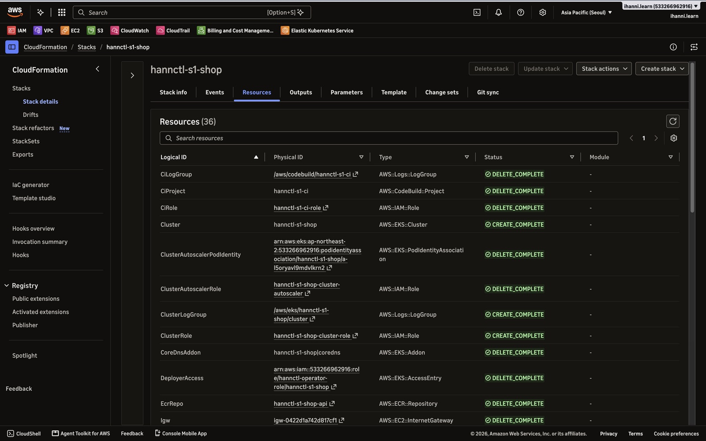

**남은 것이 없는지 확인**

```bash
./run.sh status          # "! 스택 없음" 이 나오면 이 시나리오 리소스는 모두 지워진 것
```

- 중간에 실패하면 `./run.sh down` 을 한 번 더 실행한다.
- 모든 시나리오를 끝냈으면 `./run.sh down-all` 로 공통 안전장치까지 지운다. 다른 시나리오 스택이 남아 있으면 지우지 않는다.
- `down` 을 잊어도 2단계에서 정한 유지 시간(기본 6시간)이 지나면 자동으로 삭제된다(S3 소스 버킷도 비운 뒤 삭제한다). 그래도 끝나면 바로 지우는 것이 원칙이다.

---

## 문제 해결

| 증상 | 해결 |
|---|---|
| 1단계에 `✘` | 그 줄의 `→` 안내대로 하고 `./run.sh doctor` 다시 실행 |
| 3단계 도중 터미널이 꺼짐 / CloudShell 세션 끊김 | 다시 접속해 같은 폴더에서 `./run.sh status` → 상태가 `CREATE_COMPLETE` 가 되면 `./run.sh demo` 다시 실행 (만든 인프라는 이어서 쓴다) |
| 8단계에 `✘` 가 있음 | `./run.sh after` 한 번 더 실행 |
| Trivy 건수가 이 문서(`HIGH: 16, CRITICAL: 6`)와 다름 | 정상이다. Trivy 취약점 DB 갱신에 따라 달라진다. 게이트 판단은 수정 가능한 HIGH/CRITICAL 이 1건 이상인지로만 한다 |
| 성공률·처리량·복구 시간이 이 문서와 다름 | 정상이다. 실행할 때마다 조금씩 다르다. 발표에는 자기 실행의 `REPORT.html` 값을 쓴다 |
| Grafana 그래프가 비어 있음 | 위쪽 `namespace` 가 `shop` 인지, 오른쪽 위 시간 범위가 실습 시간을 포함하는지(예: Last 40 minutes) 확인 |
| 콘솔 EKS 화면에 `Unauthorized` / `forbidden` | 1~2분 뒤 새로 고침. 그래도 같으면 `./run.sh up` 을 한 번 실행 |
| kubectl 이 `Unauthorized` / 타임아웃 | 내 공인 IP 가 바뀌었을 수 있다 → `./run.sh up` (EKS API 허용 IP 갱신) |
| `Unable to parse config file: …/.aws/config` | [START_HERE.md 문제 해결](START_HERE.md) 참고 |

그 밖의 문제는 [START_HERE.md](START_HERE.md) 의 문제 해결 표를 본다.
