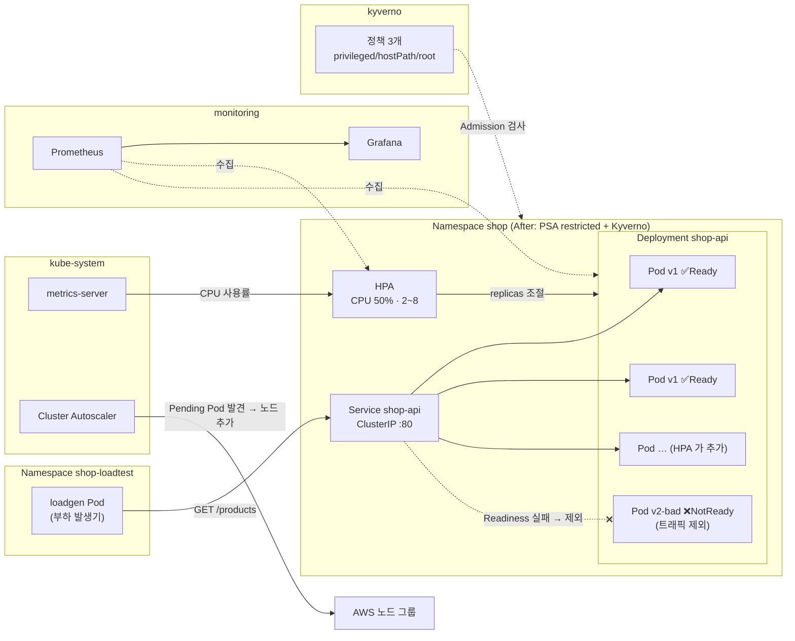
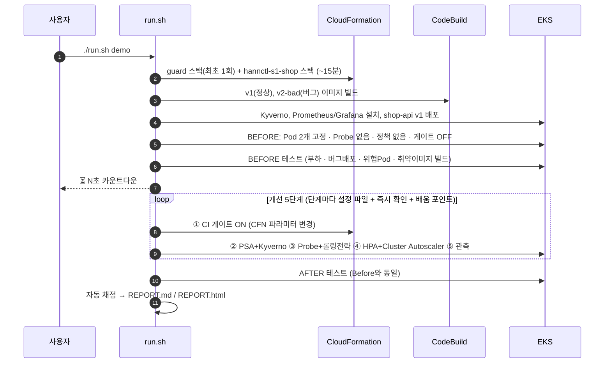

# 시나리오 1 · 쇼핑몰의 안전한 배포·장애 대응 (ShopNow)

> 🚀 **처음이라면 → [START_HERE.md](START_HERE.md)** (내려받기 → 준비 → `./run.sh doctor` → `./run.sh demo` → 삭제)

> **한 줄 요약**
> 할인 행사로 트래픽이 몰려도 **Pod와 노드가 자동으로 늘어나고**, 버그 있는 새 버전을 배포해도 **고객은 장애를 겪지 않으며**(바로 롤백), 취약한 이미지와 위험한 Pod는 **배포 전에 차단**되는 쇼핑몰 운영 체계를 만든다.
> 이 모든 것을 **같은 테스트를 Before/After로 두 번 실행**해 수치로 증명한다.

| 항목 | 내용 |
|---|---|
| 난이도 | ★★★☆☆ (3/5) — 운영(확장·배포·복구)과 보안(이미지·Pod 정책)을 균형 있게 |
| 핵심 기술 | Amazon EKS, **HPA**, **Cluster Autoscaler**(EKS Pod Identity), **Readiness/Liveness Probe**, 롤링 업데이트·**롤백**, **CodeBuild + Trivy** CI 게이트, **ECR**, PSA·**Kyverno**, **Prometheus/Grafana** |
| 소요 시간 | 처음 `demo` 약 45분(인프라 15분 + 설치 8분 포함), 이후 재실행 약 20분 |
| 예상 비용 | 약 **$0.25/시간(≈350원)**, demo 1회(생성~삭제 약 45분) 약 **$0.2(≈280원)** — 자세한 내용은 [9장](#9-비용-안전장치-삭제-finops) |
| 과정 요구사항 연결 | 인프라 운영(노드 오토스케일링, Prometheus/Grafana, 장애 대응), 공급망 보안(Trivy, Critical·High 차단), 정책 통제(privileged/root/hostPath 차단) |


## 🎯 이 시나리오의 초점 (먼저 읽기)

| 구분 | 내용 |
|---|---|
| **핵심 포커스** | 트래픽 급증과 잘못된 배포에도 서비스가 버티는 **운영 안정성**, 그리고 위험한 이미지·Pod를 배포 경로에서 막는 **배포 보안**을 함께 갖춘다 |
| **Kubernetes 보안 비중** | ★★★☆☆ — **운영 + 보안 균형형**이다. 개선 5단계 중 보안 통제 2단계(CI 이미지 게이트, Pod 보안), 안전한 배포 1단계, 운영(확장·관측) 2단계. 보안을 더 깊게 다루려면 시나리오 2~5 |
| **가장 중요하게 보는 것** | ① **HPA는 Pod를, Cluster Autoscaler는 노드를** 늘린다(둘은 다르다) ② Readiness Probe + 롤링 전략으로 **고장 난 버전이 트래픽을 받지 않고**, 롤백으로 즉시 복구 ③ 취약 이미지는 **CI에서**, 위험 Pod는 **Admission에서** 2단계로 차단 |

**무엇을 사용하나 (계층별)**

| 계층 | 사용 기술 | 이 시나리오에서 하는 일 |
|---|---|---|
| AWS 인프라 | VPC · EKS · 관리형 노드 그룹(1~3대) · ECR · CodeBuild · S3 | 실습 기반 + 이미지 빌드·저장 |
| 공급망 보안 | **CodeBuild + Trivy** (HIGH·CRITICAL 게이트) → **ECR** | 취약 이미지가 저장소에 들어가지 못하게 함 |
| Pod 생성 통제 | **PSA** restricted + **Kyverno** ValidatingPolicy | privileged·hostPath·root Pod 거부 |
| 안전한 배포 | **Readiness/Liveness Probe**, RollingUpdate(maxUnavailable 0), `rollout undo` | 고장 난 새 버전 격리, 빠른 롤백 |
| 자동 확장 | metrics-server · **HPA** · **Cluster Autoscaler**(EKS Pod Identity로 AWS 권한) | 부하에 따라 Pod와 노드 증감 |
| 관측 | **Prometheus / Grafana** | 확장·장애·복구를 그래프로 증명 |

**전 → 후: 무엇이 개선되나 (실측)**

| # | 개선(통제) | 영역 | Before → After | 왜 중요한가 |
|---|---|---|---|---|
| 1 | CI 보안 게이트 ON (Trivy) | 공급망 보안 | 취약 이미지 ECR 저장 → **차단**(HIGH 16·CRITICAL 6) | 스캔은 "발견", 게이트가 있어야 "차단" |
| 2 | PSA restricted + Kyverno | K8s 정책 통제 | 위험 Pod 3종 `ALLOWED` → `DENIED` | 노드를 장악할 수 있는 Pod를 사전 차단 |
| 3 | Probe + 롤링 전략 | 가용성(운영) | 버그 배포 중 성공률 **34.7% → 100%**, 롤백 복구 **56초 → 1초** | 배포 실수가 장애로 번지지 않음 |
| 4 | HPA + Cluster Autoscaler | 운영(확장) | Pod 2개 고정 → **2→8개**, 노드 **1→2대** | 트래픽 급증 대응 |
| 5 | Prometheus/Grafana 확인 | 관측 | – → 추이 그래프 | 숫자와 그래프로 증명 |

**다루지 않는 것 (범위 밖)**: 블루/그린 배포, 실제 ALB 인그레스(비용·잔여 리소스 문제로 제외), NetworkPolicy·RBAC 심화(→ 시나리오 2), 이미지 서명 검증

---

## 0. 가장 빠른 사용법 (명령 1개)

```bash
cd s1-shop-deploy-resilience
./run.sh demo                      # 전부 자동: 인프라 → Before 재현 → 60초 후 자동 개선 5단계 → After 검증 → 채점
./run.sh demo --before-wait 180    # Before 상태를 3분 동안 관찰한 뒤 넘어가기
./run.sh grafana                   # (다른 터미널) Grafana 그래프로 Pod 수·CPU 변화 보기 → http://localhost:3000
./run.sh down                      # 끝나면 전부 삭제 (잊어도 3시간 뒤 자동 삭제)
```

`demo`가 끝나면 `evidence/latest/REPORT.html`이 열린다. 점수, Before→After 비교, 전환 타임라인을 한 화면에서 볼 수 있다.
**다른 터미널에서 `./run.sh watch`** 를 켜 두면 HPA 목표값, Pod, 노드 수가 바뀌는 모습을 실시간으로 볼 수 있다.

> 처음 한 번 필요한 것: AWS 자격 증명(`aws configure`). python3·AWS CLI·kubectl·helm 등 필요한 도구는 **없는 것만 자동 설치**된다(`tools/install-tools.sh`, 이미 있으면 건너뜀). 자세한 준비는 [START_HERE.md](START_HERE.md) 참고.
> **로컬 Docker 불필요**: 이미지 빌드는 AWS CodeBuild에서 한다. macOS, Ubuntu, CentOS/Rocky, AWS CloudShell에서 동작한다.

---

## 1. 실무에서는 어떤 상황인가? (왜 이걸 배우나)

**ShopNow**는 EKS에서 상품 조회 API를 운영하는 쇼핑몰이다. 대규모 할인 행사가 시작되는 날 다음 세 가지 일이 동시에 일어날 수 있다.

| 상황 | 통제가 없으면 | 실제로 흔한 사고 |
|---|---|---|
| 🔥 **트래픽 급증** | Pod 2개로 버티다가 응답이 점점 느려진다 | "행사 시작 10분 만에 사이트 마비" |
| 🐛 **버그 있는 새 버전 배포** | 새 Pod가 뜨자마자 기존 Pod를 대체하고 모든 요청이 500 에러가 된다 | "배포 직후 전면 장애, 수동 복구까지 30분" |
| ☠️ **취약하거나 위험한 컨테이너** | CRITICAL 취약점이 있는 이미지, privileged Pod가 그대로 운영에 들어간다 | "오래된 라이브러리 취약점으로 침해", "컨테이너 탈출로 노드 장악" |

이 시나리오의 핵심은 **가용성(운영)** 과 **배포 안전성(보안)** 을 **함께** 다루는 것이다. 실무 SRE/DevOps 엔지니어가 매일 하는 일이기도 하다.

> 결제·주문 DB는 만들지 않는다. **상품 조회 API 하나**에 집중해 "운영 체계"를 보여주는 것이 목표다.

---

## 2. 이 시나리오의 목표 (완료 기준)

| # | 목표 | 증명 방법 |
|---|---|---|
| 1 | 부하가 오면 **Pod가 2 → 최대 8개로 자동 확장** | 부하 테스트 중 Ready Pod 수 기록 |
| 2 | Pod 자리가 없으면 **노드가 자동 추가** (1 → 최대 3) | 부하 중 노드 수 기록 |
| 3 | 부하 중에도 **요청 성공률 99% 이상** | 인클러스터 부하 발생기의 실측 성공률·p95 |
| 4 | 버그 버전을 배포해도 **성공률 95% 이상 유지** | 배포 중 부하를 걸고 성공률 측정 |
| 5 | **롤백**으로 정상 버전 복구 + **복구 시간 측정** | `/version` 응답 + 걸린 초 |
| 6 | **취약 이미지(HIGH/CRITICAL)는 ECR에 못 들어감**, 정상 이미지는 통과 | CodeBuild 결과 + ECR 이미지 존재 여부 |
| 7 | **privileged / hostPath / root Pod 생성 거부** | 서버측 dry-run → `DENIED` |
| 8 | **Prometheus가 지표를 실제 수집**, Grafana로 시각화 | Prometheus 질의 결과 |
| 9 | 모든 AWS 리소스가 **hannctl 식별자 + 유지 시간 후 자동 삭제** | 태그 감사 + janitor 확인 |

**평가 목표: 100점 만점 중 88점 이상.** 평가표는 [`RUBRIC.md`](RUBRIC.md)에 있고, `demo`가 끝나면 자동으로 채점된다.

---

## 3. 전체 구성도

### 3-1. AWS 인프라 (CloudFormation `cfn/stack.yaml` 하나로 생성)

```mermaid
flowchart TB
  subgraph PC["내 PC / CloudShell"]
    RUN["./run.sh demo"]
  end

  subgraph AWS["AWS 계정 · ap-northeast-2 (서울)"]
    subgraph GUARD["hannctl-finops-guard (공통 안전장치)"]
      EXEC["IAM hannctl-cfn-exec-role"]
      JAN["Lambda hannctl-janitor<br/>유지 시간 만료 시 자동 삭제"]
      BUD["Budget + SNS 알림"]
    end

    subgraph STACK["hannctl-s1-shop 스택"]
      subgraph CI["CI 파이프라인"]
        S3["S3 hannctl-s1-src-…<br/>(소스 zip, 1일 후 삭제)"]
        CB["CodeBuild hannctl-s1-ci (ARM)<br/>build → Trivy 게이트 → push"]
        ECR["ECR hannctl-s1-shop-api<br/>v1 · v2-bad · (vuln)"]
      end
      subgraph VPC["VPC 10.11.0.0/16 (2 AZ)"]
        NAT["NAT Gateway ×1"]
        subgraph NG["Managed Node Group (Graviton 2 vCPU, 1~3대)"]
          N1["노드 1 (시작)"]
          N2["노드 2 (자동 추가)"]
          N3["노드 3 (자동 추가)"]
        end
      end
      CP["EKS Control Plane<br/>hannctl-s1-shop (v1.35)"]
      CAR["IAM Role …-cluster-autoscaler<br/>(Pod Identity)"]
      LOG["CloudWatch Logs<br/>EKS audit · CodeBuild (3일)"]
    end
  end

  RUN -- "app/ zip 업로드" --> S3 --> CB -- "통과한 이미지만" --> ECR
  RUN -- "kubectl / helm" --> CP --- NG
  NG -- "이미지 Pull (NAT 경유)" --> ECR
  CAR -. "노드 그룹 크기 조절" .-> NG
  CP --> LOG
  JAN -. "유지 시간 만료 시" .-> STACK
```



### 3-2. EKS 내부 (Kubernetes 리소스)



### 3-3. 각 문제를 어디서 막나 (통제 지점)

```text
 [CI · 빌드 단계]      취약한 이미지인가?          → CodeBuild + Trivy (HIGH/CRITICAL 이면 빌드 실패, ECR push 안 함)
        │
 [Admission · 생성 단계] 위험한 Pod 설정인가?       → PSA restricted + Kyverno (privileged/hostPath/root 거부)
        │
 [Deployment · 배포 단계] 새 버전이 정상인가?        → Readiness Probe + maxUnavailable 0 (+ 문제 시 rollout undo)
        │
 [운영 · 실행 단계]     트래픽이 늘었나?            → HPA(Pod 확장) → 자리 부족 시 Cluster Autoscaler(노드 확장)
        │
 [관측]                 실제로 그렇게 됐나?         → Prometheus/Grafana + 실행 증적(evidence/)
```

---

## 4. 자동 진행 순서 — `./run.sh demo`가 하는 일



### 4-1. 단계별로 "이렇게 설정하면 → 이렇게 된다"

| 단계 | 설정 (파일 · 핵심 줄) | 결과 (화면에 보이는 값) | 배운 점 (핵심 포인트) |
|---|---|---|---|
| **BEFORE** | `k8s/before/shop-api.yaml`<br/>`replicas: 2`, Probe 없음, securityContext 없음 · CI `GATE=off` | 부하 중 Ready Pod **2 고정** · 버그 배포 중 성공률 **급락** · privileged Pod `ALLOWED` · 취약 이미지 `PUSHED` | 문제를 먼저 **재현**해야 개선을 증명할 수 있다 |
| **① CI 게이트** | `cfn/stack.yaml` 파라미터 `CiSecurityGate=on`<br/>`trivy image --severity HIGH,CRITICAL --ignore-unfixed --exit-code 1` | 취약 이미지 빌드 `FAILED` → ECR에 **없음**(`BLOCKED`) · 정상 이미지 `PUSHED` | 스캔은 "보는 것", 게이트는 "**막는 것**". 실패 코드(exit 1)로 파이프라인을 멈춰야 한다 |
| **② Pod 보안** | Namespace 라벨 `pod-security.kubernetes.io/enforce=restricted`<br/>`k8s/policies/kyverno-baseline.yaml` | privileged / hostPath / root Pod `DENIED` + 거부 메시지 | 위험한 Pod는 **만들어지기 전에** 막는다(예방 통제) |
| **③ 안전한 배포** | `k8s/after/30-shop-api.yaml`<br/>`readinessProbe: /health`, `maxUnavailable: 0`, `maxSurge: 1` | 버그 배포 중에도 성공률 **≥95%** (새 Pod는 NotReady로 트래픽 제외) → `rollout undo` 후 `v1` 복구 **N초** | "실행 중"과 "정상"은 다르다. Probe가 그 차이를 알려준다 |
| **④ 자동 확장** | `k8s/after/40-hpa.yaml` (`averageUtilization: 50`, 2~8)<br/>`40-cluster-autoscaler-values.yaml` + Pod Identity | 부하 중 Pod **2 → 8** · 일부 Pod Pending → 노드 **1 → 2+** | **HPA는 Pod만 늘린다**. 노드가 부족하면 Pending이므로 노드 확장은 별도로 필요하다 |
| **⑤ 관측** | (설치됨) `k8s/monitoring-values.yaml` | Prometheus 질의 결과(현재 replicas) · Grafana 그래프 | "늘어났다"는 말보다 **시간축 그래프**가 증거다 |
| **AFTER** | Before와 **똑같은 테스트** | 아래 4-2 표 | 같은 조건에서 비교해야 "개선"이라고 말할 수 있다 |

### 4-2. Before → After 결과표 (동일 테스트)

| 테스트 | Before | After | 검증 실행 실측값 (2026-11, 온디맨드, 100/100점) | 의미 |
|---|---|---|---|---|
| 부하 시 Pod 수 | FIXED (2) | **SCALED** | Pod 2 고정 → **2→4→8** (부하 시작 30초·50초 후) | 트래픽에 맞춰 처리 능력 자동 증가 |
| 부하 시 노드 수 | – | **SCALED** | 노드 **1→2** (Pending 발생 후 약 50초 만에 새 노드 Ready) | Pending Pod를 위해 노드 자동 추가 |
| 부하 중 성공률 ≥99% | OK | **OK** | 처리량 **106 → 145 rps (+37%)**, 성공률 100% / 100%, p95 224 → 193ms | 확장 중에도 정상 서비스 유지 |
| 버그 버전 배포 중 서비스 | **DEGRADED** ⚠️ | **PROTECTED** | 배포 중 성공률 **34.7% → 100%** | 잘못된 배포가 고객에게 닿지 않음 |
| 롤백 후 버전 | v1 | **v1** | 복구 시간 **56초 → 1초** (After 는 기존 v1 Pod 가 그대로 서비스 중) | 이전 정상 버전으로 신속 복구 |
| 취약 이미지 ECR 유입 | **PUSHED** ⚠️ | **BLOCKED** | Trivy: **HIGH 16 · CRITICAL 6** (Django 2.2) → 빌드 실패, push 안 함 | 공급망 게이트가 배포 경로 차단 |
| 정상 이미지 배포 | – | **PUSHED** | 게이트 통과 (빌드 30초) | 정상 개발 흐름은 유지 |
| privileged / hostPath / root Pod | **ALLOWED** ⚠️ | **DENIED** | 3종 모두 거부 (PSA restricted 메시지) | 노드 장악 가능한 Pod 차단 |
| Prometheus 지표 수집 | – | **COLLECTING** | HPA replicas=8 질의 성공 | 운영 상태가 관측 가능 |

> 수치는 실행할 때마다 조금씩 다르다. 매 실행의 `evidence/<run>/REPORT.md`에 기록되며, 발표에는 **자기 조가 측정한 값만** 사용한다.
> p95가 크게 줄지 않는 이유: 부하 발생기(파이썬 1개 프로세스)가 먼저 한계에 닿기 때문이다. 이 시나리오에서는 **처리량(rps)** 이 확장 효과를 더 잘 보여준다.
>
> 💡 **실제 검증에서 얻은 교훈**: 처음에는 공식 `python:3.13-alpine` 베이스 이미지로 만든 **정상 이미지도 게이트에서 차단**되었다(pip 내부 라이브러리 msgpack·urllib3·setuptools의 HIGH 취약점 5건). 실행에 필요 없는 pip를 이미지에서 지우자(`app/Dockerfile`) 통과했다. "공식 이미지 = 안전"이 아니며, **필요 없는 것을 빼는 것**도 공급망 보안이다.

---

## 5. 직접 조회해 보기 — 명령어 순서 (이해 확인·발표 리허설용)

```bash
eval "$(./run.sh kubeconfig)"        # 이 시나리오 전용 kubeconfig (내 ~/.kube/config 는 건드리지 않음)
```

| 순서 | 무엇을 보나 | 명령 |
|---|---|---|
| 1 | AWS에 무엇이 생겼나 | `./run.sh status` |
| 2 | 노드·Pod·HPA | `kubectl get nodes` / `kubectl -n shop get deploy,hpa,pods -o wide` |
| 3 | HPA가 보는 CPU | `kubectl -n shop describe hpa shop-api` / `kubectl top pods -n shop` |
| 4 | 직접 부하 주기 | `kubectl -n shop-loadtest exec deploy/loadgen -- python3 /app/app.py load http://shop-api.shop.svc.cluster.local/products 60 16` |
| 5 | 노드 확장 로그 | `kubectl -n kube-system logs deploy/cluster-autoscaler --tail=30` |
| 6 | 엔드포인트(트래픽 받는 Pod) | `kubectl -n shop get endpointslices -l kubernetes.io/service-name=shop-api -o wide` |
| 7 | 배포 이력·롤백 | `kubectl -n shop rollout history deploy/shop-api` / `kubectl -n shop rollout undo deploy/shop-api` |
| 8 | 현재 버전 | `kubectl -n shop-loadtest exec deploy/loadgen -- python3 /app/app.py get http://shop-api.shop.svc.cluster.local/version` |
| 9 | CI 빌드 기록 | `aws codebuild list-builds-for-project --project-name hannctl-s1-ci` → 콘솔에서 로그(Trivy 표) 확인 |
| 10 | ECR 이미지·스캔 | `aws ecr describe-images --repository-name hannctl-s1-shop-api` |
| 11 | 위험 Pod 직접 시도 | `kubectl apply -n shop --dry-run=server -f k8s/attack/privileged-pod.yaml` |
| 12 | Kyverno 정책 | `kubectl get validatingpolicy` / `kubectl describe validatingpolicy hannctl-disallow-privileged` |
| 13 | Grafana | `./run.sh grafana` → Dashboards → *Kubernetes / Compute Resources / Namespace (Pods)* → namespace `shop` |

---

## 6. run.sh 없이 처음부터 직접 구성해 보기 (원리 이해용)

`run.sh`는 아래 과정을 **순서대로 대신 실행**해 주는 스크립트일 뿐이다. 한 번은 손으로 따라 해 보면 "CloudFormation이 무엇을 만들고, CI·Kubernetes 설정이 그 위에 어떻게 올라가는지"가 확실히 보인다.

> 직접 만든 환경도 `./run.sh test after`, `./run.sh score`, `./run.sh down`으로 그대로 검증·채점·삭제할 수 있다(스택 이름과 태그만 같게 만들면 된다).

### 6-1. 준비 — 내 정보 확인

```bash
export AWS_REGION=ap-northeast-2
MY_ARN=$(aws sts get-caller-identity --query Arn --output text)   # 클러스터 관리자로 등록할 나
MY_IP=$(curl -s https://checkip.amazonaws.com)/32                  # EKS API 에 접속을 허용할 내 IP
echo "$MY_ARN  $MY_IP"
```

> assumed-role ARN(`arn:aws:sts::…:assumed-role/역할/세션`)이면 `arn:aws:iam::<계정>:role/역할` 형태로 바꿔서 쓴다.

### 6-2. 공통 안전장치 스택 (계정에 한 번만)

```bash
aws cloudformation deploy --stack-name hannctl-finops-guard \
  --template-file cfn/hannctl-finops-guard.yaml --capabilities CAPABILITY_NAMED_IAM \
  --tags Project=hannctl hannctl:role=guard
EXEC_ROLE=$(aws cloudformation describe-stacks --stack-name hannctl-finops-guard \
  --query "Stacks[0].Outputs[?OutputKey=='CfnExecRoleArn'].OutputValue" --output text)
```

**콘솔로 할 때**: CloudFormation → 스택 생성 → "템플릿 파일 업로드" → `cfn/hannctl-finops-guard.yaml` → 스택 이름 `hannctl-finops-guard` → "IAM 리소스 생성 승인" 체크.

### 6-3. 시나리오 인프라 스택 — `cfn/stack.yaml`

```bash
aws cloudformation deploy --stack-name hannctl-s1-shop \
  --template-file cfn/stack.yaml --capabilities CAPABILITY_NAMED_IAM \
  --role-arn "$EXEC_ROLE" \
  --parameter-overrides ClusterName=hannctl-s1-shop DeployerPrincipalArn="$MY_ARN" EndpointAllowedCidr="$MY_IP" \
                        NodeCapacityType=ON_DEMAND NodeDesired=1 CiSecurityGate=off \
  --tags Project=hannctl hannctl:scenario=s1 hannctl:lifetime-hours=6 hannctl:est-usd-per-hour=0.25
```

**콘솔로 할 때**: 템플릿 `cfn/stack.yaml` 업로드 → 스택 이름 `hannctl-s1-shop` → 파라미터 `DeployerPrincipalArn`, `EndpointAllowedCidr` 입력(`CiSecurityGate`는 `off`) → **"권한 – IAM 역할"에서 `hannctl-cfn-exec-role` 선택** → 태그 4개 추가 → 생성.
콘솔 **이벤트** 탭에서 VPC → NAT → ECR/S3/CodeBuild → EKS(약 10분) → 노드 그룹 → 애드온 순서로 만들어지는 것을 볼 수 있다.

> 💡 실행 역할(`hannctl-cfn-exec-role`)을 지정해야 자동 삭제(janitor)와 `./run.sh down`이 이 스택을 지울 수 있다.
> `hannctl:lifetime-hours=6`은 "만든 시각부터 6시간 뒤 자동 삭제"라는 뜻이다.

### 6-4. 이미지 빌드(CI) + EKS 접속 + 기본 구성

```bash
out() { aws cloudformation describe-stacks --stack-name hannctl-s1-shop --query "Stacks[0].Outputs[?OutputKey=='$1'].OutputValue" --output text; }
REPO=$(out EcrRepoUri); BUCKET=$(out SourceBucket)

# (1) 소스(app/) 를 zip 으로 S3 에 올리고 CodeBuild 로 빌드 → ECR push
(cd app && python3 -c "import zipfile,os;z=zipfile.ZipFile('/tmp/source.zip','w');[z.write(f) for f in os.listdir('.')]")
aws s3 cp /tmp/source.zip s3://$BUCKET/source.zip
aws codebuild start-build --project-name hannctl-s1-ci \
  --environment-variables-override name=IMAGE_TAG,value=v1 name=VARIANT,value=secure name=FAIL_MODE,value=0
aws codebuild start-build --project-name hannctl-s1-ci \
  --environment-variables-override name=IMAGE_TAG,value=v2-bad name=VARIANT,value=secure name=FAIL_MODE,value=1
aws codebuild list-builds-for-project --project-name hannctl-s1-ci     # 진행 상황 (콘솔: CodeBuild → hannctl-s1-ci)
aws ecr describe-images --repository-name hannctl-s1-shop-api --query 'imageDetails[].imageTags'   # v1, v2-bad

# (2) EKS 접속 — 이 폴더 전용 kubeconfig (내 기본 kubeconfig 는 건드리지 않는다)
export KUBECONFIG=$PWD/.kube/config
aws eks update-kubeconfig --name hannctl-s1-shop --alias hannctl-s1-shop
kubectl get nodes                                      # 노드 1대 Ready

# (3) 정책 엔진 + 모니터링 설치
helm repo add kyverno https://kyverno.github.io/kyverno/
helm repo add prometheus-community https://prometheus-community.github.io/helm-charts && helm repo update
helm install kyverno kyverno/kyverno -n kyverno --create-namespace --version 3.9.2 --wait
helm install kps prometheus-community/kube-prometheus-stack -n monitoring --create-namespace \
  --version 93.2.0 -f k8s/monitoring-values.yaml --set fullnameOverride=kps --wait

# (4) ShopNow 배포 (이미지 주소만 바꿔 넣는다)
kubectl apply -f k8s/base/shop.yaml
kubectl -n shop-loadtest create configmap shop-app --from-file=app/app.py
sed "s#__IMAGE__#$REPO:v1#" k8s/before/shop-api.yaml | kubectl apply -f -
kubectl -n shop get pods -o wide
```

### 6-5. BEFORE — 위험 재현

```bash
SVC=http://shop-api.shop.svc.cluster.local
LG="kubectl -n shop-loadtest exec deploy/loadgen -- python3 /app/app.py"

$LG load $SVC/products 60 16                  # 부하 60초
#  → {"requests": …, "success_rate": 100.0, "p95_ms": …}   그동안 kubectl -n shop get pods → 계속 2개 (고정)

kubectl -n shop set image deploy/shop-api app=$REPO:v2-bad   # 버그 버전 배포
$LG load $SVC/products 30 4
#  → success_rate 가 크게 떨어짐 (Probe 가 없어 500 을 내는 Pod 가 트래픽을 받음)
kubectl -n shop rollout undo deploy/shop-api                 # 수동 롤백

aws codebuild start-build --project-name hannctl-s1-ci \
  --environment-variables-override name=IMAGE_TAG,value=vuln name=VARIANT,value=vuln name=FAIL_MODE,value=0
#  → SUCCEEDED, ECR 에 vuln 태그가 생김 (게이트 OFF: 취약 이미지 유입)

kubectl apply -n shop --dry-run=server -f k8s/attack/privileged-pod.yaml
#  → pod/hannctl-attack-privileged created (server dry run)   (위험 Pod 허용)
```

### 6-6. AFTER — 통제를 하나씩 적용하고 바로 확인

| 순서 | 적용 | 바로 확인 | 기대 결과 |
|---|---|---|---|
| ① | `aws cloudformation deploy --stack-name hannctl-s1-shop --template-file cfn/stack.yaml --role-arn "$EXEC_ROLE" --capabilities CAPABILITY_NAMED_IAM --parameter-overrides CiSecurityGate=on` | `aws ecr batch-delete-image --repository-name hannctl-s1-shop-api --image-ids imageTag=vuln` 후 vuln 빌드 다시 시작 | 빌드 `FAILED`(로그에 `Total: … CRITICAL`, `image NOT pushed`), ECR에 vuln **없음** |
| ② | `kubectl label ns shop pod-security.kubernetes.io/enforce=restricted hannctl.io/protected=true`<br>`kubectl apply -f k8s/policies/kyverno-baseline.yaml` | privileged Pod dry-run | `Error … violates PodSecurity "restricted"` 거부 |
| ③ | `sed "s#__IMAGE__#$REPO:v1#" k8s/after/30-shop-api.yaml \| kubectl apply -f -` | `kubectl -n shop set image deploy/shop-api app=$REPO:v2-bad` 후 `kubectl -n shop get pods` | 새 Pod `0/1 Running`(NotReady), 기존 2개 계속 서비스 → `rollout undo` |
| ④ | `helm install cluster-autoscaler autoscaler/cluster-autoscaler -n kube-system --version 9.59.0 -f k8s/after/40-cluster-autoscaler-values.yaml --set autoDiscovery.clusterName=hannctl-s1-shop --set awsRegion=ap-northeast-2`<br>`kubectl apply -f k8s/after/40-hpa.yaml` | 부하를 주면서 `kubectl -n shop get hpa -w`, `kubectl get nodes -w` | HPA 목표 2→8, Pending Pod 발생 → 1~2분 뒤 노드 1→2 |
| ⑤ | (설치됨) | `./run.sh grafana` | Grafana에서 shop Namespace CPU·Pod 수 그래프 |

### 6-7. 검증 · 채점 · 삭제는 그대로 자동으로

```bash
./run.sh test after      # Before 와 같은 테스트 세트 실행
./run.sh score           # 평가표 채점 + REPORT.html
./run.sh down            # 삭제 (ECR 이미지·S3 소스까지) — 콘솔에서 스택 삭제해도 실행 역할이 자동으로 쓰인다
```

---

## 7. 결과 해석 — 발표에서 말할 것

1. **문제**: Before 테스트로 "Pod 2개 고정 → 느려짐", "버그 배포 → 성공률 급락", "취약 이미지·위험 Pod 통과"를 **실측값**으로 보여준다.
2. **설계**: 3-3의 **통제 지점(빌드 → 생성 → 배포 → 실행 → 관측)** 으로 각 기술의 위치와 이유를 설명한다.
3. **핵심 장면 3개**
   - 부하 중 `./run.sh watch` 또는 Grafana에서 **Pod 2 → 8, 노드 1 → 2(~3)** 이 늘어나는 장면
   - 버그 버전 배포 시 **v2-bad Pod가 NotReady로 남고 성공률이 유지되는** 장면 → `rollout undo`로 복구
   - CodeBuild 로그에서 **Trivy가 CRITICAL을 찾고 빌드가 실패**하며 ECR에 이미지가 없는 장면
4. **정량 성과**(자기 조의 REPORT.md 실측값으로 채울 것, 예시는 검증 실행 값): Pod 2→8, 노드 1→2, 처리량 106→145 rps, 배포 중 성공률 34.7%→100%, 롤백 복구 56초→1초, 취약 이미지 차단 1/1(CRITICAL 6), 위험 Pod 차단 3/3.
5. **한계**(과장하지 않기)
   - **HPA ≠ 노드 확장.** 둘은 다른 컴포넌트이며, 노드 추가에는 1~3분이 걸린다. 그 사이 일부 Pod는 Pending이다.
   - Readiness + maxUnavailable 0은 "**무중단을 시도**"하는 설정이다. 모든 장애 유형(예: 응답은 200인데 데이터가 틀림)을 막지는 못한다.
   - Trivy 게이트는 **알려진 취약점(CVE)** 만 막는다. 이미지 서명 검증, SBOM, 런타임 탐지는 다음 단계다.
   - 여기서는 블루/그린 배포와 클러스터 업그레이드를 다루지 않는다(확장 과제).

---

## 8. 폴더 구성

```text
s1-shop-deploy-resilience/
├── run.sh                    # 유일한 진입점 (demo / up / before / after / test / score / status / watch / grafana / extend / down)
├── README.md                 # 이 문서 (학습 가이드)
├── RUBRIC.md / rubric.json   # 평가표 (사람용 / 자동 채점기용)
├── cfn/
│   ├── stack.yaml            # AWS 인프라 전부: VPC, EKS, 노드그룹, 애드온, ECR, S3, CodeBuild(Trivy 게이트), CA IAM Role + Pod Identity
│   └── hannctl-finops-guard.yaml  # 공통 안전장치 (실행 역할, 자동 삭제 Lambda, 예산)
├── app/
│   ├── app.py                # 상품 API (+ probe / get / load 테스트 모드)
│   └── Dockerfile            # VARIANT=vuln 이면 취약 라이브러리 포함, FAIL_MODE=1 이면 버그 버전
├── k8s/
│   ├── base/shop.yaml        # Namespace, Service, 부하 발생기
│   ├── before/shop-api.yaml  # 통제 전 Deployment (Pod 2개 고정, Probe 없음)
│   ├── after/                # 30 안전한 배포 · 40 HPA · 40 Cluster Autoscaler 값
│   ├── policies/             # Kyverno 정책 (privileged / hostPath / root)
│   ├── attack/               # 위험 Pod 예시 (서버측 dry-run 으로만 사용)
│   └── monitoring-values.yaml  # Prometheus/Grafana 경량 설정
├── lib/                      # 공통 스크립트 (common.sh, 채점기 score.py, 태그 감사 tagcheck.py)
├── tools/install-tools.sh    # 필요한 도구 확인 → 없는 것만 설치 (python3·AWS CLI·kubectl·helm 등, macOS/Linux)
└── evidence/                 # 실행마다 생성: results.jsonl, REPORT.md/html, before/·after/ 증적 (부하 CSV, CI 로그, 거부 메시지 등)
```

---

## 9. 비용, 안전장치, 삭제 (FinOps)

### 9-1. 얼마나 드나 (서울 리전, 1 USD ≈ 1,400원)

| 구성 요소 | 사양 (필요한 만큼만) | 시간당 |
|---|---|---|
| EKS Control Plane | 1개 (필수, 고정) | $0.100 |
| 워커 노드 | Graviton 2 vCPU(**t4g.large** 우선) **1대로 시작**, 부하 시 Cluster Autoscaler 가 최대 3대 | 평소 $0.083 (부하 중 잠깐 2~3대) |
| NAT Gateway + 공인 IP | 1개 | $0.064 |
| CodeBuild (ARM small) | 빌드할 때만 분 단위 과금, demo 1회 빌드 5번 × 약 2분 | 실행 시 ≈ $0.04 |
| 디스크 · 로그 · ECR · S3 | 20GB gp3, 로그 3일, 이미지 최근 10개, 소스 1일 | ~$0.005 |
| **합계 (온디맨드, 보수적)** | | **≈ $0.25/시간 (≈ 350원)** |

| 사용 형태 | 예상 비용 |
|---|---|
| `demo` 1회 (생성 ~15분 + 설치 ~8분 + 진행 **실측 11분** + 삭제 ~10분) | **≈ $0.2 (≈ 280원)** — 진행 구간 실측 $0.05, 실제 값은 매 실행 `REPORT.html` 의 "비용" 섹션 |
| 1시간 실습 | ≈ $0.25 (≈ 350원) |
| 깜빡 잊고 방치 | 처음 정한 유지 시간(기본 **6시간**) 후 자동 삭제 → **최대 ≈ $1.5 (≈ 2,100원)** |

> `./run.sh cost` → 이번 달 hannctl 전체 누적 예상 비용(가동시간 × 단가)을 바로 보여준다. AWS 청구서는 최대 24시간 늦게 반영된다.

> 💰 **더 아끼고 싶다면 Spot(선택)**: `HANNCTL_CAPACITY=SPOT ./run.sh demo` → 노드 비용 약 70% 절감(시간당 약 -$0.05).
> 단, Spot 노드는 AWS가 용량이 부족하면 **실습 중에 회수·교체**된다. 실제 검증 중에도 서울 리전 t4g Spot이 회수되어 부하 테스트가 중단된 적이 있다. 그래서 기본값은 온디맨드이고, Spot을 쓸 때는 Graviton 2 vCPU 5종을 섞어 위험을 줄인다. **발표 당일에는 온디맨드를 권장**한다.

### 9-2. 비용 폭주를 막는 장치

| 장치 | 내용 |
|---|---|
| **유지 시간 자동 삭제** | `demo` 를 시작할 때 정한 시간(기본 **6시간**, **스택을 만든 시각 기준**)이 지나면 `hannctl-janitor` Lambda(10분 주기)가 **hannctl 스택만** 삭제(S3 소스 버킷 비우기 포함). 스택 태그 `hannctl:lifetime-hours` |
| **월 상한 $20 (≈ 2.8만원)** | 이번 달 누적 예상 비용이 상한에 닿으면 janitor가 hannctl 스택을 **전부 삭제**하고 `run.sh`는 새 배포를 **거부** |
| **예산 알림** | AWS Budget(`Project=hannctl` 태그, $20) 50%/80%/예상 100% 알림 (`HANNCTL_ALERT_EMAIL` 지정 시 메일) |
| **설계상 절감** | 노드 1대로 시작(Graviton, Spot 선택 가능), 최대 3대 제한, CA 축소 2분, NAT 1개, ECR 최근 10개, S3 1일, 로그 3일, Prometheus 2시간 보관, LoadBalancer 미사용 |

| 명령 | 설명 |
|---|---|
| `./run.sh lifetime 9` | 유지 시간 변경 — **만든 시각부터** 9시간. `0` = 무제한 |
| `./run.sh cap 0` / `cap 20` | 월 비용 상한 끄기 / 다시 켜기 (자세한 내용: [START_HERE.md 7단계](START_HERE.md#7단계선택-자동-삭제비용-상한을-끄고-싶다면)) |
| `./run.sh down` | 스택 삭제(ECR 이미지·S3 객체 포함) + 잔여 리소스 확인 |
| `./run.sh down-all` | 공통 안전장치(janitor·예산)까지 삭제 (다른 hannctl 스택이 없을 때만) |

**hannctl 식별자 규칙**: 이 시나리오가 AWS에 만드는 모든 리소스는 이름이 `hannctl-`로 시작하거나 `Project=hannctl` 태그를 가진다(`tag_compliance` 자동 검사). EKS가 자동 생성하는 노드 인스턴스 프로파일(`eks-…`)과 서비스 연결 역할(`AWSServiceRoleFor…`)은 이름을 정할 수 없지만, 클러스터·노드 그룹과 함께 생성되고 삭제된다.

---

## 10. 용어 사전

| 용어 | 쉬운 설명 |
|---|---|
| **HPA** (Horizontal Pod Autoscaler) | CPU 같은 지표를 보고 **Pod 개수**를 자동으로 늘리고 줄이는 Kubernetes 기능 |
| **Cluster Autoscaler** | 자리가 없어 **Pending**인 Pod가 생기면 **노드(EC2)** 를 추가하고, 한가해지면 줄이는 컴포넌트 |
| **metrics-server** | Pod/노드의 CPU·메모리 사용량을 수집해 HPA에 알려주는 애드온 |
| **Readiness Probe** | "트래픽 받을 준비가 됐나?" 검사. 실패하면 Service가 그 Pod로 요청을 보내지 않는다 |
| **Liveness Probe** | "살아 있나?" 검사. 계속 실패하면 컨테이너를 재시작한다 |
| **롤링 업데이트 / maxUnavailable / maxSurge** | Pod를 조금씩 교체하는 배포 방식. `maxUnavailable: 0`은 "새 Pod가 준비되기 전엔 기존 Pod를 내리지 마라" |
| **롤백 (rollout undo)** | 직전 정상 버전(ReplicaSet)으로 되돌리기 |
| **Trivy** | 컨테이너 이미지 안의 OS 패키지·라이브러리에서 알려진 취약점(CVE)을 찾는 스캐너 |
| **CI 게이트** | 검사 결과가 기준을 넘으면 파이프라인을 **실패시켜 다음 단계(push/배포)로 못 가게** 하는 장치 |
| **ECR** | AWS의 컨테이너 이미지 저장소 |
| **EKS Pod Identity** | Access Key 없이 특정 ServiceAccount의 Pod에 IAM Role 권한을 주는 EKS 기능 |
| **PSA / Kyverno** | Pod 보안 기준을 강제하는 기본 기능 / 정책 엔진. 위험한 Pod 생성 요청을 거부 |
| **ValidatingPolicy / CEL** | Kyverno 의 최신 정책 형식(`policies.kyverno.io/v1`). 조건을 CEL 식(예: `object.spec.containers.all(c, …)`)으로 쓰고, 거짓이면 요청을 거부한다 |
| **p95 지연시간** | 요청 100개 중 95번째로 느린 응답 시간. 평균보다 체감 품질을 잘 보여준다 |
| **Prometheus / Grafana** | 지표 수집·저장 시스템 / 그래프 대시보드 |
