# 따라하기 가이드 · 시나리오 2 · B2B SaaS 고객사별 보안 격리 (BizDesk)

이 문서 하나만 보면서 처음부터 끝까지 진행한다.
각 단계에는 **할 일**, **화면에 나오는 것**, **정상이면 이렇게 보인다**가 순서대로 있고, 실제 실행 화면을 함께 넣었다.

> 처음이라면 [0단계 · 시작 전 준비](#0단계--시작-전-준비-처음-한-번)부터 한다. 내려받기부터 삭제까지 이 문서 하나로 진행한다.
> 시나리오의 배경·원리·발표 포인트는 [README.md](README.md)에 있다. 진행 중에는 이 문서만 보면 된다.

---

## 🗺️ 진행 지도 — 지금 어디쯤인가

터미널에 `📍 [가이드 N/10단계]` 표시가 나오면, 이 문서의 같은 번호 단계로 오면 된다.

| 단계 | 하는 일 | 걸리는 시간 | 누가 |
|---|---|---|---|
| [0](#0단계--시작-전-준비-처음-한-번) | 내려받기 · 준비 (처음 한 번) | 몇 분 | 내가 실행 |
| [1](#1단계--사전-점검) | 사전 점검 `./run.sh doctor` | 약 20초 (처음 한 번은 1~2분) | 내가 실행 |
| [2](#2단계--실행-시작) | `./run.sh demo` 시작 + 두 번째 터미널에서 `./run.sh watch` | 1분 | 내가 실행 |
| [3](#3단계--인프라-생성) | CloudFormation 이 VPC·EKS·노드를 만든다 | 약 12분 | 자동 |
| [4](#4단계--클러스터-기본-구성) | 노드 준비, Kyverno 설치, 고객사 A/B 앱 배포 | 약 1분 | 자동 |
| [5](#5단계--before-위험-재현) | Before: 보호 장치 없는 상태에서 위험 재현 | 약 40초 | 자동 |
| [6](#6단계--before-관찰) | Before 상태를 직접 살펴보는 시간 | 60초(늘릴 수 있음) | 내가 관찰 |
| [7](#7단계--개선-단계-1--4) | 개선 1~4 적용, 단계마다 효과 확인 | 약 1분 30초 | 자동 |
| [8](#8단계--after-테스트와-채점) | After 테스트(Before 와 같은 테스트) + 자동 채점 | 약 40초 | 자동 |
| [9](#9단계--결과-확인) | 점수와 보고서(REPORT.html) 확인 | 자유 | 내가 확인 |
| [10](#10단계--삭제) | `./run.sh down` 으로 전부 삭제 | 약 8~10분 | 내가 실행 |

`demo` 한 번(2~9단계)은 처음 실행할 때 약 **17~20분** 걸린다. 내 계정에서 hannctl 시나리오를 **맨 처음** 실행할 때는 공통 안전장치(`hannctl-finops-guard`, 3단계에 `✔ FinOps Guard 준비 완료` 로 표시)를 함께 만들어 몇 분 더 걸린다(시나리오 2 실측 23분). 비용은 약 **$0.21/시간(≈290원)**, 삭제까지 마치면 1회 약 $0.09(≈130원)이다.

**터미널 두 개를 쓴다.**

| 터미널 | 용도 | 실행하는 명령 |
|---|---|---|
| 첫 번째 | 실습 진행 | `./run.sh doctor` → `./run.sh demo` → `./run.sh down` |
| 두 번째 | 클러스터 변화 실시간 관찰 | `./run.sh watch` (끝낼 때 `Ctrl+C`) |

두 터미널 모두 시나리오 폴더(`s2-saas-tenant-isolation`)에서 실행한다. AWS 콘솔(브라우저)도 함께 열어 두면 리소스가 만들어지는 모습을 볼 수 있다. 콘솔 오른쪽 위 리전은 **아시아 태평양(서울) ap-northeast-2** 로 둔다.

---

## 0단계 · 시작 전 준비 (처음 한 번)

**필요한 것**

| 항목 | 내용 |
|---|---|
| AWS 계정 | 내 AWS 계정에 **관리자 권한으로 콘솔 로그인**할 수 있으면 된다. Access Key 를 만들거나 `aws configure` 를 할 필요가 없다 |
| 실행 환경 | macOS · Linux(Ubuntu, CentOS/Rocky, Amazon Linux) 터미널, 또는 **AWS CloudShell**(콘솔 오른쪽 위 `>_` 아이콘). Windows 는 CloudShell 이나 WSL2 의 Ubuntu 터미널을 쓴다 |
| 도구 | 따로 설치하지 않는다. python3·AWS CLI·kubectl·helm 중 없는 것을 1단계에서 자동으로 설치한다 |

**① 시나리오 내려받기** — 둘 중 하나

```bash
# 방법 A: git
cd ~
git clone --depth 1 --filter=blob:none --sparse https://github.com/kimjhtlzk/hannctl_mentoring.git
cd hannctl_mentoring
git sparse-checkout set s2-saas-tenant-isolation
cd s2-saas-tenant-isolation

# 방법 B: git 없이 (curl, tar 만 있으면 된다)
mkdir -p ~/hannctl_mentoring && cd ~/hannctl_mentoring
curl -L https://github.com/kimjhtlzk/hannctl_mentoring/archive/refs/heads/main.tar.gz | tar xz --strip-components=1 hannctl_mentoring-main/s2-saas-tenant-isolation
cd s2-saas-tenant-isolation
```

이후의 명령은 모두 **이 폴더(`s2-saas-tenant-isolation`) 안에서** 실행한다. 터미널을 새로 열면 먼저 이 폴더로 `cd` 한다. 두 방법 모두 경로는 `~/hannctl_mentoring/s2-saas-tenant-isolation` 다.

**② macOS 터미널(zsh)이라면 한 번 실행** — 문서의 명령에 붙은 `# 설명` 주석을 zsh 가 명령으로 읽지 않게 한다. (Linux·CloudShell 은 필요 없다)

```bash
setopt interactivecomments
echo 'setopt interactivecomments' >> ~/.zshrc     # 다음에 여는 터미널에도 적용
```

**③ 처음 1단계를 실행하면 자동으로 일어나는 일** — 미리 알아 두기만 한다.

| 화면에 나오는 것 | 할 일 |
|---|---|
| 없는 도구를 설치한다 (`… 설치 중` → `✔ 설치됨`) | 기다린다. macOS 는 관리자 암호가 필요 없고, Linux 는 `sudo` 암호를 물을 수 있다 |
| 브라우저가 열리고 AWS 로그인 화면이 나온다 (CloudShell 은 이 과정이 없다) | 내 AWS 계정으로 로그인 → **허용** → 터미널로 돌아오면 이어서 진행된다 |
| 주소가 출력되고 코드를 묻는다 (브라우저가 없는 서버·SSH) | 주소를 PC·휴대폰 브라우저에서 열어 로그인 → 화면의 코드를 터미널에 붙여 넣는다 |
| 작업용 역할 `hannctl-operator-role` 을 만든다 (약 1분, 비용 0원) | 기다린다. 이후 모든 작업은 이 역할로 실행된다 |
| `root 사용자로 로그인되어 있습니다` + `hannctl-admin` 로그인 정보 | root 로 로그인한 경우다. 화면의 주소·임시 비밀번호로 `hannctl-admin` 으로 다시 로그인하고 같은 명령을 다시 실행한다 ([START_HERE.md](START_HERE.md) 3단계) |

> 막히는 곳이 있으면 [START_HERE.md](START_HERE.md) 의 준비 과정과 문제 해결 표를 본다.

---

## 1단계 · 사전 점검

**할 일** — 첫 번째 터미널에서:

```bash
./run.sh doctor          # 0단계에서 들어간 시나리오 폴더에서 실행
```

**화면에 나오는 것** — 도구, 로그인, 작업용 역할, 리전, VPC·탄력적 IP 여유, 이번 달 비용을 차례로 점검한다.

처음 실행할 때는 작업용 역할을 만드느라 `• 작업용 IAM 역할 hannctl-operator-role 준비 중 (스택 hannctl-identity, 처음 한 번 약 1분)` 줄이 먼저 나오고 1~2분 걸린다. 두 번째부터는 20초 안팎이다.

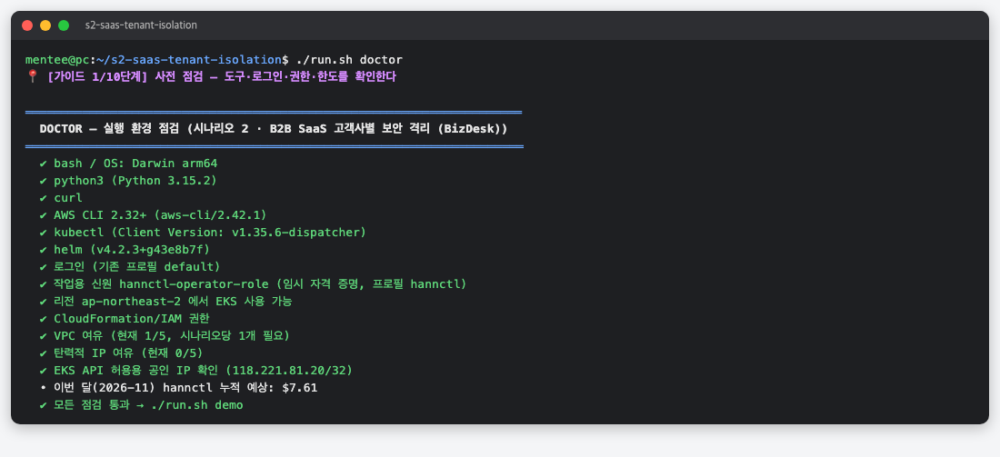

**정상이면** 모든 줄이 `✔` 이고 마지막 줄이 `✔ 모든 점검 통과 → ./run.sh demo` 다.

- `✘` 가 있으면 그 줄의 `→` 뒤 안내대로 해결하고 `./run.sh doctor` 를 다시 실행한다.
- `VPC 여유` 가 부족하다고 나오면 다른 시나리오를 먼저 `./run.sh down` 으로 지운다(시나리오 1개가 VPC 1개를 쓴다).

---

## 2단계 · 실행 시작

**할 일** — 첫 번째 터미널에서:

```bash
./run.sh demo
```

유지 시간을 묻는다. 그냥 **Enter** 를 누르면 6시간이다(만든 시각부터 6시간이 지나면 자동 삭제된다). 1~24 사이 숫자를 넣어도 된다.

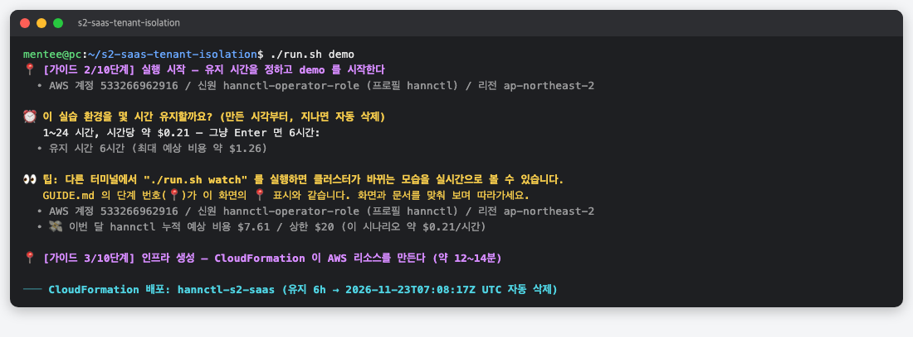

이어서 **두 번째 터미널**을 열고:

```bash
cd ~/hannctl_mentoring/s2-saas-tenant-isolation     # 새 터미널은 홈 폴더에서 시작하므로 시나리오 폴더로 이동
./run.sh watch
```

클러스터가 만들어지는 동안에는 대기 화면이 15초마다 갱신된다. 클러스터가 준비되면 자동으로 관찰 화면으로 바뀌므로 그대로 켜 둔다.

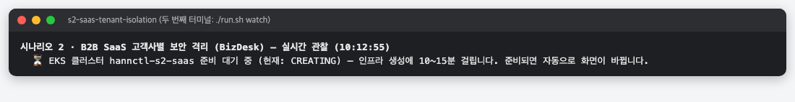

> 💡 Before 상태를 더 오래 살펴보고 싶으면 `./run.sh demo --before-wait 300` 처럼 관찰 시간(초)을 늘려서 시작한다(기본 60초).

---

## 3단계 · 인프라 생성

> 📍 터미널: `[가이드 3/10단계] 인프라 생성` · 약 12분 · 자동 진행

**화면에 나오는 것** — CloudFormation 이 리소스를 하나씩 만든다. `…` 는 만드는 중, `✔` 는 완료다. 왼쪽 `[ 0m34s]` 는 시작 후 지난 시간이다.

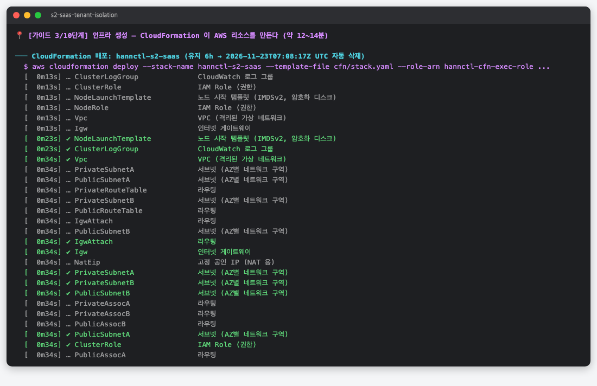

만드는 순서는 VPC·서브넷 → NAT → **EKS 클러스터(약 8~9분, 가장 오래 걸림)** → 애드온 → 고객사 운영자 IAM 역할·Access Entry → 노드 그룹(약 2분) 순서다.

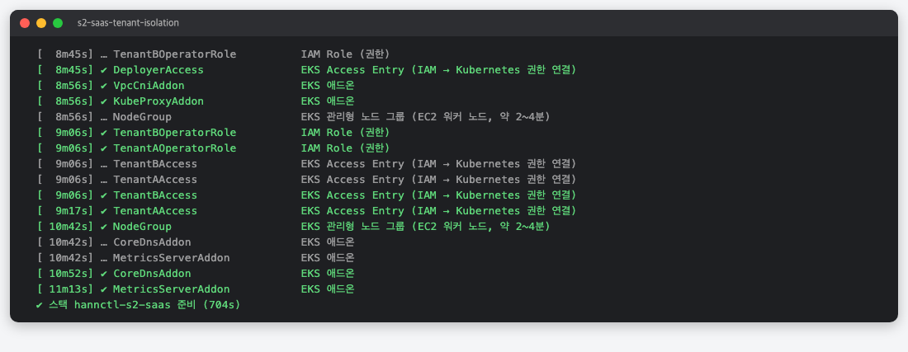

**정상이면** 마지막에 `✔ 스택 hannctl-s2-saas 준비 (약 700s)` 가 나온다.

### 🖥️ 콘솔에서 같이 보기

**CloudFormation** → **스택** → `hannctl-s2-saas` → **리소스** 탭. 새로 고침(⟳)을 누를 때마다 `CREATE_IN_PROGRESS` 가 `CREATE_COMPLETE` 로 바뀌어 간다.

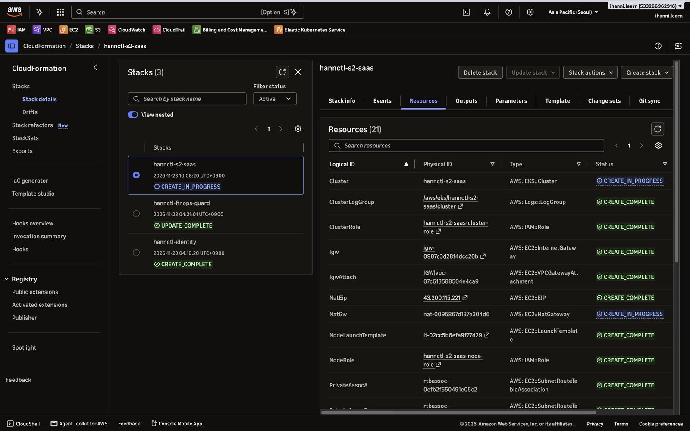

**Elastic Kubernetes Service** → **클러스터** → `hannctl-s2-saas`. 처음에는 상태가 **Creating** 이다.

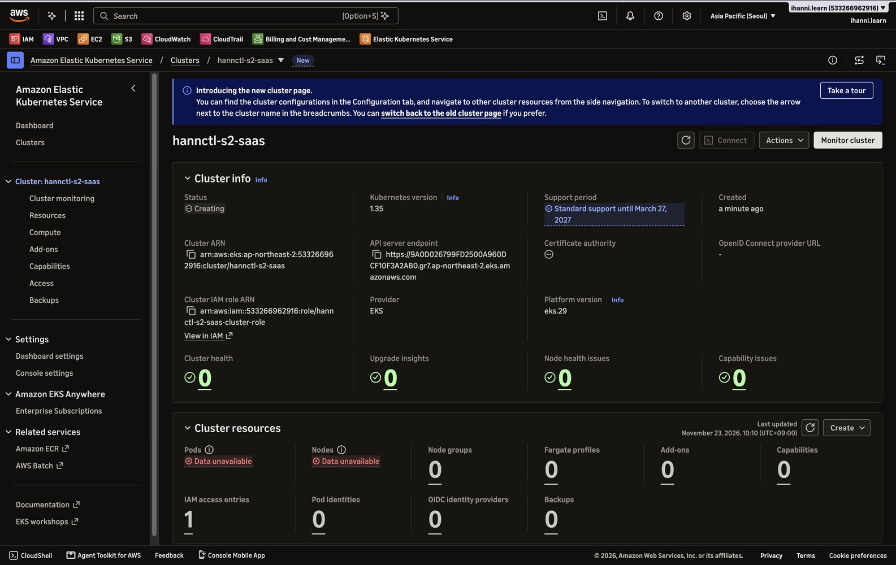

모두 끝나면 스택 상태가 `CREATE_COMPLETE` 가 된다.

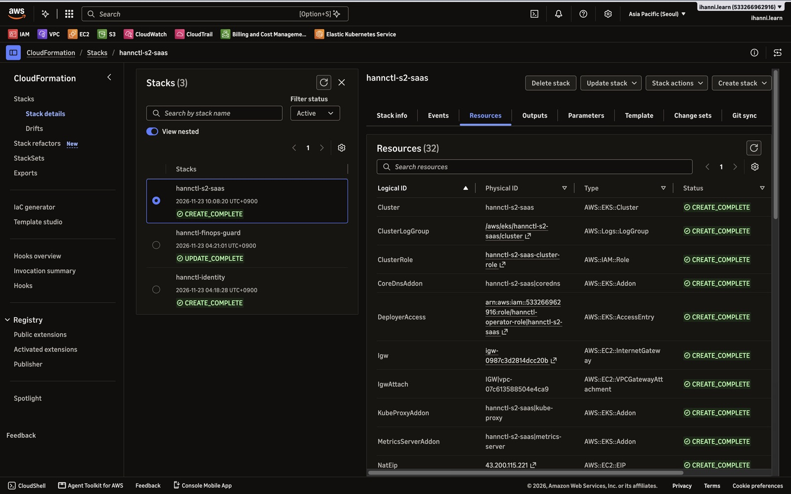

---

## 4단계 · 클러스터 기본 구성

> 📍 터미널: `[가이드 4/10단계] 클러스터 기본 구성` · 약 1분 · 자동 진행

**화면에 나오는 것** — 노드가 Ready 가 될 때까지 기다린 뒤, 정책 엔진 Kyverno 를 설치하고, 고객사 A(`tenant-a`)·B(`tenant-b`)에 각각 web·api 앱을 배포한다.

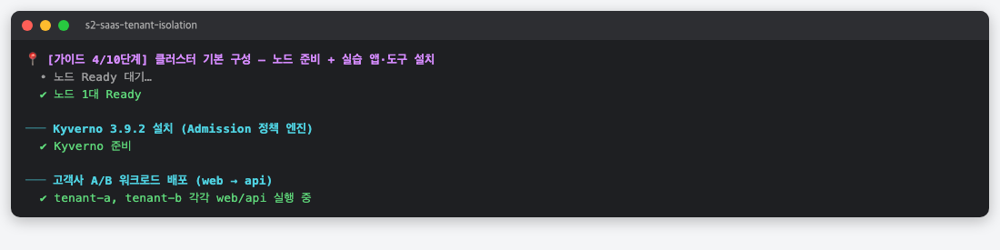

**정상이면** `✔ tenant-a, tenant-b 각각 web/api 실행 중` 이 나오고 바로 5단계로 넘어간다.

### 🖥️ 콘솔에서 같이 보기

**EKS** → `hannctl-s2-saas` → 왼쪽 **Compute**: 노드 1대가 **Ready** 다.

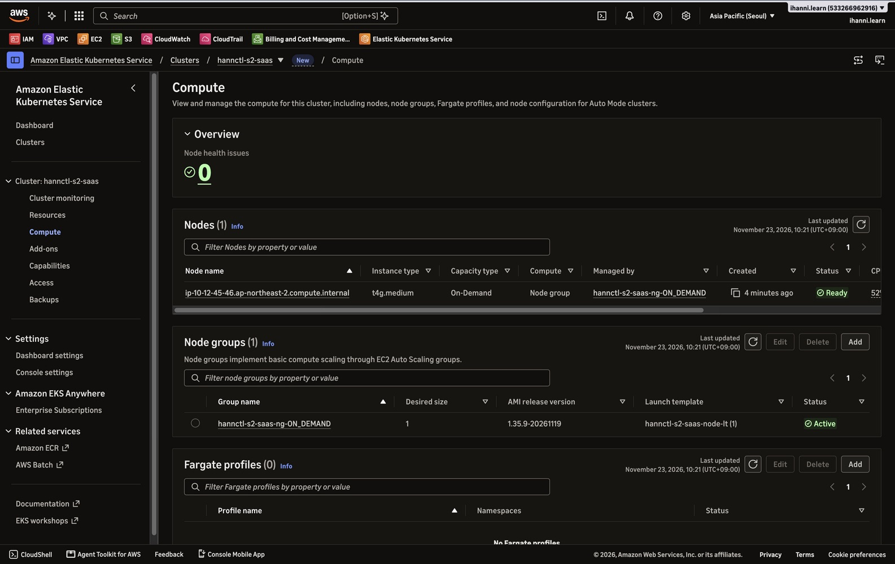

왼쪽 **Resources**: Pod·Deployment 가 모두 Running 이다.

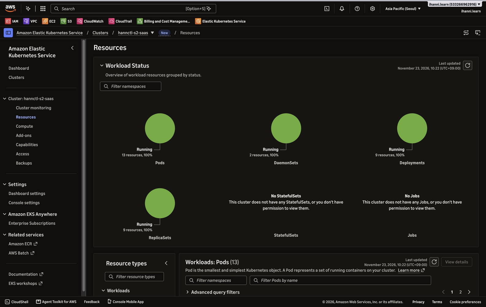

> 콘솔에서 노드·Pod 를 볼 수 있도록, 콘솔에 로그인한 사용자에게 이 클러스터의 **읽기 전용** 권한이 자동으로 주어진다(`• AWS 콘솔에서도 노드·Pod 를 볼 수 있도록 …` 안내가 한 번 나온다). 콘솔에 `Unauthorized` 나 `forbidden` 이 보이면 1~2분 뒤 새로 고침한다.

---

## 5단계 · Before (위험 재현)

> 📍 터미널: `[가이드 5/10단계] Before` · 약 40초 · 자동 진행

**무엇을 하나** — 일부러 보호 장치를 모두 뺀 상태를 만든다: NetworkPolicy 없음, Pod 보안(PSA) 없음, 두 고객사 운영자 모두 **클러스터 전체 edit 권한**. 그 상태에서 같은 테스트 20개를 실행해 위험이 실제로 일어나는지 확인한다.

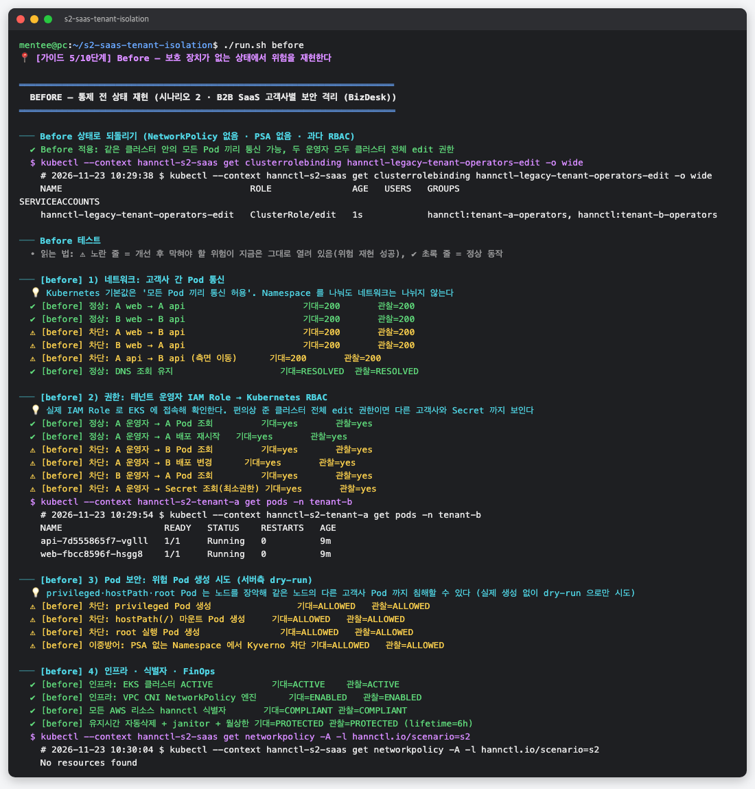

**읽는 법**

| 표시 | 의미 |
|---|---|
| `⚠` 노란 줄 | 개선 후 막혀야 할 위험이 **지금은 그대로 열려 있다** (위험 재현 성공) |
| `✔` 초록 줄 | 정상 동작 (같은 고객사 안의 통신, 인프라 상태 등) |
| `✘` 빨간 줄 | 기대와 다르다 → [문제 해결](#문제-해결) |

**정상이면** 아래처럼 위험이 재현된다.

| 테스트 | 관찰 | 뜻 |
|---|---|---|
| 차단: A web → B api | `200` ⚠ | A 고객사 앱이 B 고객사 내부 API 를 호출할 수 있다 |
| 차단: A 운영자 → B Pod 조회 | `yes` ⚠ | A 담당자가 B 고객사 Pod 를 볼 수 있다 (`get pods -n tenant-b` 결과가 실제로 출력됨) |
| 차단: A 운영자 → Secret 조회 | `yes` ⚠ | 운영자가 비밀값까지 읽을 수 있다 |
| 차단: privileged / hostPath / root Pod | `ALLOWED` ⚠ | 노드를 장악할 수 있는 Pod 를 만들 수 있다 |
| NetworkPolicy 조회 | `No resources found` | 네트워크 정책이 하나도 없다 |

### 👀 두 번째 터미널 (watch)

Namespace 보안 라벨(`ENFORCE`, `PROTECTED`)이 비어 있고, 권한은 `ClusterRole/edit` 하나(클러스터 전체), NetworkPolicy·Kyverno 정책은 `No resources found` 다.

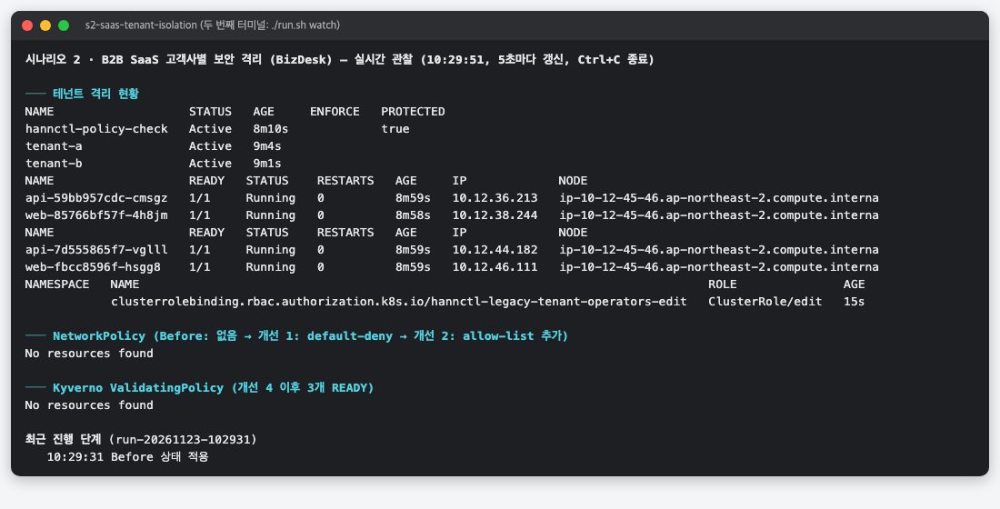

---

## 6단계 · Before 관찰

> 📍 터미널: `[가이드 6/10단계] Before 관찰` · 60초 카운트다운

카운트다운이 끝나면 자동으로 7단계로 넘어간다.

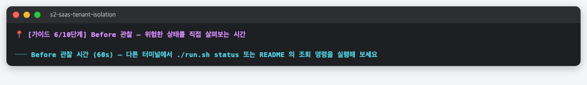

**할 일 (선택)** — 세 번째 터미널을 열어 위험을 직접 확인해 본다. 먼저 이 시나리오 전용 접속 설정을 불러온다.

```bash
cd ~/hannctl_mentoring/s2-saas-tenant-isolation     # 새 터미널은 홈 폴더에서 시작하므로 시나리오 폴더로 이동
eval "$(./run.sh kubeconfig)"
```

| 확인할 것 | 명령 | Before 결과 |
|---|---|---|
| A 앱 → B 내부 API 호출 | `kubectl -n tenant-a exec deploy/web -- python3 /app/app.py probe http://api.tenant-b.svc.cluster.local/tenant` | `200` (호출됨) |
| A 운영자로 B 고객사 조회 | `kubectl --context hannctl-s2-tenant-a get pods -n tenant-b` | B 의 Pod 목록이 보임 |
| 위험 Pod 생성 시도 (실제로 만들지 않음) | `kubectl apply -n tenant-a --dry-run=server -f k8s/attack/privileged-pod.yaml` | `pod/… created (server dry run)` |

60초가 짧으면 `demo` 가 끝난 뒤 [9단계의 "다시 해 보기"](#다시-해-보기)로 Before 상태를 다시 만들 수 있다.

---

## 7단계 · 개선 단계 1 ~ 4

> 📍 터미널: `[가이드 7/10단계] 개선 단계` · 약 1분 30초 · 자동 진행

개선 단계마다 같은 순서로 나온다: **변경 내용 → 📄 적용하는 설정 파일의 핵심 줄 → `$` 실행한 명령 → 즉시 확인(효과 측정) → 💡 배움 포인트**. 단계 사이에는 5초 쉰다.

### 개선 1/4 · 네트워크 기본 차단 (default-deny)

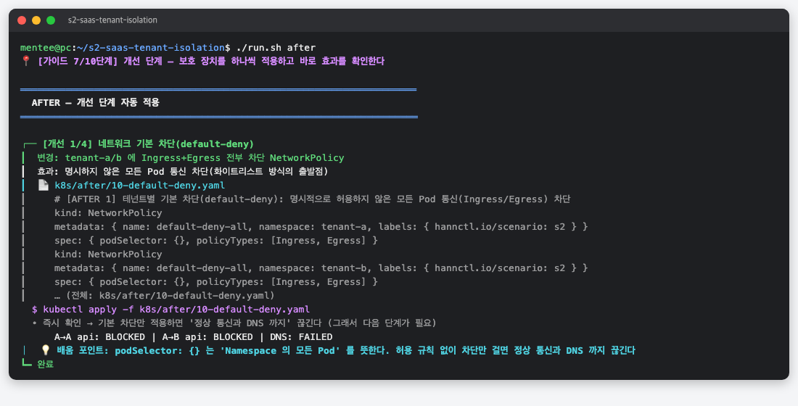

**여기가 이 시나리오에서 가장 중요한 순간이다.** 즉시 확인 결과가 `A→A api: BLOCKED | A→B api: BLOCKED | DNS: FAILED` 다. 다른 고객사로 가는 길만이 아니라 **같은 고객사 안의 정상 통신과 DNS 까지 끊겼다.** 차단만 걸면 서비스가 멈춘다는 것을 보여 준다.

watch 화면에는 고객사마다 `default-deny-all` 정책이 하나씩 생긴다.

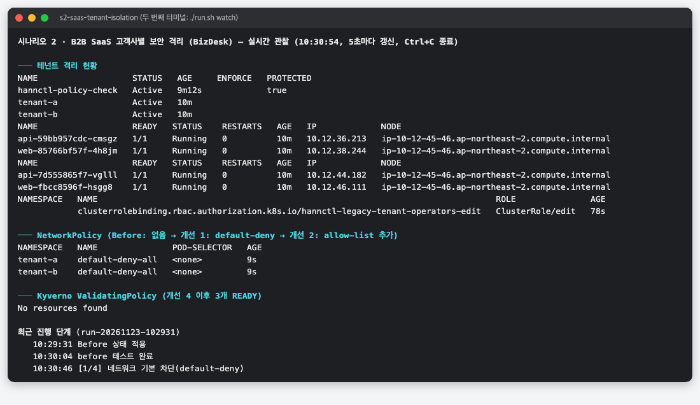

### 개선 2/4 · 필요한 통신만 허용 (allow-list)

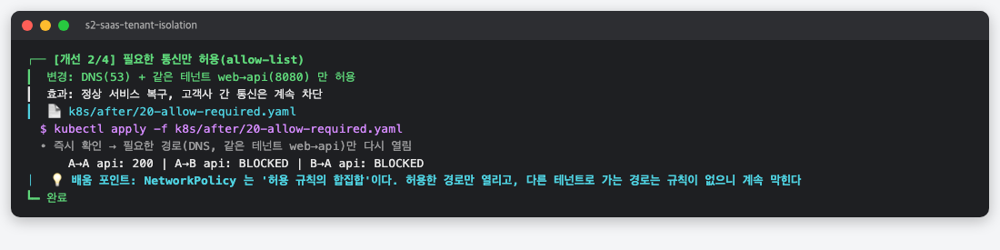

DNS(53)와 같은 고객사의 web→api(8080)만 연다. **정상이면** `A→A api: 200 | A→B api: BLOCKED | B→A api: BLOCKED` — 정상 서비스는 돌아오고 고객사 사이는 계속 막힌다.

### 개선 3/4 · 운영자 권한 최소화 (RBAC)

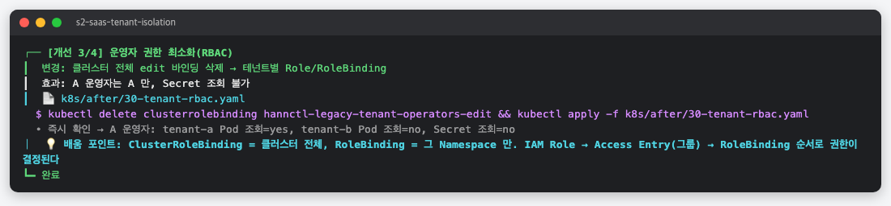

클러스터 전체 `edit` 권한을 지우고, 고객사별 Role(조회 + 배포 재시작만)을 준다. **정상이면** `tenant-a Pod 조회=yes, tenant-b Pod 조회=no, Secret 조회=no`.

### 개선 4/4 · 위험 Pod 차단 (PSA restricted + Kyverno)

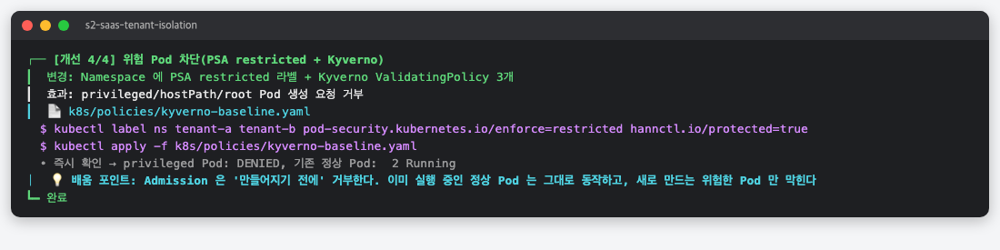

Namespace 에 PSA `restricted` 라벨을 붙이고 Kyverno 정책 3개를 적용한다. **정상이면** `privileged Pod: DENIED, 기존 정상 Pod: 2 Running` — 새 위험 Pod 는 거부되고, 이미 돌고 있던 앱은 그대로다.

### 👀 두 번째 터미널 (watch) — 개선이 끝난 모습

- Namespace: `ENFORCE=restricted`, `PROTECTED=true`
- 권한: `ClusterRole/edit` 가 사라지고 고객사별 `Role/hannctl-tenant-operator`
- NetworkPolicy: 고객사마다 4개(차단 1 + 허용 3)
- Kyverno 정책 3개 `READY=true`
- 맨 아래 **최근 진행 단계**에 개선 1~4가 시간순으로 쌓인다

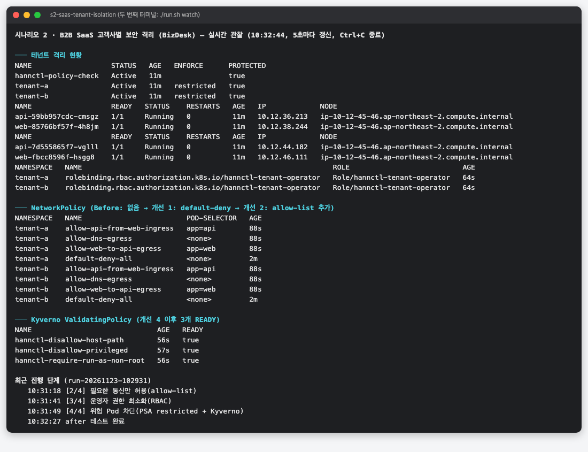

---

## 8단계 · After 테스트와 채점

> 📍 터미널: `[가이드 8/10단계] After 테스트·채점` · 약 40초 · 자동 진행

**무엇을 하나** — 5단계와 **똑같은 테스트**를 다시 실행한다. 같은 조건에서 비교해야 "개선됐다"고 말할 수 있다.

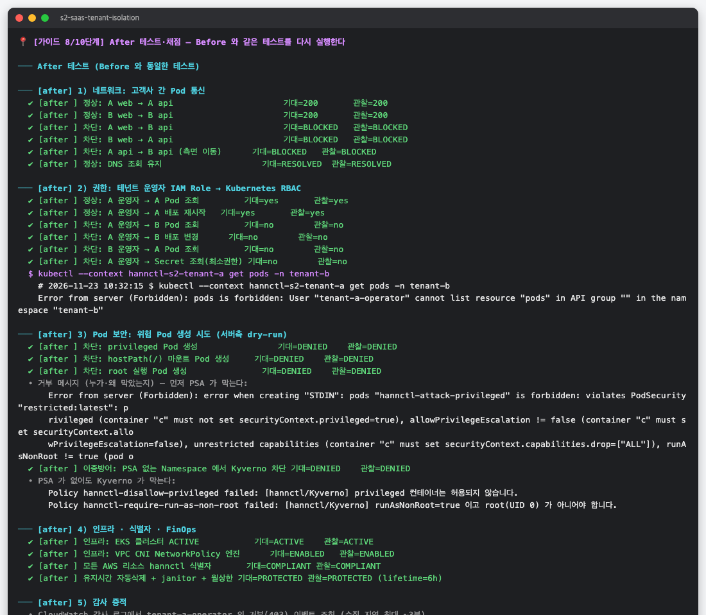

**정상이면** 모든 줄이 `✔` 초록이다.

- 교차 통신 `BLOCKED`, 같은 고객사 통신 `200`, DNS `RESOLVED`
- A 운영자: 자기 고객사는 `yes`, B 고객사·Secret 은 `no` (`Forbidden` 메시지가 실제로 출력됨)
- 위험 Pod `DENIED` + 누가 막았는지 거부 메시지 (먼저 PSA `violates PodSecurity "restricted:latest"`, PSA 가 없는 곳에서는 Kyverno `Policy hannctl-… failed`)
- 감사 로그 `FOUND` — 거부된 시도가 CloudWatch 에 기록됨 (수집 지연 때문에 최대 3분 기다릴 수 있다)

이어서 평가표로 자동 채점한다.

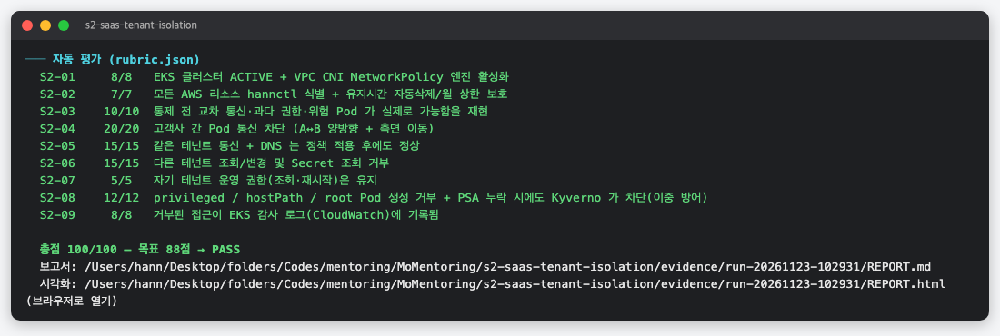

**정상이면** `총점 100/100 — 목표 88점 → PASS` (88점 이상이면 통과).

### 🖥️ 콘솔에서 같이 보기

**EKS** → `hannctl-s2-saas` → 왼쪽 **Access**: IAM 역할이 Kubernetes 그룹과 어떻게 연결되는지 보인다. `hannctl-s2-saas-tenant-a-operator` 역할 → 그룹 `hannctl:tenant-a-operators`. 이 그룹에 개선 3에서 만든 RoleBinding 이 붙는다.

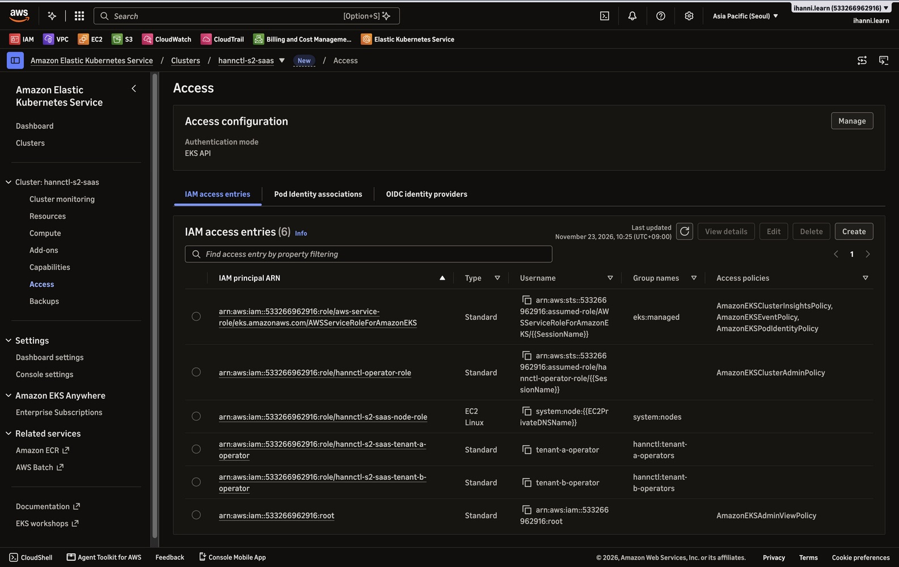

**CloudWatch** → **로그 관리** → 로그 그룹 `/aws/eks/hannctl-s2-saas/cluster` → **모든 로그 이벤트 검색**에 아래 필터를 넣고 Enter. 기간은 `1h`.

```text
{ $.user.username = "tenant-a-operator" && $.responseStatus.code = 403 }
```

거부(403) 이벤트를 펼치면 **누가**(`tenant-a-operator`, 역할 `hannctl-s2-saas-tenant-a-operator`), **무엇을**(`/api/v1/namespaces/tenant-b/pods`, `list`) 하려다 막혔는지 나온다.

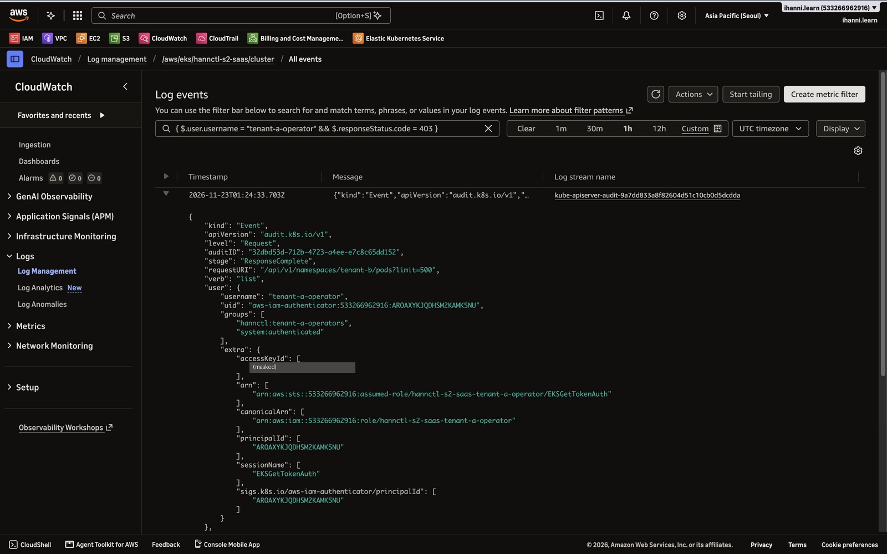

---

## 9단계 · 결과 확인

> 📍 터미널: `[가이드 9/10단계] 결과 확인`

마지막 줄에 `✔ 데모 총 소요 N분 — 보고서: evidence/run-…/REPORT.md (.html)` 가 나오면 `demo` 가 끝난 것이다.

보고서 `evidence/latest/REPORT.html` 이 브라우저로 열린다. 열리지 않으면 직접 연다.

```bash
open evidence/latest/REPORT.html        # macOS
xdg-open evidence/latest/REPORT.html    # Linux
cat evidence/latest/REPORT.md           # 터미널에서 보기 (CloudShell 포함)
```

CloudShell 에서는 오른쪽 위 **작업(Actions) → 파일 다운로드**에 `pwd` 결과 뒤 `/evidence/latest/REPORT.html` 을 붙인 경로를 넣어 내려받는다.

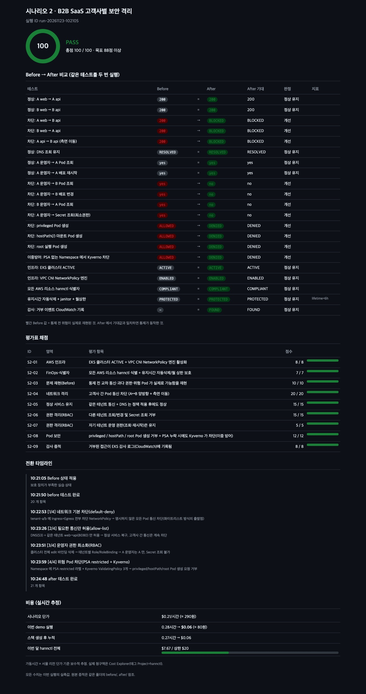

| 보고서 부분 | 보는 법 |
|---|---|
| 점수 원 | 총점과 PASS/FAIL |
| Before → After 비교 | 빨간 Before 값 = 실제로 재현된 위험, After 가 기대값과 같으면 통제가 동작한 것. `→` 는 개선, `=` 는 정상 유지 |
| 평가표 채점 | 항목별 점수 (기준은 [RUBRIC.md](RUBRIC.md)) |
| 전환 타임라인 | Before 적용 → 개선 1~4 → After 테스트 시각 |
| 비용 | 이번 실행·스택 누적·이번 달 hannctl 전체 비용 추정 |

### 다시 해 보기

인프라를 그대로 둔 채 단계만 다시 실행할 수 있다. 발표 리허설이나 6단계 관찰을 천천히 할 때 쓴다.

| 명령 | 하는 일 | 시간 |
|---|---|---|
| `./run.sh before` | 보호 장치를 모두 빼고 Before 테스트 (5단계) | 약 40초 |
| `./run.sh after` | 개선 1~4 적용 + After 테스트 + 채점 (7~8단계) | 약 2분 |
| `./run.sh demo` | 5~9단계 전체 (인프라가 있으면 바로 Before 부터) | 약 4분 |
| `./run.sh status` | 스택·클러스터·노드 상태와 남은 유지 시간 | 몇 초 |

---

## 10단계 · 삭제

> 📍 터미널: `[가이드 10/10단계] 삭제` · 약 8~10분

**할 일** — 실습이 끝나면 반드시 실행한다. 두 번째 터미널의 watch 는 `Ctrl+C` 로 먼저 끈다.

```bash
./run.sh down
```

**화면에 나오는 것** — CloudFormation 이 만든 순서의 반대로 리소스를 지운다. `🗑 … 삭제됨` 이 하나씩 쌓인다. 노드 그룹(약 3~4분)과 EKS 클러스터(약 3분) 삭제가 가장 오래 걸린다.

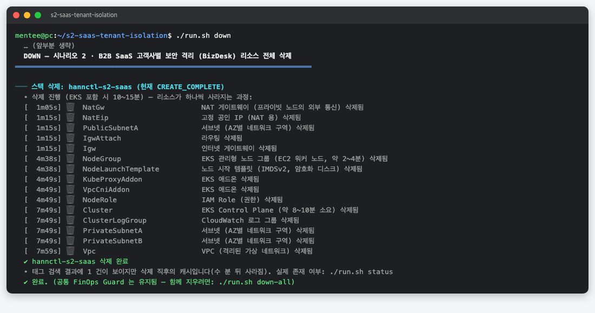

**정상이면** `✔ hannctl-s2-saas 삭제 완료` 다음에 `✔ 완료. (공통 FinOps Guard 는 유지됨 …)` 가 나온다. 공통 안전장치(`hannctl-finops-guard`)는 다음 실습을 위해 남겨 두는 것이다(비용 0원 수준).

> `태그 검색 결과에 1 건이 보이지만 삭제 직후의 캐시입니다` 줄이 함께 나올 수 있다. AWS 태그 검색이 몇 분 늦게 갱신되기 때문이며 실제로 남은 리소스는 아니다.

### 🖥️ 콘솔에서 같이 보기

**CloudFormation** → `hannctl-s2-saas` 의 상태가 `DELETE_IN_PROGRESS` 가 되고, 리소스가 하나씩 `DELETE_COMPLETE` 로 바뀐다. 다 지워지면 스택 목록(필터 **활성**)에서 사라진다.

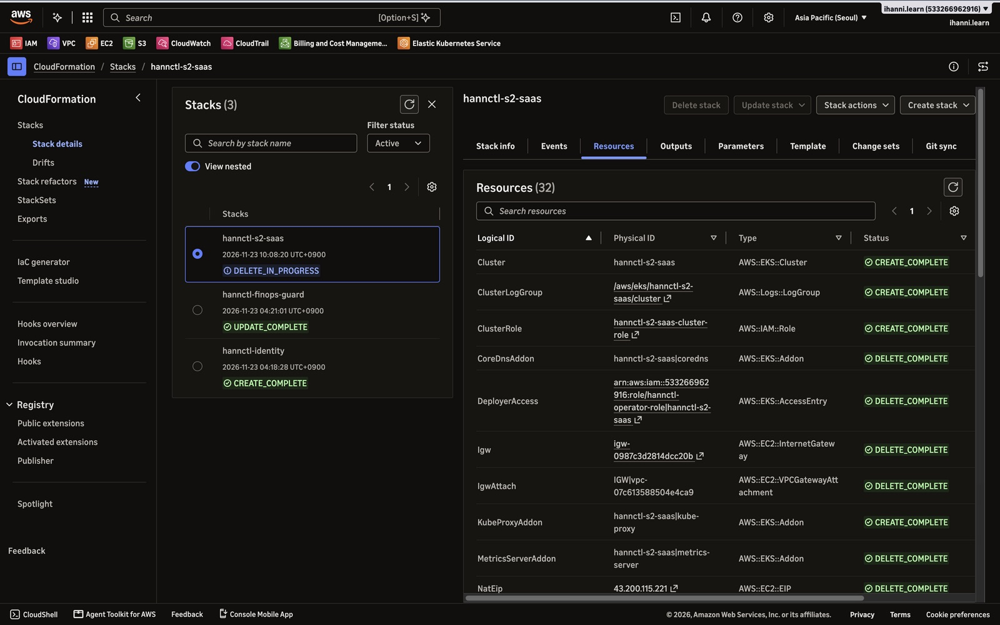

**남은 것이 없는지 확인**

```bash
./run.sh status          # "! 스택 없음" 이 나오면 이 시나리오 리소스는 모두 지워진 것
```

- 중간에 실패하면 `./run.sh down` 을 한 번 더 실행한다.
- 모든 시나리오를 끝냈으면 `./run.sh down-all` 로 공통 안전장치까지 지운다. 다른 시나리오 스택이 남아 있으면 지우지 않는다.
- `down` 을 잊어도 2단계에서 정한 유지 시간(기본 6시간)이 지나면 자동으로 삭제된다. 그래도 끝나면 바로 지우는 것이 원칙이다.

---

## 문제 해결

| 증상 | 해결 |
|---|---|
| 1단계에 `✘` | 그 줄의 `→` 안내대로 하고 `./run.sh doctor` 다시 실행 |
| 3단계 도중 터미널이 꺼짐 / CloudShell 세션 끊김 | 다시 접속해 같은 폴더에서 `./run.sh status` → 상태가 `CREATE_COMPLETE` 가 되면 `./run.sh demo` 다시 실행 (만든 인프라는 이어서 쓴다) |
| 8단계에 `✘` 가 있음 | `./run.sh after` 한 번 더 실행. 감사 로그 항목만 `✘` 면 1~3분 뒤 다시 실행 |
| 콘솔 EKS 화면에 `Unauthorized` / `forbidden` | 1~2분 뒤 새로 고침. 그래도 같으면 `./run.sh up` 을 한 번 실행 |
| kubectl 이 `Unauthorized` / 타임아웃 | 내 공인 IP 가 바뀌었을 수 있다 → `./run.sh up` (EKS API 허용 IP 갱신) |
| `Unable to parse config file: …/.aws/config` | [START_HERE.md 문제 해결](START_HERE.md) 참고 |

그 밖의 문제는 [START_HERE.md](START_HERE.md) 의 문제 해결 표를 본다.
