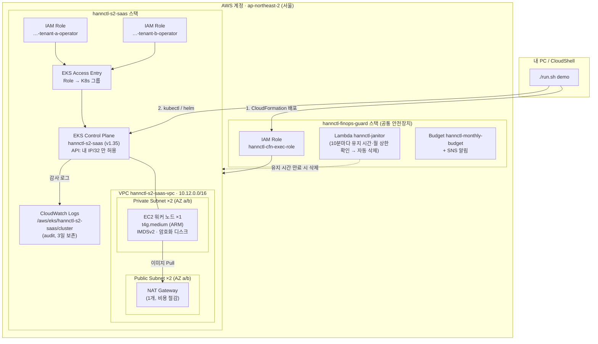
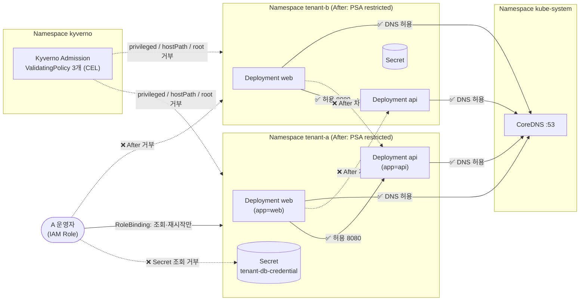
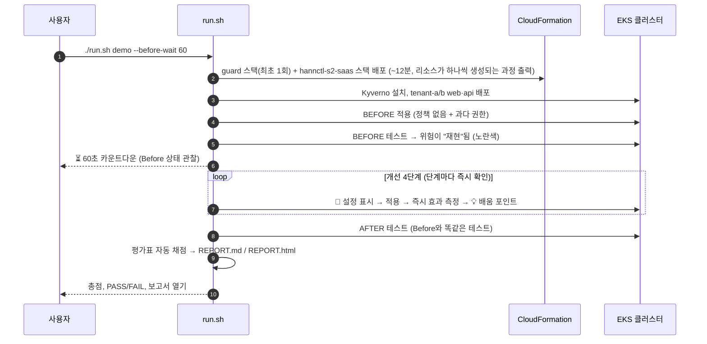

# 시나리오 2 · B2B SaaS 고객사별 보안 격리 (BizDesk) — 해설서

> ▶ **실습은 [GUIDE.md](GUIDE.md) 하나만 보고 따라간다** (내려받기·준비도 GUIDE.md 0단계에 있다).
> 이 문서는 시나리오의 배경·원리·직접 구성 방법·발표 포인트를 담은 해설서다.

> **한 줄 요약**
> 고객사 A와 B가 **같은 EKS 클러스터**를 같이 쓰더라도
> ① A의 프로그램이 B의 내부 API를 부를 수 없고,
> ② A의 운영자가 B의 리소스를 볼 수 없으며,
> ③ 위험한 Pod는 아예 만들어지지 않게 하는 것.
> 이 세 가지를 **실제로 차단되는 모습과 정상 서비스가 계속 유지되는 모습**으로 증명한다.

| 항목 | 내용 |
|---|---|
| 난이도 | ★★★☆☆ (3/5) — 네트워크·권한 개념이 핵심, 코드 작성은 거의 없음 |
| 핵심 기술 | Amazon EKS, VPC CNI **NetworkPolicy**, Kubernetes **RBAC**, EKS **Access Entry**(IAM↔K8s), **PSA**, **Kyverno**, CloudWatch 감사 로그 |
| 소요 시간 | 처음 `demo` 약 17~20분(인프라 생성 약 12분 포함), 스택이 있을 때 재실행 약 4분, 삭제(`down`) 약 8~10분 |
| 예상 비용 | 약 **$0.21/시간(≈290원)**, demo 1회(삭제까지) 약 **$0.09(≈130원)** — 자세한 내용은 [9장](#9-비용-안전장치-삭제-finops) |
| 과정 요구사항 연결 | 접근·네트워크 통제(RBAC 최소권한, NetworkPolicy 네임스페이스 격리), 정책 기반 통제(PSS/Kyverno), 감사 로그 |

---

## 🎯 이 시나리오의 초점 (먼저 읽기)

| 구분 | 내용 |
|---|---|
| **핵심 포커스** | 하나의 EKS를 함께 쓰는 고객사 사이의 **격리**를 두 축으로 구현·증명한다 — ① **Pod↔Pod 네트워크**, ② **사람↔Kubernetes API 권한** |
| **Kubernetes 보안 비중** | ★★★★★ — 모든 개선 단계가 Kubernetes 보안 통제다 |
| **가장 중요하게 보는 것** | ① 다른 고객사로 가는 통신은 막되 **정상 통신·DNS는 유지** ② 운영자 권한을 **자기 Namespace로 한정**하고, IAM → Access Entry → RBAC 연결을 이해 ③ 위험 Pod를 **만들어지기 전에** 거부(PSA + Kyverno **이중 방어**) |

**무엇을 사용하나 (계층별)**

| 계층 | 사용 기술 | 이 시나리오에서 하는 일 |
|---|---|---|
| AWS 인프라 | VPC(프라이빗 노드) · EKS · NAT | 실습 기반 |
| AWS IAM ↔ K8s | IAM Role ×2 + **EKS Access Entry** | 운영자가 **누구인지** 결정(K8s 그룹으로 매핑) |
| K8s API 권한 | **RBAC** Role / RoleBinding | 운영자가 **무엇을 할 수 있는지** 결정 |
| Pod 생성 통제 | **PSA** restricted + **Kyverno** ValidatingPolicy | 위험한 Pod를 생성 전에 거부 |
| Pod 네트워크 | **NetworkPolicy** (VPC CNI가 eBPF로 강제) | 고객사 간 통신 차단 |
| 감사 | EKS audit log → CloudWatch Logs | 거부된 시도가 기록으로 남음 |

**전 → 후: 무엇이 개선되나 (실측)**

| # | 개선(통제) | 영역 | Before → After | 왜 중요한가 |
|---|---|---|---|---|
| 1 | default-deny NetworkPolicy | K8s 네트워크 보안 | A→B `200` → `BLOCKED` *(이때 A→A·DNS도 끊김)* | "기본 차단"에서 출발하는 화이트리스트 설계 |
| 2 | allow-list (DNS, 같은 테넌트 web→api) | K8s 네트워크 보안 | A→A 다시 `200`, A↔B는 계속 `BLOCKED` | 보안과 가용성을 함께 지킴 |
| 3 | 테넌트별 Role/RoleBinding | K8s 접근 통제 | A 운영자의 B 조회·Secret 조회 `yes` → `no` | 최소 권한, 피해 범위 축소 |
| 4 | PSA restricted + Kyverno | K8s 정책 통제 | 위험 Pod 3종 `ALLOWED` → `DENIED`, PSA가 빠진 Namespace도 `DENIED` | 사전 예방 + 이중 방어 |
| ✓ | (검증) 감사 로그 | 감사 증적 | – → 403 이벤트 `FOUND` | "막았다"를 기록으로 증명 |

**다루지 않는 것 (범위 밖)**: 노드·클러스터를 나누는 강한 멀티테넌시, HTTP 경로 단위(L7) 통제·서비스 메시, 이미지 공급망 보안(→ 시나리오 3), Secret 외부 관리(→ 시나리오 5)

---

## 0. 가장 빠른 사용법 (명령 1개)

```bash
cd s2-saas-tenant-isolation
./run.sh demo                      # 전부 자동: (유지 시간 선택) → 인프라 생성 → Before 재현 → 60초 후 자동 개선 → After 검증 → 채점
./run.sh demo --before-wait 180    # Before 상태를 3분 동안 관찰하고 넘어가기
./run.sh down                      # 끝나면 전부 삭제 (잊어도 처음 정한 유지 시간, 기본 6시간 뒤 자동 삭제)
```

`demo`가 끝나면 `evidence/latest/REPORT.html`이 열린다(열리지 않으면 [START_HERE.md](START_HERE.md) 5단계 참고). 점수, Before→After 비교, 전환 타임라인을 한 화면에서 볼 수 있다.
진행되는 동안 **다른 터미널에서 `./run.sh watch`** 를 켜 두면 Namespace 보안 라벨, Pod, NetworkPolicy, Kyverno 정책, 권한(RoleBinding)이 바뀌는 모습을 5초마다 볼 수 있다(새 터미널에서도 이 폴더로 `cd` 한 뒤 실행).
> `demo` 를 시작하자마자 켜도 된다. 클러스터가 만들어지는 동안(약 10~15분)은 `⏳ EKS 클러스터 hannctl-s2-saas 준비 대기 중` 화면이 15초마다 갱신되고, 클러스터가 준비되면 자동으로 관찰 화면으로 바뀐다. 끝낼 때는 `Ctrl+C`.

> 처음 한 번 필요한 것: 내 AWS 계정에 관리자로 콘솔 로그인할 수 있으면 된다. 처음 실행할 때 브라우저 로그인으로 임시 자격 증명을 받고, 작업용 역할 `hannctl-operator-role` 이 자동으로 만들어진다(Access Key·`aws configure` 불필요). python3·AWS CLI·kubectl·helm 등은 **없는 것만 자동 설치**된다. 자세한 준비는 [START_HERE.md](START_HERE.md) 참고.
> macOS, Ubuntu, CentOS/Rocky, AWS CloudShell에서 동작한다.

---

## 1. 실무에서는 어떤 상황인가? (왜 이걸 배우나)

**BizDesk**는 여러 회사(고객사)에게 업무 프로그램을 빌려주는 **SaaS 회사**다.
고객사마다 클러스터를 따로 만들면 비용이 너무 커서, **하나의 EKS 클러스터에 고객사별 Namespace(`tenant-a`, `tenant-b`)를 나눠** 운영한다.

여기서 흔한 **오해**가 있다.

> ❌ "Namespace를 나눴으니 고객사끼리 자동으로 격리되겠지?"

**아니다.** Kubernetes의 기본값은 이렇다.

| 구분 | 기본 동작 | 실제 사고로 이어지는 예 |
|---|---|---|
| Pod 네트워크 | 클러스터 안의 **모든 Pod가 서로 통신 가능** | A사 앱이 해킹되면 공격자가 B사 내부 API를 호출해 데이터를 빼냄(**측면 이동**) |
| 운영자 권한 | 편의상 넓게 준 권한이 그대로 남음 | A사 담당 운영자가 실수/악의로 B사 서비스를 재시작·조회 |
| Pod 설정 | privileged·hostPath·root Pod 생성이 막혀 있지 않음 | 한 고객사 Pod가 **노드 전체를 장악**해 다른 고객사 Pod까지 침해 |

실제로 멀티테넌트 서비스의 감사나 보안 점검에서 가장 먼저 받는 질문이 "**고객사 간 격리를 어떻게 증명하나요?**"다.
이 시나리오는 그 질문에 **테스트 결과로** 답하는 연습이다.

---

## 2. 이 시나리오의 목표 (완료 기준)

| # | 목표 | 증명 방법 |
|---|---|---|
| 1 | A→A, B→B 통신과 DNS는 **계속 정상** | web Pod에서 같은 테넌트 api 호출 → `200` |
| 2 | A↔B 교차 통신은 **차단** | web/api Pod에서 다른 테넌트 api 호출 → `BLOCKED` |
| 3 | A 운영자는 **A만** 조회·재시작, B 조회와 Secret 조회는 **거부** | 실제 IAM Role로 접속해 `kubectl auth can-i` → `yes`/`no` |
| 4 | privileged·hostPath·root Pod는 **생성 거부** | 서버측 dry-run → `DENIED` + 거부 메시지 |
| 5 | 거부된 접근이 **감사 로그에 남음** | CloudWatch Logs의 EKS audit 로그에서 403 이벤트 |
| 6 | 모든 AWS 리소스가 **hannctl 식별자**와 **자동 삭제(유지 시간)** 를 가짐 | 태그 감사 + janitor 존재 확인 |

**평가 목표: 100점 만점 중 88점 이상**. 평가표는 [`RUBRIC.md`](RUBRIC.md)에 있고, `demo`가 끝나면 자동으로 채점된다.

---

## 3. 전체 구성도

### 3-1. AWS 인프라 (CloudFormation `cfn/stack.yaml` 하나로 생성)



### 3-2. EKS 내부 (Kubernetes 리소스)



### 3-3. 한 요청이 거치는 "통제 지점" (계층별로 무엇이 막나)

```text
 [AWS IAM]          누가 EKS 에 로그인할 수 있나?      → IAM Role + EKS Access Entry
     │
 [K8s RBAC]         로그인한 사람이 무엇을 할 수 있나? → Role / RoleBinding (Namespace 단위)
     │
 [Admission]        만들려는 Pod 가 안전한가?          → PSA(restricted) + Kyverno
     │
 [NetworkPolicy]    실행 중인 Pod 가 누구와 통신하나?  → default-deny + allow-list (VPC CNI 가 eBPF 로 강제)
     │
 [Audit Log]        위 모든 요청의 기록               → CloudWatch Logs (EKS audit)
```

> 💡 **꼭 구분할 것**: **IAM**은 AWS API 권한, **RBAC**은 Kubernetes API 권한, **NetworkPolicy**는 Pod 간 네트워크 통신이다. 세 가지는 **서로 다른 계층**이며 하나가 다른 것을 대신하지 못한다.

---

## 4. 자동 진행 순서 — `./run.sh demo`가 하는 일



### 4-1. 단계별로 무엇이 바뀌고 왜 중요한가

| 단계 | 무엇을 하나 (변경) | 바로 보이는 변화 | 왜 중요한가 (핵심 포인트) |
|---|---|---|---|
| **BEFORE** | NetworkPolicy 없음, PSA 없음, 두 운영자에게 **클러스터 전체 `edit`** 권한 | A→B 호출 `200`, A 운영자 B 조회 `yes`, privileged Pod `ALLOWED` | 문제를 **먼저 눈으로 재현**해야 개선을 증명할 수 있다 |
| **개선 1** default-deny | 각 테넌트에 "모든 통신 차단" 정책 | ⚠️ A→B 뿐 아니라 **A→A, DNS까지 끊긴다** | **가장 중요한 학습 지점**: 차단만 하면 서비스가 죽는다. 보안과 가용성을 함께 봐야 한다 |
| **개선 2** allow-list | DNS(53), 같은 테넌트 web→api(8080)만 허용 | A→A `200` 복구, A→B는 계속 `BLOCKED` | "필요한 것만 연다"는 **화이트리스트** 설계 |
| **개선 3** RBAC | 전체 `edit` 바인딩 삭제 → 테넌트별 Role (조회·재시작만) | A 운영자: A 조회 `yes`, B 조회 `no`, Secret 조회 `no` | 사람의 권한도 **최소 권한**으로. 업무에 필요한 것(재시작)은 남긴다 |
| **개선 4** Pod 보안 | Namespace에 PSA `restricted` 라벨, Kyverno 정책 3개 | privileged Pod `DENIED`, 기존 정상 Pod는 계속 `Running` (PSA·Kyverno 거부 메시지는 이어지는 After 테스트에서 출력) | 위험한 설정을 **만들어지기 전에** 거부한다(사후 탐지보다 사전 예방) |
| **AFTER** | Before와 **똑같은 테스트** 재실행 + 감사 로그 확인 | 교차 통신·교차 권한·위험 Pod 모두 차단, 정상 경로 유지 | 같은 조건에서 비교해야 개선이라고 말할 수 있다 |

### 4-2. "이렇게 설정하면 → 이렇게 된다" (설정 · 결과 · 배운 점)

`demo` 화면의 각 개선 단계에는 **📄 적용하는 설정 파일의 핵심 줄**, **적용 직후 측정값**, **💡 배움 포인트**가 순서대로 나온다. 아래 표는 그 내용을 정리한 것이다.

| 설정 (파일 · 핵심 줄) | 결과 (화면에 보이는 값) | 배운 점 |
|---|---|---|
| `k8s/after/10-default-deny.yaml`<br>`podSelector: {}`<br>`policyTypes: [Ingress, Egress]` | A→A `BLOCKED`, A→B `BLOCKED`, DNS `FAILED` | `podSelector: {}` 는 "이 Namespace의 **모든** Pod". 허용 없이 차단만 하면 정상 서비스도 멈춘다 |
| `k8s/after/20-allow-required.yaml`<br>`to: kube-dns, ports: 53`<br>`from: app=web → app=api :8080` | A→A `200`, A→B `BLOCKED` | NetworkPolicy는 **허용 규칙의 합집합**. 열어 준 길만 통하고, 다른 테넌트로 가는 길은 규칙이 없으니 막힌다 |
| `k8s/after/30-tenant-rbac.yaml`<br>`kind: Role (namespace: tenant-a)`<br>`verbs: [get, list, watch]` + `deployments: [patch]` | A 운영자: A 조회 `yes`, B 조회 `no`, Secret `no` | **ClusterRoleBinding = 클러스터 전체, RoleBinding = 그 Namespace만**. 권한은 IAM Role → Access Entry(그룹) → RoleBinding 순으로 결정된다 |
| `kubectl label ns … pod-security.kubernetes.io/enforce=restricted`<br>`k8s/policies/kyverno-baseline.yaml` | 위험 Pod `DENIED`, 기존 Pod는 `Running` 유지 (After 테스트에서 PSA 거부 메시지 `violates PodSecurity "restricted:latest"` 와 Kyverno 거부 메시지 `Policy hannctl-… failed` 출력) | Admission은 **만들어지기 전에** 거부한다. 실행 중인 정상 Pod에는 영향이 없다 |

### 4-3. Before → After 기대 결과표

| 테스트 | Before | After | 의미 |
|---|---|---|---|
| A web → A api | 200 | **200** | 정상 업무는 유지 |
| B web → B api | 200 | **200** | 정상 업무는 유지 |
| A web → B api | 200 ⚠️ | **BLOCKED** | 고객사 간 데이터 접근 차단 |
| B web → A api | 200 ⚠️ | **BLOCKED** | 양방향 모두 확인 |
| A api → B api | 200 ⚠️ | **BLOCKED** | 내부 API끼리의 측면 이동 차단 |
| DNS 조회 | RESOLVED | **RESOLVED** | default-deny 후에도 DNS 허용 확인 |
| A 운영자 → A Pod 조회 | yes | **yes** | 자기 업무는 가능 |
| A 운영자 → A 배포 재시작 | yes | **yes** | 운영에 필요한 권한 유지 |
| A 운영자 → B Pod 조회 | yes ⚠️ | **no** | 다른 고객사 접근 거부 |
| A 운영자 → B 배포 변경 | yes ⚠️ | **no** | 다른 고객사 변경 거부 |
| A 운영자 → Secret 조회 | yes ⚠️ | **no** | 운영자도 비밀값은 볼 필요가 없다 |
| privileged / hostPath / root Pod | ALLOWED ⚠️ | **DENIED** | 노드 장악 가능한 Pod 차단 (먼저 PSA 가 거부) |
| PSA 라벨이 빠진 Namespace 의 privileged Pod | ALLOWED ⚠️ | **DENIED** | **이중 방어**: PSA 를 깜빡해도 Kyverno 가 막는다 |
| 감사 로그 403 이벤트 | – | **FOUND** | "막았다"는 사실이 기록으로 남음 |

---

## 5. 직접 조회해 보기 — 명령어 순서 (발표 리허설, 이해 확인용)

`demo`는 모든 것을 자동으로 하지만, **원리를 이해하려면** 아래 명령을 순서대로 직접 실행해 보자. 먼저 kubeconfig를 지정한다.

```bash
eval "$(./run.sh kubeconfig)"        # 이 시나리오 전용 kubeconfig (내 ~/.kube/config 는 건드리지 않음)
```

| 순서 | 무엇을 보나 | 명령 |
|---|---|---|
| 1 | AWS에 무엇이 생겼나 | `./run.sh status` |
| 2 | 노드와 Pod | `kubectl get nodes -o wide` / `kubectl get pods -n tenant-a -o wide` |
| 3 | NetworkPolicy 엔진이 켜졌나 | `aws eks describe-addon --cluster-name hannctl-s2-saas --addon-name vpc-cni --query addon.configurationValues` |
| 4 | 교차 통신 직접 시도 | `kubectl -n tenant-a exec deploy/web -- python3 /app/app.py probe http://api.tenant-b.svc.cluster.local/tenant` |
| 5 | 적용된 네트워크 정책 | `kubectl get networkpolicy -A` / `kubectl describe networkpolicy allow-web-to-api-egress -n tenant-a` |
| 6 | A 운영자로 접속해 보기 | `kubectl --context hannctl-s2-tenant-a get pods -n tenant-a` (성공) / `-n tenant-b` (Forbidden) |
| 7 | 권한 목록 | `kubectl --context hannctl-s2-tenant-a auth can-i --list -n tenant-a` (첫 줄 `Warning: the list may be incomplete` 는 EKS 가 webhook 인가를 함께 쓰기 때문에 나오는 정상 안내다) |
| 8 | IAM ↔ K8s 연결 | `aws eks list-access-entries --cluster-name hannctl-s2-saas` |
| 9 | Namespace 보안 라벨 | `kubectl get ns tenant-a --show-labels` |
| 10 | Kyverno 정책 | `kubectl get validatingpolicy` (READY 열) / `kubectl describe validatingpolicy hannctl-disallow-privileged` |
| 11 | 위험 Pod 직접 시도 | `kubectl apply -n tenant-a --dry-run=server -f k8s/attack/privileged-pod.yaml` |
| 12 | 감사 로그 | CloudWatch 콘솔 → 로그 그룹 `/aws/eks/hannctl-s2-saas/cluster` → `kube-apiserver-audit-*` |

---

## 6. run.sh 없이 처음부터 직접 구성해 보기 (원리 이해용)

`run.sh`는 아래 과정을 **순서대로 대신 실행**해 주는 스크립트일 뿐이다. 한 번은 손으로 따라 해 보면 "CloudFormation이 무엇을 만들고, 그 위에 Kubernetes 설정이 어떻게 올라가는지"가 확실히 보인다.

> 직접 만든 환경도 `./run.sh test before`, `./run.sh test after`, `./run.sh score`, `./run.sh down`으로 그대로 검증·채점·삭제할 수 있다(스택 이름과 태그만 같게 만들면 된다).
> 6절의 명령은 모두 **이 시나리오 폴더에서, 한 터미널로 순서대로** 실행한다. 앞에서 만든 변수·함수(`MY_ARN`, `EXEC_ROLE` 등)를 뒤에서 그대로 쓰기 때문이다. 터미널을 새로 열었다면 6-1·6-2 를 다시 실행하고(6-2 는 스택이 이미 있으면 `EXEC_ROLE` 만 다시 읽는다), 그 뒤 절에서 만든 변수·함수 정의 줄도 다시 실행한다.
> macOS 의 zsh 라면 먼저 `setopt interactivecomments` 를 실행한다(명령 뒤 `# 설명` 주석 때문, [START_HERE.md](START_HERE.md) 맨 위 참고).

### 6-0. 작업용 역할 스택 — `cfn/hannctl-identity.yaml` (계정에 한 번만)

`run.sh` 는 처음 실행할 때 이 스택을 자동으로 만든다(`./run.sh doctor` 를 이미 했다면 있으므로 건너뛰어도 된다).
이 스택이 만드는 IAM 역할 `hannctl-operator-role` 이 이후 모든 작업의 권한이 된다. 역할이 아직 없으므로 이 단계만 **로그인한 자격 증명**으로 실행한다.

```bash
export AWS_REGION=ap-northeast-2
LOGIN=hannctl-login     # aws login 으로 받은 프로필. 아직 로그인 전이면: aws login --profile hannctl-login (브라우저 없는 원격 환경은 --remote 추가)
# 이미 있으면 그대로 쓰고, 없을 때만 만든다 (약 1분, 비용 0원)
aws cloudformation describe-stacks --stack-name hannctl-identity --profile "$LOGIN" >/dev/null 2>&1 && echo "hannctl-identity 있음 → 그대로 사용" \
  || aws cloudformation deploy --stack-name hannctl-identity --template-file cfn/hannctl-identity.yaml \
       --capabilities CAPABILITY_NAMED_IAM --profile "$LOGIN" \
       --tags Project=hannctl hannctl:role=identity hannctl:est-usd-per-hour=0 hannctl:managed-by=hannctl-cli
# 프로필 hannctl = "로그인 자격 증명으로 hannctl-operator-role 로 전환" (CLI 가 임시 자격 증명을 알아서 받고 갱신한다)
ACCT=$(aws sts get-caller-identity --profile "$LOGIN" --query Account --output text)
aws configure set role_arn "arn:aws:iam::$ACCT:role/hannctl-operator-role" --profile hannctl
aws configure set source_profile "$LOGIN" --profile hannctl
aws configure set role_session_name hannctl-cli --profile hannctl
aws configure set region ap-northeast-2 --profile hannctl
aws sts get-caller-identity --profile hannctl --query Arn --output text   # → arn:aws:sts::<계정>:assumed-role/hannctl-operator-role/hannctl-cli
```

> - **CloudShell** 은 이미 로그인되어 있다: `LOGIN` 줄과 `--profile "$LOGIN"` 을 빼고 실행하고, `source_profile` 줄 대신 `aws configure set credential_source EcsContainer --profile hannctl` 을 쓴다.
> - **root 로 로그인했다면** 역할 전환이 되지 않는다(AWS 제한). 이때는 `./run.sh doctor` 를 실행해 콘솔 사용자 `hannctl-admin` 을 만들고 그 사용자로 다시 로그인한다.
> - root 로그인 후 만든 **`hannctl-admin` 으로 로그인했다면** 이 스택은 이미 있고, `hannctl-admin` 에는 스택을 조회·생성할 권한이 없다. 스택을 조회·생성하는 `aws cloudformation …` 명령만 건너뛰고 나머지 줄은 그대로 실행한다.
> - 역할을 만든 직후에는 전환이 몇 초 늦을 수 있다. 마지막 줄이 오류면 10초 뒤 다시 실행한다.

**콘솔로 할 때**: CloudFormation → 스택 생성 → "템플릿 파일 업로드" → `cfn/hannctl-identity.yaml` → 스택 이름 `hannctl-identity` → 태그 `Project=hannctl`, `hannctl:role=identity` 추가 → "IAM 리소스 생성 승인" 체크. 프로필 설정(`ACCT=` 줄부터 끝까지)은 위와 같다.

### 6-1. 준비 — 내 정보 확인

```bash
eval "$(./run.sh kubeconfig)"    # 작업용 역할 hannctl-operator-role 로 작업 (AWS_PROFILE=hannctl — 6-0 에서 만든 프로필)
export AWS_REGION=ap-northeast-2
# 클러스터 관리자로 등록할 나 (= hannctl-operator-role). 임시 세션 ARN(…:sts::…:assumed-role/역할/세션)을 IAM 역할 ARN 으로 바꾼다
MY_ARN=$(aws sts get-caller-identity --query Arn --output text | sed -E 's#:sts::([0-9]+):assumed-role/([^/]+)/.*#:iam::\1:role/\2#')
MY_IP=$(curl -s https://checkip.amazonaws.com)/32                  # EKS API 에 접속을 허용할 내 IP
echo "$MY_ARN  $MY_IP"     # → arn:aws:iam::<계정>:role/hannctl-operator-role  <내 IP>/32
```

> - `aws sts get-caller-identity` 는 `arn:aws:sts::<계정>:assumed-role/hannctl-operator-role/hannctl-cli` 같은 **세션 ARN** 을 돌려준다. EKS Access Entry 에는 IAM 역할 ARN(`arn:aws:iam::<계정>:role/역할`)만 등록할 수 있어서 위 `sed` 로 바꾼다. `MY_ARN` 이 `arn:aws:sts::` 로 시작하면 6-3 의 스택 생성이 실패하므로 출력 형태를 확인한다.
> - `eval "$(./run.sh kubeconfig)"` 는 프로필 `hannctl`(6-0 또는 `./run.sh doctor` 가 만든다)을 쓰게 한다. `The config profile (hannctl) could not be found` 가 나오면 6-0 을 먼저 한다.

### 6-2. 공통 안전장치 스택 — `cfn/hannctl-finops-guard.yaml` (계정에 한 번만)

`./run.sh demo`(또는 `up`)를 한 번이라도 실행했다면 이 스택은 이미 있다. 아래 첫 명령은 **스택이 없을 때만** 만들고, 있으면 그대로 둔다. 여러 시나리오가 함께 쓰는 공통 스택이라, 이미 있는 스택에 `deploy` 를 다시 실행하면 다른 실습의 자동 삭제·월 상한 설정까지 바뀔 수 있다.

```bash
aws cloudformation describe-stacks --stack-name hannctl-finops-guard >/dev/null 2>&1 && echo "이미 있음 → 그대로 사용" || \
aws cloudformation deploy --stack-name hannctl-finops-guard \
  --template-file cfn/hannctl-finops-guard.yaml --capabilities CAPABILITY_NAMED_IAM \
  --tags Project=hannctl hannctl:role=guard hannctl:managed-by=hannctl-cli
EXEC_ROLE=$(aws cloudformation describe-stacks --stack-name hannctl-finops-guard \
  --query "Stacks[0].Outputs[?OutputKey=='CfnExecRoleArn'].OutputValue" --output text)
echo "$EXEC_ROLE"     # → arn:aws:iam::<계정>:role/hannctl-cfn-exec-role
```

`EXEC_ROLE` 에 `arn:aws:iam::<계정>:role/hannctl-cfn-exec-role` 이 들어 있어야 6-3 으로 넘어갈 수 있다(`echo "$EXEC_ROLE"` 로 확인). 비어 있으면 스택 생성이 아직 끝나지 않은 것이다.

**콘솔로 할 때**(스택이 없을 때만): CloudFormation → 스택 생성 → "템플릿 파일 업로드" → `cfn/hannctl-finops-guard.yaml` → 스택 이름 `hannctl-finops-guard` → 태그 `Project=hannctl`, `hannctl:role=guard`, `hannctl:managed-by=hannctl-cli` 추가 → "IAM 리소스 생성 승인" 체크.

### 6-3. 시나리오 인프라 스택 — `cfn/stack.yaml`

```bash
aws cloudformation deploy --stack-name hannctl-s2-saas \
  --template-file cfn/stack.yaml --capabilities CAPABILITY_NAMED_IAM \
  --role-arn "$EXEC_ROLE" \
  --parameter-overrides ClusterName=hannctl-s2-saas DeployerPrincipalArn="$MY_ARN" EndpointAllowedCidr="$MY_IP" \
  --tags Project=hannctl hannctl:scenario=s2 hannctl:lifetime-hours=6 hannctl:est-usd-per-hour=0.21
```

`Waiting for stack create/update to complete` 가 나온 뒤 **약 12~13분** 동안 출력 없이 기다리다가 `Successfully created/updated stack - hannctl-s2-saas` 가 나오면 끝난 것이다. 실패하면 콘솔 CloudFormation → `hannctl-s2-saas` → **이벤트** 탭에서 `CREATE_FAILED` 줄의 이유를 확인하고, `./run.sh down` 으로 지운 뒤 다시 만든다.

**콘솔로 할 때**: 템플릿 `cfn/stack.yaml` 업로드 → 스택 이름 `hannctl-s2-saas` → 파라미터 `DeployerPrincipalArn`(6-1 의 `MY_ARN`), `EndpointAllowedCidr`(6-1 의 `MY_IP`) 입력 → **"권한 – IAM 역할"에서 `hannctl-cfn-exec-role` 선택** → 태그 4개(`Project=hannctl`, `hannctl:scenario=s2`, `hannctl:lifetime-hours=6`, `hannctl:est-usd-per-hour=0.21`) 추가 → 생성.
콘솔의 **이벤트** 탭에서 VPC → 서브넷 → NAT → EKS(약 10분) → 노드 그룹 → 애드온 순서로 만들어지는 것을 볼 수 있다.

> 💡 실행 역할(`hannctl-cfn-exec-role`)을 지정해야 자동 삭제(janitor)와 `./run.sh down`이 이 스택을 지울 수 있다.
> 태그 `hannctl:lifetime-hours=6`은 "만든 시각부터 6시간 뒤 자동 삭제"라는 뜻이다.

### 6-4. EKS 접속 + 기본 구성

```bash
export KUBECONFIG=$PWD/.kube/config                    # 내 기본 kubeconfig 는 건드리지 않는다
aws eks update-kubeconfig --name hannctl-s2-saas --alias hannctl-s2-saas
kubectl get nodes                                      # 노드 Ready 확인

# 정책 엔진 Kyverno 설치
helm repo add kyverno https://kyverno.github.io/kyverno/ && helm repo update
helm install kyverno kyverno/kyverno -n kyverno --create-namespace --version 3.9.2 --wait

# 고객사 A/B 워크로드 (앱 코드는 ConfigMap 으로 주입)
#  --save-config: 뒤에서 kubectl apply 로 같은 리소스를 고칠 때 필요한 기록(last-applied)을 남긴다 (없으면 apply 때 Warning)
kubectl create namespace tenant-a --save-config; kubectl create namespace tenant-b --save-config
kubectl -n tenant-a create configmap bizdesk-app --from-file=app/app.py --save-config
kubectl -n tenant-b create configmap bizdesk-app --from-file=app/app.py --save-config
kubectl apply -f k8s/base/
kubectl -n tenant-a rollout status deploy/web; kubectl -n tenant-a rollout status deploy/api   # 준비될 때까지 대기 (보통 10~30초)
kubectl -n tenant-b rollout status deploy/web; kubectl -n tenant-b rollout status deploy/api
kubectl get pods -n tenant-a -o wide; kubectl get pods -n tenant-b -o wide                       # 4개 모두 1/1 Running

# 테넌트 운영자 IAM Role 로 접속하는 컨텍스트 2개 (IAM Role → Access Entry → K8s 그룹)
out() { aws cloudformation describe-stacks --stack-name hannctl-s2-saas --query "Stacks[0].Outputs[?OutputKey=='$1'].OutputValue" --output text; }
aws eks update-kubeconfig --name hannctl-s2-saas --role-arn "$(out TenantAOperatorRoleArn)" --alias hannctl-s2-tenant-a --user-alias hannctl-s2-tenant-a
aws eks update-kubeconfig --name hannctl-s2-saas --role-arn "$(out TenantBOperatorRoleArn)" --alias hannctl-s2-tenant-b --user-alias hannctl-s2-tenant-b
kubectl config use-context hannctl-s2-saas
```

### 6-5. BEFORE — 위험 재현

```bash
kubectl apply -f k8s/before/legacy-rbac.yaml            # 두 운영자에게 클러스터 전체 edit (과다 권한)

kubectl -n tenant-a exec deploy/web -- python3 /app/app.py probe http://api.tenant-b.svc.cluster.local/tenant
#  → 200   (A 가 B 의 내부 API 호출 성공 = 위험)
kubectl --context hannctl-s2-tenant-a auth can-i list pods -n tenant-b
#  → yes   (A 운영자가 B 를 볼 수 있음 = 위험)
kubectl apply -n tenant-a --dry-run=server -f k8s/attack/privileged-pod.yaml
#  → pod/hannctl-attack-privileged created (server dry run)   (위험 Pod 허용 = 위험)

./run.sh test before     # 지금의 Before 상태를 자동 테스트 세트로 기록 (6-7 채점의 S2-03 Before 재현 근거)
```

Before 상태를 채점용 테스트로도 기록해 둔다. `./run.sh test before` 는 클러스터 구성은 바꾸지 않고 **지금 상태 그대로** demo 와 같은 테스트를 실행해, 새 증적 폴더(`evidence/run-<시각>`, `evidence/latest` 가 이 폴더를 가리킨다)에 Before 결과를 기록한다. 이 기록이 있어야 6-7 채점의 "문제 재현(Before)" 항목과 보고서의 Before→After 비교가 채워진다.

### 6-6. AFTER — 통제를 하나씩 적용하고 바로 확인

| 순서 | 적용 | 바로 확인 | 기대 결과 |
|---|---|---|---|
| ① | `kubectl apply -f k8s/after/10-default-deny.yaml` | A→A: `kubectl -n tenant-a exec deploy/web -- python3 /app/app.py probe http://api.tenant-a.svc.cluster.local/tenant`<br>A→B: 6-5 의 probe 명령 그대로 | 둘 다 `BLOCKED` (정상 통신도 끊김!) |
| ② | `kubectl apply -f k8s/after/20-allow-required.yaml` | ①과 같은 A→A, A→B probe | A→A `200`, A→B `BLOCKED` |
| ③ | `kubectl delete -f k8s/before/legacy-rbac.yaml`<br>`kubectl apply -f k8s/after/30-tenant-rbac.yaml` | `kubectl --context hannctl-s2-tenant-a auth can-i list pods -n tenant-b` | `no` |
| ④ | `kubectl label ns tenant-a tenant-b pod-security.kubernetes.io/enforce=restricted hannctl.io/protected=true`<br>`kubectl apply -f k8s/policies/kyverno-baseline.yaml` | `kubectl apply -n tenant-a --dry-run=server -f k8s/attack/privileged-pod.yaml` | `Error from server (Forbidden): … violates PodSecurity "restricted:latest"` (PSA 가 먼저 거부) |

### 6-7. 검증 · 채점 · 삭제는 그대로 자동으로

```bash
./run.sh test after && ./run.sh score   # Before 와 같은 테스트 세트 실행 → 평가표 채점 + REPORT.md / REPORT.html (100점 만점, 88점 이상 PASS)
./run.sh down            # 삭제 약 8~10분 (또는 콘솔에서 스택 삭제 — 이 경우 실행 역할이 자동으로 쓰인다)
```

> `./run.sh test after` 는 클러스터 구성을 바꾸지 않고 **직접 구성한 상태 그대로** Before 와 같은 테스트를 실행해, 가장 최근 증적 폴더(6-5 의 `test before` 가 만든 폴더)에 이어 기록한다. 그래서 `score` 가 Before·After 를 함께 채점한다. 6-5 의 `test before` 를 건너뛰면 Before 항목이 채워지지 않는다.

---

## 7. 결과 해석 — 발표에서 말할 것

1. **문제**: "Namespace만으로는 격리되지 않는다"는 것을 Before 테스트(A→B 200, A 운영자 B 조회 yes)로 보여준다.
2. **설계**: IAM → RBAC → Admission → NetworkPolicy → Audit의 **계층별 통제 지점**(3-3 그림)을 설명한다.
3. **핵심 장면**: 개선 1에서 **정상 통신까지 끊겼다가** 개선 2에서 **필요한 것만 복구되는 장면**. 보안 정책이 서비스에 주는 영향을 이해했다는 증거다.
4. **정량 성과**(예시, 실측값으로 바꿔 쓸 것): 비인가 통신 3건 차단 3/3, 정상 통신 3건 유지 3/3, 권한 위반 4건 거부 4/4, 위험 Pod 3종 거부 3/3.
5. **한계**(과장하지 않기):
   - Namespace 격리는 **소프트 멀티테넌시**다. 노드·커널을 공유하므로 완전한 격리를 주장하지 않는다(강한 격리가 필요하면 클러스터나 노드 그룹을 분리한다).
   - NetworkPolicy는 L3/L4 통제다. HTTP 경로 단위 통제는 서비스 메시(예: Istio) 영역이다.
   - 여기서는 운영자 접속을 IAM Role assume으로 시연했다. 실제 기업에서는 SSO(IAM Identity Center)와 연동한다.

---

## 8. 폴더 구성

```text
s2-saas-tenant-isolation/
├── run.sh                    # 유일한 진입점 (doctor / demo / up / before / after / test / score / status / watch / cost / lifetime / down)
├── README.md                 # 이 문서 (학습 가이드)
├── RUBRIC.md / rubric.json   # 평가표 (사람이 읽는 표 / 자동 채점기가 읽는 표)
├── cfn/
│   ├── stack.yaml            # 이 시나리오의 AWS 인프라 전부 (VPC, EKS, 노드, 애드온, IAM Role, Access Entry, 로그)
│   ├── hannctl-identity.yaml      # 작업용 역할 hannctl-operator-role (+root 로그인 시 hannctl-admin) — 자동 생성
│   └── hannctl-finops-guard.yaml  # 공통 안전장치 (실행 역할, 자동 삭제 Lambda, 예산)
├── app/app.py                # 샘플 web/api 앱 (표준 라이브러리만 사용, ConfigMap 으로 주입 → 이미지 빌드 불필요)
├── k8s/
│   ├── base/                 # 고객사 A/B 워크로드 (처음부터 restricted 기준을 만족하도록 작성)
│   ├── before/               # 통제 전 상태 (과다 RBAC)
│   ├── after/                # 개선 단계 (10 default-deny → 20 allow-list → 30 RBAC)
│   ├── policies/             # Kyverno 정책 (privileged / hostPath / root)
│   └── attack/               # 위험 Pod 예시 (서버측 dry-run 으로만 사용, 실제 생성 안 함)
├── START_HERE.md             # 처음 시작하기 (내려받기 · 준비 · 점검 · 실행 · 삭제)
├── lib/                      # 공통 스크립트 (common.sh, 채점기 score.py, 태그 감사 tagcheck.py, 비용 추정 cost.py)
├── tools/install-tools.sh    # 필요한 도구 확인 → 없는 것만 설치 (python3·AWS CLI·kubectl·helm 등, macOS/Linux)
└── evidence/                 # 실행할 때마다 생성: results.jsonl, REPORT.md/html, before/, after/ 증적
```

**`cfn/` 템플릿 3개의 관계**

| 템플릿 | 만드는 스택 → 주요 리소스 | 언제 만들어지나 |
|---|---|---|
| `hannctl-identity.yaml` | `hannctl-identity` → 작업용 역할 `hannctl-operator-role` (+root 로 로그인했을 때 콘솔 사용자 `hannctl-admin`) | `run.sh` 첫 실행 때 자동 (손으로는 6-0) |
| `hannctl-finops-guard.yaml` | `hannctl-finops-guard` → 자동 삭제 Lambda `hannctl-janitor`, 월 예산, CloudFormation 실행 역할 `hannctl-cfn-exec-role` | 첫 `demo`/`up` 때 자동 (손으로는 6-2) |
| `stack.yaml` | `hannctl-s2-saas` → 이 시나리오의 실습 인프라 전부. `hannctl-cfn-exec-role` 로 배포되므로 guard 스택이 먼저 있어야 한다 | `demo`/`up` 때 자동 (손으로는 6-3) |

> 앞의 두 스택은 계정에 하나씩만 있고 모든 시나리오가 함께 쓴다(비용 0원 수준). `./run.sh down` 은 시나리오 스택만 지우고, 공용 스택은 `./run.sh down-all`(guard) / `./run.sh down-all --identity`(identity 까지)로 지운다(9-2 참고).

---

## 9. 비용, 안전장치, 삭제 (FinOps)

### 9-1. 얼마나 드나 (서울 리전, 1 USD ≈ 1,400원)

| 구성 요소 | 사양 (필요한 만큼만) | 시간당 |
|---|---|---|
| EKS Control Plane | 1개 (필수, 고정) | $0.100 |
| 워커 노드 | t4g.medium **1대**, 온디맨드 (Pod 10여 개면 충분) | $0.042 (`HANNCTL_CAPACITY=SPOT` 이면 약 $0.013, 단 노드가 교체될 수 있음) |
| NAT Gateway + 공인 IP | 1개 (프라이빗 노드의 이미지 다운로드 경로) | $0.064 |
| 디스크(20GB gp3) · 감사 로그(3일 보존) | | ~$0.004 |
| **합계 (보수적, 온디맨드 기준)** | | **≈ $0.21/시간 (≈ 290원)** |

| 사용 형태 | 예상 비용 |
|---|---|
| `demo` 1회 (생성 ~12분 + 진행 ~5분 + 삭제 ~8분) | **≈ $0.09 (≈ 130원)** — 실제 값은 매 실행 `REPORT.html` 의 "비용" 섹션 |
| 1시간 실습 | ≈ $0.21 (≈ 290원) |
| 깜빡 잊고 방치 | 처음 정한 유지 시간(기본 **6시간**) 후 자동 삭제 → **최대 ≈ $1.26 (≈ 1,800원)** |

> `./run.sh cost` → 이번 달 hannctl 전체 누적 예상 비용(가동시간 × 단가)을 바로 보여준다. AWS 청구서는 최대 24시간 늦게 반영된다.

### 9-2. 비용 폭주를 막는 장치

| 장치 | 내용 |
|---|---|
| **유지 시간 자동 삭제** | `demo` 를 시작할 때 멘티가 정한 시간(기본 **6시간**, **스택을 만든 시각 기준**)이 지나면 `hannctl-janitor` Lambda(10분 주기)가 **hannctl 스택만** 삭제. 스택 태그 `hannctl:lifetime-hours` |
| **월 상한 $20 (≈ 2.8만원)** | 이번 달 누적 예상 비용이 상한에 닿으면 janitor가 hannctl 스택을 **전부 삭제**하고 `run.sh`는 새 배포를 **거부** |
| **예산 알림** | AWS Budget(`Project=hannctl` 태그, $20) 50%/80%/예상 100% 알림 (`HANNCTL_ALERT_EMAIL` 지정 시 메일) |
| **설계상 절감** | 노드 1대·Graviton(ARM), NAT 1개, 로그 3일 보존, EKS 연장 지원(유료) 비활성화, LoadBalancer 미사용 |

| 명령 | 설명 |
|---|---|
| `./run.sh lifetime 9` | 유지 시간 변경 — **만든 시각부터** 9시간 (예: 6시간 중 4시간 지난 뒤 → 남은 5시간). `0` = 무제한 |
| `./run.sh cap 0` / `cap 20` | 월 비용 상한 끄기 / 다시 켜기 (자세한 내용: [START_HERE.md 7단계](START_HERE.md#7단계선택-자동-삭제비용-상한을-끄고-싶다면)) |
| `./run.sh down` | 스택 삭제 + 잔여 리소스 확인 (약 8~10분, 삭제되는 과정이 화면에 보임) |
| `./run.sh down-all` | 공통 안전장치(janitor·예산)까지 삭제 (다른 hannctl 스택이 없을 때만) |
| `./run.sh down-all --identity` | 위에 더해 작업용 역할(`hannctl-identity` 스택)까지 삭제 |

**hannctl 식별자 규칙**: 이 시나리오가 AWS에 만드는 모든 리소스는 이름이 `hannctl-`로 시작하거나 `Project=hannctl` 태그를 가진다. After 테스트의 `tag_compliance` 항목이 이를 자동으로 검사한다.
AWS가 자동으로 만드는 일부 하위 리소스(EKS 노드 인스턴스 프로파일 `eks-…`, 서비스 연결 역할 `AWSServiceRoleFor…`)는 이름을 정할 수 없지만, 클러스터·노드 그룹과 함께 생성되고 삭제된다.

---

## 10. 용어 사전

| 용어 | 쉬운 설명 |
|---|---|
| **테넌트(Tenant)** | 서비스를 빌려 쓰는 고객사 단위. 여기선 Namespace 하나가 한 고객사 |
| **NetworkPolicy** | "이 Pod는 누구와 통신할 수 있나"를 정하는 Kubernetes 방화벽 규칙. EKS에선 VPC CNI가 eBPF로 실제 차단 |
| **default-deny** | "기본은 전부 차단, 필요한 것만 허용"하는 출발점 정책 |
| **RBAC** | Kubernetes API 권한 체계. Role(무엇을 할 수 있나) + RoleBinding(누구에게 줄까) |
| **EKS Access Entry** | AWS IAM Role을 Kubernetes 사용자/그룹으로 연결하는 EKS 기능 (예전 aws-auth ConfigMap의 대체) |
| **PSA / PSS** | Pod Security Admission: Namespace 라벨로 Pod 보안 기준(privileged/baseline/restricted)을 강제하는 기본 기능 |
| **Kyverno** | Kubernetes 요청을 검사·거부하는 정책 엔진. 여기서는 최신 방식인 `ValidatingPolicy`(CEL 식으로 조건 작성)를 쓴다 |
| **CEL** | Kubernetes 가 쓰는 짧은 조건식 언어. 예: `object.spec.volumes.all(v, !has(v.hostPath))` = "모든 볼륨에 hostPath 가 없어야 함" |
| **서버측 dry-run** | API 서버가 실제로 검사(Admission 포함)하지만 저장하지는 않는 시험 요청. 위험 Pod를 실제로 띄우지 않고 차단 여부를 확인 |
| **측면 이동(Lateral Movement)** | 하나를 침해한 공격자가 내부의 다른 시스템으로 옮겨 가는 공격 단계 |
| **감사 로그(Audit Log)** | Kubernetes API에 들어온 모든 요청(누가, 무엇을, 결과)을 남긴 기록 |
