# 따라하기 가이드 · 시나리오 3 · 취약 컨테이너 이미지의 운영 배포를 막는 DevSecOps (ReleaseSafe)

이 문서 하나만 보면서 처음부터 끝까지 진행한다.
각 단계에는 **할 일**, **화면에 나오는 것**, **정상이면 이렇게 보인다**가 순서대로 있고, 실제 실행 화면을 함께 넣었다.

> 처음이라면 [0단계 · 시작 전 준비](#0단계--시작-전-준비-처음-한-번)부터 한다. 내려받기부터 삭제까지 이 문서 하나로 진행한다.
> 시나리오의 배경·원리·발표 포인트는 [README.md](README.md)에 있다. 진행 중에는 이 문서만 보면 된다.

---

## 🗺️ 진행 지도 — 지금 어디쯤인가

터미널에 `📍 [가이드 N/10단계]` 표시가 나오면, 이 문서의 같은 번호 단계로 오면 된다.

| 단계 | 하는 일 | 걸리는 시간 | 누가 |
|---|---|---|---|
| [0](#0단계--시작-전-준비-처음-한-번) | 내려받기 · 준비 (처음 한 번) | 몇 분 | 내가 실행 |
| [1](#1단계--사전-점검) | 사전 점검 `./run.sh doctor` | 약 20초 (처음 한 번은 1~2분) | 내가 실행 |
| [2](#2단계--실행-시작) | `./run.sh demo` 시작 + 두 번째 터미널에서 `./run.sh watch` | 1분 | 내가 실행 |
| [3](#3단계--인프라-생성) | CloudFormation 이 VPC·EKS·노드·ECR·CodeBuild 를 만든다 | 약 13분 | 자동 |
| [4](#4단계--클러스터-기본-구성) | 노드 준비, Kyverno 설치, ECR·CodeBuild 준비 확인 | 약 1분 | 자동 |
| [5](#5단계--before-위험-재현) | Before: 게이트 없는 CI 빌드 → 취약 이미지 배포 → 위험 재현 | 약 1분 30초 | 자동 |
| [6](#6단계--before-관찰) | Before 상태를 직접 살펴보는 시간 | 60초(늘릴 수 있음) | 내가 관찰 |
| [7](#7단계--개선-단계-1--3) | 개선 1~3 적용(CI 빌드 2회 포함), 단계마다 효과 확인 | 약 2분 | 자동 |
| [8](#8단계--after-테스트와-채점) | After 테스트(Before 와 같은 테스트) + 자동 채점 | 약 30초 | 자동 |
| [9](#9단계--결과-확인) | 점수와 보고서(REPORT.html) 확인 | 자유 | 내가 확인 |
| [10](#10단계--삭제) | `./run.sh down` 으로 전부 삭제 | 약 8분 | 내가 실행 |

`demo` 한 번(2~9단계)은 처음 실행할 때 약 **20분**(실측 19분 36초) 걸린다. 내 계정에서 hannctl 시나리오를 **맨 처음** 실행할 때는 공통 안전장치(`hannctl-finops-guard`, 3단계에 `✔ FinOps Guard 준비 완료` 로 표시)를 함께 만들어 몇 분 더 걸린다(시나리오 2 실측 23분). 비용은 약 **$0.22/시간(≈310원)**, `demo` 1회(인프라 생성 포함) 약 $0.06~0.07(≈90~100원)이다.

**터미널 두 개를 쓴다.**

| 터미널 | 용도 | 실행하는 명령 |
|---|---|---|
| 첫 번째 | 실습 진행 | `./run.sh doctor` → `./run.sh demo` → `./run.sh down` |
| 두 번째 | 이미지·배포 이력·CI 빌드·정책 실시간 관찰 | `./run.sh watch` (끝낼 때 `Ctrl+C`) |

두 터미널 모두 시나리오 폴더(`s3-devsecops-image-gate`)에서 실행한다. AWS 콘솔(브라우저)도 함께 열어 두면 리소스가 만들어지는 모습과 CI 빌드 결과를 볼 수 있다. 콘솔 오른쪽 위 리전은 **아시아 태평양(서울) ap-northeast-2** 로 둔다.

> 로컬 Docker 는 필요 없다. 이미지 빌드와 Trivy 검사는 AWS CodeBuild 에서 한다.

---

## 0단계 · 시작 전 준비 (처음 한 번)

**필요한 것**

| 항목 | 내용 |
|---|---|
| AWS 계정 | 내 AWS 계정에 **관리자 권한으로 콘솔 로그인**할 수 있으면 된다. Access Key 를 만들거나 `aws configure` 를 할 필요가 없다 |
| 실행 환경 | macOS · Linux(Ubuntu, CentOS/Rocky, Amazon Linux) 터미널, 또는 **AWS CloudShell**(콘솔 오른쪽 위 `>_` 아이콘). Windows 는 CloudShell 이나 WSL2 의 Ubuntu 터미널을 쓴다 |
| 도구 | 따로 설치하지 않는다. python3·AWS CLI·kubectl·helm 중 없는 것을 1단계에서 자동으로 설치한다 |

**① 시나리오 내려받기** — 둘 중 하나

```bash
# 방법 A: git
cd ~
git clone --depth 1 --filter=blob:none --sparse https://github.com/kimjhtlzk/hannctl_mentoring.git
cd hannctl_mentoring
git sparse-checkout set s3-devsecops-image-gate
cd s3-devsecops-image-gate

# 방법 B: git 없이 (curl, tar 만 있으면 된다)
mkdir -p ~/hannctl_mentoring && cd ~/hannctl_mentoring
curl -L https://github.com/kimjhtlzk/hannctl_mentoring/archive/refs/heads/main.tar.gz | tar xz --strip-components=1 hannctl_mentoring-main/s3-devsecops-image-gate
cd s3-devsecops-image-gate
```

이후의 명령은 모두 **이 폴더(`s3-devsecops-image-gate`) 안에서** 실행한다. 터미널을 새로 열면 먼저 이 폴더로 `cd` 한다. 두 방법 모두 경로는 `~/hannctl_mentoring/s3-devsecops-image-gate` 다.

**② macOS 터미널(zsh)이라면 한 번 실행** — 문서의 명령에 붙은 `# 설명` 주석을 zsh 가 명령으로 읽지 않게 한다. (Linux·CloudShell 은 필요 없다)

```bash
setopt interactivecomments
echo 'setopt interactivecomments' >> ~/.zshrc     # 다음에 여는 터미널에도 적용
```

**③ 처음 1단계를 실행하면 자동으로 일어나는 일** — 미리 알아 두기만 한다.

| 화면에 나오는 것 | 할 일 |
|---|---|
| 없는 도구를 설치한다 (`… 설치 중` → `✔ 설치됨`) | 기다린다. macOS 는 관리자 암호가 필요 없고, Linux 는 `sudo` 암호를 물을 수 있다 |
| 브라우저가 열리고 AWS 로그인 화면이 나온다 (CloudShell 은 이 과정이 없다) | 내 AWS 계정으로 로그인 → **허용** → 터미널로 돌아오면 이어서 진행된다 |
| 주소가 출력되고 코드를 묻는다 (브라우저가 없는 서버·SSH) | 주소를 PC·휴대폰 브라우저에서 열어 로그인 → 화면의 코드를 터미널에 붙여 넣는다 |
| 작업용 역할 `hannctl-operator-role` 을 만든다 (약 1분, 비용 0원) | 기다린다. 이후 모든 작업은 이 역할로 실행된다 |
| `root 사용자로 로그인되어 있습니다` + `hannctl-admin` 로그인 정보 | root 로 로그인한 경우다. 화면의 주소·임시 비밀번호로 `hannctl-admin` 으로 다시 로그인하고 같은 명령을 다시 실행한다 ([START_HERE.md](START_HERE.md) 3단계) |

> 막히는 곳이 있으면 [START_HERE.md](START_HERE.md) 의 준비 과정과 문제 해결 표를 본다.

---

## 1단계 · 사전 점검

**할 일** — 첫 번째 터미널에서:

```bash
./run.sh doctor          # 0단계에서 들어간 시나리오 폴더에서 실행
```

**화면에 나오는 것** — 도구, 로그인, 작업용 역할, 리전, VPC·탄력적 IP 여유, EKS API 허용용 공인 IP, 이번 달 비용을 차례로 점검한다.

처음 실행할 때는 작업용 역할을 만드느라 `• 작업용 IAM 역할 hannctl-operator-role 준비 중 (스택 hannctl-identity, 처음 한 번 약 1분)` 줄이 먼저 나오고 1~2분 걸린다. 두 번째부터는 20초 안팎이다.

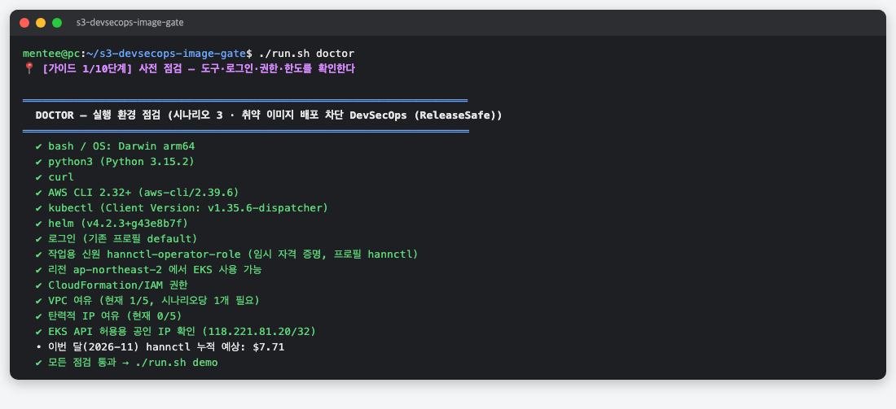

**정상이면** 모든 줄이 `✔` 이고 마지막 줄이 `✔ 모든 점검 통과 → ./run.sh demo` 다.

- `✘` 가 있으면 그 줄의 `→` 뒤 안내대로 해결하고 `./run.sh doctor` 를 다시 실행한다.
- `VPC 여유` 가 부족하다고 나오면 다른 시나리오를 먼저 `./run.sh down` 으로 지운다(시나리오 1개가 VPC 1개를 쓴다).

---

## 2단계 · 실행 시작

**할 일** — 첫 번째 터미널에서:

```bash
./run.sh demo
```

유지 시간을 묻는다. 그냥 **Enter** 를 누르면 6시간이다(만든 시각부터 6시간이 지나면 자동 삭제된다). 1~24 사이 숫자를 넣어도 된다. 6시간이면 `• 유지 시간 6시간 (최대 예상 비용 약 $1.32)` 이 나온다.

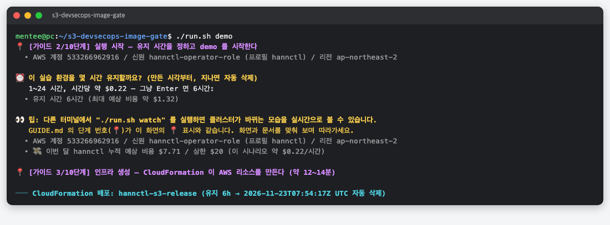

이어서 **두 번째 터미널**을 열고:

```bash
cd ~/hannctl_mentoring/s3-devsecops-image-gate     # 새 터미널은 홈 폴더에서 시작하므로 시나리오 폴더로 이동
./run.sh watch
```

클러스터가 만들어지는 동안에는 `⏳ EKS 클러스터 hannctl-s3-release 준비 대기 중` 화면이 나온다. 클러스터가 준비되면 자동으로 관찰 화면으로 바뀌므로 그대로 켜 둔다.

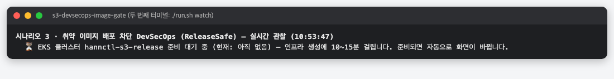

> 💡 Before 상태를 더 오래 살펴보고 싶으면 `./run.sh demo --before-wait 180` 처럼 관찰 시간(초)을 늘려서 시작한다(기본 60초).

---

## 3단계 · 인프라 생성

> 📍 터미널: `[가이드 3/10단계] 인프라 생성` · 약 13분 · 자동 진행

**화면에 나오는 것** — CloudFormation 이 리소스를 하나씩 만든다. `…` 는 만드는 중, `✔` 는 완료다. 왼쪽 `[ 0m13s]` 는 시작 후 지난 시간이다.

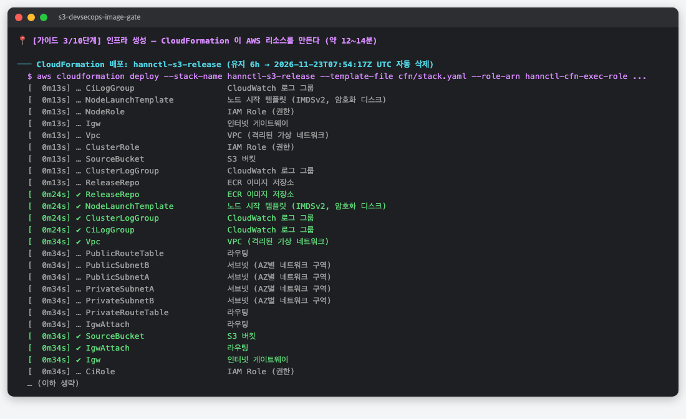

만드는 순서는 ECR 저장소(`ReleaseRepo`)·로그 그룹·S3 소스 버킷(`SourceBucket`)·VPC·서브넷 → CI 역할·**CodeBuild CI 프로젝트**(`CiProject`, 1분 안에 끝남) → NAT(약 2분) → **EKS 클러스터(약 9분, 가장 오래 걸림)** → Access Entry·애드온 → 노드 그룹(약 1분 40초) → CoreDNS·metrics-server 애드온 순서다.

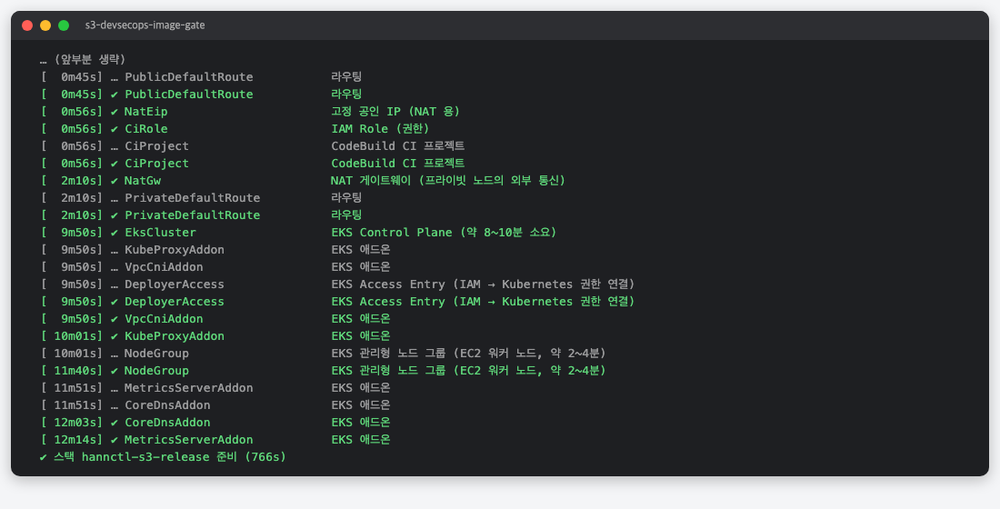

**정상이면** 마지막에 `✔ 스택 hannctl-s3-release 준비 (766s)` 처럼 걸린 시간과 함께 준비 완료가 나온다.

### 🖥️ 콘솔에서 같이 보기

**CloudFormation** → **스택** → `hannctl-s3-release` → **리소스** 탭. 새로 고침(⟳)을 누를 때마다 `CREATE_IN_PROGRESS` 가 `CREATE_COMPLETE` 로 바뀌어 간다. CodeBuild 프로젝트 `hannctl-s3-ci`, CI 역할 `hannctl-s3-ci-role`, NAT 등은 먼저 끝나고, `EksCluster` 는 오랫동안 `CREATE_IN_PROGRESS` 로 남는다.

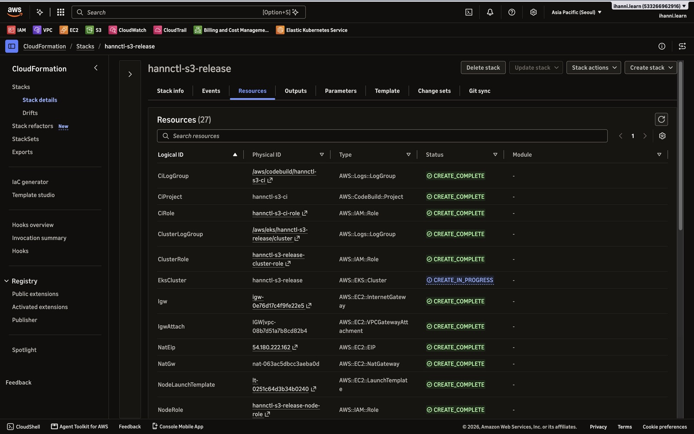

**Elastic Kubernetes Service** → **클러스터** → `hannctl-s3-release`. 처음에는 상태가 **Creating** 이고, Node groups·Add-ons 도 아직 0 이다.

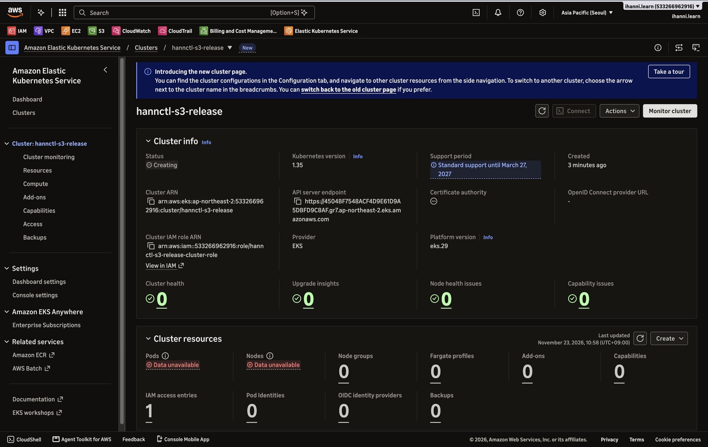

모두 끝나면 리소스 33개가 모두 `CREATE_COMPLETE` 가 된다.

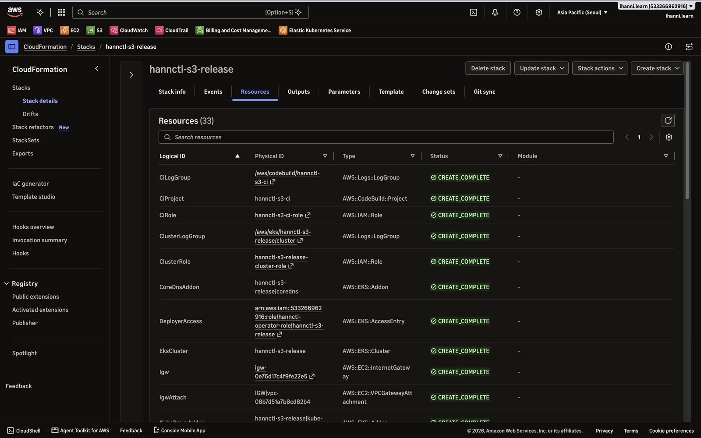

---

## 4단계 · 클러스터 기본 구성

> 📍 터미널: `[가이드 4/10단계] 클러스터 기본 구성` · 약 1분 · 자동 진행

**화면에 나오는 것** — 노드가 Ready 가 될 때까지 기다린 뒤, 정책 엔진 Kyverno 3.9.2 를 설치하고, ECR 저장소와 CodeBuild 프로젝트가 준비됐는지 확인한다.

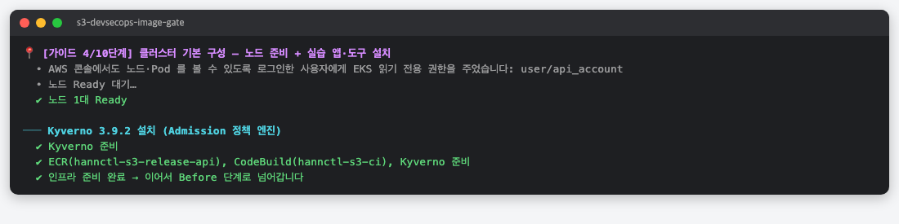

**정상이면** `✔ ECR(hannctl-s3-release-api), CodeBuild(hannctl-s3-ci), Kyverno 준비` 와 `✔ 인프라 준비 완료 → 이어서 Before 단계로 넘어갑니다` 가 나오고 바로 5단계로 넘어간다.

### 🖥️ 콘솔에서 같이 보기

**EKS** → `hannctl-s3-release` → 왼쪽 **Compute**: 노드 1대(`t4g.medium`, On-Demand)가 **Ready** 이고, 노드 그룹 `hannctl-s3-release-ng-ON_DEMAND` 가 **Active** 다.

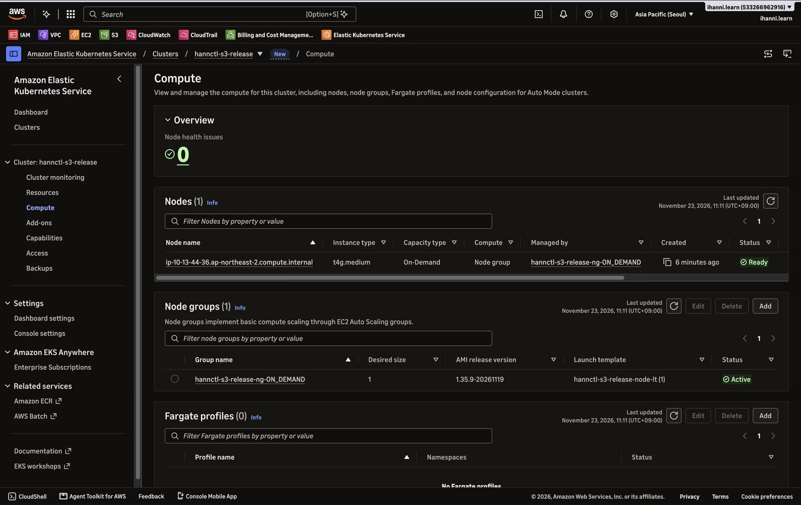

> 콘솔에서 노드·Pod 를 볼 수 있도록, 콘솔에 로그인한 사용자에게 이 클러스터의 **읽기 전용** 권한이 자동으로 주어진다(`• AWS 콘솔에서도 노드·Pod 를 볼 수 있도록 로그인한 사용자에게 EKS 읽기 전용 권한을 주었습니다: …` 안내가 한 번 나온다). 콘솔에 `Unauthorized` 나 `forbidden` 이 보이면 1~2분 뒤 새로 고침한다.

---

## 5단계 · Before (위험 재현)

> 📍 터미널: `[가이드 5/10단계] Before` · 약 1분 30초 · 자동 진행

**무엇을 하나** — 일부러 옛날 방식을 만든다: CodeBuild 가 취약 소스(`VARIANT=vuln`, Django 2.2 포함)를 **게이트를 끈 채**(`GATE=off`) 빌드한다. Trivy 는 취약점을 찾아내지만 아무도 멈추지 않으므로 이미지는 그대로 ECR 에 Push 되고, 그 이미지를 **태그로** 운영 Namespace `release` 에 배포한다. 클러스터에는 레지스트리·Pod 정책도 없다. 그 상태에서 같은 테스트를 실행해 위험이 실제로 일어나는지 확인한다.

CI 빌드는 약 45초 걸린다. 그동안 `⏳ CI 진행: PROVISIONING → BUILD → COMPLETED` 가 몇 초마다 바뀐다.

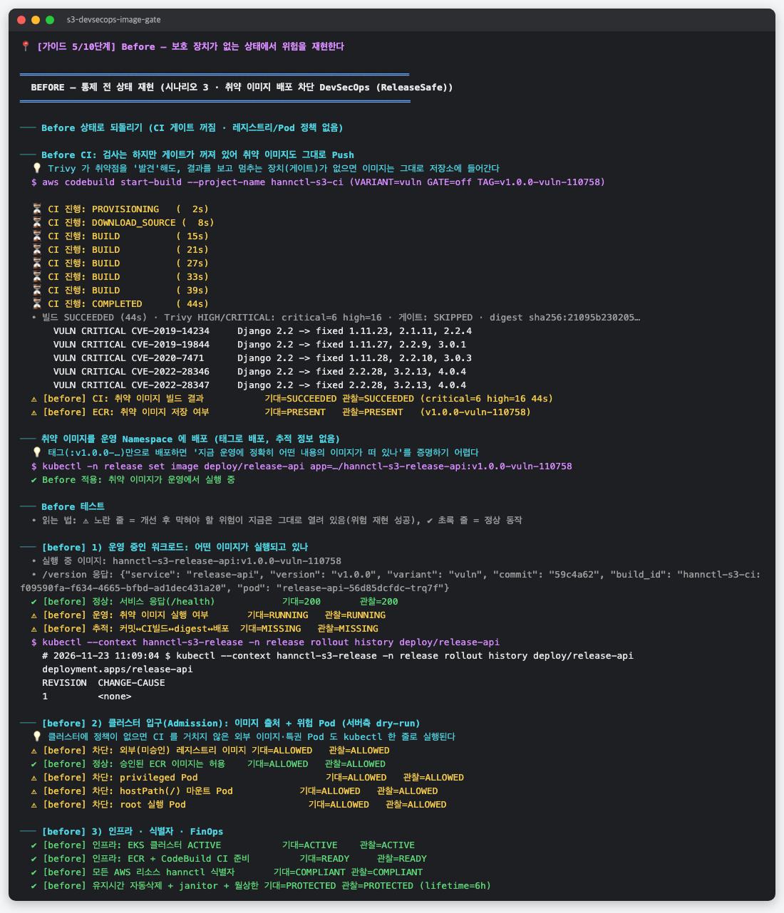

빌드 요약 줄은 이렇다.

```text
  • 빌드 SUCCEEDED (44s) · Trivy HIGH/CRITICAL: critical=6 high=16 · 게이트: SKIPPED · digest sha256:21095b230205…
      VULN CRITICAL CVE-2019-14234     Django 2.2 -> fixed 1.11.23, 2.1.11, 2.2.4
```

**Trivy 가 CRITICAL 6건·HIGH 16건을 찾았는데도 빌드는 `SUCCEEDED`, 게이트는 `SKIPPED` 다.** "검사했다"와 "막았다"는 다르다는 것이 이 시나리오의 출발점이다.

> 취약점 건수(`critical=6 high=16`)는 2026-11 실측값이다. Trivy 취약점 DB 는 매일 갱신되므로 실행 시점마다 조금씩 다를 수 있다. 발표에는 자기 실행의 `REPORT.html` 값을 쓴다.

**읽는 법**

| 표시 | 의미 |
|---|---|
| `⚠` 노란 줄 | 개선 후 막혀야 할 위험이 **지금은 그대로 열려 있다** (위험 재현 성공) |
| `✔` 초록 줄 | 정상 동작 (서비스 응답, 승인 ECR 이미지 허용, 인프라 상태 등) |
| `✘` 빨간 줄 | 기대와 다르다 → [문제 해결](#문제-해결) |

**정상이면** 아래처럼 위험이 재현된다.

| 테스트 | 관찰 | 뜻 |
|---|---|---|
| CI: 취약 이미지 빌드 결과 | `SUCCEEDED` ⚠ (`critical=6 high=16 44s`) | 취약점이 있어도 빌드가 통과한다 |
| ECR: 취약 이미지 저장 여부 | `PRESENT` ⚠ (`v1.0.0-vuln-110758`) | 취약 이미지가 저장소에 들어갔다 |
| 운영: 취약 이미지 실행 여부 | `RUNNING` ⚠ | `/version` 응답이 `"version": "v1.0.0", "variant": "vuln"` — 취약 이미지가 운영 중이다 |
| 추적: 커밋↔CI빌드↔digest↔배포 | `MISSING` ⚠ | `rollout history` 의 `CHANGE-CAUSE` 가 `<none>` — 무엇이 어디서 왔는지 기록이 없다 |
| 차단: 외부(미승인) 레지스트리 이미지 | `ALLOWED` ⚠ | CI 를 거치지 않은 외부 이미지도 실행된다 |
| 차단: privileged / hostPath(/) 마운트 / root 실행 Pod | `ALLOWED` ⚠ | 노드를 장악할 수 있는 Pod 를 만들 수 있다 |
| 정상: 서비스 응답(/health) | `200` | 서비스는 정상이다 |
| 정상: 승인된 ECR 이미지는 허용 | `ALLOWED` | 정상 배포 경로 |

Admission 테스트(외부 이미지, 위험 Pod)는 서버측 dry-run 이라 실제 Pod 는 만들어지지 않는다.

### 👀 두 번째 터미널 (watch)

- `release-api` 의 `IMAGES` 가 `…/hannctl-s3-release-api:v1.0.0-vuln-110758` — **태그**로 배포돼 있다
- 배포 이력 `REVISION 1` 의 `CHANGE-CAUSE` 는 `<none>`
- ECR 이미지 목록(`DescribeImages`)에 `v1.0.0-vuln-110758` 이 있다
- CI 빌드 `hannctl-s3-ci:f09590fa-…  SUCCEEDED`
- 맨 아래 **최근 진행 단계**: `Before 상태 적용` → `CI 빌드 vuln (vuln, gate=off)` → `before 테스트 완료`

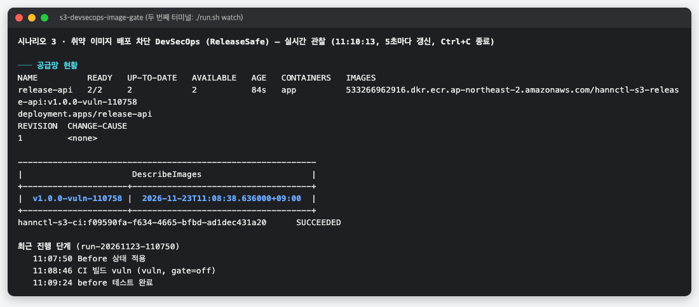

---

## 6단계 · Before 관찰

> 📍 터미널: `[가이드 6/10단계] Before 관찰` · 60초 카운트다운

화면에 `── Before 관찰 시간 (60s) — 다른 터미널에서 ./run.sh status 또는 README 의 조회 명령을 실행해 보세요` 가 나오고 카운트다운이 시작된다. 카운트다운이 끝나면 자동으로 7단계로 넘어간다.

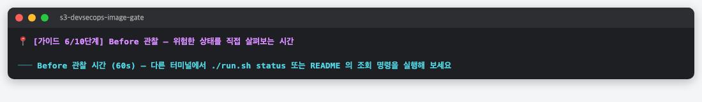

**할 일 (선택)** — 세 번째 터미널을 열어 위험을 직접 확인해 본다. 먼저 이 시나리오 전용 접속 설정을 불러온다.

```bash
cd ~/hannctl_mentoring/s3-devsecops-image-gate     # 새 터미널은 홈 폴더에서 시작하므로 시나리오 폴더로 이동
eval "$(./run.sh kubeconfig)"
```

| 확인할 것 | 명령 | Before 결과 |
|---|---|---|
| ECR 에 있는 이미지 | `aws ecr describe-images --repository-name hannctl-s3-release-api --query 'imageDetails[].[imageTags[0],imagePushedAt]' --output table` | `v1.0.0-vuln-…` 이 있다 (취약 이미지가 저장소에 들어감) |
| 운영 중인 이미지 | `kubectl -n release get deploy release-api -o jsonpath='{.spec.template.spec.containers[0].image}'` | `…/hannctl-s3-release-api:v1.0.0-vuln-…` (태그, digest 아님) |
| 배포 이력·추적 정보 | `kubectl -n release rollout history deploy/release-api` | `CHANGE-CAUSE` 가 `<none>` |
| 서비스 버전 | `kubectl -n release exec deploy/release-api -- python3 /app/app.py get http://release-api/version` | `"version": "v1.0.0", "variant": "vuln"` |
| 외부 이미지 직접 시도 (실제로 만들지 않음) | `kubectl apply -n release --dry-run=server -f k8s/attack/untrusted-registry-pod.yaml` | `created (server dry run)` (허용됨) |
| Namespace 보안 라벨 | `kubectl get ns release --show-labels` | 개선 3에서 붙일 `pod-security.kubernetes.io/enforce=restricted` 가 아직 없다 |

60초가 짧으면 `demo` 가 끝난 뒤 [9단계의 "다시 해 보기"](#다시-해-보기)로 Before 상태를 다시 만들 수 있다.

---

## 7단계 · 개선 단계 1 ~ 3

> 📍 터미널: `[가이드 7/10단계] 개선 단계` · 약 2분 · 자동 진행

개선 단계마다 같은 순서로 나온다: **변경 내용 → 📄 적용하는 설정 파일의 핵심 줄 → `$` 실행한 명령 → 즉시 확인(효과 측정) → 💡 배움 포인트**. 개선 1·2는 CodeBuild 빌드를 한 번씩 돌리므로 각각 약 40초씩 `⏳ CI 진행` 이 나온다. 단계 사이에는 5초 쉰다.

### 개선 1/3 · CI 보안 게이트 켜기 (Trivy HIGH/CRITICAL)

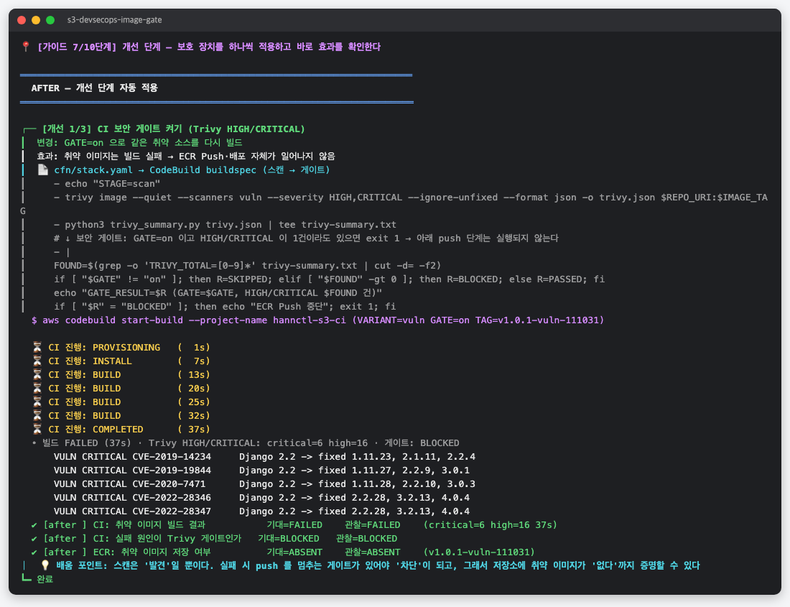

5단계와 **같은 취약 소스**를 이번에는 `GATE=on` 으로 다시 빌드한다. 📄 에 나오는 buildspec 의 핵심은 HIGH/CRITICAL 이 1건이라도 있으면 `GATE_RESULT=BLOCKED` 를 찍고 `exit 1` 로 빌드를 멈춰, 그 아래 Push 단계가 실행되지 않게 하는 것이다.

**여기가 이 시나리오에서 가장 중요한 순간이다.** **정상이면**

- `• 빌드 FAILED (37s) · Trivy HIGH/CRITICAL: critical=6 high=16 · 게이트: BLOCKED`
- `CI: 취약 이미지 빌드 결과  기대=FAILED  관찰=FAILED`
- `CI: 실패 원인이 Trivy 게이트인가  기대=BLOCKED  관찰=BLOCKED` — 다른 오류가 아니라 보안 게이트 때문에 실패했다
- `ECR: 취약 이미지 저장 여부  기대=ABSENT  관찰=ABSENT  (v1.0.1-vuln-111031)` — 저장소에 **없다**

5단계와 같은 소스, 같은 Trivy 결과(`critical=6 high=16`)인데 게이트가 있느냐 없느냐로 결과가 `PRESENT` 와 `ABSENT` 로 갈린다. 스캔은 '발견'일 뿐이고, 멈추는 장치가 있어야 '차단'이다.

### 개선 2/3 · 검증된 이미지만 배포 (digest 고정 + 추적성)

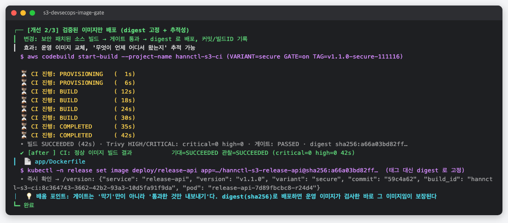

보안 패치된 소스(`VARIANT=secure`)를 `GATE=on` 으로 빌드한다. 게이트를 통과하면 ECR 에 Push 되고, 운영 배포는 태그 대신 **digest**(`@sha256:…`)로 하고 커밋·빌드 ID 를 함께 기록한다. 📄 `app/Dockerfile` 은 `VARIANT=secure` 이면 취약 라이브러리를 넣지 않고 `apk upgrade` 와 `pip` 제거를 한다.

**정상이면**

- `• 빌드 SUCCEEDED (42s) · Trivy HIGH/CRITICAL: critical=0 high=0 · 게이트: PASSED · digest sha256:a66a03bd82ff…`
- `$ kubectl -n release set image deploy/release-api app=…/hannctl-s3-release-api@sha256:a66a03bd82ff…  (태그 대신 digest 로 고정)`
- `• 즉시 확인 → /version:` 응답이 `"version": "v1.1.0", "variant": "secure"` 로 바뀌었다

게이트는 '막기'만이 아니라 '통과한 것만 내보내기'다. digest 로 배포하면 운영 이미지가 검사한 바로 그 이미지임이 보장된다.

### 개선 3/3 · 클러스터 입구 정책 (신뢰 레지스트리 + PSA + Kyverno)

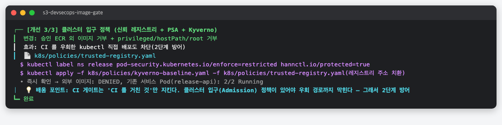

`release` Namespace 에 PSA `restricted` 라벨(`pod-security.kubernetes.io/enforce=restricted`)과 `hannctl.io/protected=true` 를 붙이고, Kyverno 정책(`kyverno-baseline.yaml` 의 Pod 보안 3개 + `trusted-registry.yaml` 의 신뢰 레지스트리 1개)을 적용한다. 신뢰 레지스트리 정책은 이미지 주소가 내 계정의 승인된 ECR 저장소(`…/hannctl-s3-*`)로 시작할 때만 Pod 를 허용한다.

**정상이면** `• 즉시 확인 → 외부 이미지: DENIED, 기존 서비스 Pod(release-api): 2/2 Running` — 외부 이미지는 거부되고, 이미 돌고 있던 서비스는 그대로다.

CI 게이트는 CI 를 **거친 것**만 지킨다. 누군가 CI 를 우회해 `kubectl` 로 직접 띄우려는 것은 클러스터 입구(Admission)에서 한 번 더 막는다 — 그래서 2단계 방어다.

### 👀 두 번째 터미널 (watch) — 개선이 끝난 모습

- `IMAGES` 가 `…/hannctl-s3-release-api@sha256:a66a03bd82fff9` — 태그 대신 **digest** 로 고정
- 배포 이력 `REVISION 2` 에 `CI 8c364743-3662-42b2-93a3-10d5fa91f9da · v1.1.0-secure-111116 · gate PASSED`
- ECR 이미지는 `v1.0.0-vuln-110758`, `v1.1.0-secure-111116` **2개뿐** — 개선 1의 `v1.0.1-vuln-111031` 은 없다
- CI 빌드 3개: `SUCCEEDED`(secure) / `FAILED`(게이트 차단) / `SUCCEEDED`(Before)
- Kyverno 정책 4개 `hannctl-disallow-host-path`, `hannctl-disallow-privileged`, `hannctl-require-run-as-non-root`, `hannctl-trusted-registry-only` 모두 `READY=true`
- 맨 아래 **최근 진행 단계**에 개선 단계와 `after 테스트 완료` 가 시간순으로 쌓인다

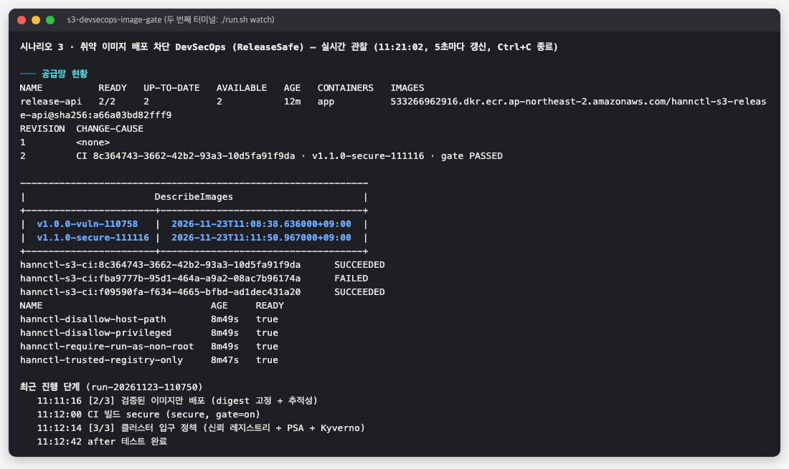

---

## 8단계 · After 테스트와 채점

> 📍 터미널: `[가이드 8/10단계] After 테스트·채점` · 약 30초 · 자동 진행

**무엇을 하나** — 5단계와 **똑같은 테스트**를 다시 실행한다. 같은 조건에서 비교해야 "개선됐다"고 말할 수 있다.

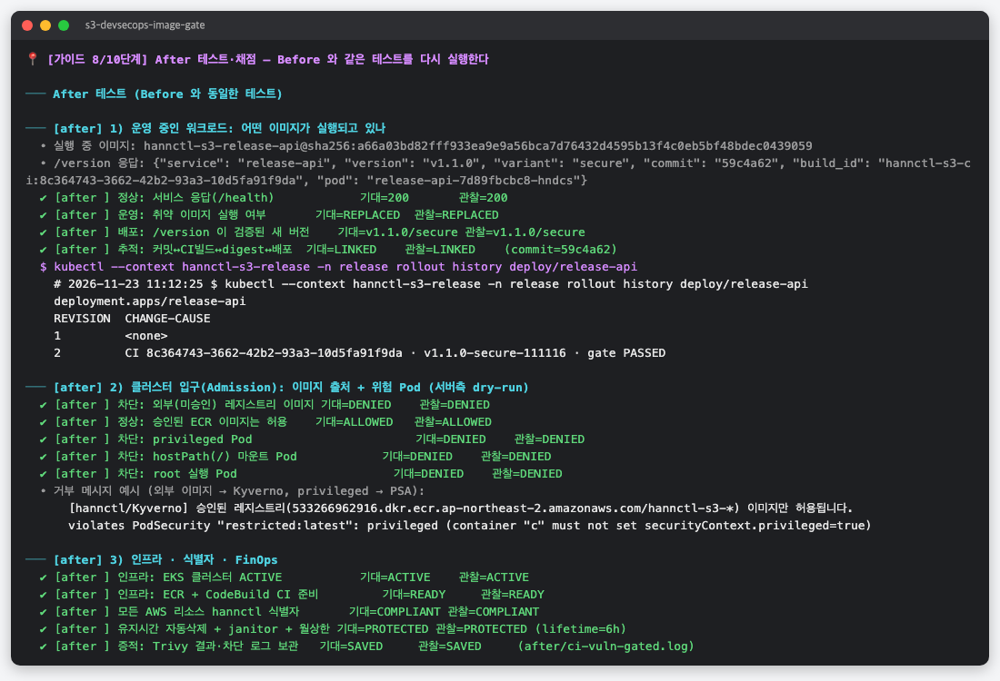

**정상이면** 모든 줄이 `✔` 초록이다.

- 실행 중 이미지 `hannctl-s3-release-api@sha256:a66a03bd…` (digest)
- 서비스 응답 `200`, 취약 이미지 `REPLACED`, `/version` 이 `v1.1.0/secure`
- 추적 `LINKED` (`commit=59c4a62`) — `rollout history` 의 `REVISION 2` 에 `CI <빌드ID> · v1.1.0-secure-111116 · gate PASSED` 가 실제로 출력됨
- 외부(미승인) 레지스트리 이미지 `DENIED`, 승인된 ECR 이미지는 `ALLOWED` 유지
- privileged / hostPath(/) 마운트 / root 실행 Pod `DENIED` + 누가 막았는지 거부 메시지:

```text
  • 거부 메시지 예시 (외부 이미지 → Kyverno, privileged → PSA):
      [hannctl/Kyverno] 승인된 레지스트리(<계정ID>.dkr.ecr.ap-northeast-2.amazonaws.com/hannctl-s3-*) 이미지만 허용됩니다.
      violates PodSecurity "restricted:latest": privileged (container "c" must not set securityContext.privileged=true)
```

- 증적 `SAVED` (`after/ci-vuln-gated.log`) — 게이트가 막은 빌드의 Trivy 결과·차단 로그가 보관됐다

이어서 평가표로 자동 채점한다.

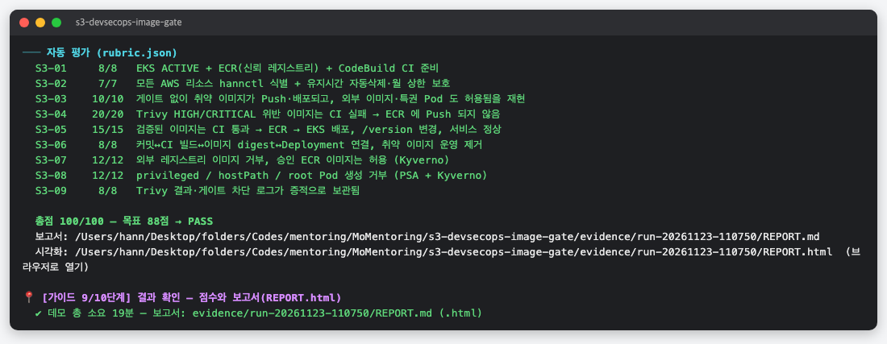

**정상이면** `총점 100/100 — 목표 88점 → PASS` (88점 이상이면 통과).

### 🖥️ 콘솔에서 같이 보기

**개발자 도구(Developer Tools)** → **CodeBuild** → **빌드 프로젝트(Build projects)** → `hannctl-s3-ci` → **빌드 기록(Build history)** 탭. 이번 `demo` 가 돌린 빌드 3개가 위에서부터 최신순으로 보인다.

| Build number | Status | 언제 만든 빌드인가 |
|---|---|---|
| 1 | **Succeeded** | 5단계 Before — 취약 소스, `GATE=off` (`v1.0.0-vuln-110758`) |
| 2 | **Failed** | 7단계 개선 1 — 같은 취약 소스, `GATE=on` → 게이트가 막음 (`v1.0.1-vuln-111031`) |
| 3 | **Succeeded** | 7단계 개선 2 — 패치된 소스, `GATE=on` → 통과 (`v1.1.0-secure-111116`) |

빌드 실행 이름(`hannctl-s3-ci:f09590fa-…`, `fba9777b-…`, `8c364743-…`)이 watch 화면의 CI 빌드 목록과 같다. 콘솔의 **Duration** 은 빌드 자체 시간이라, 기다리는 시간까지 센 터미널의 초(44s·37s·42s)보다 조금 짧다.

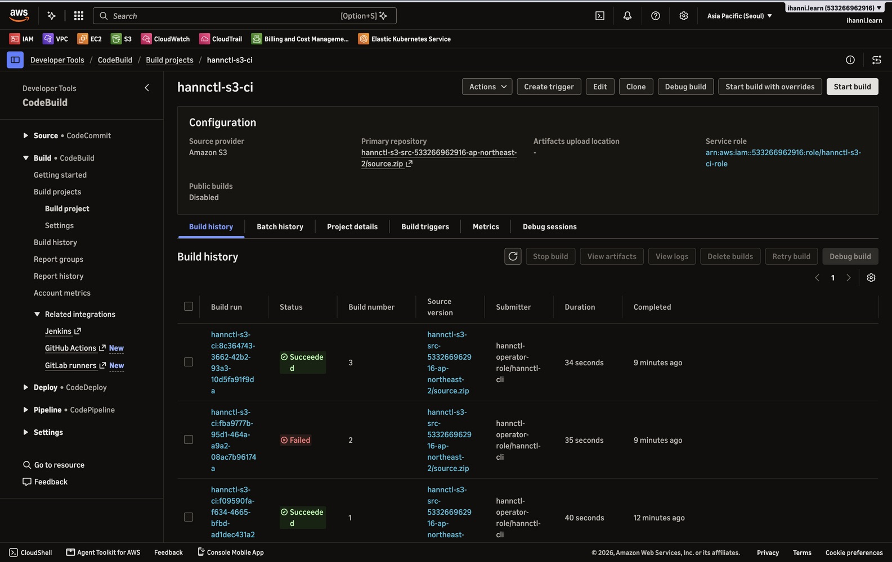

**#2 가 왜 실패했는지** 확인하려면 #2 의 빌드 실행 이름을 눌러 **빌드 로그**를 연다. `GATE_RESULT=BLOCKED (GATE=on, HIGH/CRITICAL N 건)` 다음 줄에 `ECR Push 중단` 이 있으면 보안 게이트가 멈춘 것이다. 같은 로그는 터미널의 `evidence/latest/after/ci-vuln-gated.log` 나 CloudWatch 로그 그룹 `/aws/codebuild/hannctl-s3-ci` 에도 있다.

**Elastic Container Registry** → **프라이빗 리포지토리(Private registry → Repositories)** → `hannctl-s3-release-api`. **Images (2)** — `v1.1.0-secure-111116`(개선 2, digest `sha256:a6…`)과 `v1.0.0-vuln-110758`(Before, digest `sha256:21…`)만 있다. 개선 1에서 빌드한 `v1.0.1-vuln-111031` 은 Push 단계까지 가지 못했으므로 **목록에 없다**. 이것이 "ECR: 취약 이미지 저장 여부 `ABSENT`" 의 실물이다.

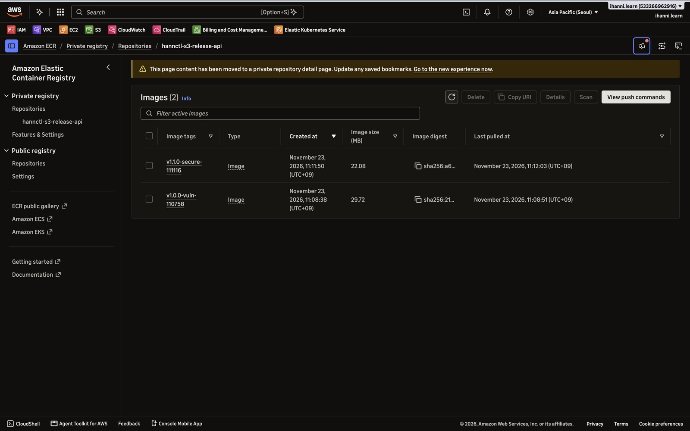

---

## 9단계 · 결과 확인

> 📍 터미널: `[가이드 9/10단계] 결과 확인`

마지막 줄에 `✔ 데모 총 소요 N분 — 보고서: evidence/run-…/REPORT.md (.html)` 가 나오면 `demo` 가 끝난 것이다.

보고서 `evidence/latest/REPORT.html` 이 브라우저로 열린다. 열리지 않으면 직접 연다.

```bash
open evidence/latest/REPORT.html        # macOS
xdg-open evidence/latest/REPORT.html    # Linux
cat evidence/latest/REPORT.md           # 터미널에서 보기 (CloudShell 포함)
```

CloudShell 에서는 오른쪽 위 **작업(Actions) → 파일 다운로드**에 `pwd` 결과 뒤 `/evidence/latest/REPORT.html` 을 붙인 경로를 넣어 내려받는다.

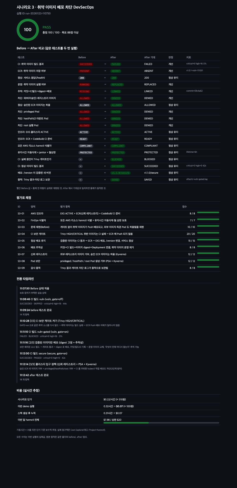

| 보고서 부분 | 보는 법 |
|---|---|
| 점수 원 | 총점과 PASS/FAIL |
| Before → After 비교 | 빨간 Before 값 = 실제로 재현된 위험(`SUCCEEDED`, `PRESENT`, `RUNNING`, `MISSING`, `ALLOWED`), After 가 기대값과 같으면 통제가 동작한 것. `→` 는 개선, `=` 는 정상 유지. Before 가 `–` 인 줄(실패 원인, 정상 이미지 빌드, `/version`, 증적)은 After 에만 있는 확인 항목이다 |
| 평가표 채점 | 항목별 점수 S3-01 ~ S3-09 (기준은 [RUBRIC.md](RUBRIC.md)) |
| 전환 타임라인 | Before 상태 적용 → CI 빌드 vuln(gate=off) → before 테스트 → 개선 1~3 과 각 CI 빌드 → after 테스트 시각 |
| 비용 | 시나리오 단가, 이번 demo 실행·스택 누적·이번 달 hannctl 전체 비용 추정 |

### 다시 해 보기

인프라를 그대로 둔 채 단계만 다시 실행할 수 있다. 발표 리허설이나 6단계 관찰을 천천히 할 때 쓴다.

| 명령 | 하는 일 | 시간 |
|---|---|---|
| `./run.sh before` | 게이트를 끄고 정책을 빼서 Before 로 되돌린 뒤 취약 이미지 빌드·배포 + Before 테스트 (5단계) | 약 1분 30초 |
| `./run.sh after` | 개선 1~3 적용(CI 빌드 2회) + After 테스트 + 채점 (7~8단계) | 약 2분 20초 |
| `./run.sh demo` | 5~9단계 전체 (인프라가 있으면 바로 Before 부터) | 약 5분 |
| `./run.sh status` | 스택·클러스터·노드 상태와 남은 유지 시간 | 몇 초 |

다시 실행할 때마다 CodeBuild 빌드가 새로 돌고 새 태그(예: `v1.0.0-vuln-112140`)의 이미지가 생긴다. `rollout history` 의 REVISION 도 이어서 쌓인다(Before 로 되돌린 배포는 `<none>`, After 배포는 `CI <빌드ID> · v1.1.0-secure-… · gate PASSED`).

---

## 10단계 · 삭제

> 📍 터미널: `[가이드 10/10단계] 삭제` · 약 8분

**할 일** — 실습이 끝나면 반드시 실행한다. 두 번째 터미널의 watch 는 `Ctrl+C` 로 먼저 끈다.

```bash
./run.sh down
```

**화면에 나오는 것** — 먼저 S3 소스 버킷을 비우고(`• 버킷 비우기: hannctl-s3-src-…`), CloudFormation 이 만든 순서의 반대로 리소스를 지운다. `🗑 … 삭제됨` 이 하나씩 쌓인다. CodeBuild 프로젝트·CI 역할·ECR 저장소·S3 버킷은 처음 30초 안에 지워지고, 노드 그룹(약 4분 30초)과 EKS 클러스터(약 3분) 삭제가 가장 오래 걸린다.

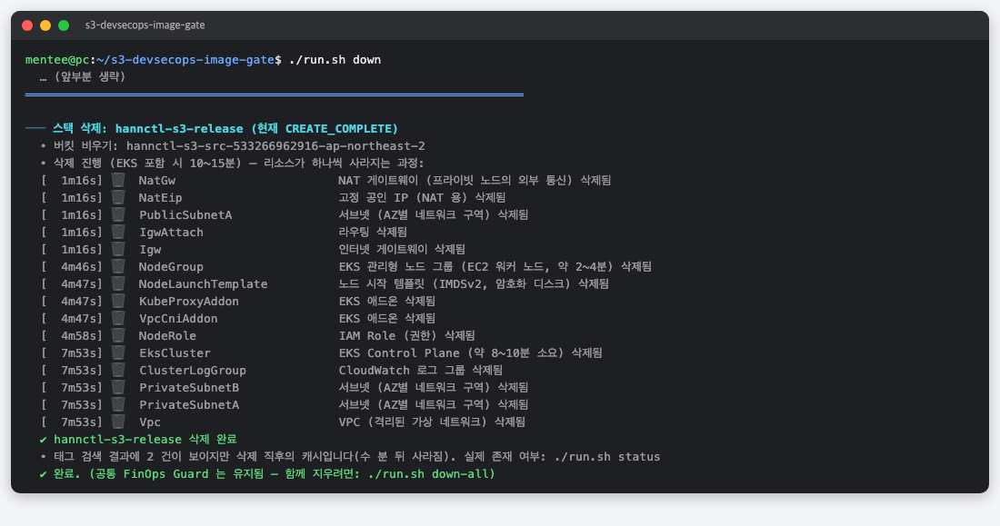

**정상이면** `✔ hannctl-s3-release 삭제 완료` 다음에 `✔ 완료. (공통 FinOps Guard 는 유지됨 — 함께 지우려면: ./run.sh down-all)` 가 나온다. 공통 안전장치(`hannctl-finops-guard`)는 다음 실습을 위해 남겨 두는 것이다(비용 0원 수준).

> `• 태그 검색 결과에 2 건이 보이지만 삭제 직후의 캐시입니다(수 분 뒤 사라짐). 실제 존재 여부: ./run.sh status` 줄이 함께 나올 수 있다. AWS 태그 검색이 몇 분 늦게 갱신되기 때문이며 실제로 남은 리소스는 아니다.

### 🖥️ 콘솔에서 같이 보기

**CloudFormation** → `hannctl-s3-release` → **리소스** 탭. `CiProject`·`CiRole`·`CiLogGroup` 등이 하나씩 `DELETE_COMPLETE` 로 바뀐다(아직 지우는 중인 `EksCluster`·`ClusterRole` 등은 `CREATE_COMPLETE` 로 남아 있다). 다 지워지면 스택 목록(필터 **활성**)에서 사라진다.

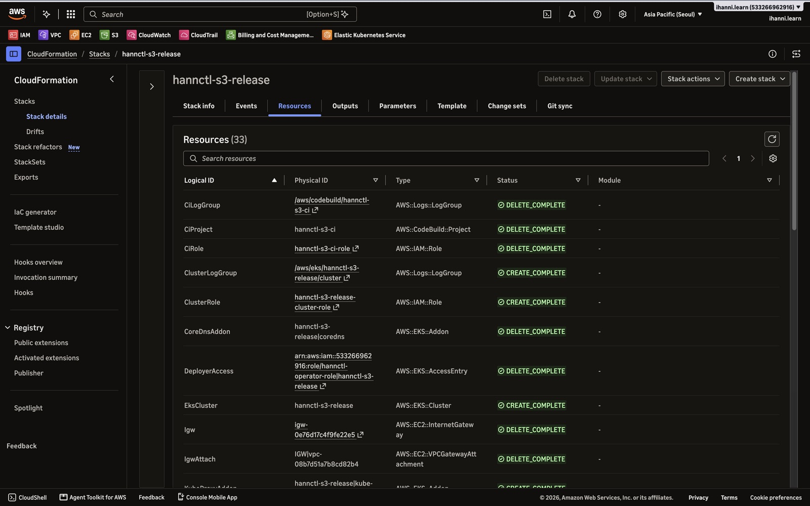

**남은 것이 없는지 확인**

```bash
./run.sh status          # "! 스택 없음" 이 나오면 이 시나리오 리소스는 모두 지워진 것
```

- 중간에 실패하면 `./run.sh down` 을 한 번 더 실행한다.
- 모든 시나리오를 끝냈으면 `./run.sh down-all` 로 공통 안전장치까지 지운다. 다른 시나리오 스택이 남아 있으면 지우지 않는다.
- `down` 을 잊어도 2단계에서 정한 유지 시간(기본 6시간)이 지나면 자동으로 삭제된다(S3 소스 버킷도 비운 뒤 삭제한다). 그래도 끝나면 바로 지우는 것이 원칙이다.

---

## 문제 해결

| 증상 | 해결 |
|---|---|
| 1단계에 `✘` | 그 줄의 `→` 안내대로 하고 `./run.sh doctor` 다시 실행 |
| 3단계 도중 터미널이 꺼짐 / CloudShell 세션 끊김 | 다시 접속해 같은 폴더에서 `./run.sh status` → 상태가 `CREATE_COMPLETE` 가 되면 `./run.sh demo` 다시 실행 (만든 인프라는 이어서 쓴다) |
| 8단계에 `✘` 가 있음 | `./run.sh after` 한 번 더 실행 |
| `CI: 실패 원인이 Trivy 게이트인가` 가 `BLOCKED` 가 아님 | 빌드가 게이트가 아닌 다른 이유로 실패한 것이다. `evidence/latest/after/ci-vuln-gated.log` 나 콘솔 CodeBuild `hannctl-s3-ci` 의 빌드 로그에서 `GATE_RESULT=` 줄이 있는지, 어디서 멈췄는지 확인하고 `./run.sh after` 를 다시 실행 |
| Trivy 건수가 이 문서(`critical=6 high=16`)와 다름 | 정상이다. Trivy 취약점 DB 갱신에 따라 달라진다. 게이트 판단은 HIGH/CRITICAL 이 1건 이상인지로만 한다 |
| 콘솔 EKS 화면에 `Unauthorized` / `forbidden` | 1~2분 뒤 새로 고침. 그래도 같으면 `./run.sh up` 을 한 번 실행 |
| kubectl 이 `Unauthorized` / 타임아웃 | 내 공인 IP 가 바뀌었을 수 있다 → `./run.sh up` (EKS API 허용 IP 갱신) |
| `Unable to parse config file: …/.aws/config` | [START_HERE.md 문제 해결](START_HERE.md) 참고 |

그 밖의 문제는 [START_HERE.md](START_HERE.md) 의 문제 해결 표를 본다.
