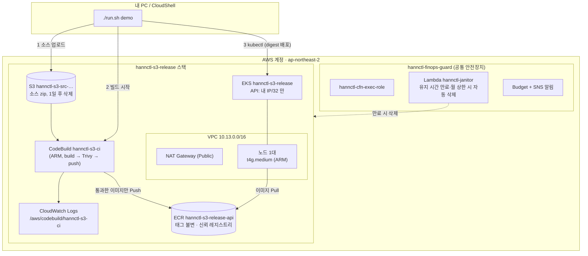
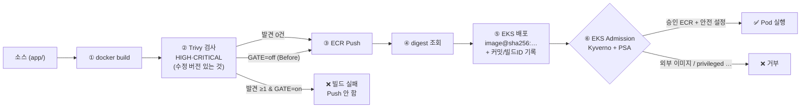
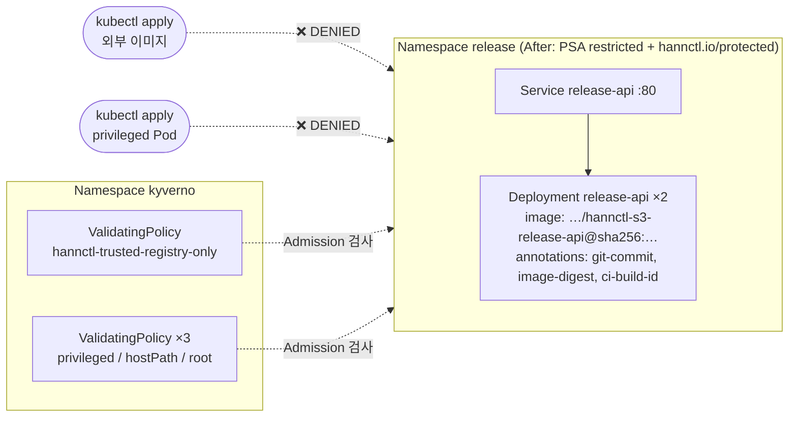
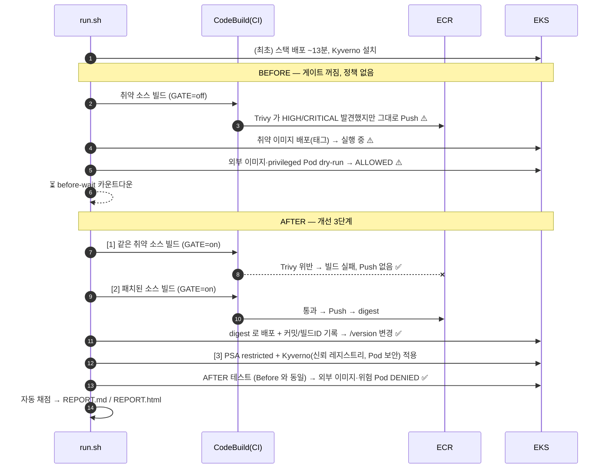

# 시나리오 3 · 취약 컨테이너 이미지의 운영 배포를 막는 DevSecOps (ReleaseSafe)

> 🚀 **처음이라면 [START_HERE.md](START_HERE.md)** 부터 — 설치·실행·삭제를 5분 안에 따라 할 수 있다.

> **한 줄 요약**
> 개발자가 **취약한 이미지**를 만들어도
> ① **CI(빌드 파이프라인)** 의 Trivy 검사에서 걸려 ECR에 올라가지 못하고,
> ② 누군가 CI를 우회해 `kubectl`로 **외부 이미지나 위험한 Pod** 를 직접 띄우려 해도 **EKS 입구(Admission)** 에서 다시 막힌다.
> **검증된 이미지만** 운영에 배포되고, 그 이미지가 **어떤 커밋·어떤 빌드에서 왔는지** 추적할 수 있음을 증명한다.

| 항목 | 내용 |
|---|---|
| 난이도 | ★★½ (2.5/5). 흐름이 직관적이고 성공/실패가 분명해 시연이 안정적이다 |
| 핵심 기술 | **CodeBuild**(CI) + **Trivy**(이미지 취약점 검사), **ECR**(신뢰 레지스트리, 태그 불변), **Kyverno**(신뢰 레지스트리·Pod 보안 정책), **PSA**, 이미지 **digest** 배포 |
| 소요 시간 | 처음 `demo` 약 **17~20분**(실측 17분: 인프라 생성 13분 + CI 빌드 3회 약 2분 + 테스트). 이후 재실행 약 5분 |
| 예상 비용 | 약 **$0.22/시간**(≈310원). EKS + Graviton 노드 1대(온디맨드) + NAT, CodeBuild는 빌드한 분만 과금. 처음 정한 유지 시간(기본 6시간)이 지나면 자동 삭제 (9장 비용표 참고) |
| 과정 요구사항 연결 | **공급망 보안**(CI 이미지 스캔, Critical·High 배포 차단, 신뢰 레지스트리만 허용) + **정책 기반 통제**(privileged/root/hostPath 차단) |

---

## 🎯 이 시나리오의 초점 (먼저 읽기)

| 구분 | 내용 |
|---|---|
| **핵심 포커스** | 취약하거나 출처를 알 수 없는 이미지가 운영에 들어오는 **공급망 경로를 두 지점에서 차단**한다 — ① **CI 게이트**(빌드 시점, Trivy), ② **클러스터 입구**(배포 시점, Kyverno + PSA) |
| **Kubernetes 보안 비중** | ★★★☆☆ — 앞부분(CI 게이트, ECR, digest 추적)은 **Kubernetes 밖**의 공급망 보안이고, 뒷부분(신뢰 레지스트리 정책, PSA, privileged/hostPath/root 차단)은 **Kubernetes 안**의 Admission 통제다. 두 영역을 연결해 보는 것이 이 시나리오의 핵심이다 |
| **가장 중요하게 보는 것** | ① "검사했다"와 "막았다"의 차이: Trivy 결과로 **빌드를 실패시키고 Push가 일어나지 않음**까지 증명 ② **digest(sha256)로 배포**하고 커밋↔CI 빌드↔이미지↔Deployment를 연결(추적성) ③ CI를 우회한 직접 배포까지 막는 **2단계 방어**(신뢰 레지스트리 + Pod 보안) |

**무엇을 사용하나 (계층별)**

| 계층 | 사용 기술 | 이 시나리오에서 하는 일 |
|---|---|---|
| AWS 인프라 | VPC(프라이빗 노드) · EKS · NAT | 실습 기반 |
| CI (빌드 파이프라인) | **CodeBuild**(ARM) + S3 소스 버킷 | 빌드 → 검사 → 게이트 → Push를 자동 실행 |
| 이미지 검사 | **Trivy** 0.76.2 (HIGH·CRITICAL, 수정 버전 있는 것) | 취약 라이브러리(Django 2.2) 탐지 → 게이트 판단 근거 |
| 이미지 저장소 | **ECR** (태그 불변, scan on push 참고용) | 통과한 이미지만 저장되는 "신뢰 레지스트리" |
| 배포 | `kubectl set image …@sha256:` + annotation | digest 고정 배포, 커밋·빌드 ID 기록 |
| Pod 생성 통제 | **Kyverno** ValidatingPolicy ×4 + **PSA** restricted | 외부 이미지·privileged·hostPath·root Pod를 생성 전에 거부 |

**전 → 후: 무엇이 개선되나 (실측)**

| # | 개선(통제) | 영역 | Before → After (실측) | 왜 중요한가 |
|---|---|---|---|---|
| 1 | CI 보안 게이트 (`GATE=on`) | 공급망 보안 | 취약 빌드 `SUCCEEDED` → `FAILED` (`GATE_RESULT=BLOCKED`, CRITICAL 6 · HIGH 16), ECR `PRESENT` → `ABSENT` | 발견에서 끝나지 않고 **운영 경로를 끊는다** |
| 2 | 검증된 이미지 digest 배포 + 추적 정보 | 공급망 보안 · 배포 운영 | 운영 이미지 `v1.0.0/vuln` → `v1.1.0/secure`(Trivy 0건), 추적 `MISSING` → `LINKED` | 운영 이미지가 **검사한 바로 그 이미지**임을 보장, 감사 대응 |
| 3 | 신뢰 레지스트리 정책 (Kyverno) | K8s 정책 통제 | 외부 이미지 `ALLOWED` → `DENIED`, 승인 ECR 이미지는 `ALLOWED` 유지 | CI를 **우회한 배포**까지 차단 |
| 4 | PSA restricted + Kyverno baseline | K8s 정책 통제 | privileged · hostPath · root Pod `ALLOWED` → `DENIED` | 위험 설정을 **만들어지기 전에** 거부 |
| ✓ | (검증) 정상 경로 | 가용성 | 정상 빌드 `SUCCEEDED`, 서비스 `200`, 기존 Pod Running 유지 | 보안 통제가 정상 배포를 막지 않음 |

**다루지 않는 것 (범위 밖)**: 이미지 서명 검증(cosign/Notation), SBOM 생성·관리, ECR Enhanced Scanning(Amazon Inspector)과 배포 후 지속 스캔, 런타임 위협 탐지(Falco·GuardDuty), 네트워크 격리(→ 시나리오 2), Secret 외부 관리(→ 시나리오 5)

---

## 0. 가장 빠른 사용법 (명령 1개)

```bash
cd s3-devsecops-image-gate
./run.sh demo                      # 전부 자동: 인프라 → Before(게이트 없음) → 60초 후 자동 개선 3단계 → After 검증 → 채점
./run.sh demo --before-wait 180    # Before 상태를 3분 동안 관찰한 뒤 넘어가기
./run.sh down                      # 끝나면 전부 삭제 (잊어도 유지 시간(기본 6시간)이 지나면 자동 삭제)
```

- 끝나면 `evidence/latest/REPORT.html`이 열린다(점수, Before→After 비교, 타임라인).
- 진행 중에 **다른 터미널에서 `./run.sh watch`** 를 실행하면 실행 중인 이미지, 배포 이력, ECR 이미지 목록, CI 빌드 상태를 실시간으로 볼 수 있다.
- 처음에는 AWS CLI v2와 자격 증명, python3만 있으면 된다. kubectl/helm은 자동 설치된다. **로컬 Docker는 필요 없다**(빌드는 AWS CodeBuild에서 한다).

---

## 1. 실무에서는 어떤 상황인가?

**ReleaseSafe**는 고객용 API를 **하루에도 여러 번** 배포하는 회사다. 지금까지의 배포 방식은 이렇다.

```text
개발자 PC 에서 docker build → 그대로 ECR 에 push → kubectl 로 배포
```

이 흐름에는 **"검사"도 "멈춤 장치"도 없다.** 실제로 자주 일어나는 사고는 다음과 같다.

| 상황 | 실제 사고로 이어지는 예 |
|---|---|
| 오래된 라이브러리가 들어간 이미지 | 이미 공개된 취약점(CVE)으로 원격 코드 실행, 데이터 유출 |
| 출처를 모르는 외부 이미지 | 인터넷의 아무 이미지나 띄웠다가 악성코드(채굴기 등)가 포함됨 → **공급망 공격** |
| 위험한 Pod 설정 | privileged/hostPath Pod 하나가 노드 전체를 장악 |
| 태그(`:latest`, `:v1`)로 배포 | 같은 태그에 다른 이미지가 덮어씌워져 "지금 운영에 뭐가 떠 있는지" 아무도 모름 |

> 💡 **핵심 메시지**: 보안의 목표는 취약점을 **발견하는 것**에서 끝나지 않는다. 운영으로 가는 길목에서 **실제로 차단하는 것**까지가 목표다.

---

## 2. 이 시나리오의 목표 (완료 기준)

| # | 목표 | 증명 방법 |
|---|---|---|
| 1 | Trivy 기준(HIGH/CRITICAL, 수정 버전 존재)을 위반한 이미지는 **CI에서 실패**한다 | CodeBuild `FAILED`, 로그 `GATE_RESULT=BLOCKED` |
| 2 | 실패한 이미지는 **ECR에 존재하지 않는다**(Push 단계가 실행되지 않음) | `aws ecr describe-images` → `ABSENT` |
| 3 | 정상 이미지는 **CI 통과 → ECR → EKS 배포**, `/version`이 바뀐다 | CodeBuild `SUCCEEDED`, `/version` = `v1.1.0/secure` |
| 4 | 운영 배포가 **커밋 ↔ CI 빌드 ↔ 이미지 digest** 로 연결된다 | Deployment annotation + 이미지가 `@sha256:` digest로 고정 |
| 5 | 승인되지 않은 레지스트리 이미지는 EKS에서 **거부**되고, 승인 ECR 이미지는 **허용**된다 | Kyverno `DENIED` / `ALLOWED` |
| 6 | privileged / hostPath / root Pod는 **거부**된다 | PSA + Kyverno `DENIED` |
| 7 | 모든 AWS 리소스가 **hannctl 식별자 + 유지 시간 자동 삭제**를 가진다 | 태그 감사, janitor 확인 |

**평가 목표: 100점 만점 중 88점 이상.** 평가표는 [`RUBRIC.md`](RUBRIC.md)에 있고 자동으로 채점된다.

---

## 3. 전체 구성도

### 3-1. AWS 인프라 (CloudFormation `cfn/stack.yaml` 하나로 생성)



### 3-2. CI 파이프라인 — 어디서 무엇이 멈추나



### 3-3. EKS 내부 (Kubernetes 리소스)



### 3-4. 2단계 방어 — 왜 CI와 클러스터 둘 다 막나

```text
 [1단계: CI 게이트]   빌드 시점      "이 이미지에 알려진 위험한 취약점이 있나?"   → Trivy (CodeBuild)
        │                             ↳ 실패하면 ECR 에 들어가지도 못한다
 [2단계: Admission]   배포 시점      "이 Pod 는 승인된 곳에서 온 이미지이고, 안전한 설정인가?" → Kyverno + PSA
                                      ↳ CI 를 우회한 kubectl 직접 배포, 외부 이미지, 위험 설정을 막는다
```

> 💡 CI 게이트만 있으면 **CI를 거치지 않은 배포**를 막지 못한다. Admission 정책만 있으면 **승인 레지스트리 안의 취약 이미지**를 막지 못한다. 그래서 둘을 함께 쓴다.

---

## 4. 자동 진행 순서 — `./run.sh demo`가 하는 일



### 4-1. 단계별로 "이렇게 설정하면 → 이렇게 된다"

| 단계 | 설정 (파일 · 핵심 줄) | 결과 (화면에 보이는 값) | 배운 점 |
|---|---|---|---|
| **BEFORE** | `cfn/stack.yaml` buildspec 의 `GATE: "off"` (run.sh 가 빌드 시 덮어씀) · 정책 파일 미적용 | `GATE_RESULT=SKIPPED (발견 N건 무시)` → 빌드 **SUCCEEDED**, ECR `PRESENT`, 운영 `RUNNING`, 외부 이미지·privileged `ALLOWED` | 검사를 했다 ≠ 막았다. 결과를 보고 **멈추는 장치**가 없으면 취약 이미지는 그대로 운영까지 간다 |
| **개선 1** CI 게이트 | buildspec: `if [ "$GATE" = "on" ] && [ "$FOUND" -gt 0 ]; then … exit 1` → 실패하면 아래 `docker push` 줄까지 **가지 않음** | 빌드 **FAILED**, 로그 `GATE_RESULT=BLOCKED (HIGH/CRITICAL N건)`, `VULN CRITICAL CVE-… Django 2.2`, ECR 태그 **ABSENT** | 게이트는 "실패 시 다음 단계가 실행되지 않는 구조"다. 그래서 "저장소에 없다"까지 증명할 수 있다 |
| **개선 2** 검증된 배포 | `app/Dockerfile`: `VARIANT=secure`(취약 라이브러리 미설치, `apk upgrade`, `pip` 제거) · run.sh: `kubectl set image …@sha256:<digest>` + `annotate hannctl.io/git-commit, image-digest, ci-build-id` | 빌드 **SUCCEEDED**(`critical=0 high=0`), `/version` = **v1.1.0/secure**, `rollout history`에 `CI <빌드ID> · gate PASSED` | 태그는 바뀔 수 있지만 digest는 내용 그 자체다. 운영 이미지가 **검사한 바로 그 이미지**임을 보장하고 감사에 답할 수 있다 |
| **개선 3** Admission 정책 | `k8s/policies/trusted-registry.yaml`(ValidatingPolicy): `object.spec.containers.all(c, c.image.startsWith('<계정>.dkr.ecr.<리전>.amazonaws.com/hannctl-s3-'))` · `kyverno-baseline.yaml` · ns 라벨 `pod-security.kubernetes.io/enforce=restricted` | 외부 이미지 → `DENIED [hannctl/Kyverno] 승인된 레지스트리…`, 승인 ECR 이미지 → `ALLOWED`, privileged/hostPath/root → `DENIED`, 기존 Pod는 Running | CI 게이트는 CI를 **거친 것**만 지킨다. 클러스터 입구 정책이 있어야 **우회 경로**까지 막힌다(2단계 방어) |
| **AFTER** | Before와 **같은 테스트** 재실행 | 위험 경로는 모두 차단, 정상 경로(서비스 200, 승인 이미지 허용)는 유지 | 같은 조건에서 비교해야 개선이라고 말할 수 있다 |

### 4-2. Before → After 기대 결과표

| 테스트 | Before | After | 의미 |
|---|---|---|---|
| CI: 취약 이미지 빌드 | SUCCEEDED ⚠️ | **FAILED** | 게이트가 빌드를 멈춤 |
| CI: 실패 원인 | – | **BLOCKED** (Trivy) | 다른 오류가 아니라 보안 게이트 때문에 실패했음을 확인 |
| ECR: 취약 이미지 저장 | PRESENT ⚠️ | **ABSENT** | 운영으로 가는 경로에 들어가지 못함 |
| CI: 정상 이미지 빌드 | – | **SUCCEEDED** | 정상 개발 흐름은 유지 |
| 운영: 취약 이미지 실행 | RUNNING ⚠️ | **REPLACED** | 운영에서 취약 이미지 제거 |
| 배포: `/version` | v1.0.0/vuln | **v1.1.0/secure** | 검증된 새 버전이 서비스 중 |
| 정상: 서비스 응답 | 200 | **200** | 교체 중에도 서비스는 정상 |
| 추적: 커밋↔빌드↔digest↔배포 | MISSING ⚠️ | **LINKED** | 감사 시 배포 근거 제시 가능 |
| 외부(미승인) 레지스트리 이미지 | ALLOWED ⚠️ | **DENIED** | 출처 통제 |
| 승인된 ECR 이미지 | ALLOWED | **ALLOWED** | 정상 배포는 막지 않음 |
| privileged / hostPath / root Pod | ALLOWED ⚠️ | **DENIED** | 위험 설정 차단 |

> **키트 검증 실행의 실측값(2026-11, Trivy 0.76.2)**: 취약 이미지 **CRITICAL 6 · HIGH 16 = 22건**(모두 Django 2.2, 예: CVE-2019-14234), 정상 이미지 **0건**, CI 빌드 1회 **약 40초**(대기 포함), 위험 시나리오 6건(취약 빌드, ECR 저장, 외부 이미지, privileged, hostPath, root) **모두 차단**, 정상 경로 4건(정상 빌드, 서비스 200, 새 버전, 승인 이미지) **모두 유지**.
> 취약점 DB는 매일 갱신되므로 건수는 실행 시점마다 조금씩 다를 수 있다. 발표에는 **자기 실행의 `REPORT.html` 값**을 쓴다.

---

## 5. 직접 조회해 보기 — 명령어 순서

```bash
eval "$(./run.sh kubeconfig)"      # 이 시나리오 전용 kubeconfig
```

| 순서 | 무엇을 보나 | 명령 |
|---|---|---|
| 1 | 생성된 AWS 리소스 | `./run.sh status` |
| 2 | ECR에 있는 이미지(태그·Push 시각) | `aws ecr describe-images --repository-name hannctl-s3-release-api --query 'imageDetails[].[imageTags[0],imagePushedAt]' --output table` |
| 3 | 최근 CI 빌드 성공/실패 | `aws codebuild list-builds-for-project --project-name hannctl-s3-ci` → `aws codebuild batch-get-builds --ids <ID> --query 'builds[0].buildStatus'` |
| 4 | CI 로그(Trivy 결과) | `evidence/latest/after/ci-vuln-gated.log` (또는 CloudWatch `/aws/codebuild/hannctl-s3-ci`) |
| 5 | 운영 중인 이미지(digest 고정 여부) | `kubectl -n release get deploy release-api -o jsonpath='{.spec.template.spec.containers[0].image}'` |
| 6 | 배포 이력·추적 정보 | `kubectl -n release rollout history deploy/release-api` / `kubectl -n release describe deploy release-api \| grep hannctl.io` |
| 7 | 서비스 버전 | `kubectl -n release exec deploy/release-api -- python3 /app/app.py get http://release-api/version` |
| 8 | 정책 목록 | `kubectl get validatingpolicy` |
| 9 | 외부 이미지 직접 시도 | `kubectl apply -n release --dry-run=server -f k8s/attack/untrusted-registry-pod.yaml` |
| 10 | Namespace 보안 라벨 | `kubectl get ns release --show-labels` |
| 11 | (참고) ECR 기본 스캔 결과 | `aws ecr describe-image-scan-findings --repository-name hannctl-s3-release-api --image-id imageTag=<취약태그>` |

---

## 6. run.sh 없이 처음부터 직접 구성해 보기 (원리 이해용)

`run.sh`는 아래 과정을 **순서대로 대신 실행**해 주는 스크립트일 뿐이다. 한 번은 손으로 따라 해 보면 "CloudFormation이 무엇을 만들고, CI → ECR → EKS가 어떻게 이어지는지"가 확실히 보인다.

> 직접 만든 환경도 `./run.sh test after`, `./run.sh score`, `./run.sh down`으로 그대로 검증·채점·삭제할 수 있다(스택 이름과 태그만 같게 만들면 된다).

### 6-1. 준비 — 내 정보 확인

```bash
export AWS_REGION=ap-northeast-2
MY_ARN=$(aws sts get-caller-identity --query Arn --output text)   # 클러스터 관리자로 등록할 나
MY_IP=$(curl -s https://checkip.amazonaws.com)/32                  # EKS API 에 접속을 허용할 내 IP
ACCOUNT=$(aws sts get-caller-identity --query Account --output text)
echo "$MY_ARN  $MY_IP  $ACCOUNT"
```

> assumed-role ARN(`arn:aws:sts::…:assumed-role/역할/세션`)이면 `arn:aws:iam::<계정>:role/역할` 형태로 바꿔서 쓴다.

### 6-2. 공통 안전장치 스택 (계정에 한 번만)

```bash
aws cloudformation deploy --stack-name hannctl-finops-guard \
  --template-file cfn/hannctl-finops-guard.yaml --capabilities CAPABILITY_NAMED_IAM \
  --tags Project=hannctl hannctl:role=guard
EXEC_ROLE=$(aws cloudformation describe-stacks --stack-name hannctl-finops-guard \
  --query "Stacks[0].Outputs[?OutputKey=='CfnExecRoleArn'].OutputValue" --output text)
```

**콘솔로 할 때**: CloudFormation → 스택 생성 → "템플릿 파일 업로드" → `cfn/hannctl-finops-guard.yaml` → 스택 이름 `hannctl-finops-guard` → "IAM 리소스 생성 승인" 체크.

### 6-3. 시나리오 인프라 스택 — `cfn/stack.yaml`

```bash
aws cloudformation deploy --stack-name hannctl-s3-release \
  --template-file cfn/stack.yaml --capabilities CAPABILITY_NAMED_IAM \
  --role-arn "$EXEC_ROLE" \
  --parameter-overrides ClusterName=hannctl-s3-release DeployerPrincipalArn="$MY_ARN" EndpointAllowedCidr="$MY_IP" \
                        NodeCapacityType=ON_DEMAND NodeDesired=1 \
  --tags Project=hannctl hannctl:scenario=s3 hannctl:lifetime-hours=6 hannctl:est-usd-per-hour=0.22
```

**콘솔로 할 때**: 템플릿 `cfn/stack.yaml` 업로드 → 스택 이름 `hannctl-s3-release` → 파라미터 `DeployerPrincipalArn`, `EndpointAllowedCidr` 입력 → **"권한 – IAM 역할"에서 `hannctl-cfn-exec-role` 선택** → 태그 4개(`Project=hannctl`, `hannctl:scenario=s3`, `hannctl:lifetime-hours=6`, `hannctl:est-usd-per-hour=0.22`) 추가 → 생성.
**이벤트** 탭을 보면 VPC, ECR, S3 버킷, CodeBuild 프로젝트(1~2분)가 먼저 만들어지고, 이어서 EKS(약 10분) → 노드 그룹 → 애드온 순서로 생성된다.

> 💡 실행 역할(`hannctl-cfn-exec-role`)을 지정해야 자동 삭제(janitor)와 `./run.sh down`이 이 스택을 지울 수 있다.
> CodeBuild 의 buildspec(빌드 → Trivy → 게이트 → Push)은 `cfn/stack.yaml` 안 `CiProject` 에 그대로 들어 있다. 콘솔 CodeBuild → `hannctl-s3-ci` → "빌드 세부 정보"에서도 볼 수 있다.

### 6-4. EKS 접속 + 기본 구성

```bash
export KUBECONFIG=$PWD/.kube/config                    # 내 기본 kubeconfig 는 건드리지 않는다
aws eks update-kubeconfig --name hannctl-s3-release --alias hannctl-s3-release
kubectl get nodes                                      # 노드 Ready 확인

# 정책 엔진 Kyverno 설치
helm repo add kyverno https://kyverno.github.io/kyverno/ && helm repo update
helm install kyverno kyverno/kyverno -n kyverno --create-namespace --version 3.9.2 --wait
kubectl create namespace release

# 스택 출력값(ECR 주소, 소스 버킷) 꺼내 두기
out() { aws cloudformation describe-stacks --stack-name hannctl-s3-release --query "Stacks[0].Outputs[?OutputKey=='$1'].OutputValue" --output text; }
REPO=$(out RepoUri); BUCKET=$(out SourceBucket)
```

### 6-5. BEFORE — 위험 재현 (게이트 꺼짐 + 정책 없음)

```bash
# ① 소스 업로드 (zip 명령 없이 python 으로 → OS 무관)
(cd app && python3 -m zipfile -c ../source.zip Dockerfile app.py trivy_summary.py)
aws s3 cp source.zip "s3://$BUCKET/source.zip"

# ② 취약 버전 빌드 — GATE=off (Trivy 는 실행하지만 결과를 무시)
TAG=v1.0.0-vuln-manual
aws codebuild start-build --project-name hannctl-s3-ci --environment-variables-override \
  name=VARIANT,value=vuln name=GATE,value=off name=IMAGE_TAG,value=$TAG name=APP_VERSION,value=v1.0.0
#   → 1분쯤 뒤 콘솔/CLI 에서 SUCCEEDED, 로그에 "TRIVY_SUMMARY critical=6 high=16", "GATE_RESULT=SKIPPED"
aws ecr describe-images --repository-name hannctl-s3-release-api --image-ids imageTag=$TAG --query 'imageDetails[0].imageDigest'
#   → "sha256:…"   (취약 이미지가 저장소에 들어감 = 위험)

# ③ 운영 배포 (태그로)
sed "s#__IMAGE__#$REPO:$TAG#" k8s/base/release-api.yaml | kubectl apply -f -
kubectl -n release rollout status deploy/release-api
kubectl -n release exec deploy/release-api -- python3 /app/app.py get http://release-api/version
#   → {"version": "v1.0.0", "variant": "vuln", …}   (취약 이미지가 운영 중 = 위험)

# ④ 클러스터 입구 시험
kubectl apply -n release --dry-run=server -f k8s/attack/untrusted-registry-pod.yaml
kubectl apply -n release --dry-run=server -f k8s/attack/privileged-pod.yaml
#   → 둘 다 "created (server dry run)"   (외부 이미지·특권 Pod 허용 = 위험)
```

### 6-6. AFTER — 통제를 하나씩 적용하고 바로 확인

| 순서 | 적용 | 바로 확인 | 기대 결과 |
|---|---|---|---|
| ① 게이트 켜기 | `aws codebuild start-build --project-name hannctl-s3-ci --environment-variables-override name=VARIANT,value=vuln name=GATE,value=on name=IMAGE_TAG,value=v1.0.1-vuln-manual name=APP_VERSION,value=v1.0.1` | `aws codebuild batch-get-builds --ids <빌드ID> --query 'builds[0].buildStatus'`<br>`aws ecr describe-images --repository-name hannctl-s3-release-api --image-ids imageTag=v1.0.1-vuln-manual` | `FAILED`, 로그 `GATE_RESULT=BLOCKED (… 22 건)`<br>ECR: `ImageNotFoundException` (Push 안 됨) |
| ② 검증된 이미지 배포 | 같은 명령에 `VARIANT=secure GATE=on IMAGE_TAG=v1.1.0-secure-manual APP_VERSION=v1.1.0` → 성공하면<br>`DIGEST=$(aws ecr describe-images … imageTag=v1.1.0-secure-manual --query 'imageDetails[0].imageDigest' --output text)`<br>`kubectl -n release set image deploy/release-api app=$REPO@$DIGEST`<br>`kubectl -n release annotate deploy/release-api hannctl.io/git-commit=manual hannctl.io/image-digest=$DIGEST hannctl.io/ci-build-id=<빌드ID>` | `/version` 조회, `kubectl -n release rollout history deploy/release-api` | `SUCCEEDED`(`critical=0 high=0`, `GATE_RESULT=PASSED`)<br>`"version": "v1.1.0", "variant": "secure"` |
| ③ 클러스터 입구 정책 | `kubectl label ns release pod-security.kubernetes.io/enforce=restricted hannctl.io/protected=true`<br>`kubectl apply -f k8s/policies/kyverno-baseline.yaml`<br>`sed "s#__REGISTRY__#$ACCOUNT.dkr.ecr.$AWS_REGION.amazonaws.com#g" k8s/policies/trusted-registry.yaml \| kubectl apply -f -` | 6-5 ④의 dry-run 두 줄 다시 실행 | 외부 이미지: `[hannctl/Kyverno] 승인된 레지스트리(…/hannctl-s3-*) 이미지만 허용됩니다.`<br>privileged: `violates PodSecurity "restricted:latest"`<br>`kubectl -n release get pods` → 기존 Pod 는 계속 Running |

### 6-7. 검증 · 채점 · 삭제는 그대로 자동으로

```bash
./run.sh test after      # Before 와 같은 테스트 세트 실행 (클러스터 상태 기준)
./run.sh score           # 평가표 채점 + REPORT.html
./run.sh down            # 삭제 (S3 버킷을 비우고 스택 삭제 — 콘솔에서 지울 땐 버킷을 먼저 비울 것)
```

> CI 관련 채점 항목(`ci_vuln_build`, `gate_reason` 등)은 `./run.sh before` / `after` 가 빌드를 직접 돌려 기록한다. 손으로 빌드한 결과까지 채점하려면 `./run.sh after` 를 한 번 실행한다.

---

## 7. 발표에서 말할 것

1. **문제**: Before에서 Trivy가 취약점을 **찾았는데도** 이미지가 운영에 들어간 장면이 핵심이다. "검사"와 "차단"은 다르다.
2. **설계**: 3-4의 **2단계 방어**(CI 게이트 + Admission)를 그림으로 설명하고, 각 단계가 무엇을 못 막는지도 함께 말한다.
3. **핵심 장면**: 같은 소스가 `GATE=off`에서는 Push되고 `GATE=on`에서는 **ECR에 없다**. 이어서 패치된 이미지가 digest로 배포되어 `/version`이 바뀐다.
4. **정량 성과**(본인 실측값으로 채운다): 위험 시나리오 N건 중 차단 N건, 정상 이미지 배포 성공률, CI 검사 소요 시간(초), 취약 이미지 Push 0건.
5. **한계**(과장 금지):
   - **ECR 스캔은 게이트가 아니다.** Scan on push는 결과만 남긴다. 결과를 조회하고 판단해 멈추는 단계가 있어야 게이트다. 또한 ECR 기본 스캔은 OS 패키지 중심이라 언어 라이브러리(이번 Django) 취약점은 CI의 Trivy가 잡았다. 언어 패키지까지 보려면 Enhanced Scanning(Amazon Inspector)이 필요하다.
   - **이미지 서명(cosign/Notation) 검증은 구현하지 않았다.** 지금은 "어느 레지스트리에서 왔나"만 검사한다. 서명을 쓰면 "누가 만들었나"까지 검증할 수 있다(확장 과제).
   - `--ignore-unfixed`(수정 버전이 없는 취약점 제외)와 HIGH/CRITICAL 기준은 **조직 정책에 따른 선택**이다. 실제로는 예외 승인 절차(`.trivyignore` + 만료일)가 필요하다.
   - 이미 배포된 이미지에서 새로 발견되는 취약점(**지속 스캔**)은 다루지 않았다.

---

## 8. 폴더 구성

```text
s3-devsecops-image-gate/
├── run.sh                     # 유일한 진입점 (demo / up / before / after / test / score / status / watch / cost / lifetime / down)
├── README.md                  # 이 문서 (학습 가이드)
├── RUBRIC.md / rubric.json    # 평가표 (사람용 / 자동 채점용)
├── cfn/
│   ├── stack.yaml             # VPC, EKS, 노드, 애드온 + ECR, S3 소스 버킷, CodeBuild(buildspec 포함), CI 역할, 로그
│   └── hannctl-finops-guard.yaml
├── app/
│   ├── app.py                 # 고객용 API (/version, /health)
│   ├── Dockerfile             # VARIANT=secure | vuln
│   └── trivy_summary.py       # Trivy JSON → 요약(건수, 상위 CVE)
├── ci/github-actions-example.yml   # 같은 파이프라인의 GitHub Actions + OIDC 버전 (참고용, 실행 안 됨)
├── k8s/
│   ├── base/                  # release Namespace, Deployment, Service, 정상 비교용 Pod
│   ├── policies/              # Kyverno ValidatingPolicy: trusted-registry + baseline(privileged/hostPath/root)
│   └── attack/                # 외부 이미지·위험 Pod 예시 (서버측 dry-run 으로만 사용)
├── lib/  tools/               # 공통 스크립트, kubectl/helm 자동 설치
└── evidence/                  # 실행마다 생성: CI 로그, admission 결과, REPORT.md/html
```

---

## 9. 비용, 안전장치, 삭제 (FinOps)

### 9-1. 비용표 (서울 리전, 1 USD ≈ 1,400원)

| 항목 | 단가 | 비고 |
|---|---|---|
| 이 시나리오 전체 | **약 $0.22/시간 (≈310원)** | `run.sh`의 `HOURLY_USD`, 스택 태그 `hannctl:est-usd-per-hour`로 기록된다 |
| ├ EKS 컨트롤 플레인 | $0.10/시간 | 클러스터가 있는 동안 고정으로 나간다 |
| ├ 노드 1대 (t4g.medium 온디맨드, ARM) | $0.042/시간 | 선택: `HANNCTL_CAPACITY=SPOT` 이면 ARM 6종 Spot(실측 $0.025~0.035) — 약 30% 더 저렴하지만 노드가 교체될 수 있다 |
| ├ NAT Gateway 1개 + 공인 IP | 약 $0.064/시간 | 데이터 처리량은 실습 수준이라 미미하다 |
| └ CodeBuild (ARM small) | 빌드한 **분당 약 $0.0034** | 빌드 1회 약 35~50초. demo 1회 3번 빌드 ≈ $0.01 |
| **demo 1회 (실측)** | 스택 생성 포함 **17분 → $0.06 (≈90원)** | 매 실행의 `REPORT.html` "비용" 섹션에 실측 소요 시간과 비용이 자동으로 기록된다 |
| **방치했을 때 최대** | 유지 시간 기본 6시간 × $0.22 ≈ **$1.3 (≈1,850원)** | 유지 시간이 지나면 janitor가 자동 삭제한다 |

### 9-2. 안전장치

| 장치 | 내용 |
|---|---|
| **유지 시간** | 처음 `demo`/`up` 할 때 "몇 시간 유지할지" 정한다(기본 **6시간**, 0~24, 0=무제한). 기준은 항상 **스택 생성 시각**. 바꾸기: `./run.sh lifetime 9`(생성 후 9시간까지). 비대화형 실행이면 자동으로 6시간 |
| **월 상한** | `Project=hannctl` 전체의 이번 달 누적 예상 비용이 **$20(≈3만원)** 에 닿으면 janitor가 hannctl 스택을 전부 삭제한다. 상한 변경/끄기: `./run.sh cap 30` / `./run.sh cap 0` ([START_HERE.md](START_HERE.md) 7단계 참고) |
| **janitor** | `hannctl-janitor` Lambda가 10분마다 확인한다. 이름 `hannctl-*`와 태그 `Project=hannctl`을 **모두** 가진 스택만 삭제한다(S3 소스 버킷도 비운 뒤 삭제) |
| **ECR / S3** | ECR `EmptyOnDelete` + 최근 10개만 보관, S3 소스는 1일 후 자동 만료, 퍼블릭 차단 |
| **설계상 절감** | 노드 1대(Graviton), NAT 1개, 로그 3일 보존, EKS 연장 지원 비활성화, LoadBalancer 미사용, CodeBuild 최소 사양 |
| **Spot (선택)** | 기본은 발표·데모 안정성을 위해 **온디맨드**다. `HANNCTL_CAPACITY=SPOT ./run.sh up`으로 바꾸면 ARM 6종(`t4g.medium, t4g.large, m6g.large, m7g.large, c6g.large, c7g.large`) 중 자리가 있는 Spot을 쓴다(서울 실측 배치 점수: t4g 2종 **1/10**, 6종 **9/10**). 키트 검증 중 Spot 재조정으로 노드가 `SchedulingDisabled`가 되고 Kyverno Pod가 `Pending`이 된 일이 실제로 있었다. 그럴 땐 `HANNCTL_CAPACITY=ON_DEMAND ./run.sh up`으로 되돌린다 |
| **명령** | `./run.sh cost`(지금까지 비용), `./run.sh lifetime N`, `./run.sh down`(삭제), `./run.sh down-all`(공통 안전장치까지) |

모든 AWS 리소스는 이름이 `hannctl-`로 시작하거나 `Project=hannctl` 태그를 가진다(After 테스트의 `tag_compliance` 항목이 자동 검사).

---

## 10. 용어 사전

| 용어 | 쉬운 설명 |
|---|---|
| **CI (지속적 통합)** | 코드가 바뀔 때마다 자동으로 빌드·검사하는 파이프라인. 여기서는 AWS CodeBuild |
| **Trivy** | 컨테이너 이미지 안의 OS 패키지·라이브러리 버전을 공개 취약점 DB(CVE)와 비교하는 스캐너 |
| **CVE / 심각도** | 공개된 취약점 번호. CRITICAL > HIGH > MEDIUM > LOW |
| **보안 게이트** | 검사 결과가 기준을 넘으면 파이프라인을 **실패**시켜 다음 단계(Push·배포)로 못 가게 하는 장치 |
| **`--ignore-unfixed`** | 아직 수정 버전이 없는 취약점은 제외(고칠 방법이 없는 것으로 빌드를 막지 않기 위함) |
| **ECR** | AWS의 컨테이너 이미지 저장소. 여기서는 "신뢰 레지스트리" 역할 |
| **태그 불변(IMMUTABLE)** | 같은 태그로 다른 이미지를 덮어쓸 수 없게 하는 ECR 설정 |
| **digest (sha256)** | 이미지 내용으로 계산한 고유 지문. 내용이 1바이트만 달라져도 바뀐다 |
| **Admission** | Kubernetes가 요청을 저장하기 직전에 검사하는 단계. PSA와 Kyverno가 여기서 동작 |
| **ValidatingPolicy** | Kyverno의 최신 정책 형식(`policies.kyverno.io/v1`). "이 조건이 참이어야 통과"를 CEL 식으로 쓴다. `validationActions: [Deny]`면 거부, `[Audit]`면 기록만 남긴다 |
| **CEL** | Common Expression Language. `object.spec.containers.all(c, …)`처럼 요청 내용(`object`)을 검사하는 짧은 식. Kubernetes 자체 정책(ValidatingAdmissionPolicy)도 같은 언어를 쓴다 |
| **신뢰 레지스트리** | "이 저장소에서 온 이미지만 실행한다"는 정책. 공급망 공격 대응의 기본 |
| **공급망 공격** | 내가 직접 만든 코드가 아니라 가져다 쓰는 이미지·라이브러리를 통해 들어오는 공격 |
| **OIDC (GitHub Actions)** | 정적 Access Key 없이 CI가 AWS Role을 단기 자격 증명으로 assume 하는 방식 |
