# 따라하기 가이드 · 시나리오 4 · EKS 보안 진단·하드닝·감사 증적 자동화 (AuditReady)

이 문서 하나만 보면서 처음부터 끝까지 진행한다.
각 단계에는 **할 일**, **화면에 나오는 것**, **정상이면 이렇게 보인다**가 순서대로 있고, 실제 실행 화면을 함께 넣었다.

> 처음이라면 [0단계 · 시작 전 준비](#0단계--시작-전-준비-처음-한-번)부터 한다. 내려받기부터 삭제까지 이 문서 하나로 진행한다.
> 시나리오의 배경·원리·발표 포인트는 [README.md](README.md)에 있다. 진행 중에는 이 문서만 보면 된다.

---

## 🗺️ 진행 지도 — 지금 어디쯤인가

터미널에 `📍 [가이드 N/10단계]` 표시가 나오면, 이 문서의 같은 번호 단계로 오면 된다.

| 단계 | 하는 일 | 걸리는 시간 | 누가 |
|---|---|---|---|
| [0](#0단계--시작-전-준비-처음-한-번) | 내려받기 · 준비 (처음 한 번) | 몇 분 | 내가 실행 |
| [1](#1단계--사전-점검) | 사전 점검 `./run.sh doctor` | 약 20초 (처음 한 번은 1~2분) | 내가 실행 |
| [2](#2단계--실행-시작) | `./run.sh demo` 시작 + 두 번째 터미널에서 `./run.sh watch` | 1분 | 내가 실행 |
| [3](#3단계--인프라-생성) | CloudFormation 이 VPC·EKS·노드·감사 로그 그룹·개발자 IAM 역할을 만든다 | 약 13분 | 자동 |
| [4](#4단계--클러스터-기본-구성) | 노드 준비, Kyverno 설치, 업무 서비스·점검 전용 Namespace 배포 | 약 1분 | 자동 |
| [5](#5단계--before-위험-재현) | Before: 감사 로그 꺼짐·과다 권한 상태에서 진단(kube-bench + 자체 점검)과 위험 재현 | 약 1분 15초 | 자동 |
| [6](#6단계--before-관찰) | Before 상태를 직접 살펴보는 시간 | 60초(늘릴 수 있음) | 내가 관찰 |
| [7](#7단계--개선-단계-1--5) | 개선 1~5 적용, 단계마다 효과 확인 | 약 2분 40초 | 자동 |
| [8](#8단계--after-테스트와-채점) | After 테스트(Before 와 같은 진단·테스트) + 감사 기록 확인 + 자동 채점 | 약 2분(감사 로그 수집이 늦으면 최대 3분 더) | 자동 |
| [9](#9단계--결과-확인) | 점수와 보고서(REPORT.html, COMPLIANCE.md) 확인 | 자유 | 내가 확인 |
| [10](#10단계--삭제) | `./run.sh down` 으로 전부 삭제 | 약 9분 | 내가 실행 |

`demo` 한 번(2~9단계)은 처음 실행할 때 약 **21분** 걸린다. 내 계정에서 hannctl 시나리오를 **맨 처음** 실행할 때는 공통 안전장치(`hannctl-finops-guard`, 3단계에 `✔ FinOps Guard 준비 완료` 로 표시)를 함께 만들어 몇 분 더 걸린다(시나리오 2 실측 23분). 비용은 약 **$0.21/시간(≈290원)**, `demo` 1회(생성·진단·개선·재진단·삭제) 약 $0.10(≈140원)이다.

**터미널 두 개를 쓴다.**

| 터미널 | 용도 | 실행하는 명령 |
|---|---|---|
| 첫 번째 | 실습 진행 | `./run.sh doctor` → `./run.sh demo` → `./run.sh down` |
| 두 번째 | 클러스터 변화 실시간 관찰 | `./run.sh watch` (끝낼 때 `Ctrl+C`) |

두 터미널 모두 시나리오 폴더(`s4-eks-audit-hardening`)에서 실행한다. AWS 콘솔(브라우저)도 함께 열어 두면 리소스가 만들어지는 모습을 볼 수 있다. 콘솔 오른쪽 위 리전은 **아시아 태평양(서울) ap-northeast-2** 로 둔다.

---

## 0단계 · 시작 전 준비 (처음 한 번)

**필요한 것**

| 항목 | 내용 |
|---|---|
| AWS 계정 | 내 AWS 계정에 **관리자 권한으로 콘솔 로그인**할 수 있으면 된다. Access Key 를 만들거나 `aws configure` 를 할 필요가 없다 |
| 실행 환경 | macOS · Linux(Ubuntu, CentOS/Rocky, Amazon Linux) 터미널, 또는 **AWS CloudShell**(콘솔 오른쪽 위 `>_` 아이콘). Windows 는 CloudShell 이나 WSL2 의 Ubuntu 터미널을 쓴다 |
| 도구 | 따로 설치하지 않는다. python3·AWS CLI·kubectl·helm 중 없는 것을 1단계에서 자동으로 설치한다 |

**① 시나리오 내려받기** — 둘 중 하나

```bash
# 방법 A: git
cd ~
git clone --depth 1 --filter=blob:none --sparse https://github.com/kimjhtlzk/hannctl_mentoring.git
cd hannctl_mentoring
git sparse-checkout set s4-eks-audit-hardening
cd s4-eks-audit-hardening

# 방법 B: git 없이 (curl, tar 만 있으면 된다)
mkdir -p ~/hannctl_mentoring && cd ~/hannctl_mentoring
curl -L https://github.com/kimjhtlzk/hannctl_mentoring/archive/refs/heads/main.tar.gz | tar xz --strip-components=1 hannctl_mentoring-main/s4-eks-audit-hardening
cd s4-eks-audit-hardening
```

이후의 명령은 모두 **이 폴더(`s4-eks-audit-hardening`) 안에서** 실행한다. 터미널을 새로 열면 먼저 이 폴더로 `cd` 한다. 두 방법 모두 경로는 `~/hannctl_mentoring/s4-eks-audit-hardening` 다.

**② macOS 터미널(zsh)이라면 한 번 실행** — 문서의 명령에 붙은 `# 설명` 주석을 zsh 가 명령으로 읽지 않게 한다. (Linux·CloudShell 은 필요 없다)

```bash
setopt interactivecomments
echo 'setopt interactivecomments' >> ~/.zshrc     # 다음에 여는 터미널에도 적용
```

**③ 처음 1단계를 실행하면 자동으로 일어나는 일** — 미리 알아 두기만 한다.

| 화면에 나오는 것 | 할 일 |
|---|---|
| 없는 도구를 설치한다 (`… 설치 중` → `✔ 설치됨`) | 기다린다. macOS 는 관리자 암호가 필요 없고, Linux 는 `sudo` 암호를 물을 수 있다 |
| 브라우저가 열리고 AWS 로그인 화면이 나온다 (CloudShell 은 이 과정이 없다) | 내 AWS 계정으로 로그인 → **허용** → 터미널로 돌아오면 이어서 진행된다 |
| 주소가 출력되고 코드를 묻는다 (브라우저가 없는 서버·SSH) | 주소를 PC·휴대폰 브라우저에서 열어 로그인 → 화면의 코드를 터미널에 붙여 넣는다 |
| 작업용 역할 `hannctl-operator-role` 을 만든다 (약 1분, 비용 0원) | 기다린다. 이후 모든 작업은 이 역할로 실행된다 |
| `root 사용자로 로그인되어 있습니다` + `hannctl-admin` 로그인 정보 | root 로 로그인한 경우다. 화면의 주소·임시 비밀번호로 `hannctl-admin` 으로 다시 로그인하고 같은 명령을 다시 실행한다 ([START_HERE.md](START_HERE.md) 3단계) |

> 막히는 곳이 있으면 [START_HERE.md](START_HERE.md) 의 준비 과정과 문제 해결 표를 본다.

---

## 1단계 · 사전 점검

**할 일** — 첫 번째 터미널에서:

```bash
./run.sh doctor          # 0단계에서 들어간 시나리오 폴더에서 실행
```

**화면에 나오는 것** — 도구(python3, AWS CLI, kubectl, helm), 로그인, 작업용 역할, 리전, VPC·탄력적 IP 여유, EKS API 허용용 공인 IP, 이번 달 비용을 차례로 점검한다.

처음 실행할 때는 작업용 역할을 만드느라 `• 작업용 IAM 역할 hannctl-operator-role 준비 중 (스택 hannctl-identity, 처음 한 번 약 1분)` 줄이 먼저 나오고 1~2분 걸린다. 두 번째부터는 20초 안팎이다.

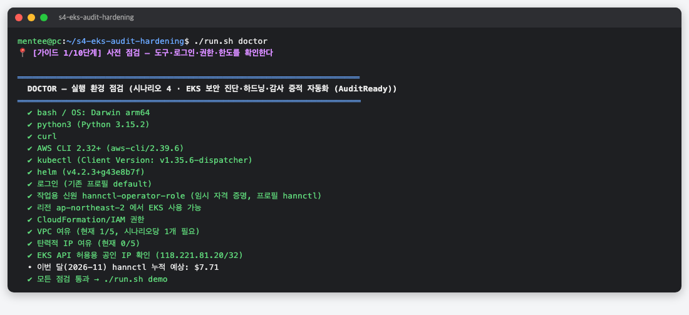

**정상이면** 모든 줄이 `✔` 이고 마지막 줄이 `✔ 모든 점검 통과 → ./run.sh demo` 다.

- `✘` 가 있으면 그 줄의 `→` 뒤 안내대로 해결하고 `./run.sh doctor` 를 다시 실행한다.
- `VPC 여유` 가 부족하다고 나오면 다른 시나리오를 먼저 `./run.sh down` 으로 지운다(시나리오 1개가 VPC 1개를 쓴다).

---

## 2단계 · 실행 시작

**할 일** — 첫 번째 터미널에서:

```bash
./run.sh demo
```

유지 시간을 묻는다. 그냥 **Enter** 를 누르면 6시간이다(만든 시각부터 6시간이 지나면 자동 삭제된다). 1~24 사이 숫자를 넣어도 된다. 6시간이면 `• 유지 시간 6시간 (최대 예상 비용 약 $1.26)` 이 나온다.

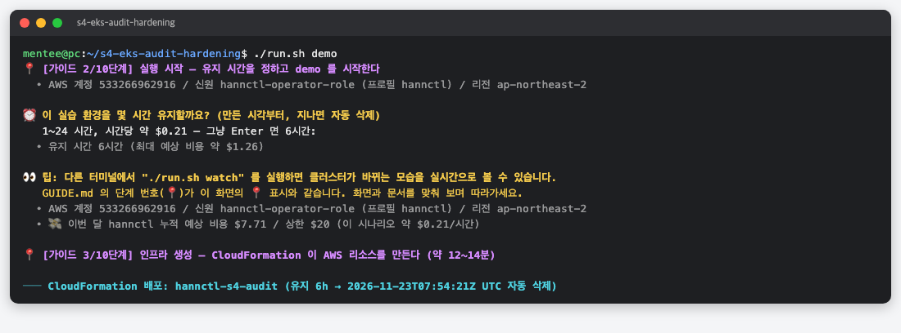

이어서 **두 번째 터미널**을 열고:

```bash
cd ~/hannctl_mentoring/s4-eks-audit-hardening     # 새 터미널은 홈 폴더에서 시작하므로 시나리오 폴더로 이동
./run.sh watch
```

클러스터가 만들어지는 동안에는 `⏳ EKS 클러스터 hannctl-s4-audit 준비 대기 중 (현재: 아직 없음) — 인프라 생성에 10~15분 걸립니다.` 화면이 15초마다 갱신된다. 클러스터가 준비되면 자동으로 관찰 화면으로 바뀌므로 그대로 켜 둔다.

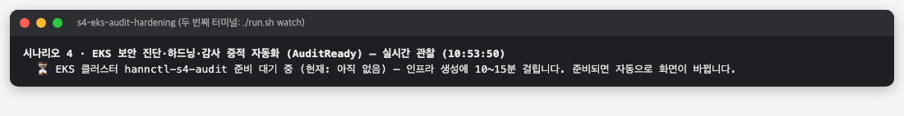

> 💡 Before 상태를 더 오래 살펴보고 싶으면 `./run.sh demo --before-wait 180` 처럼 관찰 시간(초)을 늘려서 시작한다(기본 60초).

---

## 3단계 · 인프라 생성

> 📍 터미널: `[가이드 3/10단계] 인프라 생성` · 약 13분 · 자동 진행

**화면에 나오는 것** — CloudFormation 이 리소스를 하나씩 만든다. `…` 는 만드는 중, `✔` 는 완료다. 왼쪽 `[  0m34s]` 는 시작 후 지난 시간이다. 첫 줄 `유지 6h → … UTC 자동 삭제` 는 자동 삭제 예정 시각(UTC)이다.

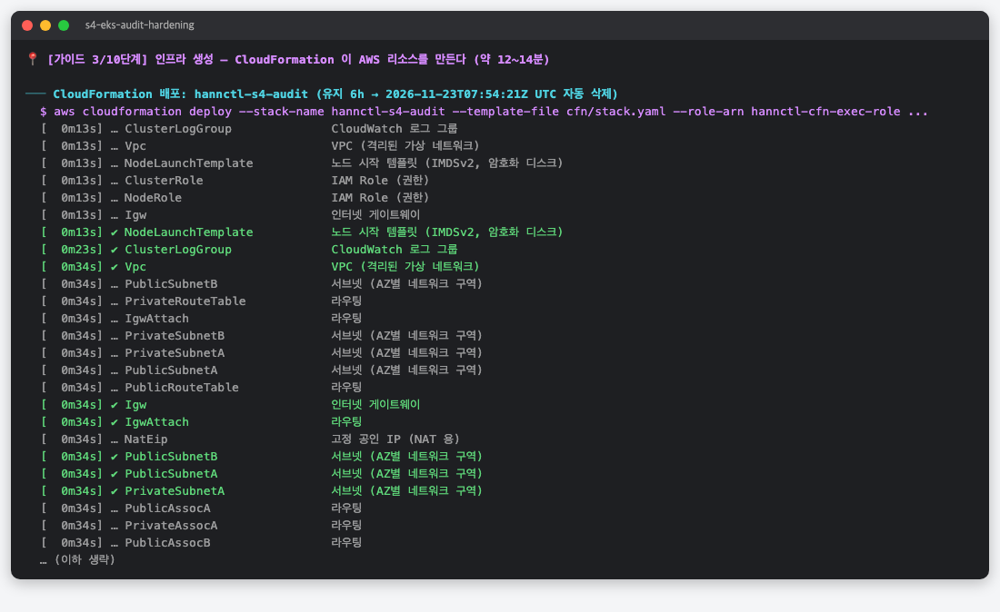

만드는 순서는 CloudWatch 로그 그룹(`ClusterLogGroup`)·노드 시작 템플릿(IMDSv2)·IAM 역할·VPC·서브넷 → NAT(약 2분) → **EKS 클러스터(약 9분, 가장 오래 걸림)** → 애드온·개발자 IAM 역할(`DeveloperRole`)·Access Entry → 노드 그룹(약 2분) → CoreDNS·Metrics Server 애드온 순서다. 감사 로그를 받을 로그 그룹은 처음부터 만들어 두지만, 클러스터의 감사 로그 자체는 **꺼진 상태로** 만든다(7단계 개선 1에서 켠다).

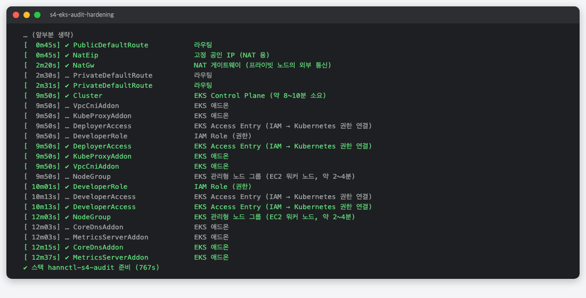

**정상이면** 마지막에 `✔ 스택 hannctl-s4-audit 준비 (767s)` 처럼 걸린 시간과 함께 준비 완료가 나온다.

### 🖥️ 콘솔에서 같이 보기

**CloudFormation** → **스택(Stacks)** → `hannctl-s4-audit` → **리소스(Resources)** 탭. 새로 고침(⟳)을 누를 때마다 `CREATE_IN_PROGRESS` 가 `CREATE_COMPLETE` 로 바뀌어 간다. 로그 그룹 `/aws/eks/hannctl-s4-audit/cluster`·IAM 역할·NAT 는 먼저 끝나고, `Cluster` 는 오랫동안 `CREATE_IN_PROGRESS` 로 남는다.

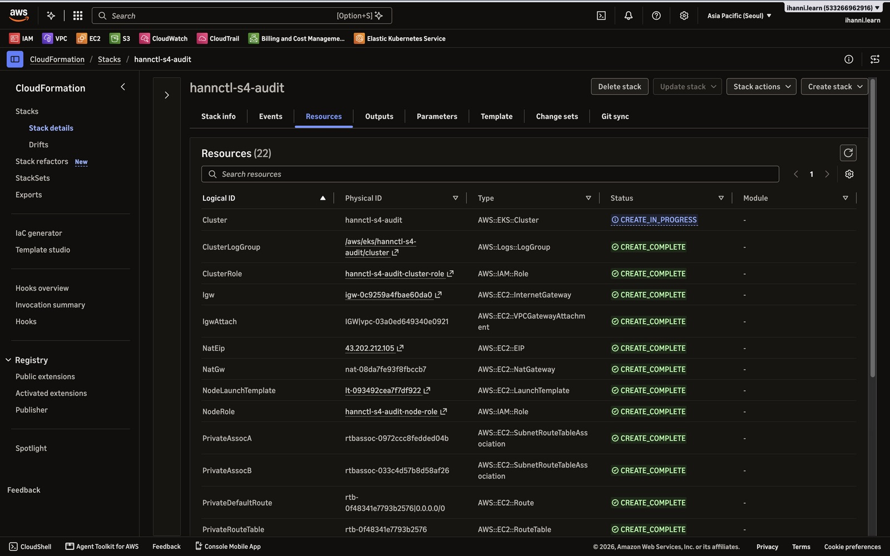

**Elastic Kubernetes Service** → **클러스터(Clusters)** → `hannctl-s4-audit`. 처음에는 상태(Status)가 **Creating** 이고, Kubernetes 버전은 `1.35` 다. Pods·Nodes 는 아직 `Data unavailable` 이다.

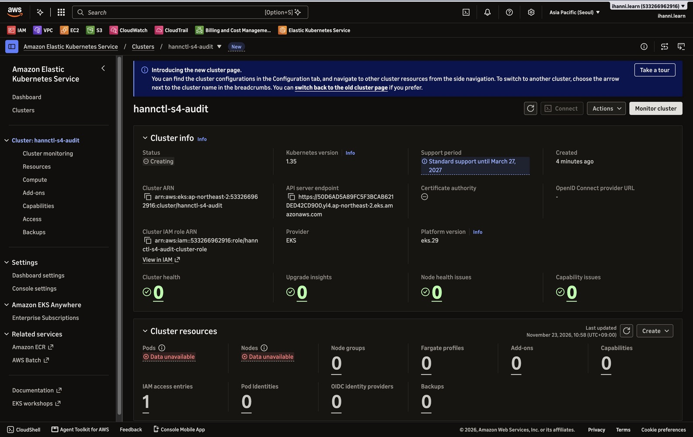

모두 끝나면 리소스 30개가 모두 `CREATE_COMPLETE` 가 된다. 아래 화면은 같은 **리소스** 탭을 7단계 개선 1(감사 로그 켜기) 도중에 본 것이라 `Cluster` 줄만 `UPDATE_IN_PROGRESS` 이고, 나머지(`DeveloperRole`, `DeveloperAccess` 등)는 `CREATE_COMPLETE` 다.

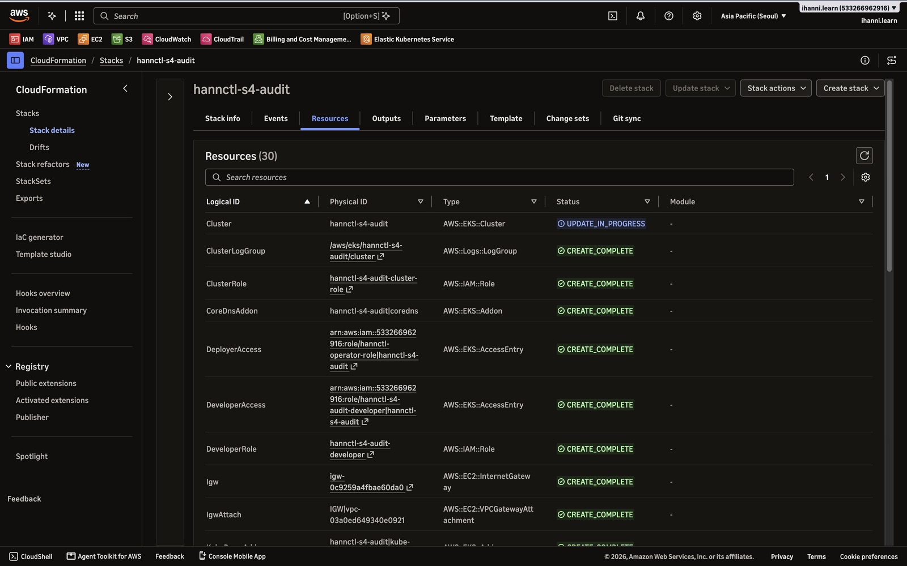

---

## 4단계 · 클러스터 기본 구성

> 📍 터미널: `[가이드 4/10단계] 클러스터 기본 구성` · 약 1분 · 자동 진행

**화면에 나오는 것** — 노드가 Ready 가 될 때까지 기다린 뒤, 정책 엔진 Kyverno 를 설치하고, 점검 대상 업무 서비스(`audit-app`: web→api), 다른 팀(`other-team`: client), 승인된 점검 전용 Namespace(`hannctl-audit`)를 배포한다.

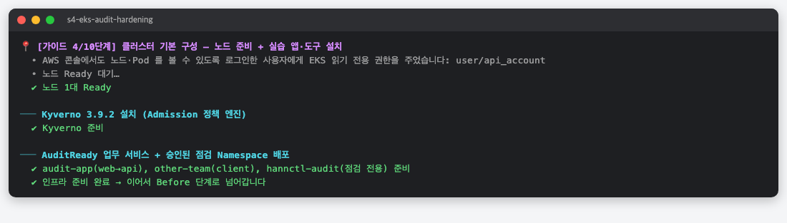

**정상이면** `✔ audit-app(web→api), other-team(client), hannctl-audit(점검 전용) 준비` 와 `✔ 인프라 준비 완료 → 이어서 Before 단계로 넘어갑니다` 가 나오고 바로 5단계로 넘어간다.

### 🖥️ 콘솔에서 같이 보기

**EKS** → `hannctl-s4-audit` → 왼쪽 **Compute**: 노드 1대(`t4g.medium`, On-Demand)가 **Ready** 이고, 노드 그룹 `hannctl-s4-audit-ng-ON_DEMAND` 가 **Active** 다.

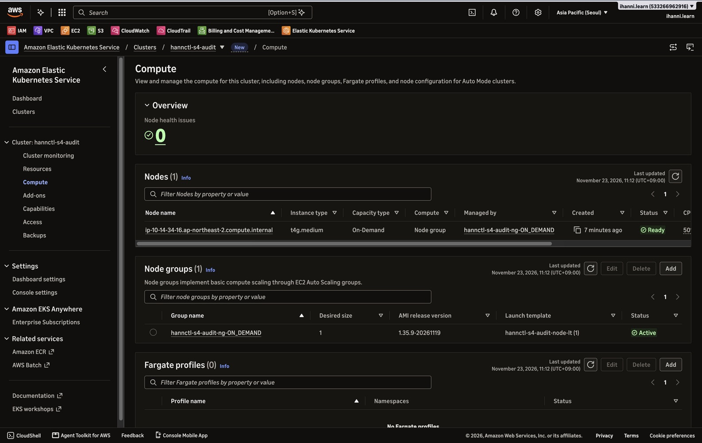

> 콘솔에서 노드·Pod 를 볼 수 있도록, 콘솔에 로그인한 사용자에게 이 클러스터의 **읽기 전용** 권한이 자동으로 주어진다(`• AWS 콘솔에서도 노드·Pod 를 볼 수 있도록 로그인한 사용자에게 EKS 읽기 전용 권한을 주었습니다: user/…` 안내가 한 번 나온다). 콘솔에 `Unauthorized` 나 `forbidden` 이 보이면 1~2분 뒤 새로 고침한다.

---

## 5단계 · Before (위험 재현)

> 📍 터미널: `[가이드 5/10단계] Before` · 약 1분 15초 · 자동 진행

**무엇을 하나** — 2년째 운영하며 쌓인 상태를 일부러 만든다: EKS 감사 로그 꺼짐, 개발자 그룹(`hannctl:developers`)과 앱의 기본 ServiceAccount(`audit-app/default`)에 `cluster-admin`, Pod 보안 기준·NetworkPolicy·정기 점검 없음. 그 상태에서 두 가지 진단과 위험 재현 테스트를 실행한다.

- **진단 A) kube-bench** — 공인 기준 CIS Amazon EKS Benchmark v1.8.0 으로 자동 점검한다. 점검 Pod 는 특권이 필요해 전용 Namespace(`hannctl-audit`)에서만 실행하고 끝나면 지운다.
- **진단 B) 자체 점검 DEMO-01~12** — CIS 에 없는 회사 기준(감사 로그, 정기 점검, 앱 정상 여부)을 점검 스크립트로 확인한다. 두 표는 합산하지 않는다.

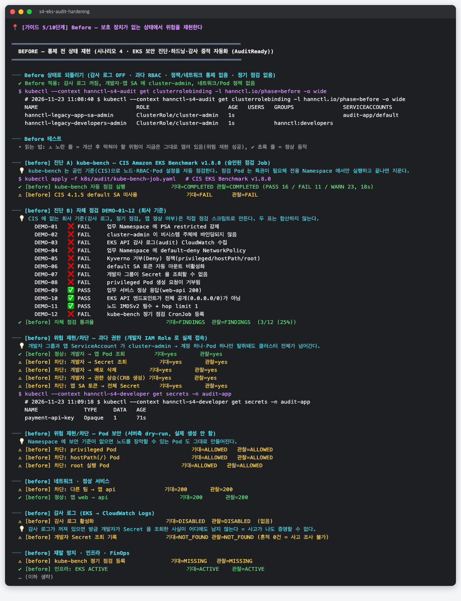

맨 위 목록에서 `hannctl-legacy-app-sa-admin`(SERVICEACCOUNTS `audit-app/default`)과 `hannctl-legacy-developers-admin`(GROUPS `hannctl:developers`)이 모두 `ClusterRole/cluster-admin` 이다.

**읽는 법**

| 표시 | 의미 |
|---|---|
| `⚠` 노란 줄 | 개선 후 막혀야 할 위험이 **지금은 그대로 열려 있다** (위험 재현 성공) |
| `✔` 초록 줄 | 정상 동작 또는 측정 결과 (개발자의 Pod 조회, web→api, 인프라 상태, kube-bench 실행, 자체 점검 통과율, 점검 소요시간 등) |
| `✘` 빨간 줄 | 기대와 다르다 → [문제 해결](#문제-해결) |

**정상이면** 아래처럼 위험이 재현된다.

| 테스트 | 관찰 | 뜻 |
|---|---|---|
| kube-bench 자동 점검 실행 | `COMPLETED` (`PASS 16 / FAIL 11 / WARN 23`) | 공인 기준으로 본 출발점 |
| CIS 4.1.5 default SA 미사용 | `FAIL` ⚠ | 앱이 default ServiceAccount 를 쓴다 |
| 자체 점검 통과율 | `FINDINGS` (`3/12 (25%)`) | DEMO-09·10·11 만 `✅ PASS`, 나머지 9개 `❌ FAIL` |
| 개발자 → 앱 Pod 조회 | `yes` ✔ | 업무에 필요한 권한 (After 에도 남아야 한다) |
| 개발자 → Secret 조회 / 배포 삭제 / 권한 상승(CRB 생성) | `yes` ⚠ | 개발자 IAM 역할로 실제 접속해 확인했다. `get secrets` 결과에 `payment-api-key` 가 실제로 출력됨 |
| 앱 SA 토큰 → 전체 Secret | `yes` ⚠ | Pod 하나만 탈취돼도 클러스터의 모든 Secret 을 읽는다 |
| privileged / hostPath(/) / root 실행 Pod | `ALLOWED` ⚠ | 노드를 장악할 수 있는 Pod 를 만들 수 있다 (서버측 dry-run, 실제 생성 안 함) |
| 다른 팀 → 앱 api | `200` ⚠ | 아무 Namespace 에서나 업무 API 를 호출할 수 있다 |
| 앱 web → api | `200` ✔ | 업무 서비스는 정상 |
| 감사 로그 활성화 | `DISABLED` ⚠ (`없음`) | 감사 로그가 꺼져 있다 |
| 개발자 Secret 조회 기록 | `NOT_FOUND` ⚠ (`흔적 0건 = 사고 조사 불가`) | 방금 개발자가 Secret 을 조회했는데 그 사실이 어디에도 남지 않았다 |
| kube-bench 정기 점검 등록 | `MISSING` ⚠ | 점검이 사람 기억에 의존한다 |
| 점검 소요시간(진단 A+B) | `AUTOMATED` (`자동 29s (수동 가정: 12항목×10분 ≈ 2시간)`) | 진단 두 가지를 자동으로 30초 안에 끝냈다 |

### 👀 두 번째 터미널 (watch)

맨 위 `DescribeCluster` 에 버전 `1.35` 만 보이고 **감사 로그 칸이 없다**(꺼져 있다). Namespace `audit-app`, `other-team` 의 `ENFORCE`·`PROTECTED` 는 비어 있고, `hannctl-audit` 만 `privileged`(점검 전용 예외 구역)다. 권한 목록에 `hannctl-legacy-app-sa-admin`, `hannctl-legacy-developers-admin` → `ClusterRole/cluster-admin` 이 있고, 진단 A 가 돌 때는 `job.batch/hannctl-kube-bench` 가 `Running` 으로 잠깐 보인다. 맨 아래 **최근 진행 단계**에 `Before 상태 적용` 이 찍힌다.

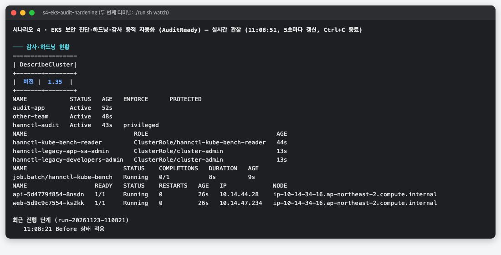

### 🖥️ 콘솔에서 같이 보기

**EKS** → **클러스터(Clusters)** → `hannctl-s4-audit` → 클러스터 화면을 아래로 내려 **Control plane logs** 절. API server, Audit, Authenticator, Controller manager, Scheduler 가 모두 **off** 다.

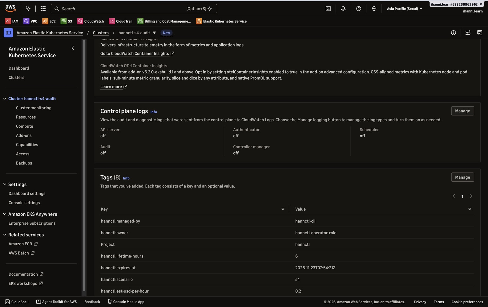

---

## 6단계 · Before 관찰

> 📍 터미널: `[가이드 6/10단계] Before 관찰` · 60초 카운트다운

화면에 `── Before 관찰 시간 (60s) — 다른 터미널에서 ./run.sh status 또는 README 의 조회 명령을 실행해 보세요` 가 나오고 `⏳ Before 상태 유지 중, 이후 자동으로 After 로 전환 — 60s 남음` 이 줄어든다. 카운트다운이 끝나면 자동으로 7단계로 넘어간다.

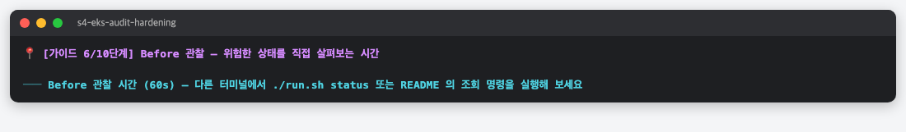

**할 일 (선택)** — 세 번째 터미널을 열어 위험을 직접 확인해 본다. 먼저 이 시나리오 전용 접속 설정을 불러온다(내 `~/.kube/config` 는 건드리지 않는다).

```bash
cd ~/hannctl_mentoring/s4-eks-audit-hardening     # 새 터미널은 홈 폴더에서 시작하므로 시나리오 폴더로 이동
eval "$(./run.sh kubeconfig)"
```

| 확인할 것 | 명령 | Before 결과 |
|---|---|---|
| AWS 리소스 전체 | `./run.sh status` | 스택·클러스터·노드 상태와 남은 유지 시간 |
| 감사 로그 켜짐 여부 | `aws eks describe-cluster --name hannctl-s4-audit --query cluster.logging` | audit 가 꺼져 있다 |
| 과다 권한 찾기 | `kubectl get clusterrolebinding -o wide \| grep cluster-admin` | `hannctl-legacy-developers-admin`(`hannctl:developers`), `hannctl-legacy-app-sa-admin`(`audit-app/default`)이 보인다 |
| 개발자로 접속해 보기 | `kubectl --context hannctl-s4-developer get secrets -n audit-app` | `payment-api-key` 가 목록에 보인다 (After: Forbidden) |
| 앱 SA 의 권한 | `kubectl auth can-i list secrets -A --as=system:serviceaccount:audit-app:default` | `yes` |

60초가 짧으면 `demo` 가 끝난 뒤 [9단계의 "다시 해 보기"](#다시-해-보기)로 Before 상태를 다시 만들 수 있다.

---

## 7단계 · 개선 단계 1 ~ 5

> 📍 터미널: `[가이드 7/10단계] 개선 단계` · 약 2분 40초 · 자동 진행

개선 단계마다 같은 형식으로 나온다: **변경·효과 → 📄 적용하는 설정 파일 → `$` 실행한 명령 → 즉시 확인(효과 측정) → 💡 배움 포인트**. 단계 사이에는 5초 쉰다. 개선 1만 CloudFormation 스택 업데이트라 1분 30초쯤 걸리고, 나머지는 몇 초 만에 끝난다.

### 개선 1/5 · 감사 로그 활성화

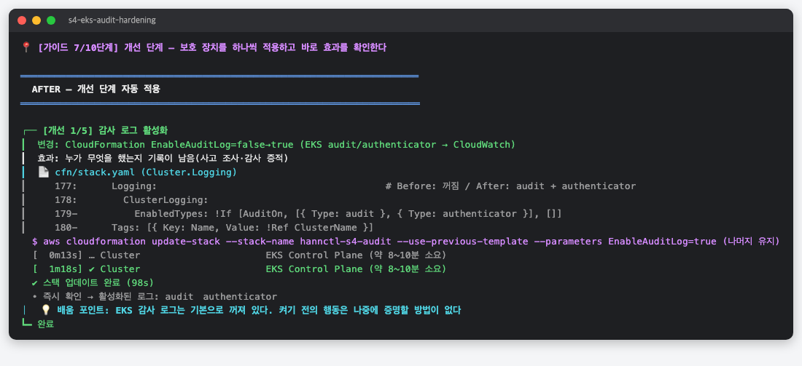

CloudFormation 파라미터 `EnableAuditLog` 를 `false→true` 로 바꿔 EKS 의 audit·authenticator 로그를 CloudWatch 로 보낸다(`cfn/stack.yaml` 의 `Cluster.Logging`). 템플릿은 그대로 두고 파라미터만 바꾸는 스택 업데이트다. **정상이면** `✔ 스택 업데이트 완료 (98s)` 다음에 `• 즉시 확인 → 활성화된 로그: audit	authenticator`.

**여기가 이 시나리오에서 가장 중요한 순간이다.** 감사 로그는 기본으로 꺼져 있고, 켜기 전의 행동은 나중에 증명할 방법이 없다. 5단계에서 개발자가 Secret 을 조회한 일은 이미 지나갔기 때문에 지금 로그를 켜도 그 기록은 생기지 않는다. 8단계에서 이 차이를 CloudWatch 로 직접 확인한다.

**🖥️ 콘솔** — **EKS** → `hannctl-s4-audit` → 클러스터 화면 아래쪽 **Control plane logs** 절. Audit 자리에 **View audit logs**, Authenticator 자리에 **View authenticator logs** 링크가 생긴다. 나머지(API server, Controller manager, Scheduler)는 그대로 off 다.

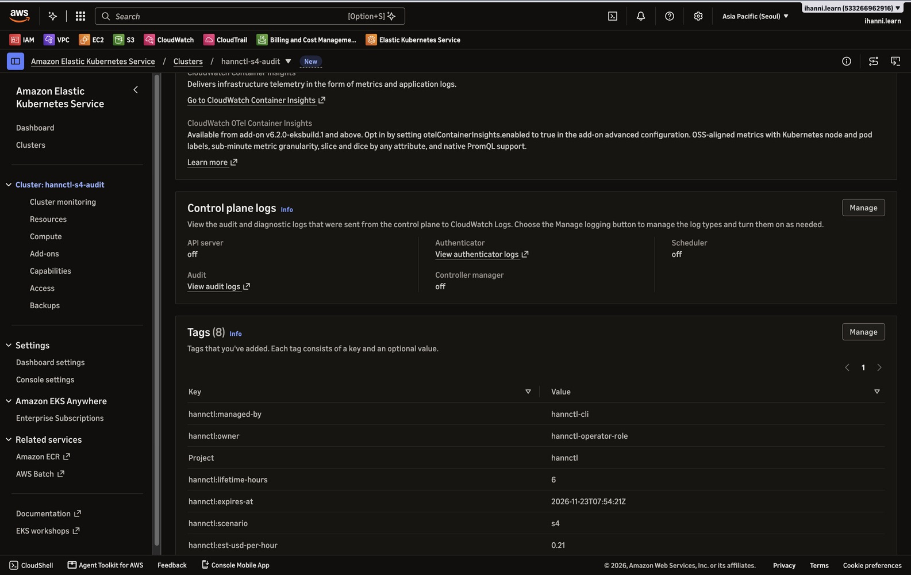

### 개선 2/5 · 과다 권한 제거 (RBAC)

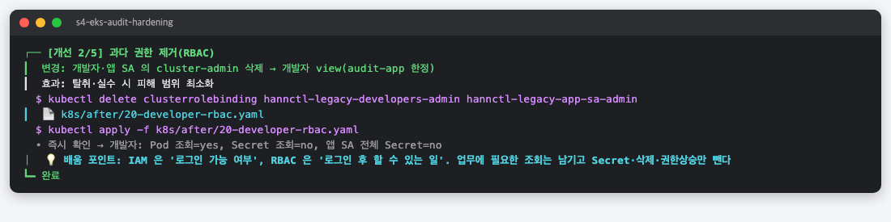

개발자·앱 SA 의 `cluster-admin` 바인딩 2개를 지우고, 개발자에게는 `audit-app` Namespace 안에서만 유효한 `view`(Secret 제외 읽기 전용)를 준다(`k8s/after/20-developer-rbac.yaml`). **정상이면** `개발자: Pod 조회=yes, Secret 조회=no, 앱 SA 전체 Secret=no`. 업무에 필요한 조회는 남기고 Secret·삭제·권한 상승만 뺀다.

### 개선 3/5 · Pod 보안 기준 강제

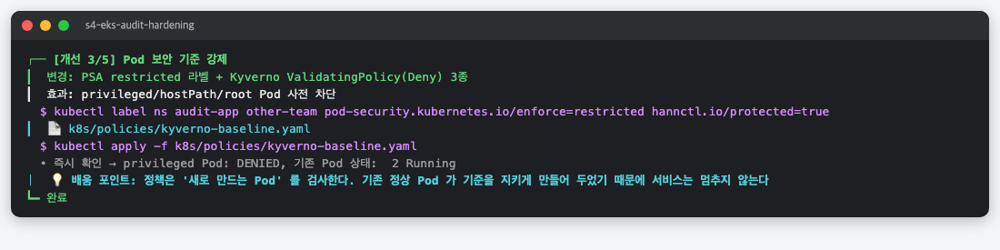

`audit-app`, `other-team` Namespace 에 PSA `restricted` 라벨과 `hannctl.io/protected=true` 를 붙이고 Kyverno ValidatingPolicy(Deny) 3종을 적용한다(`k8s/policies/kyverno-baseline.yaml`). **정상이면** `privileged Pod: DENIED, 기존 Pod 상태:  2 Running` — 새 위험 Pod 는 거부되고, 이미 돌고 있던 앱은 그대로다.

### 개선 4/5 · 네트워크·토큰 최소화

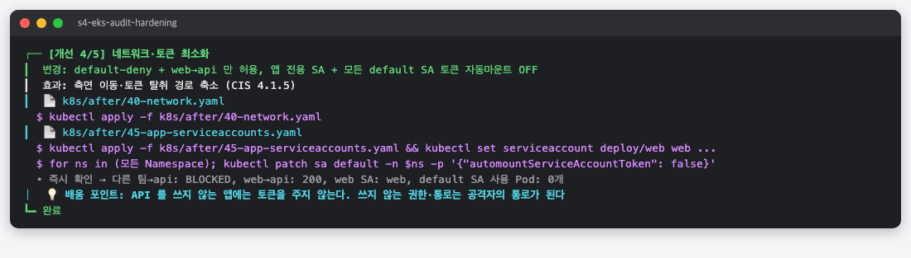

`default-deny` 후 web→api 만 허용하고(`k8s/after/40-network.yaml`), 앱 전용 ServiceAccount 를 만들어 Deployment 에 연결한 뒤(`k8s/after/45-app-serviceaccounts.yaml`), 모든 Namespace 의 default SA 토큰 자동 마운트를 끈다. **정상이면** `다른 팀→api: BLOCKED, web→api: 200, web SA: web, default SA 사용 Pod: 0개`. 이 변경으로 CIS 4.1.5(default SA 미사용)가 고쳐진다.

### 개선 5/5 · 정기 점검 자동화

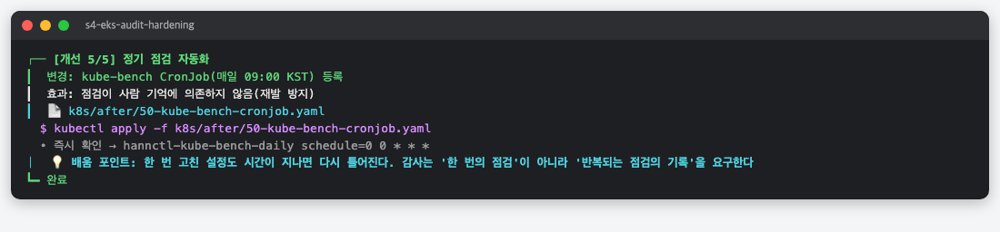

kube-bench CronJob `hannctl-kube-bench-daily` 를 등록한다(매일 00:00 UTC = 09:00 KST, `k8s/after/50-kube-bench-cronjob.yaml`). **정상이면** `hannctl-kube-bench-daily schedule=0 0 * * *`. 마지막에 `• 다음: 동일 조건으로 재진단(kube-bench + 자체 점검) → 전후 비교표 COMPLIANCE.md` 가 나오고 8단계로 넘어간다.

### 👀 두 번째 터미널 (watch) — 개선이 끝난 모습

- `DescribeCluster` 에 **감사로그** 칸이 생기고 `audit`, `authenticator` 가 보인다
- Namespace: `audit-app`, `other-team` 이 `ENFORCE=restricted`, `PROTECTED=true`
- 권한: `hannctl-legacy-*` 의 `cluster-admin` 이 사라지고 `hannctl-developers-view` → `ClusterRole/view`
- NetworkPolicy 4개: `allow-api-from-web-ingress`, `allow-dns-egress`, `allow-web-to-api-egress`, `default-deny-all`
- Kyverno 정책 3개(`hannctl-disallow-host-path`, `hannctl-disallow-privileged`, `hannctl-require-run-as-non-root`) `READY=true`
- `cronjob.batch/hannctl-kube-bench-daily` (`SCHEDULE 0 0 * * *`)
- 맨 아래 **최근 진행 단계**에 개선 단계와 `after 진단·테스트 완료` 가 시간순으로 쌓인다

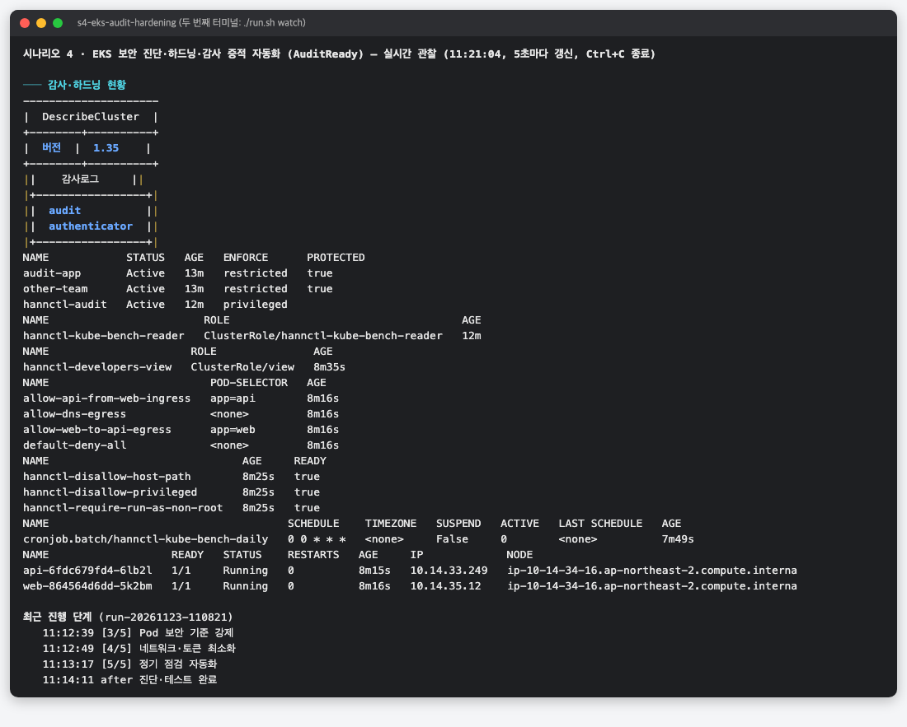

---

## 8단계 · After 테스트와 채점

> 📍 터미널: `[가이드 8/10단계] After 테스트·채점` · 약 2분 · 자동 진행

**무엇을 하나** — 5단계와 **똑같은 진단(같은 kube-bench Job, 같은 자체 점검 스크립트)과 테스트**를 다시 실행하고, 개발자의 Secret 조회 시도가 CloudWatch 감사 로그에 남았는지 찾는다. 같은 조건에서 비교해야 "개선됐다"고 말할 수 있다.

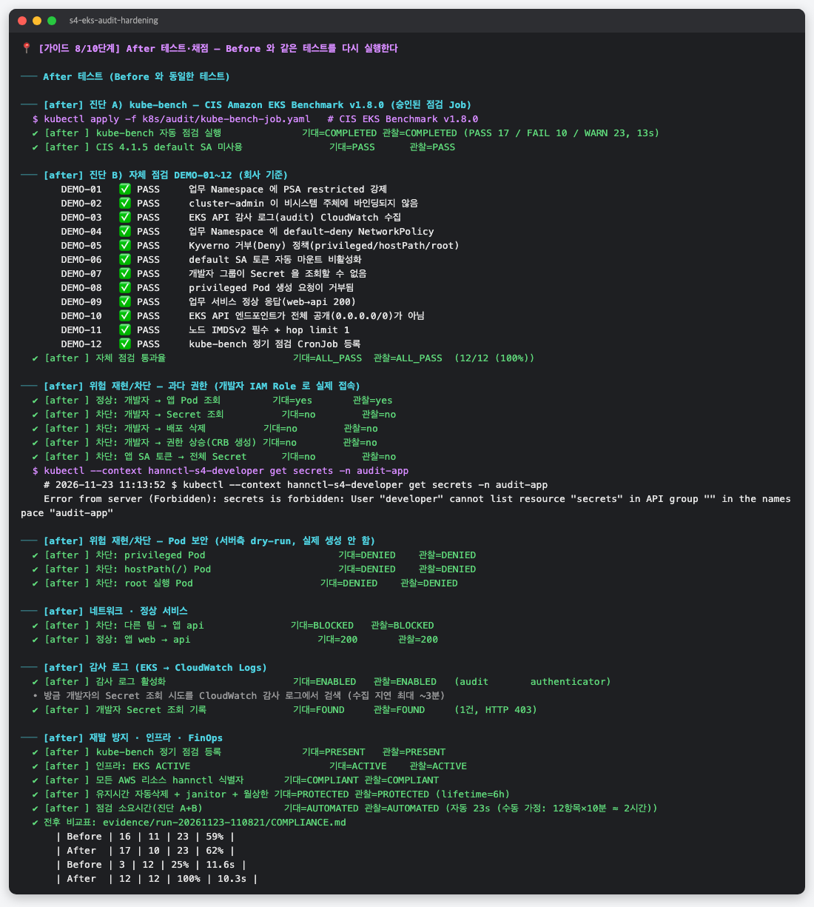

**정상이면** 모든 줄이 `✔` 초록이다.

- kube-bench `COMPLETED` (`PASS 17 / FAIL 10 / WARN 23`), CIS 4.1.5 default SA 미사용 `PASS`
- 자체 점검 DEMO-01~12 모두 `✅ PASS`, 통과율 `ALL_PASS` (`12/12 (100%)`)
- 개발자: Pod 조회 `yes`, Secret 조회·배포 삭제·권한 상승 `no`, 앱 SA 토큰 → 전체 Secret `no`. `Error from server (Forbidden): secrets is forbidden: User "developer" cannot list resource "secrets" in API group "" in the namespace "audit-app"` 가 실제로 출력됨
- privileged / hostPath(/) / root 실행 Pod `DENIED`
- 다른 팀 → 앱 api `BLOCKED`, 앱 web → api `200`
- 감사 로그 `ENABLED` (`audit	authenticator`), 개발자 Secret 조회 기록 `FOUND` (`1건, HTTP 403`) — 감사 로그는 수집이 늦을 수 있어 `(수집 지연 최대 ~3분)` 동안 기다린다
- kube-bench 정기 점검 등록 `PRESENT`, 점검 소요시간 `AUTOMATED` (`자동 23s (수동 가정: 12항목×10분 ≈ 2시간)`)

마지막에 전후 비교표 `COMPLIANCE.md` 의 요약 줄이 나온다. 위 두 줄은 kube-bench 표(PASS / FAIL / WARN / 자동판정 준수율), 아래 두 줄은 자체 점검 표(통과 / 전체 / 통과율 / 소요 시간)다.

```text
  ✔ 전후 비교표: evidence/run-20261123-110821/COMPLIANCE.md
      | Before | 16 | 11 | 23 | 59% |
      | After  | 17 | 10 | 23 | 62% |
      | Before | 3 | 12 | 25% | 11.6s |
      | After  | 12 | 12 | 100% | 10.3s |
```

kube-bench 는 FAIL 11 → 10 으로 하나만 줄었다. 우리가 고칠 수 있는 범위에서 바뀐 항목이 4.1.5 이고, 남은 FAIL·WARN 은 EKS 가 관리하는 영역이나 시스템 Pod 때문이다. 남은 항목과 이유는 `COMPLIANCE.md` 에 그대로 적혀 있다.

이어서 평가표로 자동 채점한다.

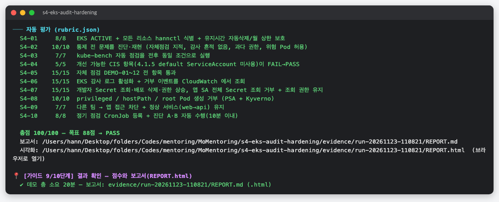

**정상이면** `총점 100/100 — 목표 88점 → PASS` (88점 이상이면 통과).

### 🖥️ 콘솔에서 같이 보기

**CloudWatch** → 왼쪽 **로그(Logs)** → **로그 관리(Log Management)** → 로그 그룹 `/aws/eks/hannctl-s4-audit/cluster` → **모든 로그 이벤트 검색**. 검색창에 아래 필터를 넣고 Enter. 기간은 `1h`.

```text
{ $.user.username = "developer" && $.objectRef.resource = "secrets" }
```

개발자(`developer`)가 Secret 에 접근한 기록만 나온다. 로그 스트림 이름은 `kube-apiserver-audit-…` 이고, 시각(Timestamp)은 UTC 다. 예를 들어 `2026-11-23T02:13:54.072Z` 는 한국 시각 11:13:54 로, 8단계 화면의 `# 2026-11-23 11:13:52 $ kubectl --context hannctl-s4-developer get secrets -n audit-app` 와 같은 시각대다. 이벤트를 펼치면 누가(`user.username`), 무엇을(`objectRef.resource`, `verb`) 했고 결과가 무엇이었는지(`responseStatus.code`, 거부는 `403`) 나온다.

5단계(11:09:18)에서 개발자가 실제로 Secret 목록을 조회했지만 그 기록은 이 목록에 **없다**. 감사 로그를 켜기 전이었기 때문이다. `./run.sh before`, `./run.sh after` 를 다시 실행했다면 그때의 기록도 함께 보인다(아래 화면은 4건).

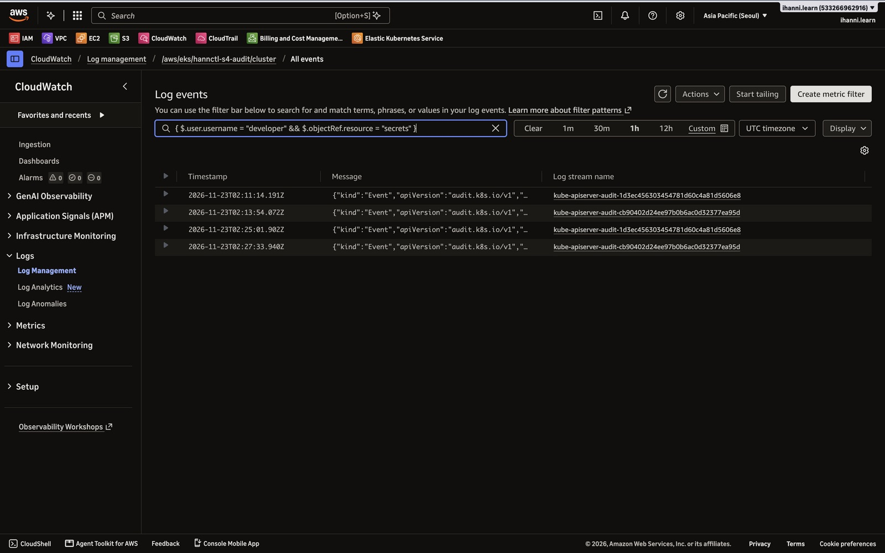

---

## 9단계 · 결과 확인

> 📍 터미널: `[가이드 9/10단계] 결과 확인`

마지막 줄에 `✔ 데모 총 소요 N분 — 보고서: evidence/run-…/REPORT.md (.html)` 가 나오면 `demo` 가 끝난 것이다.

보고서 `evidence/latest/REPORT.html` 이 브라우저로 열린다. 열리지 않으면 직접 연다.

```bash
open evidence/latest/REPORT.html        # macOS
xdg-open evidence/latest/REPORT.html    # Linux
cat evidence/latest/REPORT.md           # 터미널에서 보기 (CloudShell 포함)
cat evidence/latest/COMPLIANCE.md       # kube-bench 표와 자체 점검 표를 나눈 전후 비교 보고서
```

CloudShell 에서는 오른쪽 위 **작업(Actions) → 파일 다운로드**에 `pwd` 결과 뒤 `/evidence/latest/REPORT.html` 을 붙인 경로를 넣어 내려받는다.

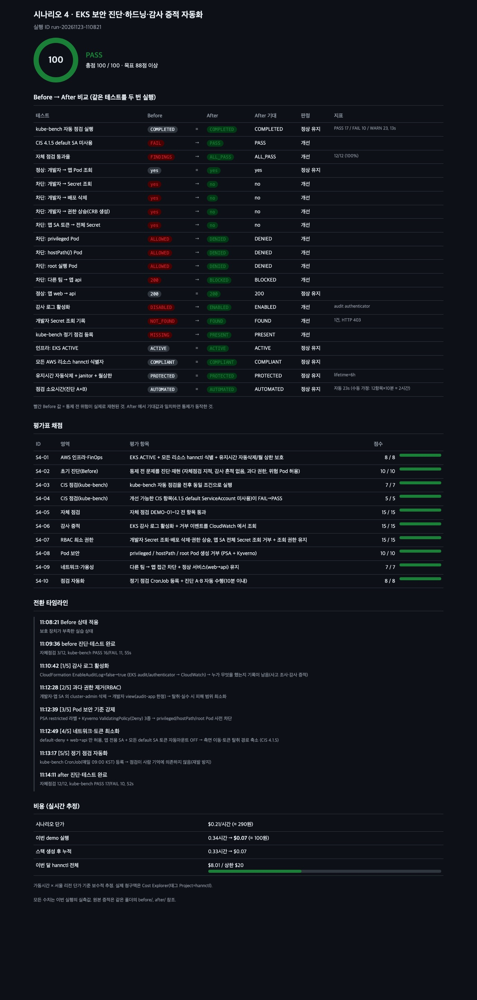

| 보고서 부분 | 보는 법 |
|---|---|
| 점수 원 | 총점과 PASS/FAIL |
| Before → After 비교 | 빨간 Before 값 = 실제로 재현된 위험(`FAIL`, `FINDINGS`, `yes`, `ALLOWED`, `200`, `DISABLED`, `NOT_FOUND`, `MISSING`), After 가 기대값과 같으면 통제가 동작한 것. `→` 는 개선, `=` 는 정상 유지. 오른쪽 **지표** 열에 kube-bench 집계, 자체 점검 통과율, `1건, HTTP 403` 등이 있다 |
| 평가표 채점 | 항목별 점수 S4-01 ~ S4-10 (기준은 [RUBRIC.md](RUBRIC.md)) |
| 전환 타임라인 | Before 상태 적용 → before 진단·테스트 완료 → 개선 1~5 → after 진단·테스트 완료 시각 |
| 비용 | 시나리오 단가, 이번 demo 실행·스택 생성 후 누적·이번 달 hannctl 전체 비용 추정 |

### 다시 해 보기

인프라를 그대로 둔 채 단계만 다시 실행할 수 있다. 발표 리허설이나 6단계 관찰을 천천히 할 때 쓴다.

| 명령 | 하는 일 | 시간 |
|---|---|---|
| `./run.sh before` | 감사 로그를 끄고(스택 업데이트 약 1분 30초) cluster-admin 등 Before 상태로 되돌린 뒤 Before 진단·테스트 (5단계) | 약 2분 30초 |
| `./run.sh after` | 개선 1~5 적용 + After 진단·테스트 + 채점 (7~8단계) | 약 3분 30초 |
| `./run.sh demo` | 5~9단계 전체 (인프라가 있으면 바로 Before 부터) | 약 5분 |
| `./run.sh status` | 스택·클러스터·노드 상태와 남은 유지 시간 | 몇 초 |

### (선택) 클러스터 버전 업그레이드 — `./run.sh upgrade`

클러스터 버전 업그레이드(1.35 → 1.36)를 절차대로 연습한다. `demo` 에는 포함되지 않으며 약 20분, 추가 비용 약 $0.07(≈100원)이다. 도중에 자동 삭제되지 않도록 먼저 유지 시간을 넉넉히 잡는다.

```bash
./run.sh lifetime 8      # 만든 시각부터 8시간
./run.sh upgrade
```

| 순서 | 무엇을 하나 |
|---|---|
| 1. 사전 점검 | `aws eks list-insights` (EKS Upgrade Insights: 제거될 API 사용 여부), 노드·앱 상태 기록 |
| 2. Control Plane | CloudFormation `KubernetesVersion=1.36` 업데이트 (약 7~12분). 한 번에 1 minor 버전씩, Control Plane 이 먼저다 |
| 3. 노드 그룹 | `NodeKubernetesVersion=1.36` → 노드를 1대씩 롤링 교체 |
| 4. 애드온 | vpc-cni, kube-proxy, coredns 등을 새 버전 기본값으로 갱신 |
| 5. 사후 점검 | 노드 버전, 앱 `200`, `./run.sh test after` 로 재진단 |

> 되돌리기(다운그레이드)는 불가능하다. 발표 직전처럼 환경이 망가지면 곤란한 시점에는 하지 않는다.

---

## 10단계 · 삭제

> 📍 터미널: `[가이드 10/10단계] 삭제` · 약 9분

**할 일** — 실습이 끝나면 반드시 실행한다. 두 번째 터미널의 watch 는 `Ctrl+C` 로 먼저 끈다.

```bash
./run.sh down
```

**화면에 나오는 것** — CloudFormation 이 만든 순서의 반대로 리소스를 지운다. `🗑 … 삭제됨` 이 하나씩 쌓인다. Access Entry·애드온·개발자 IAM 역할·라우팅은 처음 30초 안에, NAT 는 약 1분 뒤에 지워지고, 노드 그룹(약 5분)과 EKS 클러스터(약 3분) 삭제가 가장 오래 걸린다. 마지막에 감사 로그 그룹(`ClusterLogGroup`)과 VPC 가 지워진다.

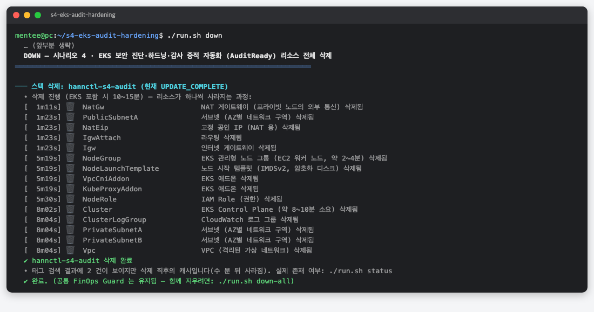

**정상이면** `✔ hannctl-s4-audit 삭제 완료` 다음에 `✔ 완료. (공통 FinOps Guard 는 유지됨 — 함께 지우려면: ./run.sh down-all)` 가 나온다. 공통 안전장치(`hannctl-finops-guard`)는 다음 실습을 위해 남겨 두는 것이다(비용 0원 수준).

> `• 태그 검색 결과에 2 건이 보이지만 삭제 직후의 캐시입니다(수 분 뒤 사라짐). 실제 존재 여부: ./run.sh status` 줄이 함께 나올 수 있다. AWS 태그 검색이 몇 분 늦게 갱신되기 때문이며 실제로 남은 리소스는 아니다.

### 🖥️ 콘솔에서 같이 보기

**CloudFormation** → **스택(Stacks)** → `hannctl-s4-audit` → **리소스(Resources)** 탭. 리소스가 하나씩 `DELETE_COMPLETE` 로 바뀐다(아직 지우는 중인 `Cluster`·`ClusterLogGroup`·`ClusterRole` 등은 이전 상태 `UPDATE_COMPLETE`·`CREATE_COMPLETE` 로 남아 있다). 다 지워지면 스택 목록(필터 **활성**)에서 사라진다.

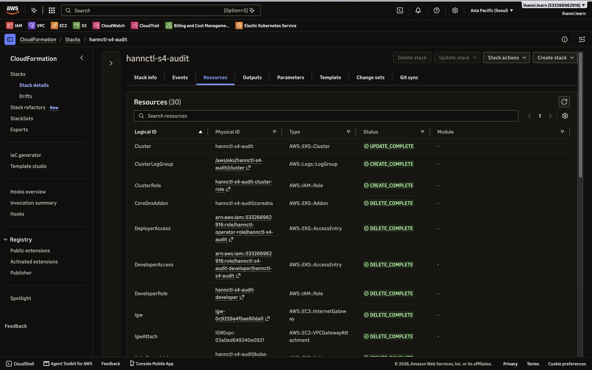

**남은 것이 없는지 확인**

```bash
./run.sh status          # "! 스택 없음" 이 나오면 이 시나리오 리소스는 모두 지워진 것
```

- 중간에 실패하면 `./run.sh down` 을 한 번 더 실행한다.
- 모든 시나리오를 끝냈으면 `./run.sh down-all` 로 공통 안전장치까지 지운다. 다른 시나리오 스택이 남아 있으면 지우지 않는다.
- `down` 을 잊어도 2단계에서 정한 유지 시간(기본 6시간)이 지나면 자동으로 삭제된다. 그래도 끝나면 바로 지우는 것이 원칙이다.

---

## 문제 해결

| 증상 | 해결 |
|---|---|
| 1단계에 `✘` | 그 줄의 `→` 안내대로 하고 `./run.sh doctor` 다시 실행 |
| 3단계 도중 터미널이 꺼짐 / CloudShell 세션 끊김 | 다시 접속해 같은 폴더에서 `./run.sh status` → 상태가 `CREATE_COMPLETE` 가 되면 `./run.sh demo` 다시 실행 (만든 인프라는 이어서 쓴다) |
| 8단계에 `✘` 가 있음 | `./run.sh after` 한 번 더 실행 |
| 8단계 `개발자 Secret 조회 기록` 이 `NOT_FOUND` | 감사 로그 수집이 늦은 것이다. 1~3분 뒤 `./run.sh test after && ./run.sh score` 로 테스트와 채점만 다시 한다 |
| 콘솔 EKS 화면에 `Unauthorized` / `forbidden` | 1~2분 뒤 새로 고침. 그래도 같으면 `./run.sh up` 을 한 번 실행 |
| kubectl 이 `Unauthorized` / 타임아웃 | 내 공인 IP 가 바뀌었을 수 있다 → `./run.sh up` (EKS API 허용 IP 갱신) |
| `Unable to parse config file: …/.aws/config` | [START_HERE.md 문제 해결](START_HERE.md) 참고 |

그 밖의 문제는 [START_HERE.md](START_HERE.md) 의 문제 해결 표를 본다.
