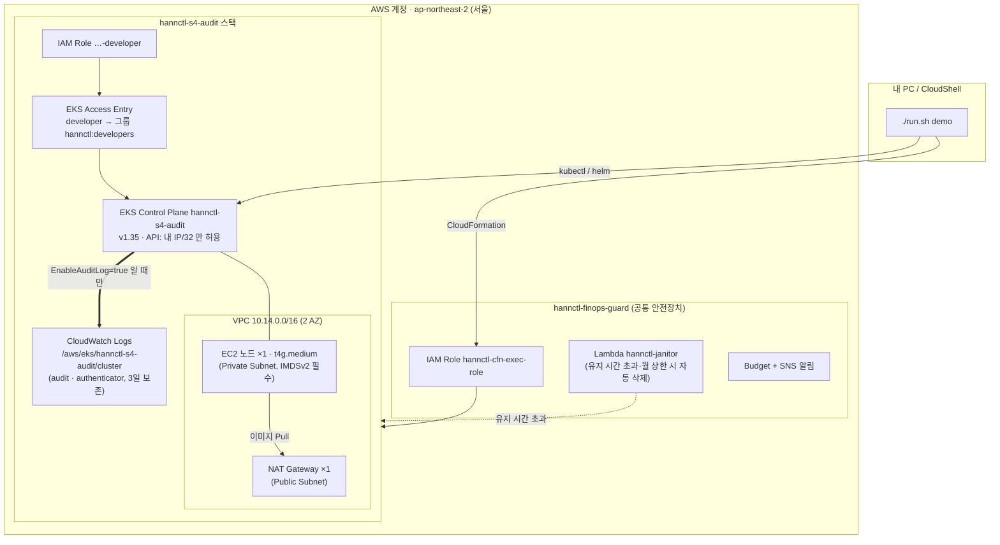
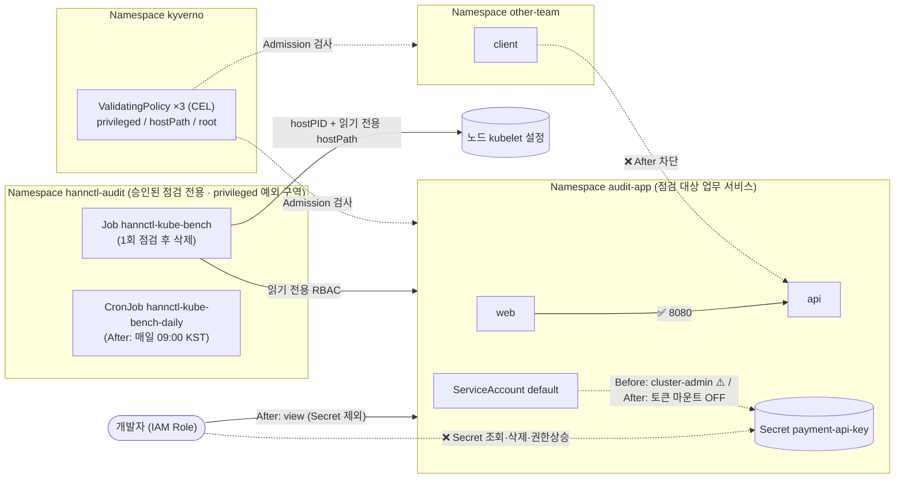
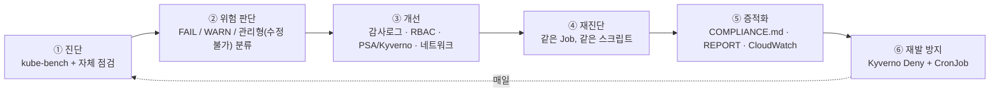
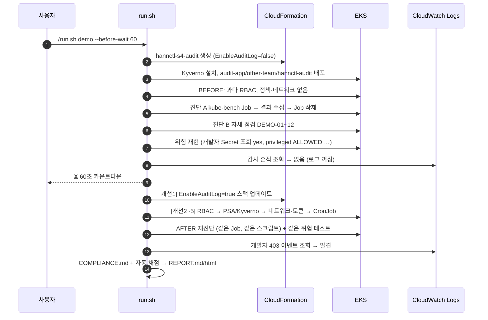

# 시나리오 4 · EKS 보안 진단·하드닝·감사 증적 자동화 (AuditReady) — 해설서

> ▶ **실습은 [GUIDE.md](GUIDE.md) 하나만 보고 따라간다** (내려받기·준비도 GUIDE.md 0단계에 있다).
> 이 문서는 시나리오의 배경·원리·직접 구성 방법·발표 포인트를 담은 해설서다.

> **한 줄 요약**
> EKS의 보안 설정을 **정해진 기준으로 자동 점검(진단)** 하고, 고칠 수 있는 항목을 **고친(하드닝)** 뒤, **같은 조건으로 다시 점검**한다.
> 그리고 무엇이 좋아졌는지를 **점수표와 감사 로그(증적)** 로 남긴다.
> 핵심은 "설정을 바꿨습니다"라는 말이 아니라 **진단 → 개선 → 재진단 → 증적 → 재발 방지**라는 한 사이클을 실제로 돌려 보이는 것이다.

| 항목 | 내용 |
|---|---|
| 난이도 | ★★★½ (3.5/5) — 도구(kube-bench)와 결과 해석, AWS 책임 범위 이해가 필요 |
| 핵심 기술 | **kube-bench**(CIS Amazon EKS Benchmark v1.8.0), 자체 점검 스크립트, **EKS 감사 로그 → CloudWatch Logs**, RBAC, PSA, Kyverno, NetworkPolicy, CronJob, (선택) **클러스터 업그레이드** |
| 소요 시간 | 처음 `demo` 약 20분(인프라 생성·구성 15분 포함), 이후 재실행 약 5분, 삭제 약 8분 (실측) |
| 예상 비용 | 약 **$0.21/시간(≈290원)** — EKS + Graviton 노드 1대 + NAT 1개. 처음 정한 유지 시간(기본 6시간) 뒤 자동 삭제 (자세히: [10장](#10-비용-안전장치-삭제-finops)) |
| 과정 요구사항 연결 | 컴플라이언스 점검(CIS kube-bench **정기 점검**·결과 기반 개선, **감사 로그** 증적), 인프라 운영(**클러스터 버전 업그레이드**), 성과(준수율 N%→N%, 점검 시간 N시간→N분) |

---

## 🎯 이 시나리오의 초점 (먼저 읽기)

| 구분 | 내용 |
|---|---|
| **핵심 포커스** | EKS 클러스터의 보안 설정을 **기준(CIS)으로 진단 → 하드닝 → 재진단 → 증적 → 재발 방지**하는 한 사이클을 실제로 돌린다 |
| **Kubernetes 보안 비중** | ★★★★★ — 클러스터 보안 설정을 점검하고 고치는 것 자체가 주제다 |
| **가장 중요하게 보는 것** | ① 개선을 **숫자**로 보여줌(자체 점검 통과율, kube-bench PASS 수) ② **고칠 수 있는 것과 AWS 관리 영역을 구분**해 정직하게 보고 ③ **감사 로그 증적**과 **정기 점검(CronJob)**으로 재발 방지 |

**무엇을 사용하나 (계층별)**

| 계층 | 사용 기술 | 이 시나리오에서 하는 일 |
|---|---|---|
| AWS 인프라 | VPC · EKS · CloudFormation 파라미터(`EnableAuditLog`) | 감사 로그를 인프라 코드로 켜고 끔 |
| 진단 | **kube-bench**(CIS Amazon EKS Benchmark v1.8.0) Job, 자체 점검 `checks/cluster_checks.py` | 기준 대비 PASS/FAIL 측정 |
| 감사 | **EKS audit log → CloudWatch Logs** | 누가 무엇을 했는지 기록 |
| K8s 접근 통제 | **RBAC** (과다 cluster-admin 제거 → 개발자 view) | 최소 권한 |
| Pod 생성 통제 | **PSA** restricted + **Kyverno** ValidatingPolicy | 위험 Pod 사전 차단 |
| 네트워크·신원 | **NetworkPolicy**, 앱 전용 ServiceAccount + default SA 토큰 자동 마운트 OFF | 측면 이동·토큰 탈취 경로 축소 |
| 재발 방지 | kube-bench **CronJob** | 점검이 사람 기억에 의존하지 않음 |
| (선택) 운영 | `./run.sh upgrade` 클러스터 버전 업그레이드 절차 | Control Plane → 노드 → 애드온 순서 |

**전 → 후: 무엇이 개선되나 (실측)**

| # | 개선(통제) | 영역 | Before → After | 왜 중요한가 |
|---|---|---|---|---|
| 1 | 감사 로그 활성화 | 감사 증적 | 기록 0건 → 거부 이벤트 기록 | 켜기 전의 행동은 나중에 증명할 방법이 없다 |
| 2 | 과다 권한 제거 | K8s 접근 통제 | 개발자·앱 SA `cluster-admin` → `view` | 탈취·실수 시 피해 범위 최소화 |
| 3 | PSA + Kyverno | K8s 정책 통제 | 위험 Pod `ALLOWED` → `DENIED` | 같은 유형의 위반이 다시 생기지 않게 |
| 4 | NetworkPolicy + SA 토큰 최소화 | K8s 네트워크·신원 | kube-bench 4.1.5 `FAIL` → `PASS` | 측면 이동·토큰 탈취 경로 축소 |
| 5 | 정기 점검 CronJob | 재발 방지 | 수동 → 매일 자동 | 지속적 컴플라이언스 |
| = | **종합** | | 자체 점검 **3/12 → 12/12**, kube-bench PASS **16 → 17** (자동 판정 59% → 62%) | 바뀐 것과 못 바꾼 것을 모두 보고 |

**다루지 않는 것 (범위 밖)**: CIS 100% 준수, ISMS-P 인증 획득, AWS가 관리하는 Control Plane 내부 점검, 런타임 위협 탐지(Falco 등)

---

## 0. 가장 빠른 사용법 (명령 1개)

```bash
cd s4-eks-audit-hardening
./run.sh demo                      # 전부 자동: 인프라 → Before 진단 → 60초 후 개선 5단계 → 재진단 → 채점·보고서
./run.sh demo --before-wait 180    # Before 상태를 3분 동안 관찰한 뒤 넘어가기
./run.sh demo --hours 3            # 유지 시간(자동 삭제까지) 3시간으로 시작 (기본 6, 0=무제한)
./run.sh upgrade                   # (선택) 클러스터 업그레이드 절차 1.35 → 1.36 (약 20분)
./run.sh down                      # 전부 삭제 (잊어도 처음 정한 유지 시간(기본 6시간) 뒤 자동 삭제)
```

`demo`가 끝나면 다음 보고서가 생성된다.
- `evidence/latest/REPORT.html`(점수·Before/After·타임라인): 자동으로 열린다(열리지 않으면 [START_HERE.md](START_HERE.md) 5단계 참고).
- `evidence/latest/COMPLIANCE.md`: **kube-bench 표와 자체 점검 표를 분리한 전후 비교 보고서**다.

**다른 터미널에서 `./run.sh watch`** 를 켜 두면 권한, 정책, CronJob이 바뀌는 과정을 실시간으로 볼 수 있다(새 터미널에서도 이 폴더로 `cd` 한 뒤 실행).
> `demo` 를 시작하자마자 켜도 된다. 클러스터가 만들어지는 동안(약 10~15분)은 `⏳ EKS 클러스터 hannctl-s4-audit 준비 대기 중` 화면이 15초마다 갱신되고, 클러스터가 준비되면 자동으로 관찰 화면으로 바뀐다. 끝낼 때는 `Ctrl+C`.

> 처음 한 번 필요한 것: 내 AWS 계정에 관리자로 콘솔 로그인할 수 있으면 된다. 처음 실행할 때 브라우저 로그인으로 임시 자격 증명을 받고, 작업용 역할 `hannctl-operator-role` 이 자동으로 만들어진다(Access Key·`aws configure` 불필요). python3·AWS CLI·kubectl·helm 등은 **없는 것만 자동 설치**된다. 자세한 준비는 [START_HERE.md](START_HERE.md) 참고.
> macOS, Ubuntu, CentOS/Rocky, AWS CloudShell에서 동작한다(로컬 Docker 불필요).

---

## 1. 실무에서는 어떤 상황인가? (왜 이걸 배우나)

**AuditReady**는 EKS로 서비스를 2년째 운영 중인 회사다. 처음에는 깔끔했지만 시간이 지나면서 이런 일이 쌓였다.

- 급한 장애 대응 때 "일단 되게" 하려고 **개발자 그룹에 `cluster-admin`** 을 줬고, 그대로 남아 있다.
- 앱 배포 스크립트가 편하려고 **앱의 기본 ServiceAccount에도 `cluster-admin`** 을 붙였다.
- 새로 만든 Namespace에는 **Pod 보안 기준도, 네트워크 정책도** 없다.
- 비용을 아끼려고 **EKS 감사 로그를 꺼 두었다**(기본값도 꺼짐).

어느 날 **내부 보안 감사**(또는 ISMS-P 같은 인증 심사 준비)에서 이런 요구가 들어온다.

> "점검 **기준**이 무엇인가요? 점검 **결과**와 **조치 이력**, 조치 후 **재점검 결과**를 주세요.
> 그리고 지난주에 누가 운영 Secret을 조회했는지 **로그로 보여주세요**."

"설정을 바꿨어요"라는 **말만으로는 통과할 수 없다.** 감사는 **증적(evidence)**, 즉 "언제, 무엇을 기준으로, 어떤 결과가 나왔고, 무엇을 고쳐서, 다시 점검하니 어떻게 되었는지"를 요구한다.
이 시나리오는 그 과정을 **스크립트로 자동화**해서 매번 같은 품질로 재현하는 연습이다.

---

## 2. 이 시나리오의 목표 (완료 기준)

| # | 목표 | 증명 방법 |
|---|---|---|
| 1 | **공인 기준(CIS)** 으로 자동 진단 | kube-bench Job이 Before/After **동일 조건**으로 실행되어 PASS/FAIL/WARN 집계 |
| 2 | **회사 기준(자체 점검)** 으로 자동 진단 | `checks/cluster_checks.py`: DEMO-01~12 통과율(Before 낮음 → After 100%) |
| 3 | 감사 로그가 **켜져 있고 실제로 조회됨** | CloudWatch Logs에서 개발자의 거부(403) 이벤트 조회 |
| 4 | 과다 권한 제거, 업무 권한은 유지 | 개발자 IAM Role로 접속: Secret·삭제·권한상승 `no`, Pod 조회 `yes` |
| 5 | 같은 유형의 위반이 **다시 생기지 않게** | PSA·Kyverno가 위험 Pod 거부, kube-bench **CronJob 정기 점검** |
| 6 | 개선 후에도 **서비스 정상** | web → api `200` |
| 7 | 점검 **시간 단축** | 진단 A+B 자동 수행 시간(초) 기록 vs 수동 가정(약 2시간) |

**평가 목표: 100점 만점 중 88점 이상**. 평가표는 [`RUBRIC.md`](RUBRIC.md)에 있고, `demo`가 끝나면 자동으로 채점된다.

---

## 3. 전체 구성도

### 3-1. AWS 인프라 (CloudFormation `cfn/stack.yaml` 하나로 생성)



### 3-2. EKS 내부 (점검 대상과 점검 도구)



### 3-3. 이 시나리오의 핵심 — 진단·개선 사이클



### 3-4. 무엇을 누가 책임지나 (AWS 공동 책임 모델)

```text
 ┌──────────────── AWS 책임 (점검·수정 불가) ────────────────┐
 │ EKS Control Plane: API 서버·etcd·스케줄러 설정            │  → kube-bench controlplane/managedservices = 대부분 WARN(수동 확인)
 └──────────────────────────────────────────────────────────┘
 ┌──────────────── 고객(우리) 책임 (점검·수정 가능) ──────────┐
 │ 노드(kubelet)  · RBAC · Pod 보안 · NetworkPolicy           │  → kube-bench node/policies, 자체 점검 DEMO-01~12
 │ 감사 로그 켜기 · API 엔드포인트 접근 제한 · IMDS 설정      │  → AWS 설정 (CloudFormation)
 └──────────────────────────────────────────────────────────┘
```

---

## 4. 자동 진행 순서 — `./run.sh demo`가 하는 일



### 4-1. 단계별 "설정 → 결과 → 배운 점"

| 단계 | 설정 (파일 · 핵심 줄) | 결과 (화면에 보이는 값) | 배운 점 (핵심 포인트) |
|---|---|---|---|
| **BEFORE** | `k8s/before/legacy-rbac.yaml`<br/>`roleRef: cluster-admin` ← `Group hannctl:developers`, `ServiceAccount audit-app/default` | 개발자 Secret 조회 `yes`, 앱 SA 전체 Secret `yes`, privileged `ALLOWED`, 감사 흔적 `NOT_FOUND` | 위험은 "만든 날"이 아니라 **시간이 지나며 쌓인다**. 먼저 진단으로 **보이게** 만들어야 한다 |
| **진단 A** | `k8s/audit/kube-bench-job.yaml`<br/>`--benchmark eks-1.8.0 --json`, `hostPID: true`, 읽기 전용 hostPath | PASS/FAIL/WARN 집계, `4.1.5 FAIL` | 공인 기준으로 점검하면 **객관적인 출발점**이 생긴다. 특권 점검 Pod는 **전용 구역에서만 실행하고 바로 지운다** |
| **진단 B** | `checks/cluster_checks.py` (DEMO-01~12) | 통과율 예: `3/12 (25%)` | CIS에 없는 **회사 기준**(감사 로그, 정기 점검, 서비스 정상)은 직접 점검 코드로 만든다 |
| **개선 1** 감사 로그 | `cfn/stack.yaml`<br/>`EnabledTypes: !If [AuditOn, [audit, authenticator], []]` → `EnableAuditLog=true` | `감사 로그: audit authenticator` | 감사 로그는 **기본으로 꺼져 있다.** 켜기 전의 행동은 **나중에 증명할 방법이 없다** |
| **개선 2** RBAC | `k8s/after/20-developer-rbac.yaml`<br/>`RoleBinding … ClusterRole: view` | 개발자: Pod 조회 `yes`, Secret `no`, 앱 SA 전체 Secret `no` | IAM은 "로그인할 수 있나", RBAC은 "로그인한 뒤 무엇을 할 수 있나"다. **업무 권한은 남기고 위험 권한만 뺀다** |
| **개선 3** Pod 보안 | Namespace 라벨 `pod-security.kubernetes.io/enforce=restricted`<br/>`k8s/policies/kyverno-baseline.yaml` `kind: ValidatingPolicy`, `validationActions: [Deny]` | privileged `DENIED`, 기존 Pod `Running` 유지 | 정책은 **새로 만드는 Pod**를 검사한다. 기존 앱이 기준을 지키게 만들어 두었기 때문에 서비스가 멈추지 않는다 |
| **개선 4** 네트워크·토큰 | `k8s/after/40-network.yaml` `default-deny` + `web→api 8080`<br/>`k8s/after/45-app-serviceaccounts.yaml` 앱 전용 SA, 모든 Namespace default SA `automountServiceAccountToken: false` | 다른 팀 → api `BLOCKED`, web → api `200`, default SA 사용 Pod `0개` | API를 쓰지 않는 앱에는 **토큰을 주지 않는다.** 쓰지 않는 통로는 공격자의 통로가 된다 |
| **개선 5** 정기 점검 | `k8s/after/50-kube-bench-cronjob.yaml` `schedule: "0 0 * * *"` | `hannctl-kube-bench-daily` 등록 | 고친 설정도 시간이 지나면 다시 틀어진다. 감사는 **반복되는 점검의 기록**을 요구한다 |
| **재진단** | 진단 A·B를 **똑같이** 다시 실행 | `COMPLIANCE.md`: 자체 점검 25% → 100%, CIS 4.1.5 FAIL → PASS | **같은 조건**으로 비교해야 개선이라고 말할 수 있다 |

### 4-2. Before → After 기대 결과표

| 테스트 | Before | After | 의미 |
|---|---|---|---|
| kube-bench 실행 | COMPLETED (PASS 16 / FAIL 11 / WARN 23) | **COMPLETED** (PASS 17 / FAIL 10 / WARN 23) | 동일 조건 재진단, 자동판정 준수율 59% → 62% |
| CIS 4.1.5 default ServiceAccount 미사용 | FAIL ⚠️ | **PASS** | 우리가 고친 CIS 항목 (앱 전용 SA + default SA 토큰 OFF) |
| 자체 점검 통과율 | FINDINGS ⚠️ (3/12 = 25%) | **ALL_PASS (12/12 = 100%)** | 회사 기준 충족 |
| 개발자 → Pod 조회 | yes | **yes** | 업무 권한 유지 |
| 개발자 → Secret 조회 / 배포 삭제 / CRB 생성 | yes ⚠️ | **no** | 과다 권한 제거 |
| 앱 SA 토큰 → 전체 Secret | yes ⚠️ | **no** | Pod 탈취 시 피해 축소 |
| privileged / hostPath / root Pod | ALLOWED ⚠️ | **DENIED** | 재발 방지(사전 차단) |
| 다른 팀 → 앱 api | 200 ⚠️ | **BLOCKED** | 네트워크 최소화 |
| 앱 web → api | 200 | **200** | 개선 후에도 서비스 정상 |
| 감사 로그 | DISABLED ⚠️ | **ENABLED** | 증적 수집 |
| 개발자 Secret 조회 기록 | NOT_FOUND ⚠️ | **FOUND** (403 이벤트) | "막았다"는 사실이 기록으로 남음 |
| 정기 점검 | MISSING | **PRESENT** | 사람 기억에 의존하지 않음 |
| 점검 소요(진단 A+B) | 자동 약 20~30초 | **자동 약 20~30초** | 수동 가정 약 2시간 → 30초 이내 |

> ⚠️ kube-bench의 **클러스터 전체 범위 항목** 대부분은 이번 개선으로 바뀌지 않는 것이 정상이다. 예:
> - 4.1.1: EKS가 만든 `eks:addon-cluster-admin`
> - 4.2.x: `kube-system`의 시스템 Pod가 hostNetwork·privileged를 사용
> - 4.3.2: 모든 Namespace에 NetworkPolicy 필요
>
> 우리가 고칠 수 있는 범위에서 실제로 바뀐 항목은 **4.1.5**(default SA 미사용)이다.
> **COMPLIANCE.md의 "After에도 FAIL로 남은 항목"** 을 그대로 보고하고 원인을 설명하는 것이 정직한 감사 보고다. 점수를 올리려고 분모에서 빼지 않는다.

---

## 5. 직접 조회해 보기 — 명령어 순서

```bash
eval "$(./run.sh kubeconfig)"      # 이 시나리오 전용 kubeconfig (내 ~/.kube/config 는 건드리지 않음)
```

| 순서 | 무엇을 보나 | 명령 |
|---|---|---|
| 1 | AWS 리소스 전체 | `./run.sh status` |
| 2 | 감사 로그 켜짐 여부 | `aws eks describe-cluster --name hannctl-s4-audit --query cluster.logging` |
| 3 | 과다 권한 찾기 | `kubectl get clusterrolebinding -o wide \| grep cluster-admin` |
| 4 | 개발자로 접속해 보기 | `kubectl --context hannctl-s4-developer get secrets -n audit-app` (After: Forbidden) |
| 5 | 앱 SA의 권한 | `kubectl auth can-i list secrets -A --as=system:serviceaccount:audit-app:default` |
| 6 | kube-bench 1회 실행 (약 30초) | `kubectl apply -f k8s/audit/kube-bench-job.yaml && kubectl -n hannctl-audit wait --for=condition=complete job/hannctl-kube-bench --timeout=300s && kubectl -n hannctl-audit logs job/hannctl-kube-bench \| head -c 1500` → 끝나면 `kubectl -n hannctl-audit delete job hannctl-kube-bench` (특권 점검 Pod 는 바로 지운다) |
| 7 | kube-bench 결과 읽기 | `cat evidence/latest/after/kube-bench.md` |
| 8 | 자체 점검 단독 실행 | `python3 checks/cluster_checks.py --context hannctl-s4-audit --cluster hannctl-s4-audit --out /tmp/s4` |
| 9 | 전후 비교 보고서 | `cat evidence/latest/COMPLIANCE.md` |
| 10 | Namespace 보안 라벨 / Kyverno 정책 | `kubectl get ns audit-app --show-labels` / `kubectl get validatingpolicy` |
| 11 | 정기 점검 | `kubectl get cronjob -n hannctl-audit` / 즉시 실행: `kubectl create job --from=cronjob/hannctl-kube-bench-daily manual-1 -n hannctl-audit` → 확인 후 `kubectl -n hannctl-audit delete job manual-1` |
| 12 | 감사 로그 검색 (CLI) | `aws logs filter-log-events --log-group-name /aws/eks/hannctl-s4-audit/cluster --log-stream-name-prefix kube-apiserver-audit --filter-pattern '{ $.user.username = "developer" && $.responseStatus.code = 403 }'` |
| 13 | 감사 로그 검색 (콘솔) | CloudWatch → Logs Insights → 로그 그룹 선택 → `fields @timestamp, user.username, verb, objectRef.resource, responseStatus.code \| filter responseStatus.code = 403` |

---

## 6. run.sh 없이 처음부터 직접 구성해 보기 (원리 이해용)

`run.sh`는 아래 과정을 **순서대로 대신 실행**해 주는 스크립트일 뿐이다. 한 번은 손으로 따라 해 보자. 그러면 "CloudFormation이 무엇을 만들고, 진단 도구가 어떻게 돌고, 무엇을 고치면 점검 결과가 어떻게 바뀌는지"가 확실히 보인다.

> 직접 만든 환경도 `./run.sh test before`, `./run.sh test after`, `./run.sh score`, `./run.sh down`으로 그대로 검증·채점·삭제할 수 있다(스택 이름과 태그만 같게 만들면 된다).
> 6절의 명령은 모두 **이 시나리오 폴더에서, 한 터미널로 순서대로** 실행한다. 앞에서 만든 변수·함수(`MY_ARN`, `EXEC_ROLE` 등)를 뒤에서 그대로 쓰기 때문이다. 터미널을 새로 열었다면 6-1·6-2 를 다시 실행하고(6-2 는 스택이 이미 있으면 `EXEC_ROLE` 만 다시 읽는다), 그 뒤 절에서 만든 변수·함수 정의 줄도 다시 실행한다.
> macOS 의 zsh 라면 먼저 `setopt interactivecomments` 를 실행한다(명령 뒤 `# 설명` 주석 때문, [START_HERE.md](START_HERE.md) 맨 위 참고).

### 6-0. 작업용 역할 스택 — `cfn/hannctl-identity.yaml` (계정에 한 번만)

`run.sh` 는 처음 실행할 때 이 스택을 자동으로 만든다(`./run.sh doctor` 를 이미 했다면 있으므로 건너뛰어도 된다).
이 스택이 만드는 IAM 역할 `hannctl-operator-role` 이 이후 모든 작업의 권한이 된다. 역할이 아직 없으므로 이 단계만 **로그인한 자격 증명**으로 실행한다.

```bash
export AWS_REGION=ap-northeast-2
LOGIN=hannctl-login     # aws login 으로 받은 프로필. 아직 로그인 전이면: aws login --profile hannctl-login (브라우저 없는 원격 환경은 --remote 추가)
# 이미 있으면 그대로 쓰고, 없을 때만 만든다 (약 1분, 비용 0원)
aws cloudformation describe-stacks --stack-name hannctl-identity --profile "$LOGIN" >/dev/null 2>&1 && echo "hannctl-identity 있음 → 그대로 사용" \
  || aws cloudformation deploy --stack-name hannctl-identity --template-file cfn/hannctl-identity.yaml \
       --capabilities CAPABILITY_NAMED_IAM --profile "$LOGIN" \
       --tags Project=hannctl hannctl:role=identity hannctl:est-usd-per-hour=0 hannctl:managed-by=hannctl-cli
# 프로필 hannctl = "로그인 자격 증명으로 hannctl-operator-role 로 전환" (CLI 가 임시 자격 증명을 알아서 받고 갱신한다)
ACCT=$(aws sts get-caller-identity --profile "$LOGIN" --query Account --output text)
aws configure set role_arn "arn:aws:iam::$ACCT:role/hannctl-operator-role" --profile hannctl
aws configure set source_profile "$LOGIN" --profile hannctl
aws configure set role_session_name hannctl-cli --profile hannctl
aws configure set region ap-northeast-2 --profile hannctl
aws sts get-caller-identity --profile hannctl --query Arn --output text   # → arn:aws:sts::<계정>:assumed-role/hannctl-operator-role/hannctl-cli
```

> - **CloudShell** 은 이미 로그인되어 있다: `LOGIN` 줄과 `--profile "$LOGIN"` 을 빼고 실행하고, `source_profile` 줄 대신 `aws configure set credential_source EcsContainer --profile hannctl` 을 쓴다.
> - **root 로 로그인했다면** 역할 전환이 되지 않는다(AWS 제한). 이때는 `./run.sh doctor` 를 실행해 콘솔 사용자 `hannctl-admin` 을 만들고 그 사용자로 다시 로그인한다.
> - root 로그인 후 만든 **`hannctl-admin` 으로 로그인했다면** 이 스택은 이미 있고, `hannctl-admin` 에는 스택을 조회·생성할 권한이 없다. 스택을 조회·생성하는 `aws cloudformation …` 명령만 건너뛰고 나머지 줄은 그대로 실행한다.
> - 역할을 만든 직후에는 전환이 몇 초 늦을 수 있다. 마지막 줄이 오류면 10초 뒤 다시 실행한다.

**콘솔로 할 때**: CloudFormation → 스택 생성 → "템플릿 파일 업로드" → `cfn/hannctl-identity.yaml` → 스택 이름 `hannctl-identity` → 태그 `Project=hannctl`, `hannctl:role=identity` 추가 → "IAM 리소스 생성 승인" 체크. 프로필 설정(`ACCT=` 줄부터 끝까지)은 위와 같다.

### 6-1. 준비 — 내 정보 확인

```bash
eval "$(./run.sh kubeconfig)"    # 작업용 역할 hannctl-operator-role 로 작업 (AWS_PROFILE=hannctl — 6-0 에서 만든 프로필)
export AWS_REGION=ap-northeast-2 AWS_PAGER=""   # AWS_PAGER="" : 긴 출력이 less 화면으로 넘어가지 않고 바로 출력되게
# 클러스터 관리자로 등록할 나 (= hannctl-operator-role). 세션 ARN 을 IAM 역할 ARN 으로 바꿔 둔다
MY_ARN=$(aws sts get-caller-identity --query Arn --output text | sed -E 's#:sts::([0-9]+):assumed-role/([^/]+)/.*#:iam::\1:role/\2#')
MY_IP=$(curl -s https://checkip.amazonaws.com)/32                  # EKS API 에 접속을 허용할 내 IP
echo "$MY_ARN  $MY_IP"      # arn:aws:iam::<계정>:role/hannctl-operator-role  <내 IP>/32
```

> - `aws sts get-caller-identity` 는 `arn:aws:sts::<계정>:assumed-role/hannctl-operator-role/hannctl-cli` 같은 **세션 ARN** 을 돌려준다. EKS Access Entry 에는 IAM 역할 ARN(`arn:aws:iam::<계정>:role/역할`)만 등록할 수 있어서 위 `sed` 로 바꾼다. `MY_ARN` 이 `arn:aws:sts::` 로 시작하면 6-3 의 스택 생성이 실패하므로 출력 형태를 확인한다.
> - `eval "$(./run.sh kubeconfig)"` 는 프로필 `hannctl`(6-0 또는 `./run.sh doctor` 가 만든다)을 쓰게 한다. `The config profile (hannctl) could not be found` 가 나오면 6-0 을 먼저 한다.

### 6-2. 공통 안전장치 스택 — `cfn/hannctl-finops-guard.yaml` (계정에 한 번만)

`./run.sh demo`(또는 `up`)를 한 번이라도 실행했다면 이 스택은 이미 있다. 아래 첫 명령은 **스택이 없을 때만** 만들고, 있으면 그대로 둔다. 여러 시나리오가 함께 쓰는 공통 스택이라, 이미 있는 스택에 `deploy` 를 다시 실행하면 다른 실습의 자동 삭제·월 상한 설정까지 바뀔 수 있다.

```bash
# 이미 있으면(다른 시나리오나 ./run.sh demo 로 만든 적이 있으면) 그대로 두고 건너뛴다
aws cloudformation describe-stacks --stack-name hannctl-finops-guard >/dev/null 2>&1 && echo "guard 스택 있음 → 건너뜀" || \
aws cloudformation deploy --stack-name hannctl-finops-guard \
  --template-file cfn/hannctl-finops-guard.yaml --capabilities CAPABILITY_NAMED_IAM \
  --tags Project=hannctl hannctl:role=guard hannctl:managed-by=hannctl-cli
EXEC_ROLE=$(aws cloudformation describe-stacks --stack-name hannctl-finops-guard \
  --query "Stacks[0].Outputs[?OutputKey=='CfnExecRoleArn'].OutputValue" --output text)
echo "$EXEC_ROLE"     # → arn:aws:iam::<계정>:role/hannctl-cfn-exec-role
```

`EXEC_ROLE` 에 `arn:aws:iam::<계정>:role/hannctl-cfn-exec-role` 이 들어 있어야 6-3 으로 넘어갈 수 있다(`echo "$EXEC_ROLE"` 로 확인). 비어 있으면 스택 생성이 아직 끝나지 않은 것이다.

**콘솔로 할 때**(스택이 없을 때만): CloudFormation → 스택 생성 → "템플릿 파일 업로드" → `cfn/hannctl-finops-guard.yaml` → 스택 이름 `hannctl-finops-guard` → 태그 `Project=hannctl`, `hannctl:role=guard`, `hannctl:managed-by=hannctl-cli` 추가 → "IAM 리소스 생성 승인" 체크.

### 6-3. 시나리오 인프라 스택 — `cfn/stack.yaml` (감사 로그 **꺼진** 상태로 시작)

```bash
aws cloudformation deploy --stack-name hannctl-s4-audit \
  --template-file cfn/stack.yaml --capabilities CAPABILITY_NAMED_IAM \
  --role-arn "$EXEC_ROLE" \
  --parameter-overrides ClusterName=hannctl-s4-audit DeployerPrincipalArn="$MY_ARN" EndpointAllowedCidr="$MY_IP" EnableAuditLog=false \
  --tags Project=hannctl hannctl:scenario=s4 hannctl:lifetime-hours=6 hannctl:est-usd-per-hour=0.21
```

`Waiting for stack create/update to complete` 가 나온 뒤 **약 12~14분** 동안 출력 없이 기다리다가 `Successfully created/updated stack - hannctl-s4-audit` 가 나오면 끝난 것이다. 실패하면 콘솔 CloudFormation → `hannctl-s4-audit` → **이벤트** 탭에서 `CREATE_FAILED` 줄의 이유를 확인하고, `./run.sh down` 으로 지운 뒤 다시 만든다.

**콘솔로 할 때**: 템플릿 `cfn/stack.yaml` 업로드 → 스택 이름 `hannctl-s4-audit` → 파라미터 `DeployerPrincipalArn`(6-1 의 `MY_ARN`), `EndpointAllowedCidr`(6-1 의 `MY_IP`) 입력, **`EnableAuditLog`=false** → **"권한 – IAM 역할"에서 `hannctl-cfn-exec-role` 선택** → 태그 4개(`Project=hannctl`, `hannctl:scenario=s4`, `hannctl:lifetime-hours=6`, `hannctl:est-usd-per-hour=0.21`) 추가 → 생성.
콘솔의 **이벤트** 탭에서 VPC → 서브넷 → NAT → EKS(약 10분) → 노드 그룹 → 애드온 순서로 만들어지는 것을 볼 수 있다.

> 💡 실행 역할(`hannctl-cfn-exec-role`)을 지정해야 자동 삭제(janitor)와 `./run.sh down`이 이 스택을 지울 수 있다.
> 태그 `hannctl:lifetime-hours=6`은 "만든 시각부터 6시간 뒤 자동 삭제"라는 뜻이다.

### 6-4. EKS 접속 + 기본 구성

```bash
export KUBECONFIG=$PWD/.kube/config                    # 내 기본 kubeconfig 는 건드리지 않는다
aws eks update-kubeconfig --name hannctl-s4-audit --alias hannctl-s4-audit
kubectl get nodes                                      # 노드 Ready 확인

# 정책 엔진 Kyverno 설치 (정책은 아직 없음 — After 에서 적용)
helm repo add kyverno https://kyverno.github.io/kyverno/ && helm repo update
helm install kyverno kyverno/kyverno -n kyverno --create-namespace --version 3.9.2 --wait

# 업무 서비스(audit-app: web→api), 다른 팀(other-team: client), 승인된 점검 전용 Namespace
kubectl create namespace audit-app --save-config; kubectl create namespace other-team --save-config
kubectl -n audit-app  create configmap auditready-app --from-file=app/app.py
kubectl -n other-team create configmap auditready-app --from-file=app/app.py
kubectl apply -f k8s/base/
kubectl apply -f k8s/audit/00-audit-namespace.yaml     # hannctl-audit (privileged 예외 구역 + 읽기 전용 RBAC)
kubectl -n audit-app rollout status deploy/web --timeout=180s     # 업무 앱 준비 대기
kubectl -n audit-app rollout status deploy/api --timeout=180s
kubectl -n other-team rollout status deploy/client --timeout=180s

# 개발자 IAM Role 로 접속하는 컨텍스트 (IAM Role → Access Entry → 그룹 hannctl:developers)
DEV_ROLE=$(aws cloudformation describe-stacks --stack-name hannctl-s4-audit \
  --query "Stacks[0].Outputs[?OutputKey=='DeveloperRoleArn'].OutputValue" --output text)
aws eks update-kubeconfig --name hannctl-s4-audit --role-arn "$DEV_ROLE" --alias hannctl-s4-developer --user-alias hannctl-s4-developer
kubectl config use-context hannctl-s4-audit
```

### 6-5. BEFORE — 과다 권한 적용 후 진단 2종

```bash
kubectl apply -f k8s/before/legacy-rbac.yaml            # 개발자 그룹·앱 default SA 에 cluster-admin

# 진단 A: kube-bench (CIS Amazon EKS Benchmark v1.8.0) — 1회 실행 후 결과 수집, Job 삭제
mkdir -p /tmp/s4/before
kubectl apply -f k8s/audit/kube-bench-job.yaml
kubectl -n hannctl-audit wait --for=condition=complete job/hannctl-kube-bench --timeout=300s
kubectl -n hannctl-audit logs job/hannctl-kube-bench > /tmp/s4/before/kube-bench-raw.log
kubectl -n hannctl-audit delete job hannctl-kube-bench     # 특권 점검 Pod 는 끝나면 바로 지운다
python3 checks/kube_bench.py summarize /tmp/s4/before/kube-bench-raw.log /tmp/s4/before
#  → 16 11 23 0 FAIL      (PASS FAIL WARN INFO 4.1.5상태)  ※ 숫자는 실행 환경에 따라 조금 다를 수 있음

# 진단 B: 자체 점검 DEMO-01~12
python3 checks/cluster_checks.py --context hannctl-s4-audit --cluster hannctl-s4-audit --out /tmp/s4/before
#  → 3 12 6.2             (통과 수, 전체, 소요초) — 자세히: cat /tmp/s4/before/selfcheck.md

# 위험 재현
kubectl --context hannctl-s4-developer get secrets -n audit-app      # → payment-api-key 목록이 보임 (위험)
kubectl auth can-i list secrets -A --as=system:serviceaccount:audit-app:default   # → yes (위험)
kubectl apply -n audit-app --dry-run=server -f k8s/attack/privileged-pod.yaml     # → created (server dry run) (위험)
aws eks describe-cluster --name hannctl-s4-audit --query cluster.logging   # → enabled: false (감사 로그 꺼짐)
```

Before 상태를 채점용 테스트로도 기록해 둔다. `./run.sh test before` 는 클러스터 구성은 바꾸지 않고 **지금 상태 그대로** demo 와 같은 테스트를 실행해, 새 증적 폴더(`evidence/run-<시각>`, `evidence/latest` 가 이 폴더를 가리킨다)에 Before 결과를 기록한다. 이 기록이 있어야 6-7 채점의 "문제 재현(Before)" 항목과 보고서의 Before→After 비교가 채워진다.

```bash
./run.sh test before          # 약 1분 (kube-bench 포함). 위험이 재현된 항목이 노란색 ✔ 로 표시된다
```

### 6-6. AFTER — 하나씩 적용하고 바로 확인

각 단계는 "적용 → 바로 확인" 순서다. `# →` 뒤가 기대 결과다.

```bash
# ① 감사 로그 켜기 (CloudFormation 파라미터만 변경, 약 2~4분)
#    콘솔: 스택 → 업데이트 → 현재 템플릿 사용 → EnableAuditLog=true (태그는 그대로 유지된다)
#    CLI 의 deploy 는 --tags 를 빼면 스택 태그를 모두 지운다 → 6-3 과 같은 태그를 다시 준다 (빠지면 자동 삭제 대상에서 빠짐)
aws cloudformation deploy --stack-name hannctl-s4-audit --template-file cfn/stack.yaml \
  --role-arn "$EXEC_ROLE" --capabilities CAPABILITY_NAMED_IAM --parameter-overrides EnableAuditLog=true \
  --tags Project=hannctl hannctl:scenario=s4 hannctl:lifetime-hours=6 hannctl:est-usd-per-hour=0.21
aws eks describe-cluster --name hannctl-s4-audit --query 'cluster.logging.clusterLogging[?enabled].types[]' --output text
#  → audit	authenticator

# ② RBAC — 과다 권한 제거, 개발자는 audit-app 조회(view)만
kubectl delete -f k8s/before/legacy-rbac.yaml
kubectl apply -f k8s/after/20-developer-rbac.yaml
kubectl --context hannctl-s4-developer get pods -n audit-app            # → web, api Pod 목록 (업무 권한 유지)
kubectl --context hannctl-s4-developer get secrets -n audit-app         # → Error from server (Forbidden)
kubectl auth can-i list secrets -A --as=system:serviceaccount:audit-app:default   # → no

# ③ Pod 보안 — PSA restricted 라벨 + Kyverno ValidatingPolicy(Deny)
kubectl label ns audit-app other-team pod-security.kubernetes.io/enforce=restricted hannctl.io/protected=true
kubectl apply -f k8s/policies/kyverno-baseline.yaml
kubectl wait validatingpolicy --all --for=jsonpath='{.status.conditionStatus.ready}'=true --timeout=120s
kubectl apply -n audit-app --dry-run=server -f k8s/attack/privileged-pod.yaml
#  → Error from server (Forbidden): ... violates PodSecurity "restricted:latest" ... (또는 Kyverno 거부)
kubectl get pods -n audit-app                                            # → 기존 web, api 는 Running 그대로

# ④ 네트워크 · ServiceAccount — default-deny + web→api 만 허용, 앱 전용 SA, default SA 토큰 OFF
kubectl apply -f k8s/after/40-network.yaml -f k8s/after/45-app-serviceaccounts.yaml
kubectl -n audit-app set serviceaccount deploy/web web
kubectl -n audit-app set serviceaccount deploy/api api
kubectl -n other-team set serviceaccount deploy/client client
for ns in $(kubectl get ns -o name | cut -d/ -f2); do kubectl -n "$ns" patch sa default -p '{"automountServiceAccountToken":false}'; done
kubectl -n audit-app rollout status deploy/web; kubectl -n audit-app rollout status deploy/api; kubectl -n other-team rollout status deploy/client
kubectl -n other-team exec deploy/client -- python3 /app/app.py probe http://api.audit-app.svc.cluster.local/health   # → BLOCKED
kubectl -n audit-app exec deploy/web -- python3 /app/app.py probe http://api.audit-app.svc.cluster.local/health       # → 200

# ⑤ 정기 점검 — kube-bench CronJob (매일 00:00 UTC = 09:00 KST)
kubectl apply -f k8s/after/50-kube-bench-cronjob.yaml
kubectl get cronjob -n hannctl-audit                                     # → hannctl-kube-bench-daily   0 0 * * *

# ⑥ 재진단 — 6-5 와 같은 Job, 같은 스크립트를 /tmp/s4/after 로
mkdir -p /tmp/s4/after
kubectl apply -f k8s/audit/kube-bench-job.yaml
kubectl -n hannctl-audit wait --for=condition=complete job/hannctl-kube-bench --timeout=300s
kubectl -n hannctl-audit logs job/hannctl-kube-bench > /tmp/s4/after/kube-bench-raw.log
kubectl -n hannctl-audit delete job hannctl-kube-bench
python3 checks/kube_bench.py summarize /tmp/s4/after/kube-bench-raw.log /tmp/s4/after
#  → 17 10 23 0 PASS
python3 checks/cluster_checks.py --context hannctl-s4-audit --cluster hannctl-s4-audit --out /tmp/s4/after
#  → 12 12 5.8
python3 checks/kube_bench.py compare /tmp/s4 && cat /tmp/s4/COMPLIANCE.md
#  → 자체 점검 25% → 100%, CIS 4.1.5 FAIL → PASS

# ⑦ 감사 증적 — 개발자가 일부러 Secret 을 조회해 거부당한 뒤, 1~3분 기다려 CloudWatch 에서 찾는다
kubectl --context hannctl-s4-developer get secrets -n audit-app         # → Forbidden
aws logs filter-log-events --log-group-name /aws/eks/hannctl-s4-audit/cluster --log-stream-name-prefix kube-apiserver-audit \
  --filter-pattern '{ $.user.username = "developer" && $.objectRef.resource = "secrets" && $.responseStatus.code = 403 }' \
  --query 'events[].message' --output text | grep -o '"username":"developer"\|"verb":"list"\|"resource":"secrets"\|"code":403' | sort | uniq -c
#  → 1 "code":403 / 1 "resource":"secrets" / 1 "username":"developer" / 1 "verb":"list"
#    (숫자 = 수집된 거부 횟수. ②·⑦ 이 모두 수집되면 2. 아무것도 안 나오면 1분 뒤 다시)
```

### 6-7. 검증 · 채점 · 삭제는 그대로 자동으로

```bash
./run.sh test after && ./run.sh score   # Before 와 같은 테스트 세트(진단 A·B 포함, 약 2~4분) → 채점 + REPORT.md / REPORT.html (Before→After 비교)
./run.sh down            # 삭제 (또는 콘솔에서 스택 삭제 — 이 경우 실행 역할이 자동으로 쓰인다)
```

> `./run.sh test after` 는 클러스터 구성을 바꾸지 않고 **직접 구성한 상태 그대로** Before 와 같은 테스트를 실행해, 가장 최근 증적 폴더(6-5 의 `test before` 가 만든 폴더)에 이어 기록한다. 그래서 `score` 가 Before·After 를 함께 채점한다. 6-5 의 `test before` 를 건너뛰면 Before 항목이 채워지지 않는다.
> 6-5·6-6 에서 `/tmp/s4` 에 만든 결과는 손으로 확인하기 위한 것이다. 채점에는 `test before`/`test after` 가 `evidence/` 에 남긴 결과만 쓰인다.

---

## 7. (선택) 클러스터 버전 업그레이드 절차 — `./run.sh upgrade`

과정 요구사항의 "클러스터 버전 업그레이드"를 **절차대로** 연습한다. demo에는 포함되지 않는다(약 20분, 추가 비용 약 $0.07).
> 실행 전에 유지 시간을 넉넉히 잡는다: `./run.sh lifetime 8` (생성 시각부터 8시간). 업그레이드 도중 자동 삭제되면 안 되기 때문이다.

| 순서 | 무엇을 하나 | 왜 이 순서인가 |
|---|---|---|
| 1. 사전 점검 | `aws eks list-insights` (EKS Upgrade Insights: 제거될 API 사용 여부), 노드·앱 상태 기록 | 업그레이드 후 깨질 것을 **미리** 찾는다 |
| 2. Control Plane | CloudFormation `KubernetesVersion=1.36` 업데이트 (약 7~12분) | 한 번에 **1 minor 버전씩만** 올릴 수 있고, Control Plane이 항상 먼저다 |
| 3. 노드 그룹 | `NodeKubernetesVersion=1.36` → 노드를 1대씩 롤링 교체 | 노드(kubelet)는 Control Plane보다 높을 수 없다 |
| 4. 애드온 | vpc-cni, kube-proxy, coredns 등을 새 버전 기본값으로 갱신 | 애드온도 버전 호환성이 있다 |
| 5. 사후 점검 | 노드 버전, 앱 `200`, `./run.sh test after`로 재진단 | 업그레이드도 **변경**이다. 변경 후에는 다시 점검한다 |

> 되돌리기(다운그레이드)는 **불가능**하다. 발표 직전처럼 환경이 망가지면 곤란한 시점에는 하지 않는다.

---

## 8. 결과 해석 — 발표에서 말할 것

1. **문제**: 시간이 지나며 쌓인 과다 권한, 꺼진 감사 로그. Before 진단 결과(자체 점검 25%, CIS 4.1.5 FAIL, 흔적 없음)로 보여준다.
2. **점검 기준 2개를 분리**: kube-bench(CIS 공식)와 자체 점검(회사 기준)은 **검사 영역이 다르므로 같은 준수율로 합산하지 않는다**(`COMPLIANCE.md` 표 1과 표 2).
3. **핵심 장면**: 개발자가 Secret을 조회했을 때 Before는 "성공했는데 **기록이 없음**", After는 "거부됐고 **CloudWatch에 기록됨**". 감사 로그의 가치를 한 장면으로 보여준다.
4. **정량 성과**(이 키트의 실측 예시 — 발표 때는 자기 실행 값으로): 자체 점검 통과율 25% → 100%, kube-bench 자동판정 준수율 59% → 62%(FAIL 11 → 10, 바뀐 항목 4.1.5), 점검 소요 수동 약 2시간(가정) → 자동 약 20~30초, 감사 이벤트 0건 → 1건(403).
5. **한계**(과장하지 않기):
   - **CIS 100% 준수가 아니다.** 남는 FAIL(예: 4.1.1 — EKS가 자동으로 만드는 `eks:addon-cluster-admin` 바인딩, 4.2.x — aws-node·kube-proxy 같은 시스템 DaemonSet)과 AWS 관리형 Control Plane 항목(WARN, 직접 점검 불가)을 **이유와 함께** 그대로 보고한다(`COMPLIANCE.md`의 "남은 이유" 열).
   - **ISMS-P 인증 획득이 아니다.** 감사 대응을 **연습**한 것이다.
   - 감사 로그는 3일 보존(비용 절감용)이다. 실무에서는 보존 기간과 S3 장기 보관, 알림(예: 403 급증)을 설계한다.

---

## 9. 폴더 구성

```text
s4-eks-audit-hardening/
├── run.sh                    # 유일한 진입점 (doctor / demo / upgrade / up / before / after / test / score / status / watch / cost / lifetime / down)
├── README.md                 # 이 문서 (학습 가이드)
├── START_HERE.md             # 처음 시작하기 (내려받기 · 준비 · 점검 · 실행 · 삭제)
├── RUBRIC.md / rubric.json   # 평가표 (사람용 / 자동 채점용)
├── cfn/
│   ├── stack.yaml            # AWS 인프라 전부 (VPC, EKS, 노드, 애드온, 감사 로그 토글, 개발자 Role)
│   ├── hannctl-identity.yaml      # 작업용 역할 hannctl-operator-role (+root 로그인 시 hannctl-admin) — 자동 생성
│   └── hannctl-finops-guard.yaml  # 공통 안전장치 (실행 역할, 자동 삭제 Lambda, 예산)
├── checks/
│   ├── cluster_checks.py     # 자체 점검 DEMO-01~12 → selfcheck.csv/md/json
│   └── kube_bench.py         # kube-bench 결과 집계 + 전후 비교(COMPLIANCE.md)
├── app/app.py                # 샘플 web/api 앱 (표준 라이브러리만, ConfigMap 으로 주입)
├── k8s/
│   ├── base/                 # audit-app(web, api), other-team(client)
│   ├── before/               # 과다 RBAC (개발자·앱 SA → cluster-admin)
│   ├── after/                # 20 개발자 view, 40 네트워크, 45 앱 전용 SA, 50 kube-bench CronJob
│   ├── audit/                # 점검 전용 Namespace·읽기 RBAC, kube-bench Job
│   ├── policies/             # Kyverno 정책 (privileged / hostPath / root)
│   └── attack/               # 위험 Pod 예시 (서버측 dry-run 으로만 사용)
├── lib/                      # 공통 스크립트 (common.sh, 채점기 score.py, 태그 감사 tagcheck.py, 비용 추정 cost.py)
├── tools/install-tools.sh    # 필요한 도구 확인 → 없는 것만 설치 (python3·AWS CLI·kubectl·helm 등, macOS/Linux)
└── evidence/                 # 실행마다 생성: before/ after/ (kube-bench·자체점검 원본), COMPLIANCE.md, REPORT.md/html
```

**`cfn/` 템플릿 3개의 관계**

| 템플릿 | 만드는 스택 → 주요 리소스 | 언제 만들어지나 |
|---|---|---|
| `hannctl-identity.yaml` | `hannctl-identity` → 작업용 역할 `hannctl-operator-role` (+root 로 로그인했을 때 콘솔 사용자 `hannctl-admin`) | `run.sh` 첫 실행 때 자동 (손으로는 6-0) |
| `hannctl-finops-guard.yaml` | `hannctl-finops-guard` → 자동 삭제 Lambda `hannctl-janitor`, 월 예산, CloudFormation 실행 역할 `hannctl-cfn-exec-role` | 첫 `demo`/`up` 때 자동 (손으로는 6-2) |
| `stack.yaml` | `hannctl-s4-audit` → 이 시나리오의 실습 인프라 전부. `hannctl-cfn-exec-role` 로 배포되므로 guard 스택이 먼저 있어야 한다 | `demo`/`up` 때 자동 (손으로는 6-3) |

> 앞의 두 스택은 계정에 하나씩만 있고 모든 시나리오가 함께 쓴다(비용 0원 수준). `./run.sh down` 은 시나리오 스택만 지우고, 공용 스택은 `./run.sh down-all`(guard) / `./run.sh down-all --identity`(identity 까지)로 지운다(10-2 참고).

---

## 10. 비용, 안전장치, 삭제 (FinOps)

### 10-1. 얼마나 드나 (서울 리전, 1 USD ≈ 1,400원)

| 구성 요소 | 사양 (필요한 만큼만) | 시간당 |
|---|---|---|
| EKS Control Plane | 1개 (필수, 고정) | $0.100 |
| 워커 노드 | t4g.medium **1대**, 온디맨드 (점검 대상 Pod 10여 개 + kube-bench 1회성 Job이면 충분) | $0.042 (`HANNCTL_CAPACITY=SPOT` 이면 약 $0.013, 단 노드가 교체될 수 있음) |
| NAT Gateway + 공인 IP | 1개 (프라이빗 노드의 이미지 다운로드 경로) | $0.064 |
| 디스크(20GB gp3) · **감사 로그**(3일 보존, 실습 수 MB) | | ~$0.004 |
| **합계 (보수적, 온디맨드 기준)** | | **≈ $0.21/시간 (≈ 290원)** |

| 사용 형태 | 예상 비용 |
|---|---|
| `demo` 1회 (실측: 생성·구성 15분 + 진단·개선·재진단 5분 + 삭제 8분) | **≈ $0.10 (≈ 140원)** — 매 실행 `REPORT.html` 의 "비용" 섹션에 실제 값 |
| (선택) `./run.sh upgrade` | 추가 약 20분 ≈ $0.07 (≈ 100원) |
| 깜빡 잊고 방치 | 처음 정한 유지 시간(기본 **6시간**) 후 자동 삭제 → **최대 ≈ $1.26 (≈ 1,800원)** |

> `./run.sh cost` → 이번 달 hannctl 전체 누적 예상 비용(가동시간 × 단가)을 바로 보여준다. AWS 청구서는 최대 24시간 늦게 반영된다.
> 💡 감사 로그는 켜는 순간부터 **수집량(GB)만큼 과금**된다. 실습 규모는 수 MB라 무시할 수준이지만, 운영에서는 보존 기간·필터·S3 보관을 함께 설계한다.

### 10-2. 비용 폭주를 막는 장치

| 장치 | 내용 |
|---|---|
| **유지 시간 자동 삭제** | `demo`를 시작할 때 정한 시간(기본 **6시간**, **스택을 만든 시각 기준**)이 지나면 `hannctl-janitor` Lambda(10분 주기)가 **hannctl 스택만** 삭제. 스택 태그 `hannctl:lifetime-hours` |
| **월 상한 $20 (≈ 2.8만원)** | 이번 달 누적 예상 비용이 상한에 닿으면 janitor가 hannctl 스택을 **전부 삭제**하고 `run.sh`는 새 배포를 **거부** |
| **예산 알림** | AWS Budget(`Project=hannctl` 태그, $20) 50%/80%/예상 100% 알림 (`HANNCTL_ALERT_EMAIL` 지정 시 메일) |
| **설계상 절감** | 노드 1대·Graviton(ARM), NAT 1개, 감사 로그 3일 보존, kube-bench 는 끝나면 즉시 삭제, EKS 연장 지원(유료) 비활성화, LoadBalancer 미사용 |

| 명령 | 설명 |
|---|---|
| `./run.sh lifetime 9` | 유지 시간 변경 — **만든 시각부터** 9시간 (예: 6시간 중 4시간 지난 뒤 → 남은 5시간). `0` = 무제한 |
| `./run.sh cap 0` / `cap 20` | 월 비용 상한 끄기 / 다시 켜기 (자세한 내용: [START_HERE.md 7단계](START_HERE.md#7단계선택-자동-삭제비용-상한을-끄고-싶다면)) |
| `./run.sh down` | 스택 삭제 + 잔여 리소스 확인 (실측 약 8분, 길면 15분. 삭제되는 과정이 화면에 보임) |
| `./run.sh down-all` | 공통 안전장치(janitor·예산)까지 삭제 (다른 hannctl 스택이 없을 때만) |
| `./run.sh down-all --identity` | 위에 더해 작업용 역할(`hannctl-identity` 스택)까지 삭제 |

**hannctl 식별자 규칙**: 이 시나리오가 AWS에 만드는 모든 리소스는 이름이 `hannctl-`로 시작하거나 `Project=hannctl` 태그를 가진다. After 테스트의 `tag_compliance` 항목이 이를 자동으로 검사한다.
AWS가 자동으로 만드는 일부 하위 리소스는 이름을 정할 수 없다. 예: EKS 노드 인스턴스 프로파일 `eks-…`, EKS가 만드는 `eks:addon-cluster-admin` 같은 Kubernetes 바인딩. 이들은 클러스터·노드 그룹과 함께 생성되고 삭제된다.

---

## 11. 용어 사전

| 용어 | 쉬운 설명 |
|---|---|
| **CIS Benchmark** | 인터넷 보안 센터(CIS)가 만든 보안 설정 기준서. EKS용은 "CIS Amazon EKS Benchmark" |
| **kube-bench** | CIS 기준을 자동으로 점검해 PASS/FAIL/WARN을 알려 주는 오픈소스 도구(Aqua Security) |
| **PASS / FAIL / WARN** | 기준 충족 / 미충족 / **자동 판정 불가(사람이 수동 확인)** |
| **하드닝(Hardening)** | 불필요한 권한·기능·통로를 줄여 공격 표면을 줄이는 작업 |
| **증적(Evidence)** | "했다"를 증명하는 기록: 점검 결과 파일, 로그, 스크린샷, 실행 이력 |
| **감사 로그(Audit Log)** | Kubernetes API에 들어온 모든 요청의 기록(누가, 언제, 무엇을, 결과) |
| **cluster-admin** | Kubernetes 최고 권한. 시스템 외의 주체에게 주면 안 되는 대표적인 권한 |
| **ServiceAccount 토큰** | Pod가 Kubernetes API를 부를 때 쓰는 신분증. 쓰지 않는 앱에는 마운트하지 않는다 |
| **ValidatingPolicy (Kyverno)** | Kyverno 1.19의 정책 형식(`policies.kyverno.io/v1`). 조건을 CEL 식으로 쓰고, `validationActions: [Deny]`면 위반 요청을 거부, `[Audit]`면 기록만 한다 |
| **CEL** | Common Expression Language. Kubernetes가 쓰는 짧은 조건식 언어(예: `!has(object.spec.hostPID) \|\| object.spec.hostPID == false`) |
| **CronJob** | 정해진 시각에 Job을 반복 실행하는 Kubernetes 리소스(리눅스 cron과 같은 개념) |
| **공동 책임 모델** | 클라우드 보안의 책임을 AWS(인프라·관리형 영역)와 고객(설정·데이터·권한)이 나누는 원칙 |
| **EKS Upgrade Insights** | 다음 버전으로 올릴 때 문제가 될 항목(제거되는 API 사용 등)을 EKS가 미리 알려 주는 기능 |
