# 따라하기 가이드 · 시나리오 5 · 내부 API 인증정보 보호와 최소 권한 (OfficeLink)

이 문서 하나만 보면서 처음부터 끝까지 진행한다.
각 단계에는 **할 일**, **화면에 나오는 것**, **정상이면 이렇게 보인다**가 순서대로 있고, 실제 실행 화면을 함께 넣었다.

> 처음이라면 [0단계 · 시작 전 준비](#0단계--시작-전-준비-처음-한-번)부터 한다. 내려받기부터 삭제까지 이 문서 하나로 진행한다.
> 시나리오의 배경·원리·발표 포인트는 [README.md](README.md)에 있다. 진행 중에는 이 문서만 보면 된다.

---

## 🗺️ 진행 지도 — 지금 어디쯤인가

터미널에 `📍 [가이드 N/10단계]` 표시가 나오면, 이 문서의 같은 번호 단계로 오면 된다.

| 단계 | 하는 일 | 걸리는 시간 | 누가 |
|---|---|---|---|
| [0](#0단계--시작-전-준비-처음-한-번) | 내려받기 · 준비 (처음 한 번) | 몇 분 | 내가 실행 |
| [1](#1단계--사전-점검) | 사전 점검 `./run.sh doctor` | 약 20초 (처음 한 번은 1~2분) | 내가 실행 |
| [2](#2단계--실행-시작) | `./run.sh demo` 시작 + 두 번째 터미널에서 `./run.sh watch` | 1분 | 내가 실행 |
| [3](#3단계--인프라-생성) | CloudFormation 이 VPC·EKS·노드·Secret·IAM 역할을 만든다 | 약 12분 | 자동 |
| [4](#4단계--클러스터-기본-구성) | 노드 준비, Kyverno 설치, office Namespace·사내 포털 배포 | 약 1분 | 자동 |
| [5](#5단계--before-위험-재현) | Before: 공용 정적 키를 쓰는 상태에서 위험 재현 | 약 1분 | 자동 |
| [6](#6단계--before-관찰) | Before 상태를 직접 살펴보는 시간 | 60초(늘릴 수 있음) | 내가 관찰 |
| [7](#7단계--개선-단계-1--5) | 개선 1~5 적용, 단계마다 효과 확인 | 약 1분 | 자동 |
| [8](#8단계--after-테스트와-채점) | After 테스트(Before 와 같은 테스트) + 감사 기록 확인 + 자동 채점 | 약 1분(CloudTrail 기록이 늦으면 최대 10분) | 자동 |
| [9](#9단계--결과-확인) | 점수와 보고서(REPORT.html) 확인 | 자유 | 내가 확인 |
| [10](#10단계--삭제) | `./run.sh down` 으로 전부 삭제 | 약 8분 | 내가 실행 |

`demo` 한 번(2~9단계)은 처음 실행할 때 약 **19분** 걸린다. 내 계정에서 hannctl 시나리오를 **맨 처음** 실행할 때는 공통 안전장치(`hannctl-finops-guard`, 3단계에 `✔ FinOps Guard 준비 완료` 로 표시)를 함께 만들어 몇 분 더 걸린다(시나리오 2 실측 23분). 비용은 약 **$0.21/시간(≈290원)**, `demo` 1회(인프라 생성 포함) 약 $0.06(≈90원)이다.

**터미널 두 개를 쓴다.**

| 터미널 | 용도 | 실행하는 명령 |
|---|---|---|
| 첫 번째 | 실습 진행 | `./run.sh doctor` → `./run.sh demo` → `./run.sh down` |
| 두 번째 | 클러스터 변화 실시간 관찰 | `./run.sh watch` (끝낼 때 `Ctrl+C`) |

두 터미널 모두 시나리오 폴더(`s5-secret-iam-least-privilege`)에서 실행한다. AWS 콘솔(브라우저)도 함께 열어 두면 리소스가 만들어지는 모습을 볼 수 있다. 콘솔 오른쪽 위 리전은 **아시아 태평양(서울) ap-northeast-2** 로 둔다(IAM 화면은 리전이 `Global` 로 표시된다).

---

## 0단계 · 시작 전 준비 (처음 한 번)

**필요한 것**

| 항목 | 내용 |
|---|---|
| AWS 계정 | 내 AWS 계정에 **관리자 권한으로 콘솔 로그인**할 수 있으면 된다. Access Key 를 만들거나 `aws configure` 를 할 필요가 없다 |
| 실행 환경 | macOS · Linux(Ubuntu, CentOS/Rocky, Amazon Linux) 터미널, 또는 **AWS CloudShell**(콘솔 오른쪽 위 `>_` 아이콘). Windows 는 CloudShell 이나 WSL2 의 Ubuntu 터미널을 쓴다 |
| 도구 | 따로 설치하지 않는다. python3·AWS CLI·kubectl·helm 중 없는 것을 1단계에서 자동으로 설치한다 |

**① 시나리오 내려받기** — 둘 중 하나

```bash
# 방법 A: git
cd ~
git clone --depth 1 --filter=blob:none --sparse https://github.com/kimjhtlzk/hannctl_mentoring.git
cd hannctl_mentoring
git sparse-checkout set s5-secret-iam-least-privilege
cd s5-secret-iam-least-privilege

# 방법 B: git 없이 (curl, tar 만 있으면 된다)
mkdir -p ~/hannctl_mentoring && cd ~/hannctl_mentoring
curl -L https://github.com/kimjhtlzk/hannctl_mentoring/archive/refs/heads/main.tar.gz | tar xz --strip-components=1 hannctl_mentoring-main/s5-secret-iam-least-privilege
cd s5-secret-iam-least-privilege
```

이후의 명령은 모두 **이 폴더(`s5-secret-iam-least-privilege`) 안에서** 실행한다. 터미널을 새로 열면 먼저 이 폴더로 `cd` 한다. 두 방법 모두 경로는 `~/hannctl_mentoring/s5-secret-iam-least-privilege` 다.

**② macOS 터미널(zsh)이라면 한 번 실행** — 문서의 명령에 붙은 `# 설명` 주석을 zsh 가 명령으로 읽지 않게 한다. (Linux·CloudShell 은 필요 없다)

```bash
setopt interactivecomments
echo 'setopt interactivecomments' >> ~/.zshrc     # 다음에 여는 터미널에도 적용
```

**③ 처음 1단계를 실행하면 자동으로 일어나는 일** — 미리 알아 두기만 한다.

| 화면에 나오는 것 | 할 일 |
|---|---|
| 없는 도구를 설치한다 (`… 설치 중` → `✔ 설치됨`) | 기다린다. macOS 는 관리자 암호가 필요 없고, Linux 는 `sudo` 암호를 물을 수 있다 |
| 브라우저가 열리고 AWS 로그인 화면이 나온다 (CloudShell 은 이 과정이 없다) | 내 AWS 계정으로 로그인 → **허용** → 터미널로 돌아오면 이어서 진행된다 |
| 주소가 출력되고 코드를 묻는다 (브라우저가 없는 서버·SSH) | 주소를 PC·휴대폰 브라우저에서 열어 로그인 → 화면의 코드를 터미널에 붙여 넣는다 |
| 작업용 역할 `hannctl-operator-role` 을 만든다 (약 1분, 비용 0원) | 기다린다. 이후 모든 작업은 이 역할로 실행된다 |
| `root 사용자로 로그인되어 있습니다` + `hannctl-admin` 로그인 정보 | root 로 로그인한 경우다. 화면의 주소·임시 비밀번호로 `hannctl-admin` 으로 다시 로그인하고 같은 명령을 다시 실행한다 ([START_HERE.md](START_HERE.md) 3단계) |

> 막히는 곳이 있으면 [START_HERE.md](START_HERE.md) 의 준비 과정과 문제 해결 표를 본다.

---

## 1단계 · 사전 점검

**할 일** — 첫 번째 터미널에서:

```bash
./run.sh doctor          # 0단계에서 들어간 시나리오 폴더에서 실행
```

**화면에 나오는 것** — 도구, 로그인, 작업용 역할, 리전, VPC·탄력적 IP 여유, EKS API 허용용 공인 IP, 이번 달 비용을 차례로 점검한다.

처음 실행할 때는 작업용 역할을 만드느라 `• 작업용 IAM 역할 hannctl-operator-role 준비 중 (스택 hannctl-identity, 처음 한 번 약 1분)` 줄이 먼저 나오고 1~2분 걸린다. 두 번째부터는 20초 안팎이다.

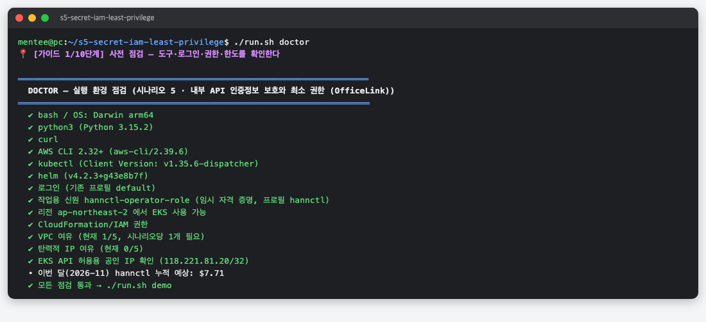

**정상이면** 모든 줄이 `✔` 이고 마지막 줄이 `✔ 모든 점검 통과 → ./run.sh demo` 다.

- `✘` 가 있으면 그 줄의 `→` 뒤 안내대로 해결하고 `./run.sh doctor` 를 다시 실행한다.
- `VPC 여유` 가 부족하다고 나오면 다른 시나리오를 먼저 `./run.sh down` 으로 지운다(시나리오 1개가 VPC 1개를 쓴다).

---

## 2단계 · 실행 시작

**할 일** — 첫 번째 터미널에서:

```bash
./run.sh demo
```

유지 시간을 묻는다. 그냥 **Enter** 를 누르면 6시간이다(만든 시각부터 6시간이 지나면 자동 삭제된다). 1~24 사이 숫자를 넣어도 된다. 6시간이면 `• 유지 시간 6시간 (최대 예상 비용 약 $1.26)` 이 나온다.

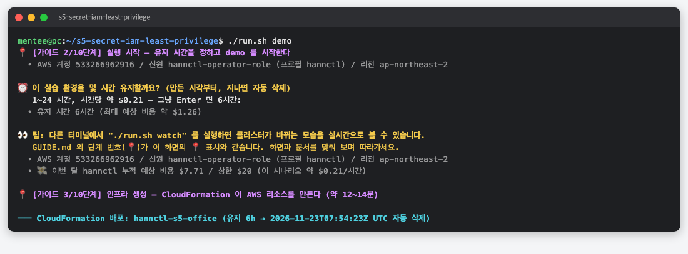

이어서 **두 번째 터미널**을 열고:

```bash
cd ~/hannctl_mentoring/s5-secret-iam-least-privilege     # 새 터미널은 홈 폴더에서 시작하므로 시나리오 폴더로 이동
./run.sh watch
```

클러스터가 만들어지는 동안에는 `⏳ EKS 클러스터 hannctl-s5-office 준비 대기 중` 화면이 나온다. 클러스터가 준비되면 자동으로 관찰 화면으로 바뀌므로 그대로 켜 둔다.

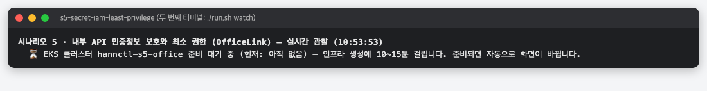

> 💡 Before 상태를 더 오래 살펴보고 싶으면 `./run.sh demo --before-wait 180` 처럼 관찰 시간(초)을 늘려서 시작한다(기본 60초).

---

## 3단계 · 인프라 생성

> 📍 터미널: `[가이드 3/10단계] 인프라 생성` · 약 12분 · 자동 진행

**화면에 나오는 것** — CloudFormation 이 리소스를 하나씩 만든다. `…` 는 만드는 중, `✔` 는 완료다. 왼쪽 `[ 0m33s]` 는 시작 후 지난 시간이다.

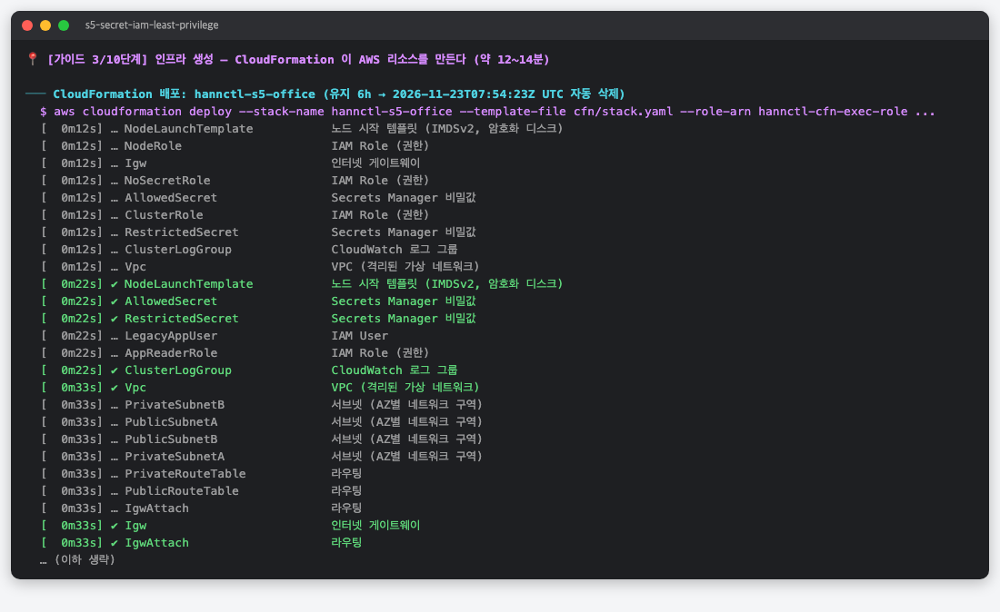

만드는 순서는 Secret 2개(`AllowedSecret`, `RestrictedSecret`)·IAM 역할·공용 IAM 사용자(`LegacyAppUser`)·VPC·서브넷 → NAT(약 2분) → **EKS 클러스터(약 8~9분, 가장 오래 걸림)** → 애드온·개발자/운영자 IAM 역할·Access Entry → 노드 그룹(약 2분) → Pod Identity Agent 애드온 → **Pod Identity 연결 2개**(`AppReaderAssociation`, `NoSecretAssociation`) 순서다.

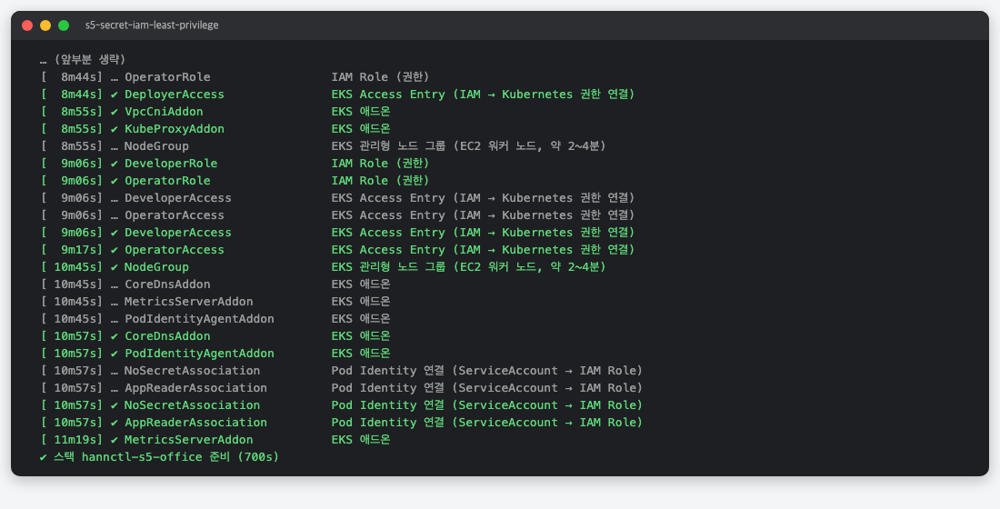

**정상이면** 마지막에 `✔ 스택 hannctl-s5-office 준비 (700s)` 처럼 걸린 시간과 함께 준비 완료가 나온다.

### 🖥️ 콘솔에서 같이 보기

**CloudFormation** → **스택** → `hannctl-s5-office` → **리소스** 탭. 새로 고침(⟳)을 누를 때마다 `CREATE_IN_PROGRESS` 가 `CREATE_COMPLETE` 로 바뀌어 간다. 초반에 Secret·IAM 역할·`hannctl-s5-legacy-app` 사용자는 먼저 끝나고, `Cluster` 는 오랫동안 `CREATE_IN_PROGRESS` 로 남는다.

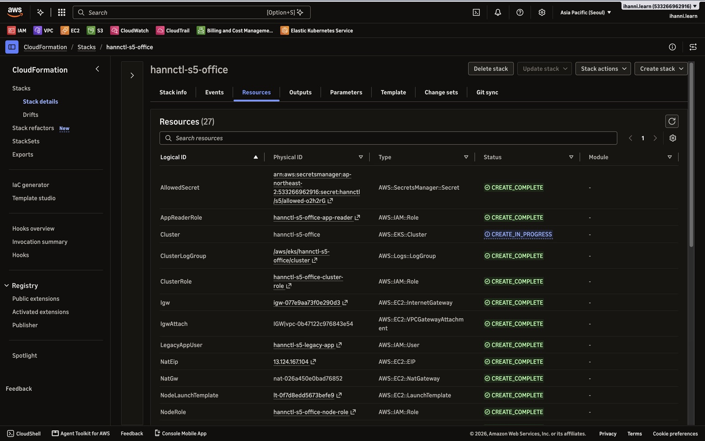

**Elastic Kubernetes Service** → **클러스터** → `hannctl-s5-office`. 처음에는 상태가 **Creating** 이고, Pod Identities 도 아직 0 이다.

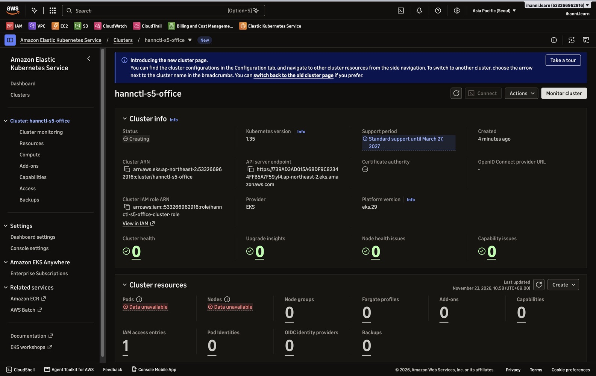

모두 끝나면 리소스 40개가 모두 `CREATE_COMPLETE` 가 된다. `AppReaderAssociation`(Pod Identity 연결)도 이 목록에 있다.

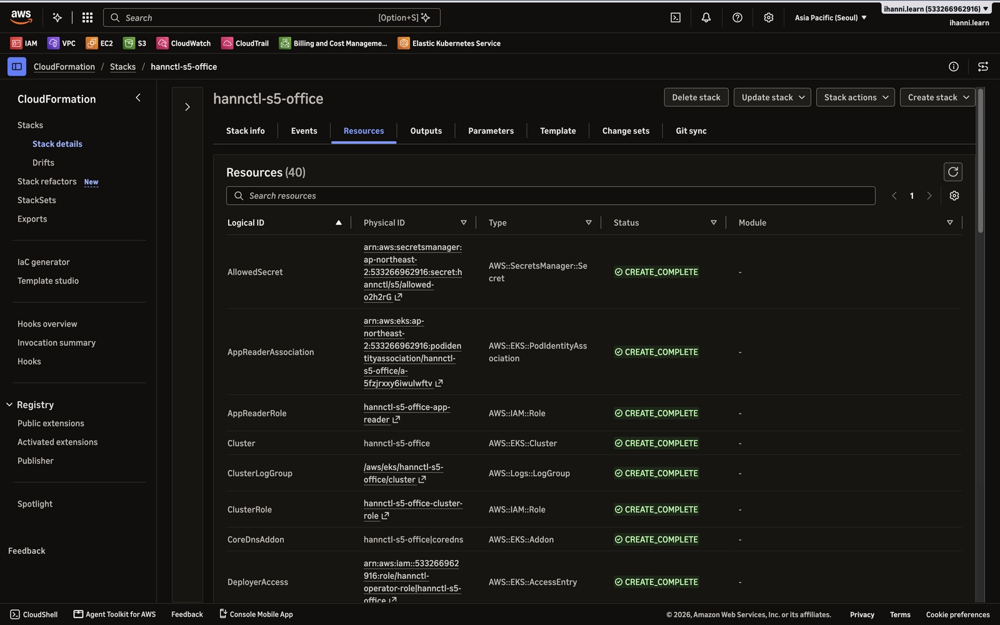

---

## 4단계 · 클러스터 기본 구성

> 📍 터미널: `[가이드 4/10단계] 클러스터 기본 구성` · 약 1분 · 자동 진행

**화면에 나오는 것** — 노드가 Ready 가 될 때까지 기다린 뒤, 정책 엔진 Kyverno 를 설치하고, `office` Namespace·ServiceAccount 와 사내 포털(`office-web`)을 배포한다.

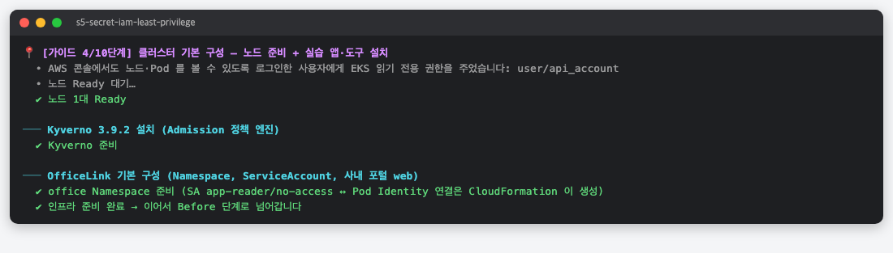

**정상이면** `✔ office Namespace 준비 (SA app-reader/no-access ↔ Pod Identity 연결은 CloudFormation 이 생성)` 와 `✔ 인프라 준비 완료 → 이어서 Before 단계로 넘어갑니다` 가 나오고 바로 5단계로 넘어간다.

### 🖥️ 콘솔에서 같이 보기

**EKS** → `hannctl-s5-office` → 왼쪽 **Compute**: 노드 1대(`t4g.medium`, On-Demand)가 **Ready** 이고, 노드 그룹 `hannctl-s5-office-ng-ON_DEMAND` 가 **Active** 다.

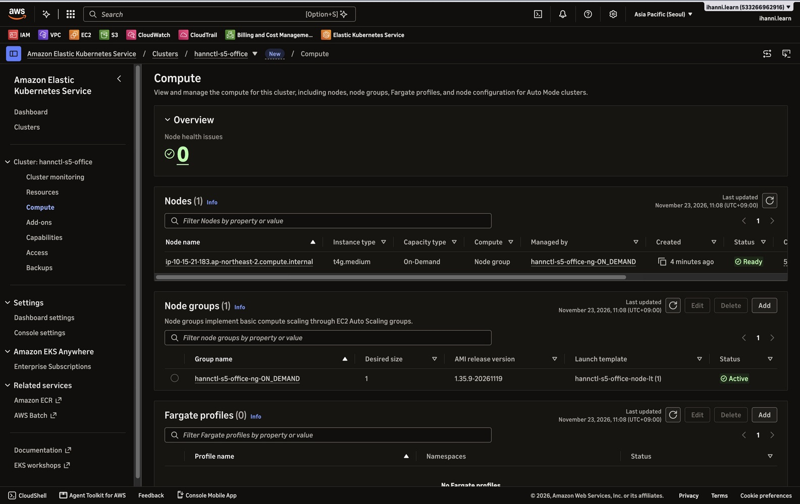

> 콘솔에서 노드·Pod 를 볼 수 있도록, 콘솔에 로그인한 사용자에게 이 클러스터의 **읽기 전용** 권한이 자동으로 주어진다(`• AWS 콘솔에서도 노드·Pod 를 볼 수 있도록 …` 안내가 한 번 나온다). 콘솔에 `Unauthorized` 나 `forbidden` 이 보이면 1~2분 뒤 새로 고침한다.

---

## 5단계 · Before (위험 재현)

> 📍 터미널: `[가이드 5/10단계] Before` · 약 1분 · 자동 진행

**무엇을 하나** — 일부러 옛날 방식을 만든다: 공용 IAM 사용자 `hannctl-s5-legacy-app` 에 **정적 Access Key** 를 발급해 Kubernetes Secret `legacy-aws-credentials` 에 넣고, 업무 API(`office-api`)와 비인가 Pod(`intruder`)가 **같은 키**를 `envFrom` 으로 쓴다. 개발자·운영자에게는 `cluster-admin` 을 준다. 그 상태에서 같은 테스트를 실행해 위험이 실제로 일어나는지 확인한다.

키 값은 화면에 나오지 않는다. 발급된 키는 `! 정적 Access Key 발급됨: AKIA**** (Before 재현용 — After 에서 폐기)` 처럼 앞부분만 보인다.

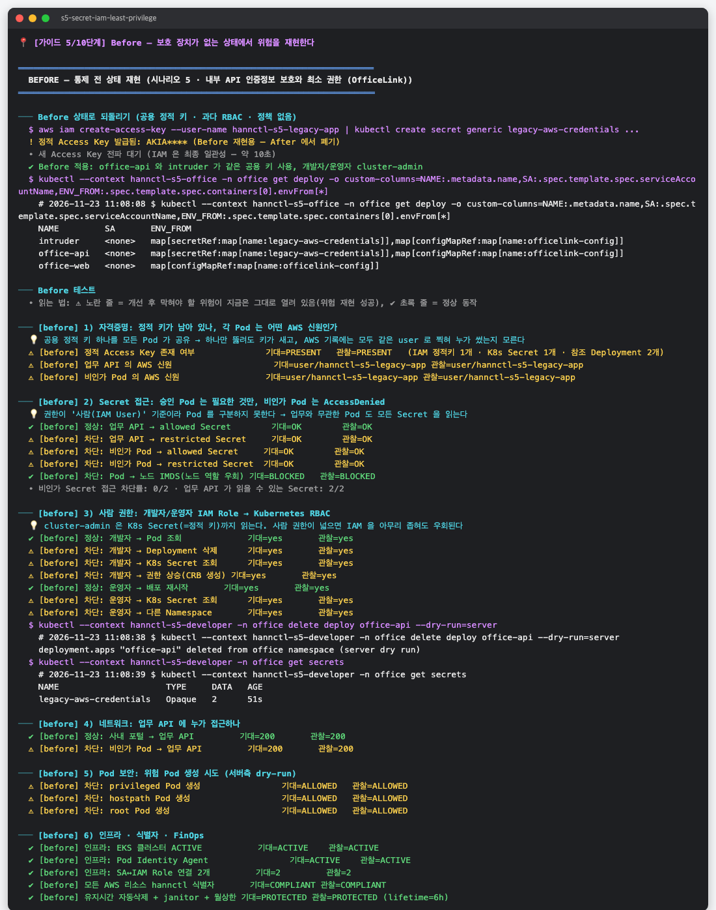

배포 목록에서 `office-api` 와 `intruder` 의 `SA` 칸은 `<none>`(전용 ServiceAccount 없음)이고, `ENV_FROM` 에 `secretRef:map[name:legacy-aws-credentials]` 가 있다. 두 Pod 모두 같은 공용 키로 AWS 에 접근한다는 뜻이다.

**읽는 법**

| 표시 | 의미 |
|---|---|
| `⚠` 노란 줄 | 개선 후 막혀야 할 위험이 **지금은 그대로 열려 있다** (위험 재현 성공) |
| `✔` 초록 줄 | 정상 동작 (업무 API 의 allowed 조회, 포털 → API 통신, 인프라 상태 등) |
| `✘` 빨간 줄 | 기대와 다르다 → [문제 해결](#문제-해결) |

**정상이면** 아래처럼 위험이 재현된다.

| 테스트 | 관찰 | 뜻 |
|---|---|---|
| 정적 Access Key 존재 여부 | `PRESENT` ⚠ (`IAM 정적키 1개 · K8s Secret 1개 · 참조 Deployment 2개`) | 유출되면 계속 쓸 수 있는 장기 키가 있다 |
| 업무 API / 비인가 Pod 의 AWS 신원 | 둘 다 `user/hannctl-s5-legacy-app` ⚠ | 모든 Pod 가 같은 신원이라 누가 썼는지 구분이 안 된다 |
| 업무 API → restricted Secret | `OK` ⚠ | 업무에 필요 없는 Secret 까지 읽는다 |
| 비인가 Pod → allowed / restricted Secret | `OK` ⚠ | 승인되지 않은 Pod 가 모든 Secret 을 읽는다 |
| Pod → 노드 IMDS(노드 역할 우회) | `BLOCKED` | 노드 설정(hop limit 1)으로 처음부터 막혀 있다 |
| 개발자 → Deployment 삭제 / K8s Secret 조회 / 권한 상승 | `yes` ⚠ | 개발자가 `get secrets` 로 `legacy-aws-credentials`(=정적 키)를 볼 수 있다 (결과가 실제로 출력됨) |
| 운영자 → K8s Secret 조회 / 다른 Namespace | `yes` ⚠ | 운영자 권한이 넓다 |
| 비인가 Pod → 업무 API | `200` ⚠ | 아무 Pod 나 업무 API 를 호출할 수 있다 |
| privileged / hostpath / root Pod 생성 | `ALLOWED` ⚠ | 노드를 장악할 수 있는 Pod 를 만들 수 있다 |

중간에 `• 비인가 Secret 접근 차단률: 0/2 · 업무 API 가 읽을 수 있는 Secret: 2/2` 가 나온다.

### 👀 두 번째 터미널 (watch)

세 배포 모두 `SERVICE_ACCOUNT` 가 `<none>` 이고, `정적 키 상태: PRESENT (IAM 정적키 1개 · K8s Secret 1개 · 참조 Deployment 2개)` 다. Pod Identity 연결 2개(`office app-reader`, `office no-access`)는 CloudFormation 이 미리 만들어 두었지만 아직 어느 Pod 도 이 ServiceAccount 를 쓰지 않는다. 권한은 `hannctl-legacy-office-admins` → `ClusterRole/cluster-admin` 이다. NetworkPolicy·Kyverno 정책은 아직 없다.

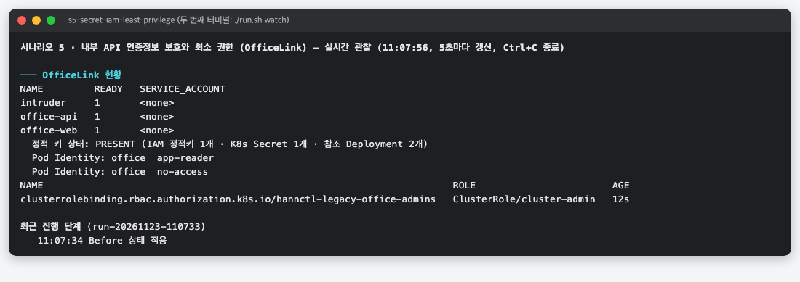

### 🖥️ 콘솔에서 같이 보기

**IAM** → **사용자(IAM users)** → `hannctl-s5-legacy-app` → **보안 자격 증명(Security credentials)** 탭. 아래쪽 **Access keys (1)** 에 Before 에서 발급한 키가 1개 있고, 위쪽 요약의 Access key 1 이 **Active** 다.

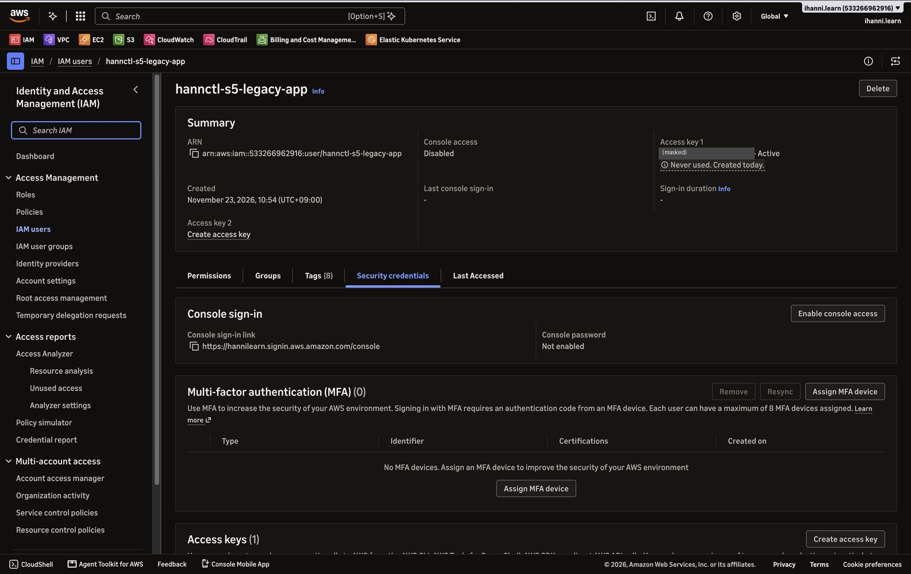

---

## 6단계 · Before 관찰

> 📍 터미널: `[가이드 6/10단계] Before 관찰` · 60초 카운트다운

카운트다운이 끝나면 자동으로 7단계로 넘어간다.

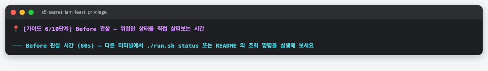

**할 일 (선택)** — 세 번째 터미널을 열어 위험을 직접 확인해 본다. 먼저 이 시나리오 전용 접속 설정을 불러온다.

```bash
cd ~/hannctl_mentoring/s5-secret-iam-least-privilege     # 새 터미널은 홈 폴더에서 시작하므로 시나리오 폴더로 이동
eval "$(./run.sh kubeconfig)"
```

| 확인할 것 | 명령 | Before 결과 |
|---|---|---|
| 업무 API 의 AWS 신원 | `kubectl -n office exec deploy/office-api -- python3 /app/app.py whoami` | `user/hannctl-s5-legacy-app` (공용 계정) |
| 비인가 Pod 의 Secret 접근 | `kubectl -n office exec deploy/intruder -- python3 /app/app.py check hannctl/s5/allowed` | `OK` (읽힘) |
| 정적 키가 남았나 | `aws iam list-access-keys --user-name hannctl-s5-legacy-app` / `kubectl -n office get secret` | 키 1개, `legacy-aws-credentials` 가 보임 |
| 개발자로 Secret 조회 | `kubectl --context hannctl-s5-developer -n office get secrets` | `legacy-aws-credentials` 가 목록에 보임 |

60초가 짧으면 `demo` 가 끝난 뒤 [9단계의 "다시 해 보기"](#다시-해-보기)로 Before 상태를 다시 만들 수 있다.

---

## 7단계 · 개선 단계 1 ~ 5

> 📍 터미널: `[가이드 7/10단계] 개선 단계` · 약 1분 · 자동 진행

개선 단계마다 같은 순서로 나온다: **변경 내용 → 📄 적용하는 설정 파일의 핵심 줄 → `$` 실행한 명령 → 즉시 확인(효과 측정) → 💡 배움 포인트**. 단계 사이에는 5초 쉰다.

### 개선 1/5 · Pod Identity 전환

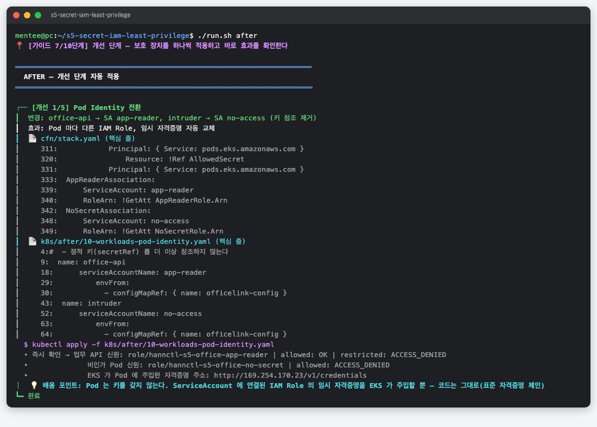

`office-api` 는 ServiceAccount `app-reader`, `intruder` 는 `no-access` 를 쓰도록 바꾸고 키 참조(`secretRef`)를 뺀다. **정상이면**

- `업무 API 신원: role/hannctl-s5-office-app-reader | allowed: OK | restricted: ACCESS_DENIED`
- `비인가 Pod 신원: role/hannctl-s5-office-no-secret | allowed: ACCESS_DENIED`
- `EKS 가 Pod 에 주입한 자격증명 주소: http://169.254.170.23/v1/credentials`

Pod 에는 키가 없다. EKS 가 ServiceAccount 에 연결된 IAM 역할의 임시 자격 증명을 넣어 줄 뿐이고, 앱 코드는 그대로다.

**🖥️ 콘솔** — **EKS** → `hannctl-s5-office` → 왼쪽 **Access** → **Pod Identity associations** 탭. 연결 2개가 보인다: Namespace `office` / Service account `app-reader` → 역할 `hannctl-s5-office-app-reader`, `no-access` → `hannctl-s5-office-no-secret`.

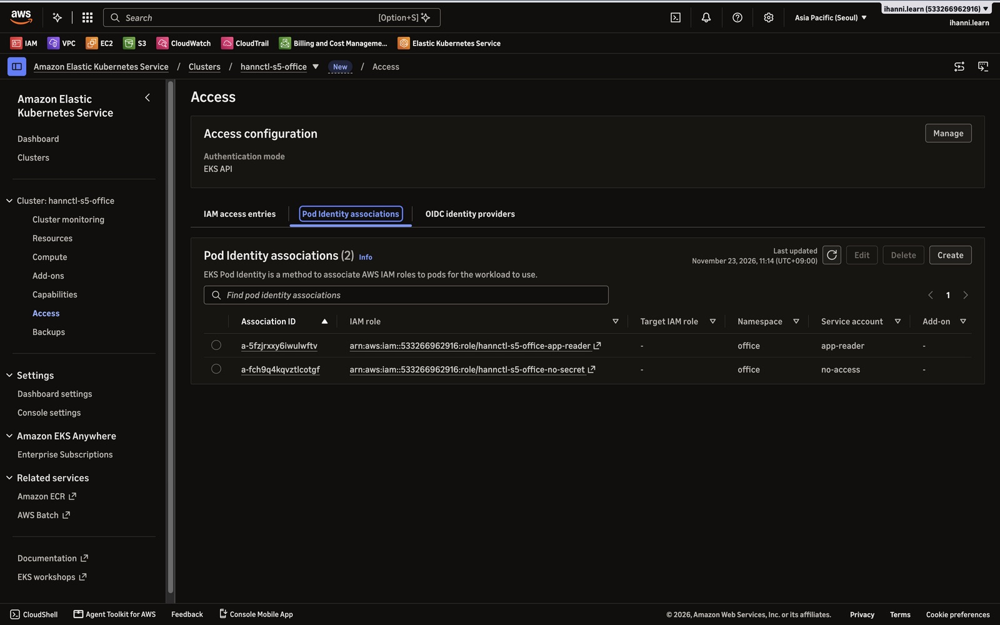

### 개선 2/5 · 정적 Access Key 폐기

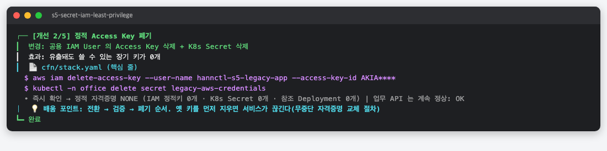

공용 IAM 사용자의 Access Key 와 Kubernetes Secret 을 지운다. **정상이면** `정적 자격증명 NONE (IAM 정적키 0개 · K8s Secret 0개 · 참조 Deployment 0개) | 업무 API 는 계속 정상: OK`.

**여기가 이 시나리오에서 가장 중요한 순간이다.** 개선 1에서 새 신원으로 **전환**하고 동작을 **검증**한 뒤에야 옛 키를 **폐기**한다. 옛 키를 먼저 지우면 서비스가 끊긴다. 그래서 키를 지운 직후에도 업무 API 는 `OK` 다.

**🖥️ 콘솔** — **IAM** → **사용자(IAM users)** → `hannctl-s5-legacy-app` → **보안 자격 증명(Security credentials)** 탭. **Access keys (0)** 이 되고, 요약의 Access key 1 자리에 **Create access key** 만 남는다.

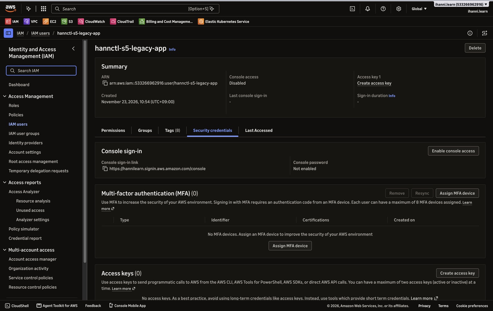

### 개선 3/5 · 사람 권한 최소화 (RBAC)

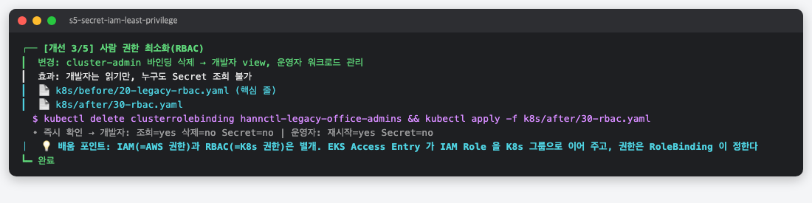

`cluster-admin` 바인딩을 지우고, 개발자에게는 `view`(Secret 제외), 운영자에게는 워크로드 관리 Role 을 준다. **정상이면** `개발자: 조회=yes 삭제=no Secret=no | 운영자: 재시작=yes Secret=no`.

### 개선 4/5 · 위험 Pod 차단 (PSA + Kyverno)

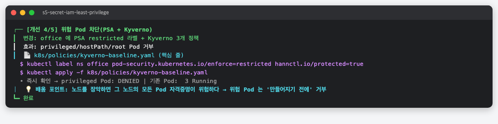

`office` Namespace 에 PSA `restricted` 라벨을 붙이고 Kyverno 정책 3개를 적용한다. **정상이면** `privileged Pod: DENIED | 기존 Pod:  3 Running` — 새 위험 Pod 는 거부되고, 이미 돌고 있던 앱은 그대로다.

### 개선 5/5 · 네트워크 최소화 (NetworkPolicy)

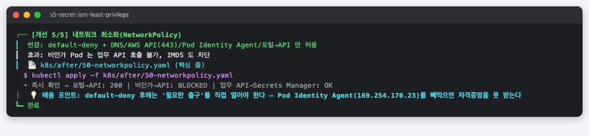

기본 전부 차단(default-deny) 후 DNS, AWS API(443), Pod Identity Agent, 포털 → API 만 연다. **정상이면** `포털→API: 200 | 비인가→API: BLOCKED | 업무 API→Secrets Manager: OK`. 차단 뒤에도 Secret 조회가 `OK` 인 것은 Pod Identity Agent(`169.254.170.23`)로 가는 길을 열어 두었기 때문이다. 이 길을 빼먹으면 Pod 가 자격 증명을 받지 못한다.

### 👀 두 번째 터미널 (watch) — 개선이 끝난 모습

- `정적 키 상태: NONE (IAM 정적키 0개 · K8s Secret 0개 · 참조 Deployment 0개)`
- SERVICE_ACCOUNT: `intruder` → `no-access`, `office-api` → `app-reader`
- NetworkPolicy 4개: `allow-dns-and-aws-apis`, `allow-web-egress-to-api`, `allow-web-to-api`, `default-deny-all`
- 권한: `cluster-admin` 이 사라지고 `hannctl-office-developers-view`(`ClusterRole/view`), `hannctl-office-operators`(`Role/hannctl-office-operator`)
- Kyverno 정책 3개 `READY=true`
- 맨 아래 **최근 진행 단계**에 개선 단계와 `after 테스트 완료` 가 시간순으로 쌓인다

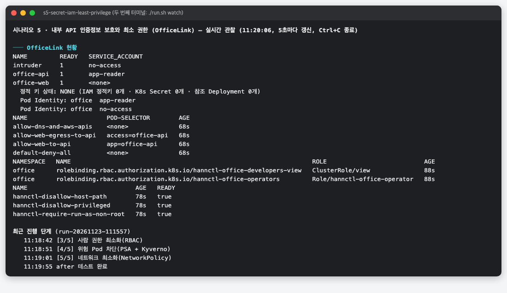

---

## 8단계 · After 테스트와 채점

> 📍 터미널: `[가이드 8/10단계] After 테스트·채점` · 약 1분 · 자동 진행

**무엇을 하나** — 5단계와 **똑같은 테스트**를 다시 실행하고, 감사 기록(EKS audit, CloudTrail)까지 확인한다. 같은 조건에서 비교해야 "개선됐다"고 말할 수 있다.

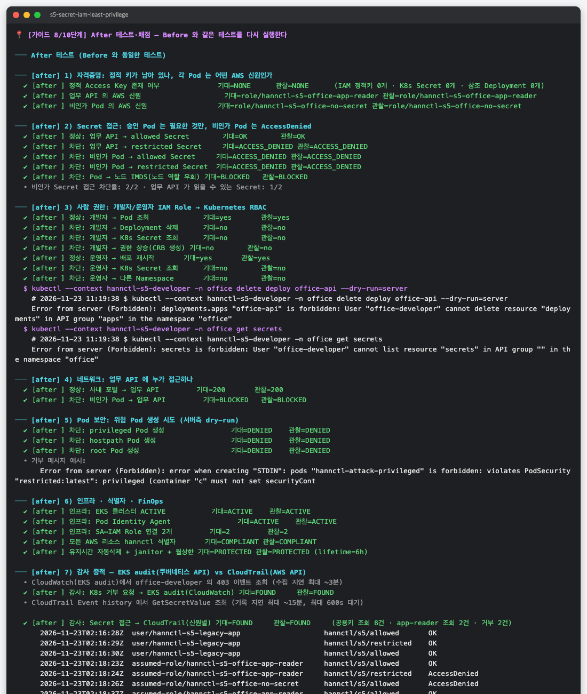

**정상이면** 모든 줄이 `✔` 초록이다.

- 정적 Access Key `NONE`, 업무 API 신원 `role/hannctl-s5-office-app-reader`, 비인가 Pod 신원 `role/hannctl-s5-office-no-secret`
- 업무 API → allowed `OK`, restricted `ACCESS_DENIED` / 비인가 Pod → 둘 다 `ACCESS_DENIED` / IMDS `BLOCKED`
- `• 비인가 Secret 접근 차단률: 2/2 · 업무 API 가 읽을 수 있는 Secret: 1/2`
- 개발자: Pod 조회 `yes`, 삭제·Secret·권한 상승 `no` (`Error from server (Forbidden): … User "office-developer" cannot …` 메시지가 실제로 출력됨) / 운영자: 재시작 `yes`, Secret·다른 Namespace `no`
- 포털 → 업무 API `200`, 비인가 Pod → 업무 API `BLOCKED`
- 위험 Pod 3종 `DENIED` + 거부 메시지(`violates PodSecurity "restricted:latest": privileged …`)
- 감사: `K8s 거부 요청 → EKS audit(CloudWatch)` `FOUND`, `Secret 접근 → CloudTrail(신원별)` `FOUND`

CloudTrail 확인은 기록이 나타날 때까지 기다린다(`기록 지연 최대 ~15분, 최대 600s 대기`). 찾으면 누가 어떤 Secret 을 읽었는지 시간순으로 보여 준다.

```text
  ✔ [after ] 감사: Secret 접근 → CloudTrail(신원별) 기대=FOUND     관찰=FOUND     (공용키 조회 8건 · app-reader 조회 2건 · 거부 2건)
      2026-11-23T02:08:20Z  user/hannctl-s5-legacy-app                    hannctl/s5/allowed       OK
      2026-11-23T02:08:22Z  user/hannctl-s5-legacy-app                    hannctl/s5/restricted    OK
      2026-11-23T02:08:23Z  user/hannctl-s5-legacy-app                    hannctl/s5/allowed       OK
      2026-11-23T02:10:06Z  assumed-role/hannctl-s5-office-app-reader     hannctl/s5/allowed       OK
      2026-11-23T02:10:07Z  assumed-role/hannctl-s5-office-app-reader     hannctl/s5/restricted    AccessDenied
      2026-11-23T02:10:09Z  assumed-role/hannctl-s5-office-no-secret      hannctl/s5/allowed       AccessDenied
      2026-11-23T02:10:23Z  assumed-role/hannctl-s5-office-app-reader     hannctl/s5/allowed       OK
```

Before 에는 모두 같은 `user/hannctl-s5-legacy-app` 이 restricted 까지 읽었고, After 에는 Pod 마다 다른 역할로 기록되며 허용되지 않은 조회는 `AccessDenied` 다.

이어서 평가표로 자동 채점한다.

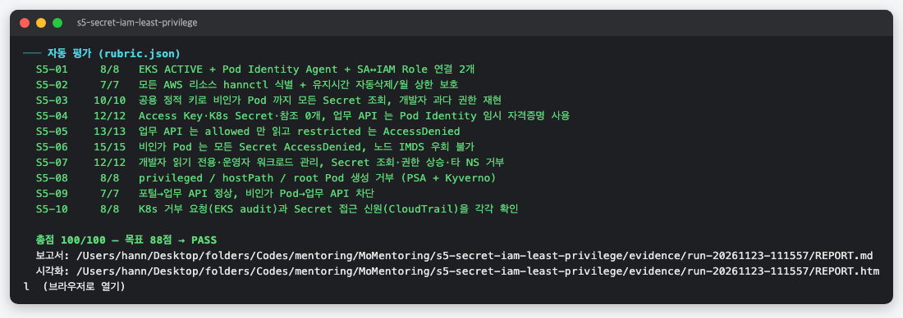

**정상이면** `총점 100/100 — 목표 88점 → PASS` (88점 이상이면 통과).

### 🖥️ 콘솔에서 같이 보기

**Secrets Manager** → **Secrets** → 검색창에 이름 필터 `hannctl/s5` 를 넣는다. 이 시나리오의 Secret 2개가 보인다: `hannctl/s5/allowed`(설명 `readable by office-api only`)와 `hannctl/s5/restricted`(설명 `nobody in the cluster should read it`). 값은 열어 보지 않는다.

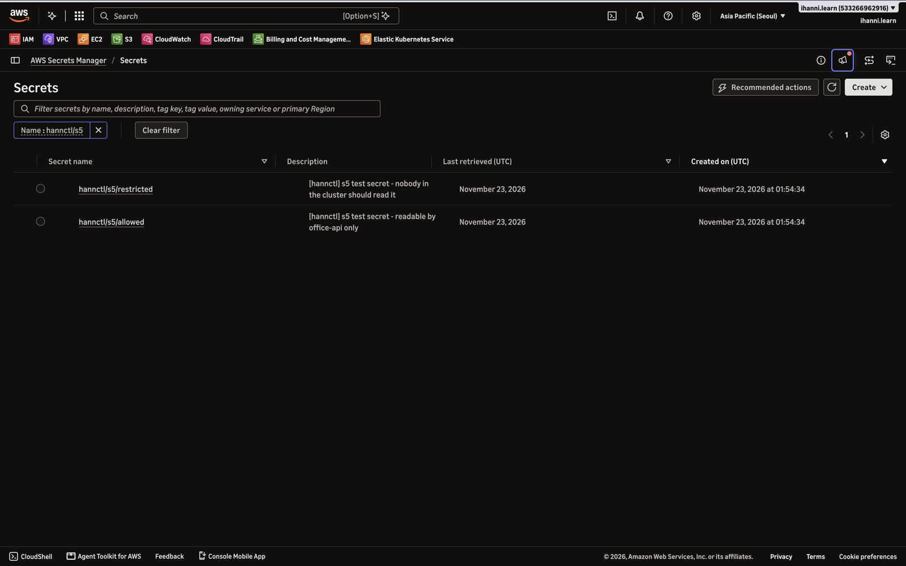

**CloudTrail** → 왼쪽 **이벤트 기록(Event history)** → **조회 속성(Lookup attributes)** 에서 **이벤트 이름(Event name)** 을 고르고 `GetSecretValue` 를 넣는다. **사용자 이름(User name)** 칸에 Pod 별 세션 `eks-hannctl-s5-offic…`(업무 API), `eks-hannctl-s5-intr…`(비인가 Pod)이 따로 찍힌다. Before 때의 기록은 `hannctl-s5-legacy-app` 으로 보인다. 기록은 보통 1~5분 늦게 나타난다.

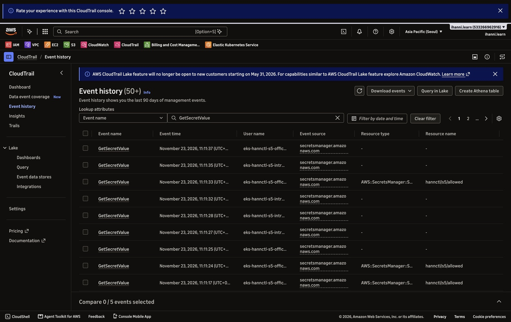

---

## 9단계 · 결과 확인

> 📍 터미널: `[가이드 9/10단계] 결과 확인`

마지막 줄에 `✔ 데모 총 소요 N분 — 보고서: evidence/run-…/REPORT.md (.html)` 가 나오면 `demo` 가 끝난 것이다.

보고서 `evidence/latest/REPORT.html` 이 브라우저로 열린다. 열리지 않으면 직접 연다.

```bash
open evidence/latest/REPORT.html        # macOS
xdg-open evidence/latest/REPORT.html    # Linux
cat evidence/latest/REPORT.md           # 터미널에서 보기 (CloudShell 포함)
```

CloudShell 에서는 오른쪽 위 **작업(Actions) → 파일 다운로드**에 `pwd` 결과 뒤 `/evidence/latest/REPORT.html` 을 붙인 경로를 넣어 내려받는다.

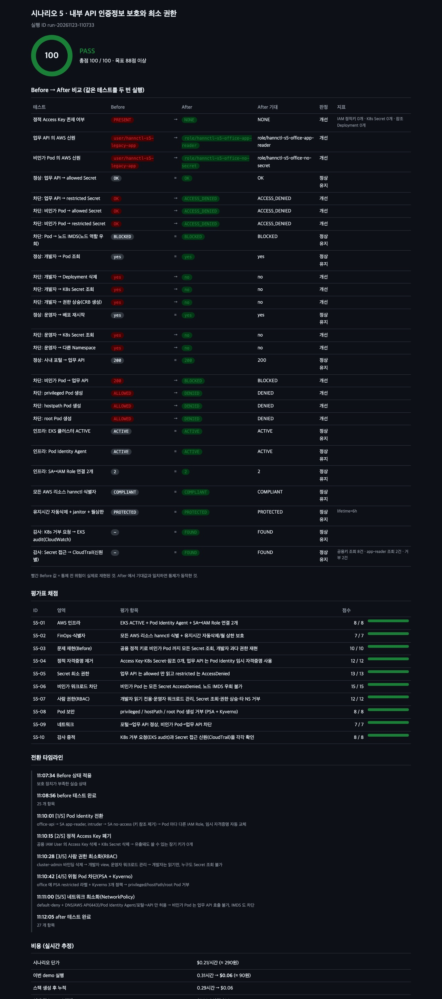

| 보고서 부분 | 보는 법 |
|---|---|
| 점수 원 | 총점과 PASS/FAIL |
| Before → After 비교 | 빨간 Before 값 = 실제로 재현된 위험(`PRESENT`, `user/hannctl-s5-legacy-app`, `OK`, `yes`, `ALLOWED` 등), After 가 기대값과 같으면 통제가 동작한 것. `→` 는 개선, `=` 는 정상 유지 |
| 평가표 채점 | 항목별 점수 S5-01 ~ S5-10 (기준은 [RUBRIC.md](RUBRIC.md)) |
| 전환 타임라인 | Before 적용 → before 테스트 → 개선 1~5 → after 테스트 시각 |
| 비용 | 시나리오 단가, 이번 demo 실행·스택 누적·이번 달 hannctl 전체 비용 추정 |

### 다시 해 보기

인프라를 그대로 둔 채 단계만 다시 실행할 수 있다. 발표 리허설이나 6단계 관찰을 천천히 할 때 쓴다.

| 명령 | 하는 일 | 시간 |
|---|---|---|
| `./run.sh before` | 정적 키 재발급 + cluster-admin 으로 되돌리고 Before 테스트 (5단계) | 약 1분 |
| `./run.sh after` | 개선 1~5 적용 + After 테스트 + 채점 (7~8단계) | 약 2분 |
| `./run.sh demo` | 5~9단계 전체 (인프라가 있으면 바로 Before 부터) | 약 3~4분 |
| `./run.sh status` | 스택·클러스터·노드 상태와 남은 유지 시간 | 몇 초 |

---

## 10단계 · 삭제

> 📍 터미널: `[가이드 10/10단계] 삭제` · 약 8분

**할 일** — 실습이 끝나면 반드시 실행한다. 두 번째 터미널의 watch 는 `Ctrl+C` 로 먼저 끈다.

```bash
./run.sh down
```

**화면에 나오는 것** — CloudFormation 이 만든 순서의 반대로 리소스를 지운다. `🗑 … 삭제됨` 이 하나씩 쌓인다. Pod Identity 연결·IAM 역할·공용 IAM 사용자(`LegacyAppUser`)·Secret 2개는 처음 1분 안에 지워지고, 노드 그룹(약 4분)과 EKS 클러스터(약 3분) 삭제가 가장 오래 걸린다.

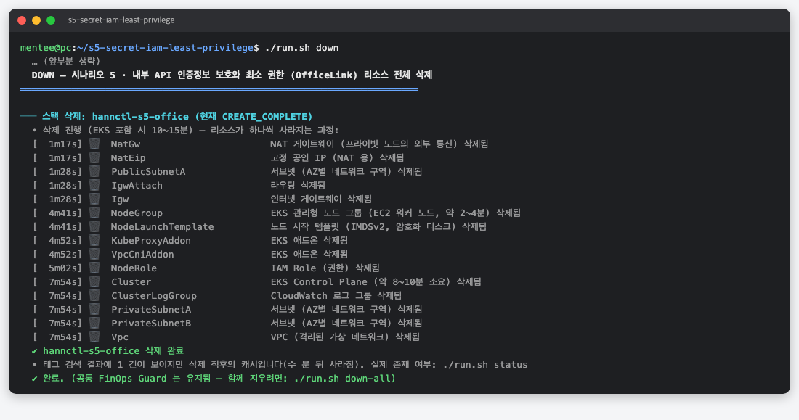

**정상이면** `✔ hannctl-s5-office 삭제 완료` 다음에 `✔ 완료. (공통 FinOps Guard 는 유지됨 — 함께 지우려면: ./run.sh down-all)` 가 나온다. 공통 안전장치(`hannctl-finops-guard`)는 다음 실습을 위해 남겨 두는 것이다(비용 0원 수준).

> `태그 검색 결과에 1 건이 보이지만 삭제 직후의 캐시입니다` 줄이 함께 나올 수 있다. AWS 태그 검색이 몇 분 늦게 갱신되기 때문이며 실제로 남은 리소스는 아니다.

### 🖥️ 콘솔에서 같이 보기

**CloudFormation** → `hannctl-s5-office` → **리소스** 탭. 리소스가 하나씩 `DELETE_COMPLETE` 로 바뀐다(아직 지우는 중인 `Cluster` 등은 `CREATE_COMPLETE` 로 남아 있다). 다 지워지면 스택 목록(필터 **활성**)에서 사라진다.


**남은 것이 없는지 확인**

```bash
./run.sh status          # "! 스택 없음" 이 나오면 이 시나리오 리소스는 모두 지워진 것
```

- 중간에 실패하면 `./run.sh down` 을 한 번 더 실행한다.
- 모든 시나리오를 끝냈으면 `./run.sh down-all` 로 공통 안전장치까지 지운다. 다른 시나리오 스택이 남아 있으면 지우지 않는다.
- `down` 을 잊어도 2단계에서 정한 유지 시간(기본 6시간)이 지나면 자동으로 삭제된다(공용 IAM 사용자의 Access Key 도 함께 지운다). 그래도 끝나면 바로 지우는 것이 원칙이다.

---

## 문제 해결

| 증상 | 해결 |
|---|---|
| 1단계에 `✘` | 그 줄의 `→` 안내대로 하고 `./run.sh doctor` 다시 실행 |
| 3단계 도중 터미널이 꺼짐 / CloudShell 세션 끊김 | 다시 접속해 같은 폴더에서 `./run.sh status` → 상태가 `CREATE_COMPLETE` 가 되면 `./run.sh demo` 다시 실행 (만든 인프라는 이어서 쓴다) |
| 8단계에 `✘` 가 있음 | `./run.sh after` 한 번 더 실행 |
| 8단계 `감사: Secret 접근 → CloudTrail` 이 `NOT_FOUND` | CloudTrail 기록이 늦은 것이다. 몇 분 뒤 `./run.sh test after && ./run.sh score` 로 테스트와 채점만 다시 한다 |
| 콘솔 EKS 화면에 `Unauthorized` / `forbidden` | 1~2분 뒤 새로 고침. 그래도 같으면 `./run.sh up` 을 한 번 실행 |
| kubectl 이 `Unauthorized` / 타임아웃 | 내 공인 IP 가 바뀌었을 수 있다 → `./run.sh up` (EKS API 허용 IP 갱신) |
| `Unable to parse config file: …/.aws/config` | [START_HERE.md 문제 해결](START_HERE.md) 참고 |

그 밖의 문제는 [START_HERE.md](START_HERE.md) 의 문제 해결 표를 본다.
