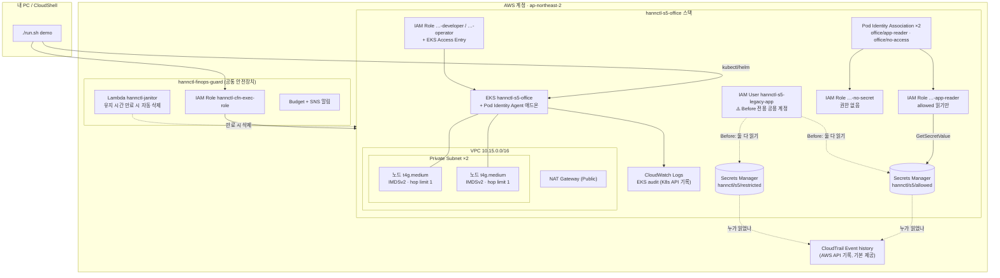
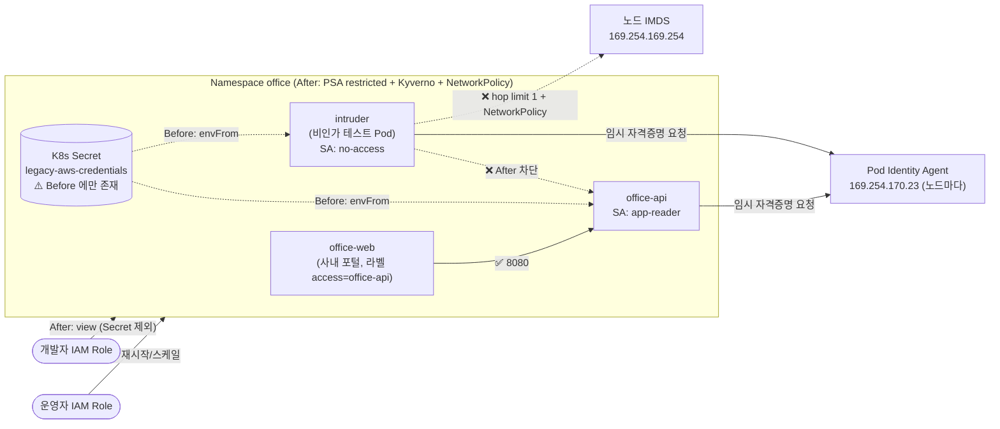
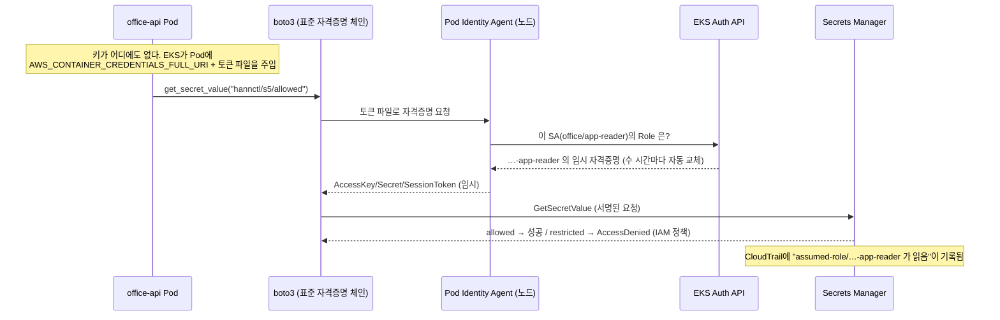
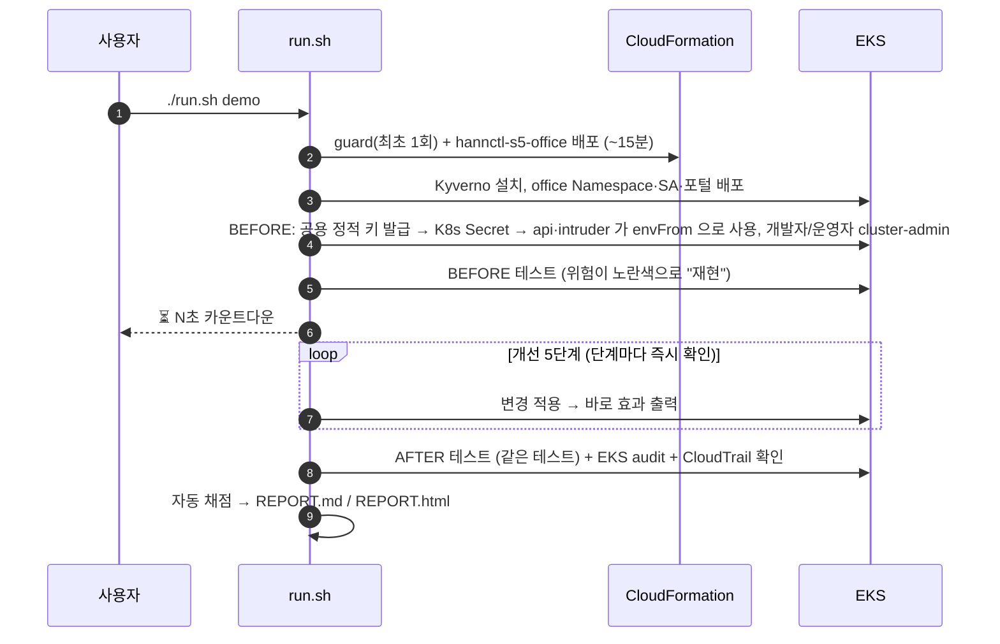

# 시나리오 5 · 내부 API 인증정보 보호와 최소 권한 (OfficeLink)

> 처음이라면 [START_HERE.md](START_HERE.md) 부터.

> **한 줄 요약**
> 사내 업무 API가 **AWS 키를 코드·설정 파일에 넣지 않고**, Pod마다 **자기에게 필요한 Secret 하나만** 읽게 만든다.
> 승인되지 않은 Pod는 `AccessDenied`를 받고, 개발자·운영자의 Kubernetes 권한도 업무에 필요한 만큼만 남긴다.
> 이것을 **같은 테스트의 Before/After 결과**로 증명한다.

| 항목 | 내용 |
|---|---|
| 난이도 | ★★★☆☆ (3/5) — IAM과 Kubernetes 권한의 경계를 이해하는 것이 핵심, 코드 작성은 거의 없음 |
| 핵심 기술 | AWS **Secrets Manager**, **EKS Pod Identity**, IAM 최소 권한, Kubernetes **RBAC** + EKS Access Entry, **PSA/Kyverno**, **NetworkPolicy**, **CloudTrail** vs **EKS audit** |
| 소요 시간 | 처음 `demo` 약 20분(인프라 생성 실측 13분 포함), 이후 재실행 약 3~5분 (CloudTrail 기록이 늦으면 최대 10분 추가 대기) |
| 예상 비용 | 약 **$0.21/시간(≈300원)** (EKS $0.10 + 노드 1대 + NAT 1개 + Secret 2개). 처음 정한 유지 시간(기본 6시간)이 지나면 자동 삭제 |
| 과정 요구사항 연결 | 접근·네트워크 통제(RBAC 최소 권한, NetworkPolicy, **시크릿 외부 관리**), 정책 기반 통제(PSS/Kyverno), 감사 로그 |


## 🎯 이 시나리오의 초점 (먼저 읽기)

| 구분 | 내용 |
|---|---|
| **핵심 포커스** | Pod가 AWS에 접근할 때 **누구로(신원)**, **무엇까지(권한)** 접근하는지를 통제한다 — 정적 키 제거, **EKS Pod Identity** 기반 최소 권한, 사람 권한 분리 |
| **Kubernetes 보안 비중** | ★★★★☆ — **Kubernetes 워크로드 신원(ServiceAccount)과 AWS IAM이 만나는 경계**가 핵심이다 |
| **가장 중요하게 보는 것** | ① 유출되면 계속 쓸 수 있는 **장기 정적 키 0개** ② Pod마다 다른 IAM Role로 **필요한 Secret 하나만**(비인가 Pod는 `AccessDenied`) ③ 노드 IAM 역할로 우회하는 **IMDS 경로 차단** 확인 ④ **CloudTrail(AWS API)과 EKS audit(K8s API)** 구분 |

**무엇을 사용하나 (계층별)**

| 계층 | 사용 기술 | 이 시나리오에서 하는 일 |
|---|---|---|
| 비밀값 저장 | **AWS Secrets Manager** (`hannctl/s5/allowed`, `hannctl/s5/restricted`) | 코드·설정 파일 밖에서 비밀값 관리 |
| AWS 권한 | IAM Role(app-reader / no-secret), Before 재현용 IAM User | Secret별 최소 권한 |
| 워크로드 신원 | **EKS Pod Identity**(Agent + Association) ↔ **ServiceAccount** | Pod가 키 없이 임시 자격 증명을 받음 |
| 노드 보호 | IMDSv2 + hop limit 1 | Pod가 노드 역할을 빌려 쓰는 우회 차단 |
| 사람 권한 | **RBAC** + EKS Access Entry (개발자 읽기 / 운영자 관리) | 사람의 K8s 권한 최소화 |
| Pod 생성·네트워크 | **PSA** + **Kyverno**, **NetworkPolicy** | 위험 Pod 거부, 필요한 통신만 허용 |
| 감사 | **CloudTrail**(GetSecretValue) / **EKS audit**(K8s API) | 서로 다른 감사 데이터를 구분해 확인 |

**전 → 후: 무엇이 개선되나 (실측)**

| # | 개선(통제) | 영역 | Before → After | 왜 중요한가 |
|---|---|---|---|---|
| 1 | Pod Identity 전환 | K8s 워크로드 신원 | 신원 `user/hannctl-s5-legacy-app`(공용) → `role/…-app-reader`, 읽을 수 있는 Secret **2/2 → 1/2** | Pod는 키를 갖지 않고, 역할의 임시 자격 증명만 받는다 |
| 2 | 정적 Access Key 폐기 | 시크릿 관리 | IAM 키 1·K8s Secret 1·참조 Deployment 2 → **0** | 유출돼도 쓸 수 있는 키가 없다 |
| 3 | 사람 권한 최소화 | K8s 접근 통제 | 권한 위반 5건 `yes` → `no` (정상 권한 2건 유지) | 개발자는 읽기만, 누구도 Secret 조회 불가 |
| 4 | PSA + Kyverno | K8s 정책 통제 | 위험 Pod 3종 `ALLOWED` → `DENIED` | 노드 장악 → 자격 증명 탈취 경로 차단 |
| 5 | NetworkPolicy | K8s 네트워크 보안 | 비인가 Pod → 업무 API `200` → `BLOCKED` | 신원 통제와 네트워크 통제를 함께 |
| ✓ | (확인) IMDS 우회 | 노드 보호 | 처음부터 `BLOCKED` (hop limit 1) | Pod Identity만으로 격리가 끝나지 않는다는 점 |

**다루지 않는 것 (범위 밖)**: Secret 자동 로테이션, Secrets Store CSI Driver / External Secrets, Vault 서버 구축, KMS 고객 관리형 키(CMK) 봉투 암호화

---

## 0. 가장 빠른 사용법 (명령 1개)

```bash
cd s5-secret-iam-least-privilege
./run.sh demo                      # 전부 자동: 인프라 → Before 재현 → 60초 후 단계별 개선 → After 검증 → 채점 → 보고서
./run.sh demo --before-wait 180    # Before 상태를 3분 동안 관찰하고 넘어가기
./run.sh down                      # 끝나면 전부 삭제 (잊어도 유지 시간이 지나면 자동 삭제)
./run.sh demo --hours 3            # 처음 시작할 때 유지 시간 지정 (기본 6, 0 = 무제한)
```

- 끝나면 `evidence/latest/REPORT.html`이 열린다(점수, Before→After 비교, 전환 타임라인).
- 진행 중 **다른 터미널에서 `./run.sh watch`** 를 켜 두면 Pod가 쓰는 ServiceAccount, 정적 키 개수, 네트워크 정책이 바뀌는 모습이 실시간으로 보인다.
- CloudTrail 기록 대기 시간은 `CLOUDTRAIL_WAIT_SECONDS=300 ./run.sh demo`처럼 줄일 수 있다(줄이면 감사 항목이 미확인으로 남을 수 있다).

> 처음 한 번 필요한 것: AWS 자격 증명(`aws configure`). python3·AWS CLI·kubectl·helm 등 필요한 도구는 **없는 것만 자동 설치**된다(`tools/install-tools.sh`, 이미 있으면 건너뜀). 자세한 준비는 [START_HERE.md](START_HERE.md) 참고.
> macOS, Ubuntu, CentOS/Rocky, AWS CloudShell에서 동작한다.

---

## 1. 실무에서는 어떤 상황인가? (왜 이걸 배우나)

**OfficeLink**는 사내 업무 API를 EKS에서 운영한다. API가 외부 서비스에 연결하려면 비밀번호나 토큰 같은 **비밀값(Secret)** 이 필요하다. 지금은 이렇게 하고 있다.

| 지금 방식 (Before) | 실제로 터지는 사고 |
|---|---|
| AWS Access Key를 **설정 파일·환경변수**에 넣는다(Git에도 올라감) | GitHub에 키가 노출되어 몇 분 만에 악용됨(채굴, 데이터 탈취). 사고 단골 1순위 |
| **여러 Pod가 같은 공용 키**를 쓴다 | 아무 Pod 하나만 뚫려도 **모든 비밀값**이 털린다. 로그만 보고는 누가 읽었는지 구분이 안 된다 |
| 공용 키 권한이 넓다(모든 Secret 읽기) | 업무 API에 필요 없는 비밀값까지 노출 |
| 개발자·운영자 모두 `cluster-admin` | 개발자가 운영 배포를 지우거나, Kubernetes Secret에 저장된 키를 그대로 꺼내 봄 |

이 시나리오의 핵심 질문은 두 가지다.

1. **"어떤 워크로드가 어떤 Secret을 볼 수 있는가?"** → AWS IAM + Pod Identity로 통제
2. **"어떤 사람이 Kubernetes 리소스를 관리할 수 있는가?"** → Kubernetes RBAC로 통제

> 💡 둘은 **다른 계층**이다. Pod가 AWS Secret을 읽는 권한은 **IAM**이, 사람이 `kubectl`로 하는 일은 **RBAC**이 결정한다. 하나만 막아서는 안 된다.

---

## 2. 이 시나리오의 목표 (완료 기준)

| # | 목표 | 증명 방법 |
|---|---|---|
| 1 | 정적 AWS 키가 **0개** (IAM Access Key, K8s Secret, Deployment 참조 모두) | IAM 키 개수 + K8s 오브젝트 검사 |
| 2 | 업무 API는 **Pod Identity 임시 자격증명**으로 동작 | Pod 안에서 `whoami` → `role/hannctl-s5-office-app-reader` |
| 3 | 업무 API는 **allowed만** 읽고 restricted는 `AccessDenied` | Pod 안에서 Secrets Manager 호출 결과 |
| 4 | 비인가 Pod는 **모든 Secret에 `AccessDenied`**, 노드 IMDS 우회도 불가 | 같은 호출 + IMDS 토큰 요청 실패 |
| 5 | 개발자는 **읽기만**, 운영자는 **워크로드 관리만**, 누구도 Secret 조회 불가 | 실제 IAM Role로 접속해 `kubectl auth can-i` |
| 6 | 위험 Pod(privileged/hostPath/root) **생성 거부**, 비인가 Pod의 API 호출 **네트워크 차단** | 서버측 dry-run, Pod 간 HTTP |
| 7 | **누가 어떤 신원으로** Secret을 읽었는지 감사 기록으로 확인 | CloudTrail(AWS API) + EKS audit(K8s API) |

**평가 목표: 100점 만점 중 88점 이상**. [`RUBRIC.md`](RUBRIC.md) 기준으로 `demo`가 끝나면 자동 채점된다.

---

## 3. 전체 구성도

### 3-1. AWS 인프라 (CloudFormation `cfn/stack.yaml` 하나로 생성)



### 3-2. EKS 내부 (Kubernetes 리소스)



### 3-3. 핵심 흐름 — Pod가 Secret을 읽기까지 (After)



### 3-4. 계층별 통제 지점

```text
 [AWS IAM]         Pod 가 어떤 AWS 권한을 갖나?        → Pod Identity (ServiceAccount ↔ IAM Role), Secret 단위 정책
 [K8s RBAC]        사람이 kubectl 로 무엇을 할 수 있나? → IAM Role + EKS Access Entry → Kubernetes 그룹 → RoleBinding
 [Admission]       만들려는 Pod 가 안전한가?           → PSA(restricted) + Kyverno
 [NetworkPolicy]   Pod 가 누구와 통신하나?             → default-deny + DNS/AWS API/Pod Identity Agent/포털→API 만 허용
 [노드]            Pod 가 노드 역할을 훔칠 수 있나?      → IMDSv2 + hop limit 1 (CloudFormation 런치 템플릿)
 [감사]            누가 무엇을 했나?                  → EKS audit(K8s API, CloudWatch) / CloudTrail(AWS API)
```

---

## 4. 자동 진행 순서 — `./run.sh demo`가 하는 일



### 4-1. 단계별 "설정 → 결과 → 배운 점"

`demo`는 각 단계에서 **적용하는 설정의 핵심 줄(📄)을 먼저 보여주고**, 적용한 뒤 **바로 결과를 출력**한다. 그다음 **💡 배움 포인트**를 한 줄로 정리한다.

| 단계 | 설정 (파일 · 핵심 줄) | 결과 (화면에 보이는 값) | 💡 배운 점 |
|---|---|---|---|
| **BEFORE** | `before/10-workloads-static-key.yaml`<br>`envFrom: secretRef: legacy-aws-credentials`<br>`before/20-legacy-rbac.yaml` → `cluster-admin` | 두 Pod 모두 `user/hannctl-s5-legacy-app`<br>allowed·restricted 모두 `OK`<br>개발자 Secret 조회 `yes` | 공용 키 하나 = 모든 Pod가 같은 신원. 하나만 뚫려도 전부 새고, 누가 썼는지도 모른다 |
| **1. Pod Identity 전환** | `cfn/stack.yaml` `AppReaderAssociation` (`ServiceAccount: app-reader` → `RoleArn: …app-reader`)<br>`after/10-…pod-identity.yaml` `serviceAccountName: app-reader` | api 신원 `role/hannctl-s5-office-app-reader`<br>allowed `OK` · restricted `ACCESS_DENIED`<br>intruder `ACCESS_DENIED` | Pod는 키를 갖지 않는다. SA에 연결된 IAM Role의 **임시 자격증명**을 EKS가 주입할 뿐이고, 코드는 그대로다(표준 자격증명 체인) |
| **2. 정적 키 폐기** | `aws iam delete-access-key …`<br>`kubectl delete secret legacy-aws-credentials` | 정적 자격증명 `NONE` (IAM 키 0 · K8s Secret 0 · 참조 0)<br>업무 API는 계속 `OK` | ⭐ **전환 → 검증 → 폐기** 순서. 옛 키를 먼저 지우면 서비스가 끊긴다 |
| **3. 사람 권한(RBAC)** | `after/30-rbac.yaml`<br>개발자 `ClusterRole: view` (Secret 제외)<br>운영자 Role `deployments: patch` | 개발자: 조회 `yes`, 삭제·Secret·권한상승 `no`<br>운영자: 재시작 `yes`, Secret `no` | IAM(AWS 권한)과 RBAC(K8s 권한)은 별개다. Access Entry가 IAM Role을 K8s 그룹으로 잇고, 권한은 RoleBinding이 정한다 |
| **4. 위험 Pod 차단** | ns 라벨 `pod-security.kubernetes.io/enforce=restricted`<br>`policies/kyverno-baseline.yaml` (ValidatingPolicy, CEL `expression`) | privileged/hostPath/root `DENIED`<br>기존 Pod는 `Running` 유지 | 노드를 장악하면 그 노드의 모든 Pod 자격증명이 위험하다. 그래서 **만들어지기 전에** 거부한다 |
| **5. 네트워크 최소화** | `after/50-networkpolicy.yaml`<br>`default-deny-all` + `169.254.170.23/32:80` + `0.0.0.0/0 except 169.254.169.254:443` + `access: office-api` | 포털→API `200`, 비인가→API `BLOCKED`<br>Secret 조회는 계속 `OK` | default-deny 후에는 필요한 출구를 직접 열어야 한다. **Pod Identity Agent**를 빼먹으면 자격증명을 못 받는다 |
| **AFTER** | (같은 테스트 재실행) + EKS audit + CloudTrail | 아래 4-2 표 | 같은 조건에서 비교해야 "개선"이라고 말할 수 있다 |

### 4-2. Before → After 기대 결과표

| 테스트 | Before | After | 의미 |
|---|---|---|---|
| 정적 Access Key 존재 | PRESENT ⚠️ | **NONE** | 유출돼도 쓸 수 있는 장기 키 0개 |
| 업무 API의 AWS 신원 | user/hannctl-s5-legacy-app ⚠️ | **role/hannctl-s5-office-app-reader** | 공용 계정 → 워크로드 전용 임시 자격증명 |
| 비인가 Pod의 AWS 신원 | user/hannctl-s5-legacy-app ⚠️ | **role/hannctl-s5-office-no-secret** | 같은 키 공유 → 각자 다른 신원(추적 가능) |
| 업무 API → allowed | OK | **OK** | 정상 업무 유지 |
| 업무 API → restricted | OK ⚠️ | **ACCESS_DENIED** | 필요한 Secret만 (최소 권한) |
| 비인가 Pod → allowed / restricted | OK ⚠️ | **ACCESS_DENIED** | 승인되지 않은 워크로드 차단 |
| Pod → 노드 IMDS | BLOCKED | **BLOCKED** | 노드 IAM 역할 우회 불가(hop limit 1, 처음부터 적용) |
| 개발자 → Pod 조회 | yes | **yes** | 업무는 가능 |
| 개발자 → 삭제 / Secret 조회 / 권한 상승 | yes ⚠️ | **no** | 읽기 전용 |
| 운영자 → 배포 재시작 | yes | **yes** | 운영 권한 유지 |
| 운영자 → Secret 조회 / 다른 Namespace | yes ⚠️ | **no** | 관리 범위 한정 |
| 포털 → 업무 API | 200 | **200** | 정상 통신 유지 |
| 비인가 Pod → 업무 API | 200 ⚠️ | **BLOCKED** | 네트워크 최소화 |
| privileged / hostPath / root Pod | ALLOWED ⚠️ | **DENIED** | 위험 Pod 차단 |
| EKS audit 403 / CloudTrail 신원별 기록 | – | **FOUND / FOUND** | "막았다·누가 읽었다"가 기록으로 남음 |

---

## 5. 직접 조회해 보기 — 명령어 순서 (이해 확인, 발표 리허설용)

```bash
eval "$(./run.sh kubeconfig)"          # 이 시나리오 전용 kubeconfig (내 ~/.kube/config 는 건드리지 않음)
```

| 순서 | 무엇을 보나 | 명령 |
|---|---|---|
| 1 | AWS 리소스 한눈에 | `./run.sh status` |
| 2 | 비밀값 목록(값은 보지 않기) | `aws secretsmanager list-secrets --filters Key=name,Values=hannctl/s5 --query 'SecretList[].Name'` |
| 3 | SA ↔ IAM Role 연결 | `aws eks list-pod-identity-associations --cluster-name hannctl-s5-office` |
| 4 | 어떤 Pod가 어떤 SA를 쓰나 | `kubectl -n office get deploy -o custom-columns=NAME:.metadata.name,SA:.spec.template.spec.serviceAccountName` |
| 5 | Pod의 AWS 신원 | `kubectl -n office exec deploy/office-api -- python3 /app/app.py whoami` |
| 6 | Secret 접근 시도 | `kubectl -n office exec deploy/intruder -- python3 /app/app.py check hannctl/s5/allowed` |
| 7 | EKS가 주입한 자격증명 경로(키가 아님) | `kubectl -n office exec deploy/office-api -- printenv AWS_CONTAINER_CREDENTIALS_FULL_URI` |
| 8 | 정적 키가 남았나 | `aws iam list-access-keys --user-name hannctl-s5-legacy-app` / `kubectl -n office get secret` |
| 9 | IMDS 우회 시도 | `kubectl -n office exec deploy/intruder -- python3 /app/app.py imds` |
| 10 | IAM 정책(최소 권한) 확인 | `aws iam get-role-policy --role-name hannctl-s5-office-app-reader --policy-name hannctl-s5-read-allowed-secret-only` |
| 11 | 개발자로 접속 | `kubectl --context hannctl-s5-developer -n office get pods` (성공) / `get secrets` (Forbidden) |
| 12 | 네트워크 정책 | `kubectl -n office get networkpolicy` |
| 13 | CloudTrail(누가 Secret 을 읽었나) | `aws cloudtrail lookup-events --lookup-attributes AttributeKey=EventName,AttributeValue=GetSecretValue --max-results 10` |
| 14 | EKS audit(누가 kubectl 로 거부당했나) | CloudWatch → `/aws/eks/hannctl-s5-office/cluster` → `kube-apiserver-audit-*` |

---

## 6. run.sh 없이 처음부터 직접 구성해 보기 (원리 이해용)

`run.sh`는 아래 과정을 **순서대로 대신 실행**해 주는 스크립트일 뿐이다. 한 번은 손으로 따라 해 보면 CloudFormation이 만드는 것(Secret, IAM Role, Pod Identity 연결)과 그 위에 Kubernetes 설정이 올라가는 방식이 확실히 보인다.

> 직접 만든 환경도 `./run.sh test after`, `./run.sh score`, `./run.sh down`으로 그대로 검증·채점·삭제할 수 있다(스택 이름과 태그만 같게 만들면 된다).

### 6-1. 준비 — 내 정보 확인

```bash
export AWS_REGION=ap-northeast-2
MY_ARN=$(aws sts get-caller-identity --query Arn --output text)   # 클러스터 관리자로 등록할 나
MY_IP=$(curl -s https://checkip.amazonaws.com)/32                  # EKS API 에 접속을 허용할 내 IP
echo "$MY_ARN  $MY_IP"
```

> assumed-role ARN(`arn:aws:sts::…:assumed-role/역할/세션`)이면 `arn:aws:iam::<계정>:role/역할` 형태로 바꿔서 쓴다.

### 6-2. 공통 안전장치 스택 (계정에 한 번만)

```bash
aws cloudformation deploy --stack-name hannctl-finops-guard \
  --template-file cfn/hannctl-finops-guard.yaml --capabilities CAPABILITY_NAMED_IAM \
  --tags Project=hannctl hannctl:role=guard
EXEC_ROLE=$(aws cloudformation describe-stacks --stack-name hannctl-finops-guard \
  --query "Stacks[0].Outputs[?OutputKey=='CfnExecRoleArn'].OutputValue" --output text)
```

**콘솔로 할 때**: CloudFormation → 스택 생성 → "템플릿 파일 업로드" → `cfn/hannctl-finops-guard.yaml` → 스택 이름 `hannctl-finops-guard` → "IAM 리소스 생성 승인" 체크.

### 6-3. 시나리오 인프라 스택 — `cfn/stack.yaml`

```bash
aws cloudformation deploy --stack-name hannctl-s5-office \
  --template-file cfn/stack.yaml --capabilities CAPABILITY_NAMED_IAM \
  --role-arn "$EXEC_ROLE" \
  --parameter-overrides ClusterName=hannctl-s5-office DeployerPrincipalArn="$MY_ARN" EndpointAllowedCidr="$MY_IP" \
                        NodeCapacityType=ON_DEMAND NodeDesired=1 \
  --tags Project=hannctl hannctl:scenario=s5 hannctl:lifetime-hours=6 hannctl:est-usd-per-hour=0.21
```

**콘솔로 할 때**: 템플릿 `cfn/stack.yaml` 업로드 → 스택 이름 `hannctl-s5-office` → 파라미터 `DeployerPrincipalArn`, `EndpointAllowedCidr` 입력 → **"권한 – IAM 역할"에서 `hannctl-cfn-exec-role` 선택** → 태그 4개(`Project=hannctl`, `hannctl:scenario=s5`, `hannctl:lifetime-hours=6`, `hannctl:est-usd-per-hour=0.21`) 추가 → 생성.
**이벤트** 탭에서 VPC → NAT → EKS(약 10분) → 노드 그룹 → Pod Identity Agent → Secret 2개 → IAM Role → Pod Identity 연결 순서로 만들어지는 것을 볼 수 있다.

만들어진 것 확인 (값은 보지 않는다):

```bash
aws secretsmanager list-secrets --filters Key=name,Values=hannctl/s5 --query 'SecretList[].Name'
aws eks list-pod-identity-associations --cluster-name hannctl-s5-office \
  --query 'associations[].[namespace,serviceAccount]' --output table
#  → office / app-reader, office / no-access
```

> 💡 실행 역할(`hannctl-cfn-exec-role`)을 지정해야 자동 삭제(janitor)와 `./run.sh down`이 이 스택을 지울 수 있다.

### 6-4. EKS 접속 + 기본 구성

```bash
export KUBECONFIG=$PWD/.kube/config                    # 내 기본 kubeconfig 는 건드리지 않는다
aws eks update-kubeconfig --name hannctl-s5-office --alias hannctl-s5-office
kubectl get nodes

# 정책 엔진 Kyverno 설치
helm repo add kyverno https://kyverno.github.io/kyverno/ && helm repo update
helm install kyverno kyverno/kyverno -n kyverno --create-namespace --version 3.9.2 --wait

# office Namespace + 앱 코드/설정(ConfigMap) + ServiceAccount 2개 + 사내 포털
kubectl create namespace office
kubectl -n office create configmap officelink-app --from-file=app/app.py
kubectl -n office create configmap officelink-config --from-literal=AWS_REGION=$AWS_REGION \
  --from-literal=AWS_DEFAULT_REGION=$AWS_REGION
kubectl apply -f k8s/base/

# 개발자/운영자 IAM Role 로 접속하는 컨텍스트 (IAM Role → Access Entry → K8s 그룹)
out() { aws cloudformation describe-stacks --stack-name hannctl-s5-office --query "Stacks[0].Outputs[?OutputKey=='$1'].OutputValue" --output text; }
aws eks update-kubeconfig --name hannctl-s5-office --role-arn "$(out DeveloperRoleArn)" --alias hannctl-s5-developer --user-alias hannctl-s5-developer
aws eks update-kubeconfig --name hannctl-s5-office --role-arn "$(out OperatorRoleArn)" --alias hannctl-s5-operator --user-alias hannctl-s5-operator
kubectl config use-context hannctl-s5-office
```

### 6-5. BEFORE — 위험 재현 (공용 정적 키)

키 값이 **화면이나 파일에 남지 않도록** 발급 결과를 바로 Kubernetes Secret으로 넘긴다.

```bash
aws iam create-access-key --user-name hannctl-s5-legacy-app --output json \
  | python3 -c 'import json,sys;k=json.load(sys.stdin)["AccessKey"];print("AWS_ACCESS_KEY_ID="+k["AccessKeyId"]);print("AWS_SECRET_ACCESS_KEY="+k["SecretAccessKey"])' \
  | kubectl -n office create secret generic legacy-aws-credentials --from-env-file=/dev/stdin

kubectl apply -f k8s/before/                 # api·intruder 가 envFrom 으로 같은 키 사용 + 개발자/운영자 cluster-admin
kubectl -n office rollout status deploy/office-api; kubectl -n office rollout status deploy/intruder
sleep 10                                      # 새 키가 IAM 에 퍼질 때까지 잠깐 대기

kubectl -n office exec deploy/office-api -- python3 /app/app.py whoami
#  → user/hannctl-s5-legacy-app         (공용 계정)
kubectl -n office exec deploy/intruder -- python3 /app/app.py check hannctl/s5/restricted
#  → OK                                 (비인가 Pod 가 restricted 까지 읽음 = 위험)
kubectl --context hannctl-s5-developer -n office auth can-i get secrets
#  → yes                                (개발자가 K8s Secret = 정적 키를 볼 수 있음 = 위험)
```

### 6-6. AFTER — 통제를 하나씩 적용하고 바로 확인

| 순서 | 적용 | 바로 확인 | 기대 결과 |
|---|---|---|---|
| ① Pod Identity 전환 | `kubectl apply -f k8s/after/10-workloads-pod-identity.yaml` | `kubectl -n office exec deploy/office-api -- python3 /app/app.py whoami`<br>`… office-api … check hannctl/s5/restricted`<br>`… intruder … check hannctl/s5/allowed` | `role/hannctl-s5-office-app-reader`<br>`ACCESS_DENIED`<br>`ACCESS_DENIED` |
| ② 정적 키 폐기 | `for k in $(aws iam list-access-keys --user-name hannctl-s5-legacy-app --query 'AccessKeyMetadata[].AccessKeyId' --output text); do aws iam delete-access-key --user-name hannctl-s5-legacy-app --access-key-id $k; done`<br>`kubectl -n office delete secret legacy-aws-credentials` | `aws iam list-access-keys --user-name hannctl-s5-legacy-app --query 'length(AccessKeyMetadata)'`<br>`… office-api … check hannctl/s5/allowed` | `0`<br>`OK` (업무는 무중단) |
| ③ RBAC | `kubectl delete -f k8s/before/20-legacy-rbac.yaml`<br>`kubectl apply -f k8s/after/30-rbac.yaml` | `kubectl --context hannctl-s5-developer -n office auth can-i get secrets`<br>`kubectl --context hannctl-s5-operator -n office auth can-i patch deployments` | `no`<br>`yes` |
| ④ Pod 보안 | `kubectl label ns office pod-security.kubernetes.io/enforce=restricted hannctl.io/protected=true`<br>`kubectl apply -f k8s/policies/kyverno-baseline.yaml` | `kubectl apply -n office --dry-run=server -f k8s/attack/privileged-pod.yaml` | `Error … violates PodSecurity` 또는 Kyverno 거부 |
| ⑤ 네트워크 | `kubectl apply -f k8s/after/50-networkpolicy.yaml` | `kubectl -n office exec deploy/intruder -- python3 /app/app.py probe http://office-api.office.svc.cluster.local/health`<br>`… intruder … python3 /app/app.py imds` | `BLOCKED`<br>`BLOCKED` (노드 역할 우회 불가) |
| ⑥ 감사 | (몇 분 뒤) `aws cloudtrail lookup-events --lookup-attributes AttributeKey=EventName,AttributeValue=GetSecretValue --max-results 20 --query 'Events[].[EventTime,Username]' --output table` | 누가 Secret 을 읽었나 | Before: `hannctl-s5-legacy-app`<br>After: `eks-hannctl-s5-…` 세션(…-app-reader 역할) |

### 6-7. 검증 · 채점 · 삭제는 그대로 자동으로

```bash
./run.sh test after      # Before 와 같은 테스트 세트 실행
./run.sh score           # 평가표 채점 + REPORT.html
./run.sh down            # 삭제 (레거시 IAM User 의 Access Key 도 먼저 지운다)
```

---

## 7. 발표에서 말할 것

1. **문제**: Before에서 비인가 Pod가 공용 키로 restricted Secret까지 `OK`로 읽고, CloudTrail에도 모두 같은 `user/hannctl-s5-legacy-app`으로 찍혀 **누가 읽었는지 구분이 안 된다.**
2. **설계**: Pod → ServiceAccount → Pod Identity → IAM Role → Secrets Manager 흐름(3-3)과 계층별 통제(3-4).
3. **핵심 장면**: 개선 1→2의 **전환 순서**(전환 → 검증 → 폐기). 운영 중인 서비스의 자격증명을 바꾸는 실무 절차다.
4. **정량 성과**(실측으로 바꿔 쓸 것): 정적 자격증명 제거 `1개 → 0개`, 비인가 Secret 접근 차단 `2/2`, 업무 API 허용 범위 `Secret 2개 → 1개`, RBAC 위반 거부 `5/5`, 위험 Pod 거부 `3/3`.
5. **감사 데이터 구분**: **EKS audit(CloudWatch)** 은 "누가 Kubernetes API에 무엇을 요청했나"이고, **CloudTrail**은 "누가 AWS API(GetSecretValue)를 호출했나"다. 둘은 서로 다른 데이터다.
6. **한계**(과장하지 않기):
   - Secret **자동 로테이션**은 구현하지 않았다(확장 과제: Secrets Manager 로테이션 + 앱 캐시 갱신).
   - Pod Identity만으로 완벽해지지 않는다. 노드 IMDS를 hop limit 1로 막았지만, 노드 역할 자체도 최소 권한이어야 한다.
   - 앱이 Secret을 메모리에 가진 뒤의 유출(로그 출력 등)은 코드 리뷰나 로그 마스킹 영역이다.
   - 사람 접속은 IAM Role assume으로 시연했다. 실제 기업에서는 SSO(IAM Identity Center)와 연동한다.

---

## 8. 폴더 구성

```text
s5-secret-iam-least-privilege/
├── run.sh                    # 유일한 진입점 (demo / up / before / after / test / score / status / watch / lifetime / down)
├── README.md                 # 이 문서 (학습 가이드)
├── RUBRIC.md / rubric.json   # 평가표 (사람용 / 자동 채점용)
├── cfn/
│   ├── stack.yaml            # AWS 인프라 전부: VPC, EKS, 노드(IMDS hop 1), Pod Identity Agent, Secret 2개,
│   │                         #   Pod Identity Role/연결 2개, 레거시 IAM User, 개발자/운영자 Role + Access Entry, 로그
│   └── hannctl-finops-guard.yaml   # 공통 안전장치 (실행 역할, 자동 삭제 Lambda, 예산)
├── app/app.py                # 업무 API (boto3 표준 자격증명 체인, 값 마스킹) — ConfigMap 주입, 이미지 빌드 불필요
├── k8s/
│   ├── base/                 # Namespace, ServiceAccount 2개, Service, 사내 포털(office-web)
│   ├── before/               # 10 정적 키 사용 워크로드, 20 cluster-admin 바인딩
│   ├── after/                # 10 Pod Identity 워크로드, 30 RBAC, 50 NetworkPolicy
│   ├── policies/             # Kyverno 정책 (privileged / hostPath / root)
│   └── attack/               # 위험 Pod 예시 (서버측 dry-run 으로만 사용)
├── lib/                      # 공통 스크립트 (common.sh, score.py, tagcheck.py)
├── tools/install-tools.sh    # 필요한 도구 확인 → 없는 것만 설치 (python3·AWS CLI·kubectl·helm 등, macOS/Linux)
└── evidence/                 # 실행 결과 (results.jsonl, REPORT.md/html, before/, after/) — 비밀값·키 원문은 저장하지 않음
```

---

## 9. 비용, 안전장치, 삭제 (FinOps)

> 유지 시간·월 상한을 바꾸거나 끄는 방법: [START_HERE.md](START_HERE.md) 7단계.

| 항목 | 값 (서울, 1USD≈1,400원) |
|---|---|
| 시간당 단가 | **$0.21 ≈ 290원** (EKS $0.10 + t4g.medium 노드 1대 $0.042 + NAT $0.059 + 공인 IP $0.005 + Secret 2개 비례분) |
| `demo` 1회 (처음, 인프라 생성 포함) | 스택 생성 실측 13분 + Before/After/채점 약 3~5분 → 약 **$0.07 ≈ 100원** |
| `demo` 재실행 실측 (인프라 있음) | 2분 → **$0.01 ≈ 15원** (Before 대기 20초 기준) |
| 방치했을 때 최대 | 유지 시간(기본 6h) × 단가 = **$1.26 ≈ 1,800원** 후 자동 삭제 |
| 월 상한 | **$20 ≈ 28,000원** (hannctl 전체 누적 예상치 기준, 도달 시 자동 정리) |

> 실측값은 `evidence/<실행>/REPORT.md`의 "비용" 섹션 값이다(가동 시간 × 단가로 보수적으로 추정). 실제 청구액은 Cost Explorer에서 태그 `Project=hannctl`로 확인한다.

| 장치 | 내용 |
|---|---|
| **유지 시간** | 처음 시작할 때 정한다(기본 **6시간**, 0~24, 0 = 무제한). 기준은 항상 **스택 생성 시각**이다. `hannctl-janitor`가 10분마다 확인해 만료된 **hannctl 스택만** 삭제하고, 그 전에 레거시 IAM User의 Access Key도 지운다. 변경: `./run.sh lifetime 9` (생성 시각 + 9시간) |
| **방치 시 최대 비용** | 유지 시간 × 단가 = 6h × $0.21 ≈ **$1.3(≈1,800원)** |
| **월 상한** | `Project=hannctl` 비용 기준 월 **$20(≈3만원)**. 월 누적 예상치가 상한에 닿으면 janitor가 hannctl 스택을 정리한다(`HANNCTL_ALERT_EMAIL`로 메일 알림) |
| **비용 절감** | Graviton 노드 1대(필요 시 2대, `HANNCTL_CAPACITY=SPOT` 으로 더 저렴하게 가능), NAT 1개, 로그 3일 보존, LoadBalancer 미사용, 공개 이미지 사용(ECR/빌드 없음) |
| **보안 위생** | 정적 키는 Before 동안만 존재하고 개선 2에서 폐기, `down`할 때도 다시 확인한다. 화면·증적에는 키 ID와 비밀값을 **앞 4자리만** 표시한다 |
| **삭제** | `./run.sh down` (스택 + Access Key + 잔여 확인). `./run.sh down-all` 은 공통 안전장치까지 삭제 |

모든 AWS 리소스는 이름이 `hannctl-`(Secret은 `hannctl/s5/…`)로 시작하거나 `Project=hannctl` 태그를 가진다(`tag_compliance` 자동 검사).

---

## 10. 용어 사전

| 용어 | 쉬운 설명 |
|---|---|
| **정적 자격증명(Access Key)** | IAM User에 발급되는 장기 키. 지우기 전까지 영원히 유효해서 유출되면 위험하다 |
| **임시 자격증명** | STS가 발급하는, 몇 시간 뒤 만료되는 키. 유출돼도 피해 시간이 짧다 |
| **Secrets Manager** | AWS의 비밀값 금고. 누가 읽을 수 있는지를 IAM으로 통제하고, 조회 기록이 CloudTrail에 남는다 |
| **ServiceAccount(SA)** | Pod의 "신분증". Pod Identity는 이 SA를 IAM Role과 연결한다 |
| **EKS Pod Identity** | SA ↔ IAM Role 연결을 EKS가 관리하고, Pod에 임시 자격증명을 자동 주입하는 기능(IRSA의 후속 방식) |
| **표준 자격증명 체인** | AWS SDK가 키를 찾는 순서(환경변수 → 컨테이너 자격증명 → …). 코드는 그대로 두고 주입 방식만 바꿀 수 있다 |
| **IMDS / hop limit** | EC2 메타데이터 서버. hop limit 1이면 노드 자신만 응답을 받고 Pod(한 단계 더 떨어진 곳)는 받지 못한다 |
| **EKS Access Entry** | IAM Role을 Kubernetes 사용자·그룹으로 연결하는 EKS 기능 |
| **RBAC** | Kubernetes API 권한. Role(무엇을) + RoleBinding(누구에게) |
| **Kyverno ValidatingPolicy** | Kyverno 1.19의 정책 형식(`policies.kyverno.io/v1`). 조건을 CEL 식으로 쓰고, 어기면 요청을 거부한다(`kubectl get validatingpolicy`) |
| **CEL** | Common Expression Language. `object.spec.volumes.all(v, !has(v.hostPath))`처럼 "참이어야 통과"하는 짧은 식 |
| **CloudTrail** | AWS API 호출 기록(누가, 언제, 어떤 API를). Event history는 별도 설정 없이 90일 보관 |
| **EKS audit 로그** | Kubernetes API 요청 기록. CloudWatch Logs로 내보내도록 켜야 한다 |
